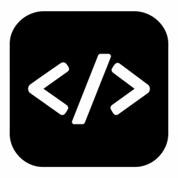

<p align="center">
  
</p>

<h1 align="center">Rynox IDE</h1>

<p align="center">
  IDE desktop độc lập (Tauri 2 + Rust): soạn code, xem thay đổi git và trò chuyện với AI agent điều khiển các CLI <code>claude</code> / <code>codex</code> ngay trong thư mục dự án.
</p>

## Tính năng

- **Trình soạn code** (Monaco) với cây thư mục, tab tệp, lưu có kiểm tra xung đột và diff thay đổi.
- **Git**: xem tệp đã thêm/sửa/xoá, nhánh hiện tại, hoàn tác và commit.
- **Chat với AI**: mỗi tin nhắn là một lượt chạy `claude` hoặc `codex` trong thư mục dự án; lịch sử và mã phiên của CLI được lưu theo từng thư mục, nên mở lại là tiếp tục đúng cuộc hội thoại.
- **Đính kèm**: dán ảnh hoặc tệp vào ô chat (hoặc nút `+`); tệp được gửi cho CLI dưới dạng `@đường-dẫn`.
- **Dự án**: lưu danh sách dự án (tên, thư mục, biến môi trường) và mở lại dự án dùng lần trước.
- Mở tệp đang xem trong VS Code.

Chưa có: terminal thật (khung terminal hiện chỉ báo chưa hỗ trợ) và CLI `gemini`.

## Tải về (macOS)

Tải tệp `.dmg` mới nhất tại [trang Releases](https://github.com/0132E282/codexis-ide/releases/latest), mở tệp và kéo app vào thư mục `Applications`.

- Bản hiện tại chỉ chạy trên Mac chip Apple Silicon (arm64).
- App chưa được ký số và notarize nên macOS có thể chặn lần mở đầu tiên. Bấm chuột phải vào app, chọn **Open**, hoặc chạy `xattr -cr "/Applications/Rynox IDE.app"`.
- Để chat với AI, cần cài sẵn và đăng nhập CLI `claude` hoặc `codex` (xem phần Yêu cầu).

## Yêu cầu

- [Node.js](https://nodejs.org) và [pnpm](https://pnpm.io).
- [Rust](https://rustup.rs) (toolchain stable) và các thành phần hệ thống của Tauri 2: xem [tauri.app/start/prerequisites](https://tauri.app/start/prerequisites/). Trên macOS cần Xcode Command Line Tools (`xcode-select --install`).
- Để chat với AI: cài ít nhất một CLI và đăng nhập sẵn, sao cho `claude` hoặc `codex` chạy được từ terminal. App tìm thêm trong `/opt/homebrew/bin`, `/usr/local/bin` và `~/.local/bin`.

## Cài đặt và chạy

```sh
pnpm install
pnpm start        # chạy app đầy đủ (tauri dev, tự build lại khi sửa code)
```

Các lệnh khác:

```sh
pnpm dev          # chỉ Vite (không có Rust nên các lệnh backend không chạy)
pnpm build        # chỉ build frontend
pnpm tauri build --bundles app,dmg  # đóng gói bản .app và .dmg (src-tauri/target/release/bundle/)
pnpm typecheck    # tsc --noEmit
pnpm lint         # eslint (lint:fix để tự sửa)
pnpm format:check # prettier (format để tự sửa)

cargo fmt --manifest-path src-tauri/Cargo.toml
cargo clippy --manifest-path src-tauri/Cargo.toml -- -D warnings
cargo test --manifest-path src-tauri/Cargo.toml
```

## Cấu hình bằng biến môi trường

| Biến              | Tác dụng                                        | Mặc định                                              |
| ----------------- | ----------------------------------------------- | ----------------------------------------------------- |
| `RYNOX_WORKSPACE` | Thư mục mở khi khởi động                        | Dự án mở lần trước, nếu không có thì thư mục hiện tại |
| `RYNOX_DB`        | Đường dẫn file SQLite lưu dự án và lịch sử chat | `rynox.db` trong thư mục dữ liệu của app              |

Ví dụ:

```sh
RYNOX_WORKSPACE=~/code/my-app RYNOX_DB=~/rynox-dev.db pnpm start
```

## Dữ liệu được lưu ở đâu

Trên macOS:

- `~/Library/Application Support/ai.geteasy.rynox-ide/rynox.db`: dự án, lịch sử chat, mã phiên CLI. File chỉ chủ sở hữu đọc được vì có thể chứa biến môi trường của dự án.
- `~/Library/Caches/ai.geteasy.rynox-ide/attachments/`: ảnh và tệp đã dán vào chat. Thư mục này là cache, xoá được.

Nếu có file `projects.json` cũ trong thư mục dữ liệu, các dự án trong đó được nhập vào `rynox.db` một lần; file cũ không bị xoá.

## Cấu trúc

- `src-tauri/` — backend Rust: workspace sandbox, git, agent CLI, lưu trữ SQLite, đính kèm.
- `src/` — giao diện React 19 (Vite, Tailwind, Monaco). `src/lib/ide.ts` và `src/lib/api.ts` là nơi duy nhất gọi các Tauri command.
- `prompts/` — prompt cho AI agent.
- `docs/` — tài liệu và thiết kế.

Quy ước làm việc với repo và các vấn đề đã biết nằm trong [AGENTS.md](AGENTS.md).
