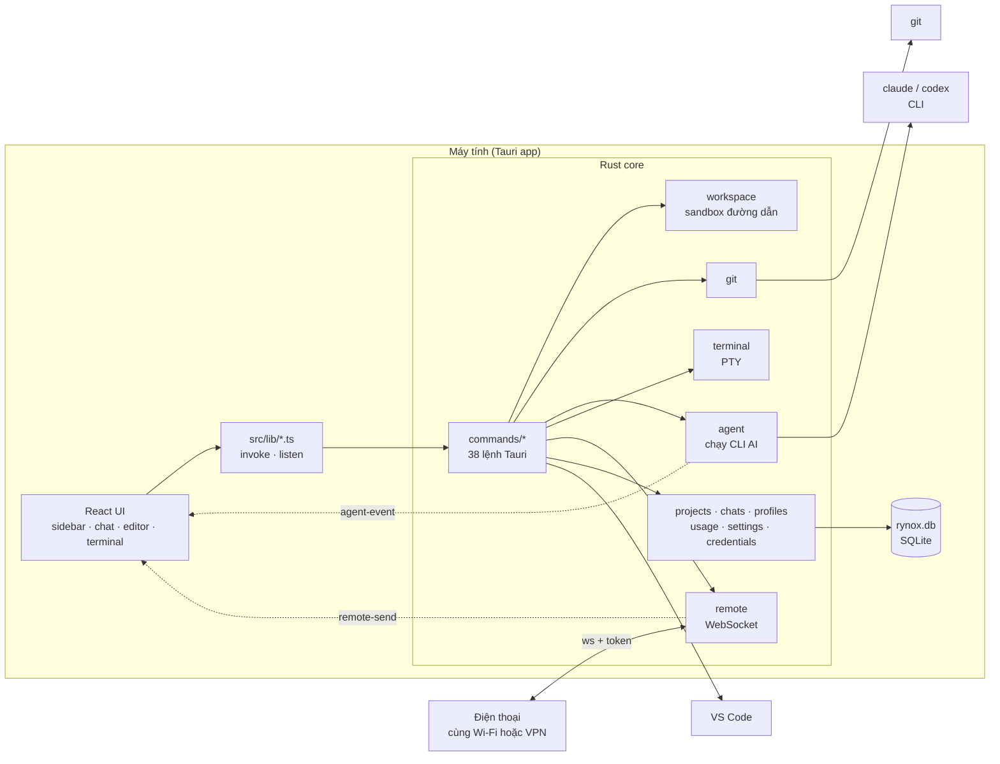
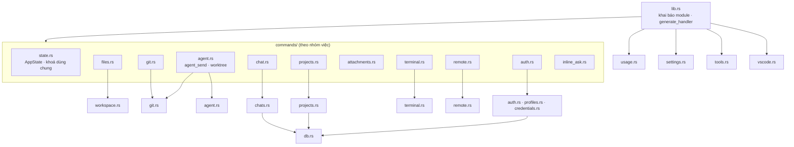
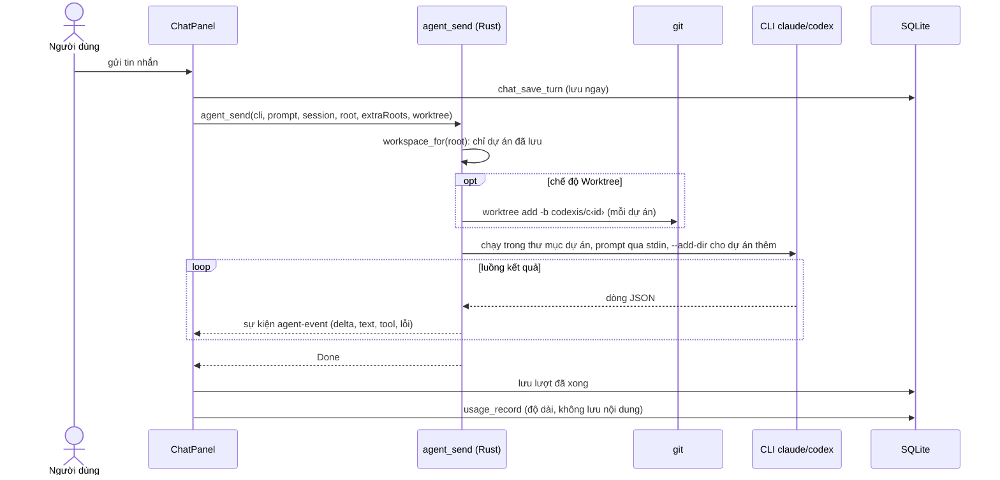
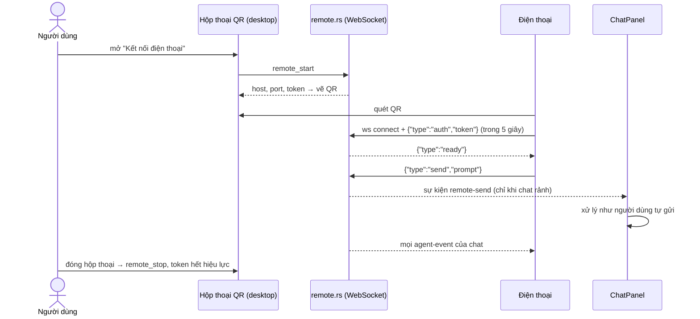
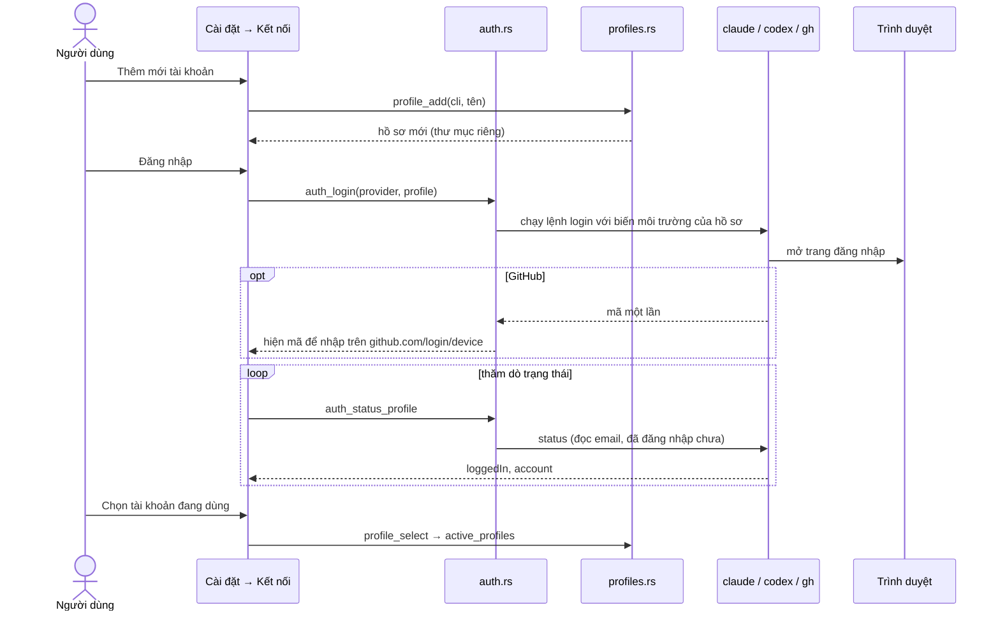
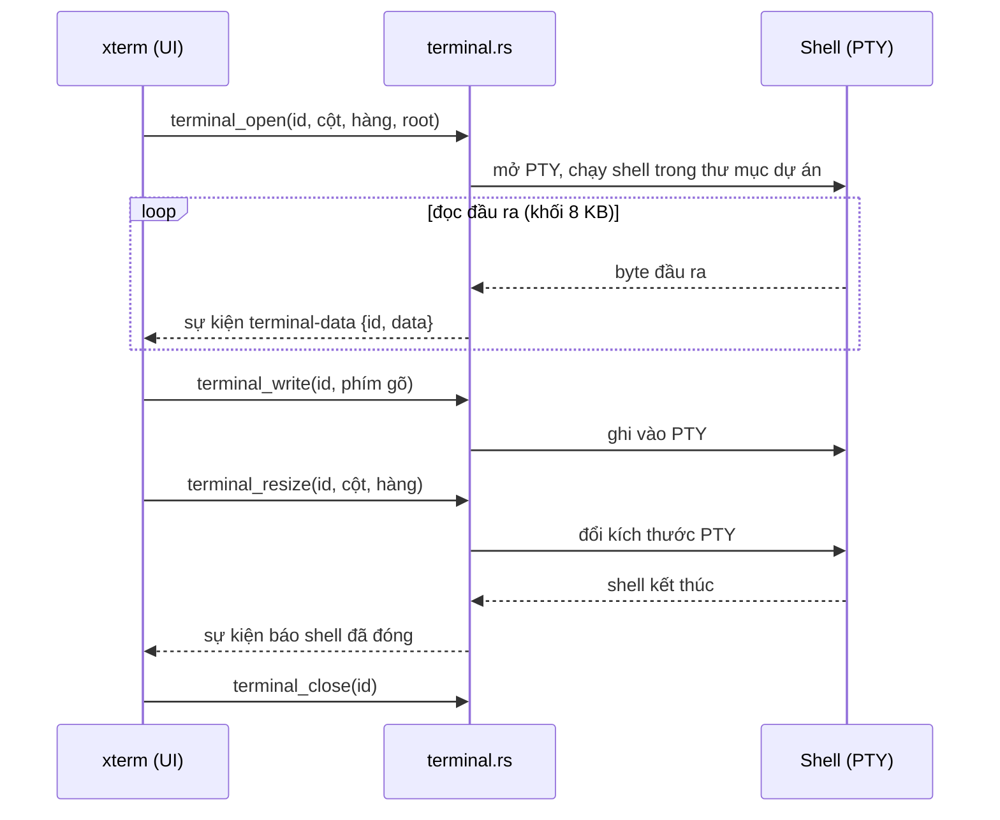
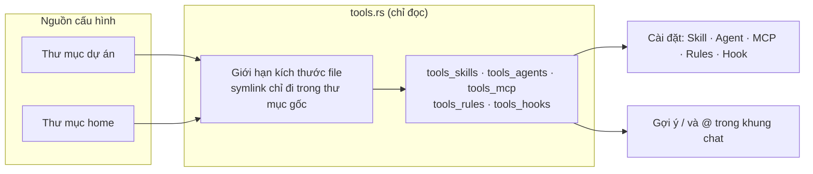
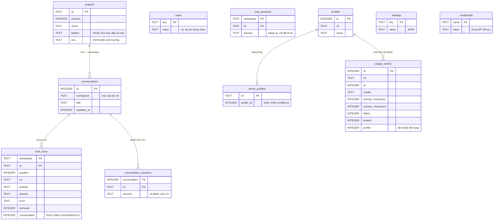

# Kiến trúc Codexis IDE

Tài liệu tóm tắt cấu trúc, luồng dữ liệu và cơ sở dữ liệu của Codexis IDE. Mọi sơ đồ vẽ từ mã nguồn hiện có; chỗ nào là suy luận được ghi rõ ở mục [Giả định và giới hạn](#giả-định-và-giới-hạn).

- **Trạng thái**: Đã xác minh theo mã nguồn (`src-tauri/src`, `src`), chưa đối chiếu bằng chạy app.
- **Nguồn**: `lib.rs`, `commands/*`, `db.rs`, `chats.rs`, `projects.rs`, `profiles.rs`, `usage.rs`, `credentials.rs`, `settings.rs`, `remote.rs`, `agent.rs`, `git.rs`, `workspace.rs`, `src/lib/*.ts`.

## 1. Tổng quan

Codexis IDE là IDE desktop độc lập (Tauri 2 + Rust, UI React 19): soạn code, xem thay đổi git, terminal thật và khung chat điều khiển các CLI AI `claude` và `codex`. Dữ liệu nằm trên máy người dùng; điện thoại chỉ điều khiển từ xa qua WebSocket.

| Lớp       | Công nghệ                                          | Vai trò                                   |
| --------- | -------------------------------------------------- | ----------------------------------------- |
| UI        | React 19, Vite 8, Tailwind 4, Monaco, xterm, Radix | Hiển thị, soạn thảo, chat                 |
| Cầu nối   | Tauri `invoke` / `emit`, lớp `src/lib/*.ts`        | Gọi lệnh Rust, nhận sự kiện               |
| Lõi       | Rust (`src-tauri/src`)                             | Workspace, git, PTY, agent, lưu trữ       |
| Lưu trữ   | SQLite (`rynox.db`, thư mục dữ liệu app)           | Dự án, chat, tài khoản, thống kê, cài đặt |
| Bên ngoài | CLI `claude`, `codex`, `git`, VS Code              | Chạy AI, git, mở trong VS Code            |

## 2. Sơ đồ hệ thống



## 3. Cấu trúc mã

### Backend: `src-tauri/src`



Quy ước: tên và shape (tham số, kiểu trả về) của lệnh Tauri được giữ ổn định; đổi phía Rust thì đổi `src/lib/*.ts` tương ứng.

### Frontend: `src`

- `app.tsx`: ghép hook và component; `hooks/use-workspace.ts` giữ trạng thái dự án, pane, cuộc chat.
- `components/shell/`: thanh bên, hộp thoại (cài đặt, thống kê, kết nối điện thoại, dự án mới) tải chậm qua `dialogs-host.tsx`; `chat/` chứa hook và component của khung chat.
- `components/ai-chat/code-viewer/`: tab, cây file, editor (Monaco), panel thay đổi.
- `lib/`: lớp gọi backend (`ide.ts`, `ide-*.ts`, `api.ts`), nơi duy nhất nên đổi khi đổi cách gọi backend.

## 4. Luồng chính

### 4.1. Một lượt chat AI



### 4.2. Điều khiển từ điện thoại



### 4.3. Đăng nhập CLI và nhiều tài khoản

Codexis không bao giờ thấy mật khẩu hay token: đăng nhập chạy luồng đăng nhập của chính CLI, rồi đọc trạng thái lại từ CLI. Mỗi tài khoản phụ là một thư mục hồ sơ riêng, CLI được trỏ tới đó bằng biến môi trường (`CLAUDE_CONFIG_DIR`, `CODEX_HOME`, `GH_CONFIG_DIR`).



### 4.4. Terminal

Mỗi terminal là một shell thật chạy trong pseudo-terminal (PTY) tại thư mục dự án.



### 4.5. Skill, agent, MCP, rule và hook (chỉ đọc)

`tools.rs` chỉ liệt kê cấu hình có trên máy, không ghi gì. Bí mật (giá trị env, header, token, tham số, query URL) không bao giờ được trả về.



## 5. Cơ sở dữ liệu (ERD)

Một file SQLite `rynox.db` trong thư mục dữ liệu app (đổi bằng biến `RYNOX_DB`), quyền chỉ chủ sở hữu trên Unix. **Không khai báo `FOREIGN KEY`**: các đường nối dưới đây là quan hệ logic do mã duy trì.



Ghi chú:

- Chỉ mục: `usage_events_cli_at (cli, at)`.
- `db.rs` tự nâng cấp file cũ bằng `add_column_if_missing` (cột `archived`, `conversation`) và gom lượt chat cũ vào một cuộc trò chuyện (`group_old_turns`). File không phải database bị chuyển thành `*.corrupt` rồi tạo mới; nếu vẫn không mở được, app chạy bằng DB trong bộ nhớ.
- Nội dung chat (`prompt`, `answer`) nằm trong `chat_turns`; thống kê (`usage_events`) chỉ lưu độ dài, không lưu nội dung.

## 6. Ranh giới an toàn

- **Workspace sandbox** (`workspace.rs`): chỉ nhận đường dẫn tương đối, làm sạch và kiểm tra trong root; chặn symlink ra ngoài, chặn file nằm trong danh sách cấm (ví dụ `.env`, khoá); giới hạn kích thước; ghi có kiểm tra băm mong đợi.
- **Dự án**: lệnh nhận `root` chỉ chấp nhận dự án đã lưu hoặc workspace đang mở (`workspace_for`); dự án thêm trong một lượt chat đi qua cùng cửa kiểm tra.
- **Worktree**: lượt chat chạy trên nhánh `codexis/c<id>` trong bản sao ở thư mục dữ liệu app, dự án gốc không bị sửa; tên worktree chỉ gồm chữ, số, dấu gạch.
- **Điện thoại**: WebSocket `ws://` (không mã hóa) với token ngẫu nhiên mỗi lần mở; tối đa 3 máy; chỉ tin `send` được xử lý. Chỉ dùng trên mạng tin cậy hoặc qua VPN.
- **Bí mật**: file DB chứa khoá API và biến môi trường dự án nên chỉ chủ sở hữu đọc được; không đưa secret vào repo.

## 7. Lệnh phát triển

```sh
pnpm install
pnpm start            # tauri dev (app đầy đủ)
pnpm typecheck        # tsc --noEmit
pnpm lint             # eslint
pnpm build            # build frontend
cargo fmt --manifest-path src-tauri/Cargo.toml
cargo clippy --manifest-path src-tauri/Cargo.toml -- -D warnings
cargo test --manifest-path src-tauri/Cargo.toml --lib <module>::
```

## 8. Giả định và giới hạn

- Quan hệ trong ERD là quan hệ logic suy ra từ tên cột và truy vấn; schema không có khoá ngoại. Cột `usage_events.profile` được thêm bằng di trú nên không có trong khối `CREATE TABLE` gốc.
- Số lệnh Tauri (38) và thứ tự module lấy từ lần tách `commands/` gần nhất; chưa có kiểm tra tự động giữ hai con số này đúng.
- Ba luồng ở mục 4.3 đến 4.5 (đăng nhập CLI, terminal, tools) vẽ từ phần đầu mỗi module và chữ ký hàm công khai; chưa đọc hết thân hàm nên thứ tự chi tiết (ví dụ khoảng thăm dò trạng thái) chưa được xác minh.
- Vấn đề đã biết: `cargo test --lib` đầy đủ không kết thúc vì `terminal::tests::a_shell_runs_in_a_pseudo_terminal` treo; `workspace::tests::binary_files_are_read_as_bytes_but_not_as_text` đang fail; typecheck có các lỗi có sẵn (xem `AGENTS.md`).
