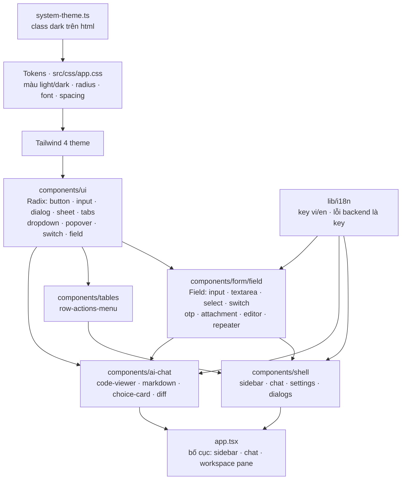

# Codexis IDE — Design System

Nguồn chuẩn: **code hiện có** (không có Figma). Mọi giá trị dưới đây đọc từ file thật; nếu code đổi thì sửa tài liệu này, không ngược lại. Chi tiết component: [components.md](./components.md). Chỗ chưa nhất quán: [inconsistencies.md](./inconsistencies.md). Mục lục: [index.md](./index.md).

Phong cách: công cụ desktop dày thông tin, tối giản, nền phẳng, viền mảnh, bo góc nhỏ, một màu nhấn xanh. Style shadcn/ui (cva + `data-slot` + `cn`).

## 0. Sơ đồ hệ thống design

Chiều phụ thuộc đi từ trên xuống: tokens, rồi `ui`, rồi `Field` và bảng, rồi `shell` và `ai-chat`, cuối cùng là `app.tsx`. Mọi ô nhập đi qua `Field`; mọi chữ đi qua `t()`.

## 1. Tokens

Nguồn: `src/css/app.css` (Tailwind 4, `@theme` ánh xạ `--color-*` -> biến CSS ở `:root` / `.dark`). Không có `tailwind.config`. Dùng class semantic (`bg-background`, `text-muted-foreground`, `border-border`...), không hard-code hex trong component.

### 1.1 Màu semantic

| Token                                                      | Light                                         | Dark                                    | Dùng cho                                                         |
| ---------------------------------------------------------- | --------------------------------------------- | --------------------------------------- | ---------------------------------------------------------------- |
| background / foreground                                    | #fafafa / #18181b                             | #111113 / #fafafa                       | Nền app, chữ chính                                               |
| card / card-foreground                                     | #ffffff / #18181b                             | #18181b / #fafafa                       | Card, input nền, button outline                                  |
| popover / popover-foreground                               | #ffffff / #18181b                             | #18181b / #fafafa                       | Popover, menu                                                    |
| primary / primary-foreground                               | #2f6fed / #ffffff                             | #5b8df6 / #ffffff                       | Hành động chính, focus, link                                     |
| secondary / -foreground                                    | #f1f3f9 / #18181b                             | #27272a / #fafafa                       | Button phụ, badge phụ                                            |
| muted / muted-foreground                                   | #f4f4f5 / #71717a                             | #27272a / #a1a1aa                       | Nền phụ, chữ phụ, placeholder                                    |
| accent / accent-foreground                                 | #eff4fe / #2f6fed                             | #1e2a4a / #93b4fb                       | Hover, tab đang chọn                                             |
| destructive / -foreground                                  | #e5484d / #ffffff                             | #f26a6e / #ffffff                       | Xoá, lỗi, `aria-invalid`                                         |
| border                                                     | #e4e4e7                                       | #27272a                                 | Viền mặc định (`* { border-color }` áp toàn cục ở `@layer base`) |
| input                                                      | #d4d4d8                                       | #3f3f46                                 | Viền ô nhập                                                      |
| ring                                                       | #2f6fed                                       | #5b8df6                                 | Focus ring, resize handle, viền choice-card                      |
| chart-1..5                                                 | #2f6fed #10a05e #f59e0b #8b5cf6 #ec4899       | #5b8df6 #34d399 #fbbf24 #a78bfa #f472b6 | Biểu đồ thống kê (usage)                                         |
| sidebar, sidebar-foreground/-primary/-accent/-border/-ring | trùng giá trị card/primary/accent/border/ring | trùng tương ứng                         | Token sidebar đã khai báo trong theme                            |

Ghi chú: token sidebar-* khai báo trong theme; đã grep `bg-/text-/border-sidebar*` trong `src/**/*.tsx`: không component nào dùng (token chưa dùng).

Màu ngoài token (hard-code trong `src/css/app.css`): gutter diff của editor `#2ea043` (thêm), `#388bfd` (sửa), `#f85149` (xoá); chấm loading `rgb(59 91 219)`; AI glow `rgb(250 204 21)` (vàng). Terminal và Monaco có palette riêng: `src/lib/code-palettes.ts`, `src/components/ai-chat/monaco-setup.ts`, `activity-terminal.tsx` (`THEME.dark/light`).

### 1.2 Dark mode

Class `dark` trên `<html>`, biến thể Tailwind `@custom-variant dark (&:is(.dark *))`. Điều khiển bởi `src/lib/system-theme.ts` (`Appearance = 'system' | 'light' | 'dark'`, theo `prefers-color-scheme` khi là `system`; `CodeColors` riêng cho màu code). Monaco/xterm đọc class `dark` để đổi theme. Component mới phải đẹp ở cả hai chế độ: chỉ dùng token, không dùng màu cố định cho nền/chữ.

### 1.3 Typography

- Font: `--font-sans` = `'Instrument Sans'`, rồi `ui-sans-serif, system-ui, sans-serif` + emoji. **Không thấy `@font-face`, `@fontsource` hay `<link>` nào nạp Instrument Sans** (đã grep `index.html`, `src/`, `package.json`) nên thực tế rơi về font hệ thống. Xem inconsistencies.
- Monospace: class `font-mono` của Tailwind (đường dẫn file, code); không có `--font-mono` tuỳ biến.
- Cỡ dùng thực tế (đếm trong `src/**/*.tsx`): `text-sm` (~124, mặc định, `App` gốc đặt `text-sm`), `text-xs` (~101, nhãn phụ, trạng thái, đường dẫn), `text-lg` (~8), `text-base` (~7, tiêu đề tab settings dùng `text-base font-semibold`). Trọng số: `font-medium` cho button/label, `font-semibold` cho tiêu đề. Không dùng cỡ tuỳ ý trừ `text-[0.8rem]` cho mô tả/lỗi trong `Field`.

### 1.4 Radius

`--radius: 4px` và mọi `--radius-xs..4xl` đều bằng nó, nên `rounded-sm/md/lg/xl` **đều ra 4px** (trừ `rounded-full`, `rounded-none`, `rounded` thuần = mặc định Tailwind 0.25rem = cũng 4px). Quy ước dùng: button/input `rounded-sm`; card trong chat `rounded-xl`; item danh sách `rounded-md`; chip/avatar `rounded-full`. Đổi độ bo toàn app chỉ cần sửa `--radius`.

### 1.5 Spacing

Dùng thang mặc định Tailwind 4 (4px/đơn vị), không có token spacing tuỳ biến. Mẫu lặp lại: card `p-3`, dialog `p-6 gap-4`, form `FieldGroup gap-4`, item danh sách `gap-1.5`, thanh công cụ `gap-2`. Chiều cao điều khiển: button/input mặc định `h-9`, `sm` `h-8`, `xs` `h-6`, `lg` `h-10`.

### 1.6 Shadow

Không có token shadow riêng; dùng utility Tailwind: `shadow-lg` (dialog), `shadow-md` (popover/menu), `shadow-sm`/`shadow-xs` (nhẹ). Button outline và input đặt `shadow-none`. Nút "Hoàn tác đoạn này" trong gutter editor (`.pm-revert-pop`) dùng `0 2px 8px rgb(0 0 0 / .15)`.

### 1.7 Z-index

Chỉ 3 mức, đếm trong `src/**/*.tsx`: `z-10` (resize handle, sticky nhỏ), `z-20` (1 chỗ), `z-50` (overlay + content của Dialog/AlertDialog/Sheet/Popover/Dropdown/ContextMenu). Không thêm mức mới; lớp nổi dùng Radix portal + `z-50`. Overlay: Dialog `bg-black/80`, Sheet `bg-black/50`.

## 2. Component và quy tắc dùng

Danh mục đầy đủ ở [components.md](./components.md). Quy tắc cứng:

1. **Mọi ô nhập trong layout/form dùng `Field`** (`src/components/form/field/index.tsx`, `ui="input|textarea|select|switch|..."`), không đặt `<input>`, `<textarea>` hay `Input` thô. Ngoại lệ chỉ khi chưa có `ui` phù hợp, và phải ghi chú; các chỗ vi phạm hiện có ở inconsistencies.md.
2. **Bảng dữ liệu dùng `DataTable` khi có.** Hiện **chưa có** `src/components/tables/index.tsx` (thư mục `src/components/tables/` chỉ có `row-actions-menu.tsx`; `collection-context.tsx` nằm ở `src/components/form/`). Trước khi có, bảng mới phải hỏi/lập kế hoạch tạo `DataTable`, không tự viết `<table>` rời.
3. **Nút dùng `Button`** (`src/components/ui/button.tsx`) với variant `default|destructive|outline|secondary|ghost|link`; nút chỉ icon dùng size `icon|icon-sm|icon-xs|icon-lg` kèm `aria-label`.
4. **Xác nhận phá huỷ** qua `useConfirm()` (`src/hooks/use-confirm.tsx`, AlertDialog), không dùng `window.confirm`.
5. **Phản hồi** qua `toast.success/error` của `sonner` (xem mục 4.3, có vấn đề `<Toaster>`).
6. **Icon**: `lucide-react`, luôn `aria-hidden="true"` khi đi kèm chữ; kích thước mặc định `size-4` trong button.
7. Class gộp bằng `cn()` (`src/lib/utils.ts`); biến thể bằng `cva`.

## 3. Layout

Gốc: `src/app.tsx` -> `div.flex.h-screen.flex-col.overflow-hidden.bg-background.text-sm`. Chưa đăng nhập AI CLI thì thay bằng `LoginScreen` (`src/components/shell/accounts.tsx`). Không có breakpoint responsive: đây là app desktop, không có layout phone trong frontend (chỉ `connect-phone-dialog.tsx` hiện QR ghép cặp với app điện thoại ngoài; `src-tauri/src/remote.rs` là server). Mọi co giãn dựa vào resize bằng chuột và `min-w-0`/`overflow`.

| Vùng            | File                                                                                                                     | Hành vi                                                                                                                                                                                                                                 |
| --------------- | ------------------------------------------------------------------------------------------------------------------------ | --------------------------------------------------------------------------------------------------------------------------------------------------------------------------------------------------------------------------------------- |
| Sidebar         | `src/components/shell/sidebar.tsx`, `chat/project-row.tsx`, `sidebar-toggle.tsx`                                         | Rộng cố định 256px hoặc gập (0; hook `useResizableWidth('ide.width.sidebar', 256, 0, 480, 'x', 'trailing')`, lưu localStorage; < 120px coi là gập; khi gập dùng `inert`). Chứa project, danh sách chat, menu ⋮ (settings, usage, phone) |
| Vùng chính      | `app.tsx` `<main>`                                                                                                       | Mỗi project/pane một `WorkspacePane`, ẩn bằng `hidden` để giữ state. Trống: câu `app.pick_aproject_to` căn giữa, `text-muted-foreground`                                                                                                |
| Workspace pane  | `src/components/shell/workspace-pane.tsx`                                                                                | Gồm chat panel và code viewer chia cột, kéo được bằng `ResizeHandle`                                                                                                                                                                    |
| Chat panel      | `src/components/shell/chat-panel.tsx`, `composer.tsx`, `chat/message-list.tsx`, `chat/turn-view.tsx`, `turn-steps.tsx`   | Danh sách lượt, composer dưới cùng (textarea + gợi ý `/` `@`, đính kèm). Tự đóng khi hẹp hơn 220px (`chat/use-too-narrow.ts`, `CHAT_TOO_NARROW`)                                                                                        |
| Code viewer     | `src/components/code-viewer.tsx` + `code-viewer/*`                                                               | Cây file (`tree-panel`), tab (`file-tabs`), thanh công cụ, Monaco (`monaco-code.tsx`), panel thay đổi (`changes-panel`, `local-changes.tsx`, `commit-box.tsx`), `quick-open.tsx`, `inline-ask.tsx`                                      |
| Terminal        | `src/components/ai-chat/activity-terminal.tsx`                                                                           | Dưới vùng chính, `border-t`, cao 256px mặc định, kéo mép trên (96px..cửa sổ), tối đa `max-h-[80%]`, lưu `ide.height.terminal`                                                                                                           |
| Settings dialog | `src/components/shell/settings-dialog.tsx`, `settings-tabs/*`                                                            | `DialogContent` cỡ `h-[min(66vh,48rem)] w-[min(74vw,80rem)]`; Tabs dọc bên trái `w-44`, nội dung cuộn `overflow-y-auto`, `DialogFooter border-t`                                                                                        |
| Dialog khác     | `dialogs-host.tsx`, `usage-dialog.tsx`, `connect-phone-dialog.tsx`, `new-project-dialog.tsx`, `manage-accounts-page.tsx` | Mở từ `DialogsHost` ở `app.tsx`                                                                                                                                                                                                         |

`ResizeHandle` (`src/components/ai-chat/resize-handle.tsx`): thanh kéo 1.5 (6px), `z-10`, hover `bg-ring/40`, grip hiện khi hover/kéo, bắt buộc `label` (aria-label).

## 4. Mẫu UI

### 4.1 Card file đã sửa — `src/components/shell/changed-files-card.tsx`

Card `rounded-xl border bg-card p-3 space-y-3`. Tiêu đề `HardDrive` + `changed_files.title` (đếm file, tên project). Mỗi file là `li rounded-md border bg-background`: `FileIcon`, đường dẫn `font-mono text-xs truncate` (bỏ tiền tố worktree), trạng thái `text-xs text-muted-foreground` ("Đã sửa/tạo/xoá · Đã áp dụng/Đã hoàn tác"). Hàng nút `Button size="sm" variant="outline"`: Xem (toggle `aria-pressed`, mở `UnifiedDiff` trong `max-h-72 overflow-auto`) và Hoàn tác (qua `useConfirm`, rồi `toast.success`/`toast.error`).

### 4.2 Choice card — `src/components/ai-chat/choice-card.tsx`

Thẻ `rounded-xl border border-ring bg-background px-4 py-3`, `role="group"` + `aria-labelledby` câu hỏi. Mỗi lựa chọn là nút full-width có đường kẻ trên, ô số `size-7 rounded-md bg-muted`; phím số 1..n chọn nhanh (không bắt khi đang gõ ở ô "Khác"). Hàng cuối: `Field` (ô "Khác…", Enter gửi, bỏ qua khi đang IME `isComposing`) + `Button variant="secondary"` "Bỏ qua". Sau khi trả lời/bị thay: chỉ đọc, `disabled`, phương án không chọn mờ `opacity-50`, phương án chọn có `Check`. Nút đóng `X` có `aria-label`.

### 4.3 Dialog, AlertDialog, Sheet, Toast

- Dialog (`ui/dialog.tsx`): căn giữa, `max-w-lg`, `rounded-lg border p-6 shadow-lg`, animation `animate-in/out` + `zoom-95` + `fade`, `duration-200`; nút đóng có `sr-only` "Close" (**chữ cứng tiếng Anh, chưa qua t()**). Dùng `DialogTitle`/`DialogDescription` (dùng `sr-only` cho description nếu không hiển thị, như settings-dialog).
- AlertDialog (`ui/alert-dialog.tsx`) qua `useConfirm`: Huỷ (`common.cancel`) + hành động.
- Sheet (`ui/sheet.tsx`): trượt từ `top|right|bottom|left`, overlay `bg-black/50`.
- Toast: `toast` từ `sonner` (dùng ở `changed-files-card`, `local-changes`, `commit-box`, `code-block`, `use-file-session`, `use-ai-edit`). **Không tìm thấy `<Toaster />` hay `ui/sonner.tsx` nào trong `src/`**: nếu thật sự chưa mount thì toast không hiện. Cần xác nhận (xem inconsistencies.md).
- Menu: `dropdown-menu.tsx`, `context-menu.tsx` (`file-context-menu.tsx`), `popover.tsx` (`branch-popover.tsx`).

### 4.4 Trạng thái

Loading: `ai-chat/loading-rows.tsx` (skeleton `animate-pulse`), `animate-spin` cho spinner, `.pm-dots` khi tạo ảnh. Lỗi form: `FieldError`/dòng `text-destructive` + `aria-invalid`. Disabled: `disabled:opacity-50` + `pointer-events-none`. Phá huỷ: luôn xác nhận.

## 5. i18n

- `t(key, params?)` từ `src/lib/i18n/index.ts`. Mọi chữ hiển thị đi qua `t()`: JSX, `aria-label`, `placeholder`, toast, title dialog, kể cả chuỗi trong const phải gọi `t()` tại chỗ hiển thị (không đặt ở hằng số module, để đổi ngôn ngữ cập nhật được).
- Key dạng `ten_file.cum_ngan_ngu` (ví dụ `changed_files.title`, `choice_card.other`, `common.cancel`), khai báo ở **cả** `src/lib/i18n/vi/*.ts` và `src/lib/i18n/en/*.ts` (nhóm: `shell-main`, `shell-settings`, `shell-chat`, `ai-chat`, `code-viewer`, `ui-lib`; gộp ở `vi/index.ts`, `en/index.ts`). Tham số `{name}` thay bằng `params.name`.
- Fallback: thiếu en -> hiện vi; thiếu cả hai -> hiện chính key. Do đó **thêm key phải thêm đủ cả vi và en**. Ngôn ngữ: `Language = 'vi' | 'en'`, mặc định `vi`, lưu `localStorage['codexis.language']`, đồng bộ `<html lang>`; component dùng `useLanguage()` để re-render.
- Lỗi từ backend: yêu cầu của dự án là backend Rust trả **key lỗi** để frontend dịch bằng `t()`; `src/lib/ai-error.ts` hiện hiển thị `response.data.message` do server gửi hoặc câu `fallback` đã dịch (đây là dấu vết kiểu axios cũ). Quy tắc cho code mới: không hiện chuỗi lỗi thô của backend; map key -> `t(key)`, key lạ -> câu chung đã dịch.
- Ghi chú: comment ở `src/lib/i18n/en/index.ts` ghi "by its Vietnamese text" nhưng thực tế key là `file.short_text` (comment lỗi thời).

## 6. Accessibility và motion

Đang làm tốt (giữ nguyên): `Button`/`Input` có `focus-visible:ring-[3px] ring-ring/50` và `aria-invalid` đổi viền destructive; `FieldError` có `role="alert"`; icon trang trí `aria-hidden`; `ResizeHandle` có `aria-label`; `ChoiceCard` có `role="group"`, nhãn, phím số; nút toggle có `aria-pressed`; `inert` cho sidebar đã gập; `sr-only` cho `DialogDescription`; `FieldLabel htmlFor={name}` gắn với `id={name}`.
Quy tắc: mọi nút icon phải có `aria-label` (qua `t()`); không truyền nghĩa chỉ bằng màu (trạng thái file có chữ "Đã sửa/tạo/xoá"); Radix lo focus trap/Esc cho dialog/menu; phím tắt không được chặn khi đang gõ hoặc đang IME.

Motion:

- Mức nền: transition ngắn (`transition-colors`, `duration-200` cho dialog), `tw-animate-css` cung cấp `animate-in/out`, `fade`, `zoom`.
- `Button` có `motion-reduce:transition-none`. `@media (prefers-reduced-motion: reduce)` trong `src/css/app.css` tắt animation `.pm-dots::before` và đổi `pm-ai-glow` (2.4s vàng mờ dần) thành nền vàng tĩnh `rgb(250 204 21 / .2)`. Các file khác dùng `motion-reduce:` hoặc `animate-none`: `turn-view.tsx`, `turn-steps.tsx`, `work-steps.tsx`, `usage-dialog.tsx`, `tool-table.tsx`, `branch-popover.tsx`, `local-changes.tsx`, `loading-rows.tsx`, `commit-box.tsx`, `file-tabs.tsx`, `use-typewriter.ts`.
- `html.no-transitions *` tắt mọi transition trong vài frame đầu sau reload để layout không "nhảy".
- Quy tắc: animation mới phải có biến thể `motion-reduce:` hoặc `@media (prefers-reduced-motion)`; không animation lặp vô hạn ngoài trạng thái loading.

## 7. Công cụ

`pnpm lint`, `pnpm format:check`, `pnpm typecheck` (có 22 lỗi sẵn có, xem AGENTS.md). Không có script `design:lint` trong `package.json` nên front matter ở đầu file này chưa được lint bằng `@google/design.md`; ảnh mẫu `docs/design/images/` chưa tạo (chưa chụp màn hình).
