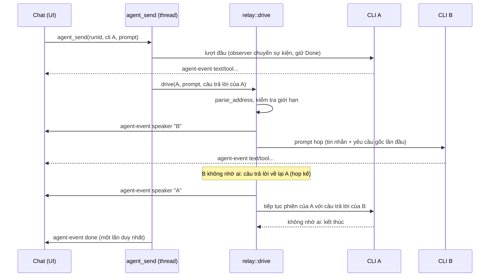

# Thiết kế: chuyển lượt giữa các AI (AI relay)

Trạng thái: **đã triển khai (2026-11-07)**, chưa kiểm trên app thật với CLI thật (xem mục 6). Căn cứ mã `[đã kiểm]`: `src-tauri/src/relay.rs`, `commands/agent.rs`, `agent.rs` (`Event::Speaker`), `validation.rs` (`relay_message`), `prompts/chat/role.md`, `prompts/chat/relay-hop.md`, `use-agent-turns.ts`, `turn-steps.tsx`.

## 1. Là gì, để làm gì

Trong một lượt chat, một AI (`claude` hoặc `codex`) có thể nhờ AI kia trả lời một tin nhắn; backend chạy CLI của AI kia, đưa câu trả lời về cho AI đã nhờ, và lặp lại cho tới khi không AI nào nhờ ai nữa. Mỗi hop hiện trong timeline của lượt, có nhãn tên AI đang nói. Không cần người dùng duyệt từng hop; luôn dừng được bằng nút Dừng / Ctrl+C.

Toàn bộ logic ở Rust; frontend chỉ hiển thị.

## 2. Quy ước địa chỉ

Một khối mã mà dòng mở bắt đầu bằng ` ```relay:<tên AI> ` (tên `claude` hoặc `codex`, không phân biệt hoa thường), nội dung là tin nhắn, dòng đóng ` ``` `:

````text
```relay:codex
Xem giúp hàm parse trong src/x.rs có chặn được đầu vào rỗng không.
```
````

- Chỉ khối **đầu tiên** và **đã đóng** của câu trả lời được tính; khối không đóng, hay chữ `relay:` giữa câu, không phải địa chỉ.
- Quy ước được dạy cho Claude qua `prompts/chat/role.md` (system prompt). Codex không có system prompt trong app này, nên nó biết quy ước nhờ phần hướng dẫn trong mỗi tin hop (`prompts/chat/relay-hop.md`): Codex chỉ tự nhờ AI khác được khi đã ở trong một relay. Claude bắt đầu relay được ngay từ lượt đầu.
- Gemini chưa phải CLI chat của app (`CliKind::AGENTS` chỉ có claude, codex): tên khác bị từ chối (`relay.unknown_target`). Khi thêm một CLI vào `AGENTS`, parser nhận luôn.

## 3. Luồng



Quy tắc đi tiếp (`Relay::next`):

- Câu trả lời có địa chỉ tới AI khác: hop tới AI đó, AI đang nói chờ câu trả lời (ngăn xếp người hỏi).
- Câu trả lời không có địa chỉ: về cho AI hỏi gần nhất (hop trả lời); nếu không còn ai hỏi thì kết thúc, AI đầu tiên có lời cuối.
- AI nhờ đúng AI đang chờ mình thì coi là trả lời (rút khỏi ngăn xếp), không đẩy thêm.
- Hop tới AI lần đầu kèm "yêu cầu gốc của người dùng" (cắt 2000 ký tự) làm ngữ cảnh chung tối thiểu; mỗi AI giữ phiên CLI riêng trong relay nên nhớ các hop trước.

## 4. Giới hạn và chống vòng lặp

| Giới hạn                                         | Giá trị / khoá lỗi                                                 |
| ------------------------------------------------ | ------------------------------------------------------------------ |
| Số hop tối đa mỗi lượt (kể cả hop trả lời)       | `relay::MAX_HOPS` = 6, khoá `relay.hop_limit`                      |
| Không tự gửi cho chính mình                      | `relay.self_address`                                               |
| Cùng (AI nhận, tin nhắn) không gửi hai lần       | `relay.repeated`                                                   |
| AI không có trong `CliKind::AGENTS`              | `relay.unknown_target`                                             |
| Tin nhắn rỗng, quá 20 000 byte, ký tự điều khiển | `relay.bad_message` (kiểm bằng `validation::relay_message`, garde) |
| Câu trả lời quá dài khi chuyển ngược về          | cắt còn 20 000 byte, không từ chối                                 |

Dừng do giới hạn: backend gửi `Event::Error("relay.…")` rồi `done`; UI dịch ở `errors.relay.*` (vi/en). Hop lỗi (CLI thiếu, lỗi chạy) cũng dừng relay, lỗi hiện như mọi lượt.

Hop không có người trả lời câu hỏi quyền: chạy không bật ask mode; chế độ `plan` thành `planReadOnly`, chế độ "Hỏi từng việc" thành mặc định của CLI. Relay không chạy trong side chat (`side-…`).

## 5. Dừng

Nút Dừng / Ctrl+C gọi `agent_stop(runId)` (không đổi tên, không đổi shape). `TurnRegistry::request_stop` đặt cờ `stopped` của lượt rồi trả pid của tiến trình đang chạy để kill. Cờ được kiểm trước mỗi hop và ngay trước khi spawn, và nếu tiến trình spawn sau lúc dừng thì bị kill ngay trong `spawned`. Hết một hop thì pid bị xoá (`clear_pid`) để lệnh dừng sau không kill nhầm tiến trình khác. Dừng không phát lỗi.

## 6. Sự kiện và UI

- `agent-event` thêm `kind: "speaker"`, `text` = tên AI (`claude`/`codex`), phát trước các bước của mỗi hop.
- Với hop của AI không phải AI của chat: bỏ `session`, `context`, `plan` (thuộc về AI của chat); `done` của từng hop bị giữ, chỉ phát một `done` cuối.
- Frontend: `Step` có thêm `{ kind: 'speaker', cli }` (lưu cùng steps của lượt), `withSpeaker` trong `turn-events.ts`, nhãn `SpeakerLabel` trong `turn-steps.tsx`.

## 7. Chưa kiểm chứng

Điều phối được kiểm bằng runner giả (`src-tauri/tests/unit/relay.rs`: parser, hop limit, tự gửi, lặp, dừng, hop lỗi). Chưa chạy với `claude`/`codex` thật trong app Tauri: định dạng sự kiện thực của từng hop, việc Claude tự nhờ theo system prompt và Codex làm theo hướng dẫn hop là giả định cho tới khi thử.
