# Kiến trúc Codexis IDE

Tài liệu tóm tắt cấu trúc, luồng dữ liệu và cơ sở dữ liệu của Codexis IDE. Mọi sơ đồ vẽ từ mã nguồn hiện có; chỗ nào là suy luận được ghi rõ ở mục [Giả định và giới hạn](#giả-định-và-giới-hạn).

- **Trạng thái**: Đã đối chiếu lại với mã nguồn ngày 2026-11-06 (kể cả thay đổi chưa commit: `format_code`, `github_profile`, khoá lỗi i18n, cài đặt ngôn ngữ/giao diện), chưa đối chiếu bằng chạy app. Mục 4–7 là thiết kế refactor OOP **đã triển khai** và kiểm chứng bằng fmt, clippy, test ngày 2026-11-07 (7.5).
- **Nguồn**: `lib.rs`, `commands/*`, `db.rs`, `chats.rs`, `projects.rs`, `profiles.rs`, `usage.rs`, `credentials.rs`, `settings.rs`, `remote.rs`, `agent.rs`, `git.rs`, `workspace.rs`, `formatter.rs`, `tools.rs`, `window_buttons.rs`, `src/lib/*.ts`, `src/hooks/*`, `src/components/*`.
- **Nguyên tắc**: tính năng viết ở backend Rust; frontend chỉ vẽ giao diện và gọi lệnh Tauri qua `src/lib/`. Các CLI được điều khiển hiện chỉ có `claude` và `codex` (`cli::CliKind`); `gemini` mới nằm trong kế hoạch.

## 1. Tổng quan

Codexis IDE là IDE desktop độc lập (Tauri 2 + Rust, UI React 19): soạn code, xem thay đổi git, terminal thật và khung chat điều khiển các CLI AI `claude` và `codex`. Dữ liệu nằm trên máy người dùng; điện thoại chỉ điều khiển từ xa qua WebSocket.

| Lớp       | Công nghệ                                          | Vai trò                                   |
| --------- | -------------------------------------------------- | ----------------------------------------- |
| UI        | React 19, Vite 8, Tailwind 4, Monaco, xterm, Radix | Hiển thị, soạn thảo, chat                 |
| Cầu nối   | Tauri `invoke` / `emit`, lớp `src/lib/*.ts`        | Gọi lệnh Rust, nhận sự kiện               |
| Lõi       | Rust (`src-tauri/src`)                             | Workspace, git, PTY, agent, lưu trữ       |
| Lưu trữ   | SQLite (`codexis.db`, thư mục dữ liệu app)         | Dự án, chat, tài khoản, thống kê, cài đặt |
| Bên ngoài | CLI `claude`, `codex`, `git`, VS Code              | Chạy AI, git, mở trong VS Code            |

Toàn bộ hệ thống nhìn từ trên xuống, và tài liệu nào mô tả phần nào:

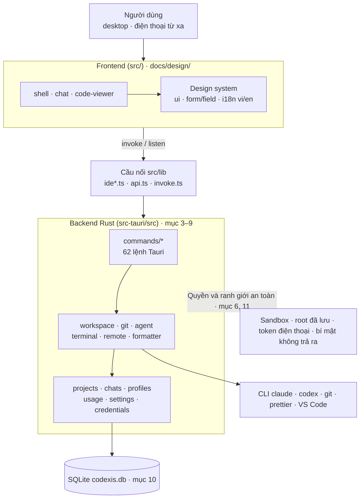

- **Frontend** (`src/`): chỉ vẽ giao diện và gọi lệnh; design system ở `docs/design/`.
- **Backend** (`src-tauri/src`): mọi tính năng; lỗi trả về là key cố định, frontend dịch.
- **Dữ liệu**: một file SQLite trên máy, nội dung chat tách khỏi thống kê.
- **Bên ngoài**: các CLI và công cụ được gọi như tiến trình con, không bao giờ lộ mật khẩu hay token.

## 2. Sơ đồ hệ thống

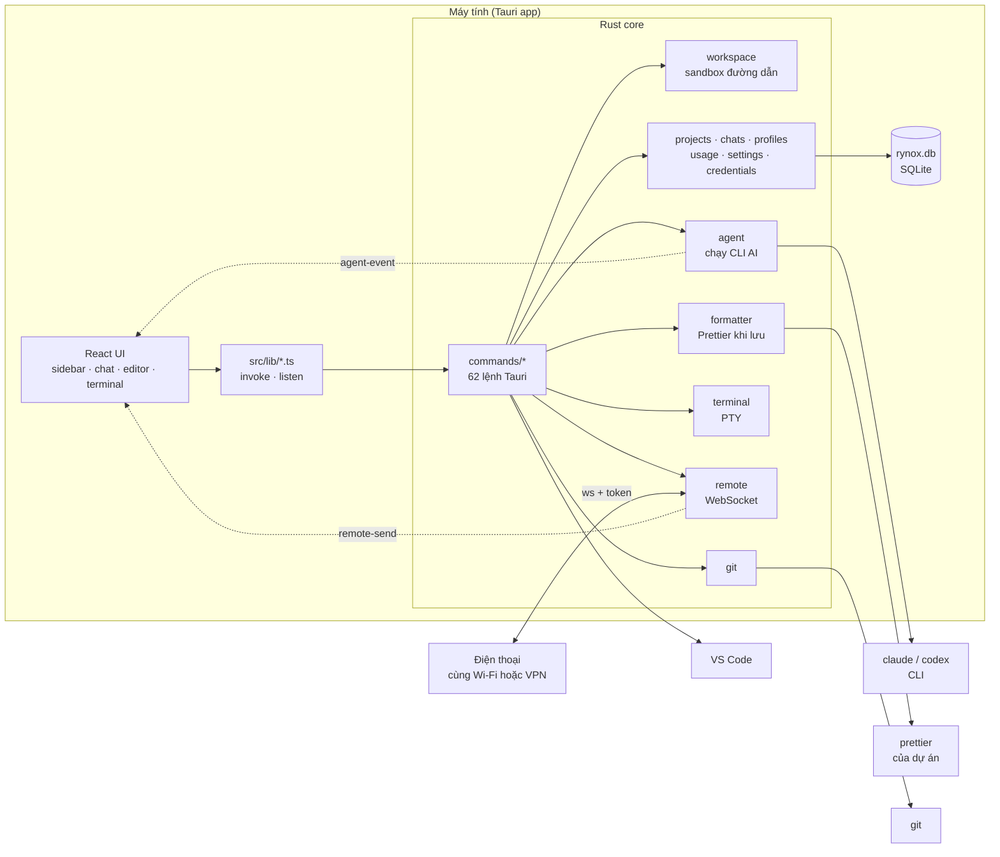

## 3. Cấu trúc mã

### Backend: `src-tauri/src`

```mermaid
flowchart TD
    lib["lib.rs<br/>khai báo module · generate_handler"] --> commands
    subgraph commands["commands/ (theo nhóm việc)"]
        state["state.rs<br/>AppState · khoá dùng chung"]
        files["files.rs"]
        projects_c["projects.rs"]
        git_c["git.rs"]
        agent_c["agent.rs<br/>agent_send · TurnRegistry · worktree"]
        chat_c["chat.rs"]
        att["attachments.rs"]
        term_c["terminal.rs"]
        rem_c["remote.rs"]
        auth_c["auth.rs"]
        ask["inline_ask.rs"]
    end
    lib --> direct["Lệnh đăng ký thẳng ở lib.rs<br/>profiles · credentials · usage<br/>settings · tools · window_buttons"]
    files --> workspace["workspace.rs"] & formatter["formatter.rs"]
    git_c --> git["git.rs"]
    agent_c --> agent["agent.rs<br/>agent/claude.rs · agent/codex.rs"] & git
    ask --> agent
    git_c --> agent
    chat_c --> chats["chats.rs"]
    projects_c --> projects["projects.rs"]
    term_c --> terminal["terminal.rs"]
    rem_c --> remote["remote.rs"]
    auth_c --> auth["auth.rs<br/>auth/claude.rs · codex.rs · github.rs"]
    auth_c --> profiles["profiles.rs"]
    agent & auth & formatter --> cli["cli.rs<br/>CliKind · locate · command"]
    att --> attachments["attachments.rs"]
    workspace & direct & attachments --> permission["permission.rs<br/>PathPolicy · Sandbox"]
    profiles & chats & usage["usage.rs"] & settings["settings.rs"] --> cli
    chats & projects & auth_c --> db["db.rs"]
    direct --> profiles & credentials["credentials.rs"] & usage & settings & tools["tools.rs"] & wb["window_buttons.rs"]
    files --> vscode["vscode.rs"]
    subgraph outside["Ngoài refactor OOP (thêm sau, chưa nối đủ)"]
        context["context.rs<br/>ContextUsage"]
        background["background.rs<br/>BackgroundTasks"]
        plan["plan.rs"]
        project_data["project_data.rs"]
    end
    context --> cli
```

Trạng thái dùng chung được `lib.rs` đăng ký bằng `app.manage`: `AppState` (dự án và chat), `Terminals`, `TurnRegistry` (`commands/agent.rs`: mỗi lượt đang chạy giữ `Responder` cho câu hỏi quyền của CLI và pid để dừng lượt), `Remote`. Các store khác (`CredentialStore`, `ProfileStore`, `UsageStore`, `SettingsStore`) do `setup` của từng module đăng ký.

| Nhóm lệnh                               | Module                                                            | Lệnh                                                                                                  |
| --------------------------------------- | ----------------------------------------------------------------- | ----------------------------------------------------------------------------------------------------- |
| Workspace và file                       | `commands/files.rs`                                               | `workspace_info/tree/read/read_media/write/rename`, `local_put_file`, `format_code`, `open_in_vscode` |
| Dự án                                   | `commands/projects.rs`                                            | `projects_list/add/remove/select`                                                                     |
| Git                                     | `commands/git.rs`                                                 | `local_changes/branches/head/discard/commit/commit_message`                                           |
| Chat AI                                 | `commands/agent.rs`, `inline_ask.rs`, `chat.rs`, `attachments.rs` | `agent_send/permission/stop`, `inline_ask`, `chat_*`, `attachment_save/read`                          |
| Terminal và điện thoại                  | `commands/terminal.rs`, `remote.rs`                               | `terminal_open/write/resize/close`, `remote_start/stop`                                               |
| Đăng nhập                               | `commands/auth.rs`                                                | `auth_status`, `auth_status_profile`, `auth_login/logout`, `claude_usage_profile`, `github_profile`   |
| Hồ sơ, khoá, thống kê, cài đặt, công cụ | đăng ký thẳng ở `lib.rs`                                          | `profile*`, `credential_*`, `usage_*`, `settings_get/save`, `tools_*`, `window_buttons_visible`       |

Quy ước: tên và shape (tham số, kiểu trả về) của lệnh Tauri được giữ ổn định; đổi phía Rust thì đổi `src/lib/*.ts` tương ứng.

### Frontend: `src`

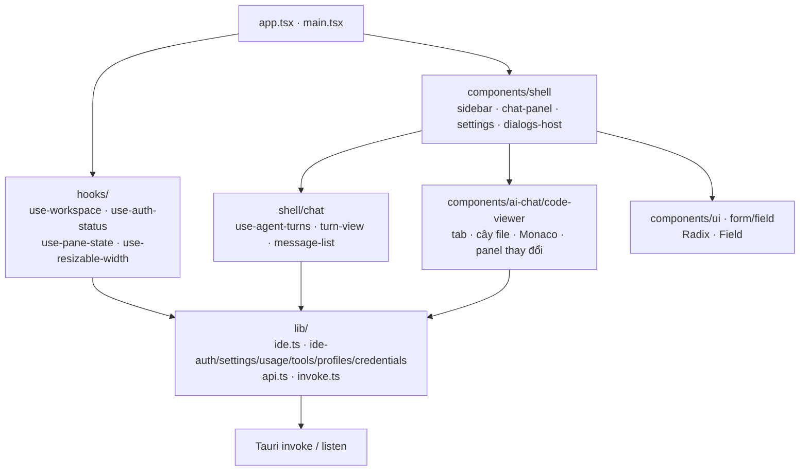

- `app.tsx`: ghép hook và component; `hooks/use-workspace.ts` giữ trạng thái dự án, pane, cuộc chat.
- `components/shell/`: thanh bên, khung chat, hộp thoại (cài đặt, thống kê, kết nối điện thoại, dự án mới) tải chậm qua `dialogs-host.tsx`; `chat/` chứa hook và component của khung chat; card file AI đã sửa ở `changed-files-card.tsx`.
- `components/ai-chat/code-viewer/`: tab, cây file, editor (Monaco), panel thay đổi.
- `components/form/field/`: bộ Field dùng cho mọi ô nhập; `components/ui/`: Radix.
- `lib/`: lớp gọi backend, nơi duy nhất nên đổi khi đổi cách gọi backend. `ide.ts` và `ide-*.ts` bọc từng nhóm lệnh; `api.ts` giả lập API cũ của web (`/ai-chat/local/*`) bằng lệnh Tauri; `invoke.ts` bọc `invoke` và dịch lỗi (backend trả key cố định, frontend dịch bằng i18n vi/en ở `lib/i18n`).
- Frontend nghe sự kiện từ backend: `agent-event` (lượt chat), `terminal-data`, `terminal-exit`, `remote-send`, `remote-connected`, `remote-disconnected`.

## 4. Thiết kế OOP (đã triển khai)

Mục 4 đến 7 mô tả thiết kế OOP **đã triển khai** (TASK-001 đến TASK-011: `agent::Cli`, shim `ask_once`, re-export `locate`, `Provider::`, `CLIS`, `CLI_NAMES` đã xoá; `commands/git.rs` và `inline_ask.rs` dùng `ClaudeAgent::ask_once` và `CliKind::Claude.name()`), để chuyển `src-tauri/src` sang phong cách OOP của Rust: struct + `impl` đóng gói trạng thái và hành vi, trait cho đa hình, composition thay kế thừa. Các mục còn lại mô tả mã **hiện có**. Phần "Vấn đề hiện tại" ở 4.1 là hiện trạng **trước** refactor, giữ lại làm lý do thiết kế. Đã kiểm chứng ngày 2026-11-07 ở 7.5.

Ràng buộc cứng: không đổi tên, tham số, kiểu trả về, key lỗi của lệnh Tauri (`generate_handler!` trong `lib.rs` giữ nguyên đường dẫn); không đổi `src/` (frontend); không thêm dependency (`Cargo.toml` giữ nguyên); không đổi hành vi (thứ tự tham số CLI, sự kiện `agent-event`, quy tắc quyền ở mục 6). Chỉ thêm pattern khi giải quyết vấn đề đang có (KISS/YAGNI).

### 4.1. Vấn đề trước refactor và kết quả

Trước refactor, danh tính "CLI nào" có **hai enum và ba bảng chuỗi**, mỗi nơi tự `match`:

| Nơi                                         | Biểu diễn                                                             | Rẽ nhánh theo CLI                                                                                                                                                       |
| ------------------------------------------- | --------------------------------------------------------------------- | ----------------------------------------------------------------------------------------------------------------------------------------------------------------------- |
| `auth.rs`                                   | `enum Provider { Claude, Codex, Github }`                             | 6 `match self` (`cli`, `name`, `program`, `status_args`, `logout_args`, `login_args`), `match provider` trong `status()`, `if provider != Github` trong `start_login()` |
| `agent.rs`                                  | `enum Cli { Claude, Codex }`                                          | `args()` (4 nhánh `match (self, session)`, `match self` cho model, nhánh mode), `with_add_dirs()`, `parse_line()` (~15 nhánh `match (cli, type)`)                       |
| `profiles.rs`                               | `const CLIS` (tên → `CLAUDE_CONFIG_DIR`/`CODEX_HOME`/`GH_CONFIG_DIR`) | `variable(cli)`                                                                                                                                                         |
| `usage.rs`                                  | `const CLI_NAMES` + `agent::Cli::parse`                               | `record()`, `usage_stats_profile()`                                                                                                                                     |
| `settings.rs`                               | literal `"claude" \| "codex"`                                         | `validate()` 2 chỗ                                                                                                                                                      |
| `chats.rs`                                  | `agent::Cli::parse`                                                   | 2 chỗ                                                                                                                                                                   |
| `commands/agent.rs`                         | `cli == Cli::Claude`                                                  | 3 chỗ (khoá API, agent team, chế độ hỏi quyền)                                                                                                                          |
| `commands/git.rs`, `commands/inline_ask.rs` | literal `"claude"`                                                    | `active_environment("claude")`                                                                                                                                          |

Sau refactor, thêm một CLI chỉ cần một biến thể `CliKind`, hai struct impl và hai nhánh factory (mục 5). Trước đó, thêm một CLI (ví dụ `gemini`) phải sửa ≥ 8 file. Codex dựng tham số bằng `insert(1 + offset * 2, …)` nên thứ tự cờ phụ thuộc thứ tự gọi `args()` rồi `with_add_dirs()`.

Vấn đề phụ trước refactor: `agent::run_turn` có 12 tham số (`#[allow(clippy::too_many_arguments)]`); `Responder = Arc<Mutex<Option<ChildStdin>>>` bị khoá/`take()` ở 4 chỗ rời; `commands/agent.rs` có hai registry `Approvals` và `Running` cùng khoá `run_id`; `auth.rs` lặp 6 lần `Command::new(p).envs(…).stdin(Stdio::null())`; `git.rs` và `tools.rs` có nhóm hàm tự do cùng nhận một trạng thái (`&Workspace`, `&[Base]`); `locate()` nằm trong `agent.rs` nhưng `auth.rs`, `formatter.rs` dùng chung; kiểm "đường dẫn thật nằm trong thư mục" được viết 3 lần (`workspace.rs`, `tools.rs`, `attachments.rs`).

| ID  | Yêu cầu                              | Tiêu chí chấp nhận                                                                                       | Đáp ứng                                       |
| --- | ------------------------------------ | -------------------------------------------------------------------------------------------------------- | --------------------------------------------- |
| R1  | Một nguồn chuẩn cho danh tính CLI    | Không còn `Provider`, `agent::Cli`, `CLIS`, `CLI_NAMES`, literal tên CLI dùng để rẽ nhánh ngoài `cli.rs` | `cli::CliKind`                                |
| R2  | Đa hình thay `match` rải rác         | Hành vi riêng từng CLI nằm trong `impl Trait for …`; `match` theo CLI chỉ còn ở factory và bảng dữ liệu  | `AgentCli`, `AuthTool`, `CliKind::agent/auth` |
| R3  | Thêm CLI = 1 struct + impl + 1 nhánh | Không sửa store (`profiles`, `usage`, `settings`, `chats`) ngoài bảng `CliKind`                          | như R2                                        |
| R4  | Giữ contract Tauri                   | `git diff -- src/` rỗng; chữ ký mọi `#[tauri::command]` không đổi                                        | lớp `commands/*`                              |
| R5  | Giữ hành vi                          | Test qua như baseline (mục 7.5); thứ tự tham số CLI và key lỗi giống hệt (mục 7.3)                       | toàn bộ                                       |
| R6  | Không thêm dependency                | `Cargo.toml` không đổi                                                                                   | chỉ `std` + crate sẵn có                      |
| R7  | Nhiều coder làm song song            | Mỗi nhóm sở hữu file riêng (mục 7.2)                                                                     | Phase 0 tạo nền chung                         |

### 4.2. Sơ đồ lớp (Class Diagram)

Các struct/trait chính; nguồn: `cli.rs`, `agent.rs`, `agent/*`, `auth.rs`, `auth/*`, `commands/agent.rs`, `git.rs`, `tools.rs`. Lớp quyền (`PathPolicy`, `Sandbox`, `Access`, `PhoneGate`) vẽ riêng ở mục 6.4.

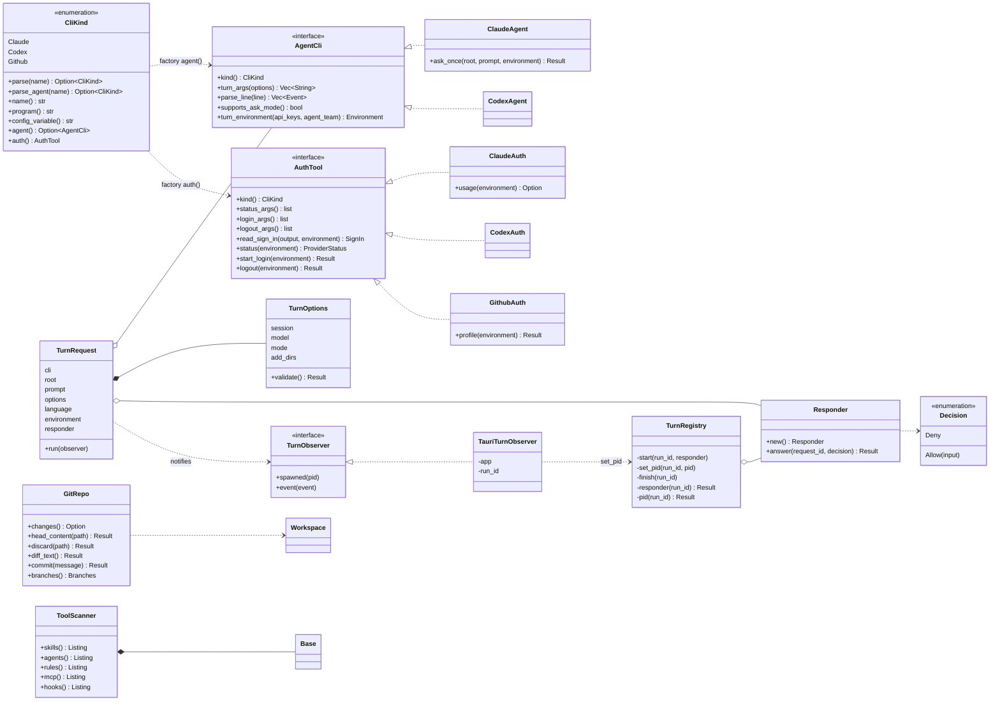

- `cli.rs` là nguồn chuẩn duy nhất về danh tính CLI (`CliKind`) cùng `locate` và `command` dùng chung. Hành vi chia theo mối quan tâm: `AgentCli` (chạy lượt chat, `agent/`) và `AuthTool` (đăng nhập, `auth/`). Hai trait tách nhau vì GitHub chỉ có đăng nhập, không chat: composition thay một "siêu trait".
- Factory `CliKind::agent()` khai báo trong `agent.rs`, `CliKind::auth()` trong `auth.rs` (Rust cho phép `impl CliKind` ở module khác cùng crate); thêm CLI chỉ sửa file của mình và hai factory. `TauriTurnObserver` và `RunHandle` là kiểu riêng của `commands/agent.rs`.
- Struct cụ thể là unit struct; factory trả `&'static dyn Trait`; trait có bound `Sync` để dùng qua thread.

### 4.3. Định nghĩa hàm và method

Ký hiệu: `Env` = `&[(&'static str, String)]` (môi trường trỏ CLI vào hồ sơ); `Environment` = `Vec<(&'static str, String)>`. Key lỗi giữ nguyên chuỗi đang có trong mã.

#### `cli.rs`

| Mục               | Chữ ký                                                                                          | Trách nhiệm                                                                    |
| ----------------- | ----------------------------------------------------------------------------------------------- | ------------------------------------------------------------------------------ |
| `CliKind`         | `#[derive(Debug, Clone, Copy, PartialEq, Eq, Hash)] pub enum CliKind { Claude, Codex, Github }` | Danh tính CLI                                                                  |
| `CliKind::ALL`    | `pub const ALL: [CliKind; 3]`                                                                   | Claude, Codex, Github — giữ thứ tự của `Provider::ALL` và `CLIS`               |
| `CliKind::AGENTS` | `pub const AGENTS: [CliKind; 2]`                                                                | Claude, Codex — giữ thứ tự `CLI_NAMES`                                         |
| `parse`           | `pub fn parse(name: &str) -> Option<CliKind>`                                                   | `"claude"`, `"codex"`, `"github"`                                              |
| `parse_agent`     | `pub fn parse_agent(name: &str) -> Option<CliKind>`                                             | Chỉ CLI chat được; thay `agent::Cli::parse` (không nhận `github`)              |
| `name`            | `pub fn name(self) -> &'static str`                                                             | Tên trong DB, hồ sơ, `ProviderStatus.provider`                                 |
| `program`         | `pub fn program(self) -> &'static str`                                                          | Tệp chạy: `claude`, `codex`, `gh`                                              |
| `config_variable` | `pub fn config_variable(self) -> &'static str`                                                  | `CLAUDE_CONFIG_DIR`, `CODEX_HOME`, `GH_CONFIG_DIR`                             |
| `Environment`     | `pub type Environment = Vec<(&'static str, String)>`                                            | Kiểu môi trường dùng chung (trước ở `auth.rs`)                                 |
| `locate`          | `pub fn locate(program: &str) -> Option<PathBuf>`                                               | PATH rồi `EXTRA_BIN_DIRS` (trước ở `agent.rs`; `auth`, `formatter` dùng chung) |
| `command`         | `pub fn command(program: &Path, environment: &[(&str, String)]) -> Command`                     | `Command::new` + `envs` + `stdin(null)`; nơi gọi tự đổi stdin/stdout nếu cần   |

#### `agent.rs` + `agent/claude.rs` + `agent/codex.rs`

| Mục                                | Chữ ký                                                                                                                                                                                                                    | Trách nhiệm                                                                                |
| ---------------------------------- | ------------------------------------------------------------------------------------------------------------------------------------------------------------------------------------------------------------------------- | ------------------------------------------------------------------------------------------ |
| trait `AgentCli: Sync`             | —                                                                                                                                                                                                                         | Adapter cho một CLI chat                                                                   |
| `kind`                             | `fn kind(&self) -> CliKind`                                                                                                                                                                                               | Danh tính                                                                                  |
| `turn_args`                        | `fn turn_args(&self, options: &TurnOptions<'_>) -> Vec<String>`                                                                                                                                                           | Đủ tham số một lượt, thay `Cli::args` + `with_add_dirs`; thứ tự ở mục 7.3                  |
| `parse_line`                       | `fn parse_line(&self, line: &str) -> Vec<Event>`                                                                                                                                                                          | Chuyển một dòng JSON của CLI sang `Event` chung                                            |
| `supports_ask_mode`                | `fn supports_ask_mode(&self) -> bool { false }`                                                                                                                                                                           | Claude trả `true`: chế độ `ASK_MODE` mở responder                                          |
| `turn_environment`                 | `fn turn_environment(&self, api_keys: Environment, agent_team: bool) -> Environment { Vec::new() }`                                                                                                                       | Claude: khoá API + `CLAUDE_CODE_EXPERIMENTAL_AGENT_TEAMS=1` khi bật; Codex: rỗng           |
| `CliKind::agent`                   | `pub fn agent(self) -> Option<&'static dyn AgentCli>`                                                                                                                                                                     | Factory; `Github` → `None`                                                                 |
| `TurnOptions<'a>`                  | `pub struct TurnOptions<'a> { pub session: Option<&'a str>, pub model: Option<&'a str>, pub mode: Option<&'a str>, pub add_dirs: &'a [String] }`                                                                          | Tuỳ chọn một lượt (Parameter Object)                                                       |
| `TurnOptions::validate`            | `pub fn validate(&self) -> Result<(), &'static str>`                                                                                                                                                                      | `agent.model_invalid` rồi `agent.mode_invalid` (thứ tự kiểm như hiện tại)                  |
| `TurnRequest<'a>`                  | `pub struct TurnRequest<'a> { pub cli: &'static dyn AgentCli, pub root: &'a Path, pub prompt: &'a str, pub options: TurnOptions<'a>, pub language: &'a str, pub environment: Env, pub responder: Option<&'a Responder> }` | Thay 12 tham số của `run_turn`                                                             |
| `TurnRequest::run`                 | `pub fn run(&self, observer: &dyn TurnObserver)`                                                                                                                                                                          | Chạy lượt; sự kiện cuối luôn là `Event::Done`                                              |
| `TurnRequest::spawn` (riêng)       | `fn spawn(&self) -> Result<Child, String>`                                                                                                                                                                                | `agent.command_missing\|<program>`, `agent.command_failed\|<program>`                      |
| `TurnRequest::send_prompt` (riêng) | `fn send_prompt(&self, stdin: ChildStdin)`                                                                                                                                                                                | Có responder: gửi JSON `user` rồi giao stdin cho responder; không: ghi prompt thô rồi đóng |
| `TurnRequest::stream` (riêng)      | `fn stream(&self, stdout: ChildStdout, observer: &dyn TurnObserver)`                                                                                                                                                      | Đọc dòng; dòng `result` → `responder.close()`; lọc qua `EventFilter`                       |
| trait `TurnObserver`               | `fn spawned(&self, pid: u32);` `fn event(&self, event: Event);`                                                                                                                                                           | Observer thay hai closure `on_spawn`, `emit`                                               |
| `EventFilter` (riêng)              | `#[derive(Default)] struct EventFilter { streamed: bool, subagents: HashSet<String> }`; `fn admit(&mut self, event: &Event) -> bool`                                                                                      | Bỏ `Text` trùng sau `Delta`; bỏ `SubagentDone` của sub-agent không mở trong lượt           |
| `Responder`                        | `#[derive(Clone, Default)] pub struct Responder(Arc<Mutex<Option<ChildStdin>>>)`; `pub fn new() -> Self`                                                                                                                  | Cổng ghi câu trả lời quyền vào stdin của CLI                                               |
| `Responder::attach` / `close`      | `fn attach(&self, stdin: ChildStdin)`; `fn close(&self)`                                                                                                                                                                  | Giữ stdin mở / đóng để CLI thoát                                                           |
| `Responder::answer`                | `pub fn answer(&self, request_id: &str, decision: &Decision) -> Result<(), String>`                                                                                                                                       | Ghi `control_response`; `agent.reply_failed`, `agent.turn_ended`                           |
| `Decision`                         | `pub enum Decision { Allow { input: serde_json::Value }, Deny }`                                                                                                                                                          | Quyết định của người dùng (value object); `agent_permission` dựng từ `allow` + `input`     |
| `ClaudeAgent::ask_once`            | `pub fn ask_once(&self, root: &Path, prompt: &str, environment: Env) -> Result<String, String>`                                                                                                                           | Hỏi một câu (`claude -p`); key `agent.claude_*` như hiện có                                |
| giữ hàm thuần                      | `with_language`, `split_message`, `valid_model`, `valid_mode`, `ASK_MODE`                                                                                                                                                 | Không trạng thái → giữ hàm tự do (test đang dùng)                                          |
| shim tạm (đã xoá ở Phase 3)        | `agent::Cli`, `agent::ask_once(root, prompt, env)`, `pub(crate) use crate::cli::locate`                                                                                                                                   | Đã xoá; không còn trong mã                                                                 |

Helper chỉ Claude dùng (`tool_started`, `file_change`, `tool_finished`, `cut`, `is_subagent_call`, `subagent_started`) chuyển vào `agent/claude.rs` làm hàm riêng.

#### `commands/agent.rs`

| Mục                       | Chữ ký                                                                            | Trách nhiệm                                                                                                                                                                                                                              |
| ------------------------- | --------------------------------------------------------------------------------- | ---------------------------------------------------------------------------------------------------------------------------------------------------------------------------------------------------------------------------------------- |
| `TurnRegistry`            | `#[derive(Default)] pub struct TurnRegistry(Mutex<HashMap<String, RunHandle>>)`   | Thay `Approvals` + `Running`; `lib.rs` `manage` một kiểu thay hai                                                                                                                                                                        |
| `RunHandle` (riêng)       | `struct RunHandle { responder: Option<Responder>, pid: Option<u32> }`             | Trạng thái một lượt đang chạy                                                                                                                                                                                                            |
| `start`                   | `fn start(&self, run_id: &str, responder: Option<Responder>)`                     | Ghi lượt trước khi tạo thread                                                                                                                                                                                                            |
| `set_pid`                 | `fn set_pid(&self, run_id: &str, pid: u32)`                                       | Ghi pid khi CLI đã chạy                                                                                                                                                                                                                  |
| `finish`                  | `fn finish(&self, run_id: &str)`                                                  | Xoá lượt khi xong                                                                                                                                                                                                                        |
| `responder`               | `fn responder(&self, run_id: &str) -> Result<Responder, String>`                  | Khoá lỗi → `agent.reply_failed`; không có lượt/responder → `agent.turn_ended`                                                                                                                                                            |
| `pid`                     | `fn pid(&self, run_id: &str) -> Result<u32, String>`                              | Khoá lỗi → `agent.stop_failed`; chưa có pid → `agent.turn_ended` (như hiện tại)                                                                                                                                                          |
| `kill` (riêng)            | `fn kill(pid: u32) -> Result<(), String>`                                         | `taskkill` / `kill`; `agent.stop_failed`                                                                                                                                                                                                 |
| `TauriTurnObserver`       | `struct TauriTurnObserver { app: AppHandle, run_id: String }` impl `TurnObserver` | `spawned` → `TurnRegistry::set_pid`; `event` → `emit("agent-event", AgentPayload)`                                                                                                                                                       |
| `agent_send` (giữ chữ ký) | 12 tham số như cũ                                                                 | `CliKind::parse_agent` + `.agent()` (`agent.cli_unsupported`) → `TurnOptions::validate` → `workspace_for` → worktree → `cli.turn_environment(..)` + hồ sơ → responder khi `supports_ask_mode() && mode == ASK_MODE` → `TurnRequest::run` |

#### `auth.rs` + `auth/claude.rs` + `auth/codex.rs` + `auth/github.rs`

| Mục                                          | Chữ ký                                                                                                                                                                | Trách nhiệm                                                                                                                       |
| -------------------------------------------- | --------------------------------------------------------------------------------------------------------------------------------------------------------------------- | --------------------------------------------------------------------------------------------------------------------------------- |
| trait `AuthTool: Sync`                       | —                                                                                                                                                                     | Một công cụ có đăng nhập                                                                                                          |
| `kind`                                       | `fn kind(&self) -> CliKind`                                                                                                                                           | Danh tính                                                                                                                         |
| `status_args` / `login_args` / `logout_args` | `fn …(&self) -> &'static [&'static str]`                                                                                                                              | Tham số lệnh của từng tool (giá trị như hiện có)                                                                                  |
| `read_sign_in` (hook)                        | `fn read_sign_in(&self, output: &std::process::Output, environment: Env) -> SignIn`                                                                                   | Đọc trạng thái từ output lệnh status                                                                                              |
| `status` (khung)                             | `fn status(&self, environment: Env) -> ProviderStatus`                                                                                                                | Template: locate → `--version` → lệnh status → `read_sign_in` → thêm `auth.detail.version`, `auth.detail.path`. Impl không ghi đè |
| `start_login`                                | `fn start_login(&self, environment: Env) -> Result<Option<String>, String>`                                                                                           | Mặc định chạy lệnh login rồi trả `Ok(None)`; `auth.command_missing\|<program>`, `auth.command_failed\|<program>`                  |
| `logout`                                     | `fn logout(&self, environment: Env) -> Result<(), String>`                                                                                                            | `auth.command_missing\|…`, `auth.command_failed\|…`, `auth.logout_failed`                                                         |
| `CliKind::auth`                              | `pub fn auth(self) -> &'static dyn AuthTool`                                                                                                                          | Factory                                                                                                                           |
| `SignIn`                                     | `pub struct SignIn { pub logged_in: bool, pub account: Option<String>, pub details: Vec<Detail> }`                                                                    | Kết quả hook                                                                                                                      |
| `status_all` (giữ hàm)                       | `pub fn status_all(environment_of: impl Fn(CliKind) -> Environment) -> Vec<ProviderStatus>`                                                                           | Đọc song song mọi tool (`std::thread::scope`)                                                                                     |
| `ClaudeAuth`                                 | hook: `claude_state` + `claude_details` trên stdout; `pub fn usage(&self, environment: Env) -> Option<Vec<LimitUsage>>`                                               | Thay `claude_usage`; `parse_limits` chuyển vào đây                                                                                |
| `CodexAuth`                                  | hook: exit code + `codex_account` + dòng `auth.detail.status`                                                                                                         | `id_token_email`, `decode_base64_url` chuyển vào đây                                                                              |
| `GithubAuth`                                 | hook: exit code + `github_account` + `github_details`; ghi đè `start_login` (mã thiết bị); `pub fn profile(&self, environment: Env) -> Result<GithubProfile, String>` | Thay `github_profile`; `avatar_data_url`, `image_mime`, `base64_encode`, `device_code` chuyển vào đây                             |

`commands/auth.rs`: `parse_provider` → `CliKind::parse(name).ok_or("auth.unsupported")`; `profile_environment(app, kind, profile)` gọi `ProfileStore::environment(kind.name(), profile)` (nhánh `cli() == None` là mã chết trước refactor, đã bỏ).

#### Store, git, tools

| Mục                                         | Chữ ký                                                                                                                                                                                                                                                                                                                                                                                    | Trách nhiệm                                              |
| ------------------------------------------- | ----------------------------------------------------------------------------------------------------------------------------------------------------------------------------------------------------------------------------------------------------------------------------------------------------------------------------------------------------------------------------------------- | -------------------------------------------------------- |
| `ProfileStore` (giữ mọi chữ ký `cli: &str`) | `variable` = `CliKind::parse(cli).map(CliKind::config_variable).ok_or(ProfileError::Invalid)`; `list` duyệt `CliKind::ALL`                                                                                                                                                                                                                                                                | Bỏ `CLIS`                                                |
| `UsageStore`                                | `record`: `CliKind::parse_agent` (`usage.invalid`); `stats`: duyệt `CliKind::AGENTS`; `usage_stats_profile` dùng `parse_agent`                                                                                                                                                                                                                                                            | Bỏ `CLI_NAMES`                                           |
| `ChatSettings::validate`                    | `default_cli` rỗng hoặc `parse_agent`; `fallback_order` dùng `parse_agent`                                                                                                                                                                                                                                                                                                                | `CLAUDE_PLANS`/`CODEX_PLANS` giữ (gắn field serde)       |
| `ChatStore`                                 | `CliKind::parse_agent` thay `Cli::parse` (2 chỗ)                                                                                                                                                                                                                                                                                                                                          | —                                                        |
| `GitRepo<'a>`                               | `pub struct GitRepo<'a> { workspace: &'a Workspace }`; `pub fn new(workspace: &'a Workspace) -> Self`                                                                                                                                                                                                                                                                                     | Facade trên CLI `git` cho một workspace                  |
| `GitRepo` methods                           | `changes(&self) -> Option<Vec<Change>>`; `head_content(&self, path: &str) -> Result<Option<String>, WorkspaceError>`; `discard(&self, path: &str) -> Result<(), WorkspaceError>`; `diff_text(&self) -> Result<String, GitError>`; `commit(&self, message: &str) -> Result<Committed, GitError>`; `branches(&self) -> Branches`; riêng `own_paths(&self) -> Result<Vec<String>, GitError>` | Thay hàm tự do cùng tên                                  |
| `ensure_worktree` (giữ hàm tự do)           | `pub fn ensure_worktree(root: &Path, base: &Path, name: &str) -> Result<PathBuf, GitError>`; riêng `fn valid_worktree_name(name: &str) -> bool`                                                                                                                                                                                                                                           | Không cần workspace; chữ ký giữ cho `commands/agent.rs`  |
| `ToolScanner`                               | `pub struct ToolScanner { bases: Vec<Base> }`; `pub fn new(project_root: Option<&str>, home: Option<&Path>) -> Self`; `pub fn skills(&self) -> Listing<ToolEntry>`; `pub fn agents(&self) -> Listing<ToolEntry>`; `pub fn rules(&self) -> Listing<RuleFile>`; `pub fn mcp(&self) -> Listing<McpServer>`; `pub fn hooks(&self) -> Listing<HookEntry>`                                      | Gom 5 hàm cùng nhận `&[Base]`; lệnh `tools_*` giữ chữ ký |
| `Base`                                      | `struct Base { scope: Scope, sandbox: Sandbox }`; giữ `display`, `relative`, `read`, `children`; `contained` → `sandbox.resolve`                                                                                                                                                                                                                                                          | Dùng `permission::Sandbox` (mục 6.4)                     |

### 4.4. Vì sao `&'static dyn Trait` thay vì giữ enum + `match`

| Phương án                                                       | Lợi ích                                                                                             | Chi phí / rủi ro                                                                    | Kết luận |
| --------------------------------------------------------------- | --------------------------------------------------------------------------------------------------- | ----------------------------------------------------------------------------------- | -------- |
| A. Giữ enum, gom `match` vào một `impl`                         | Ít đổi nhất                                                                                         | CLI mới vẫn sửa mọi `match`; `parse_line` vẫn một khối ~130 dòng trộn hai giao thức | Không    |
| B. `CliKind` + trait theo mối quan tâm + factory `&'static dyn` | Hành vi mỗi CLI ở file riêng; thêm CLI không sửa mã cũ ngoài factory; tách file cho coder song song | Một lần gián tiếp vtable (không đáng kể so với spawn process); cần bound `Sync`     | **Chọn** |
| C. Generic `run<C: AgentCli>()`                                 | Static dispatch                                                                                     | CLI chọn lúc chạy từ chuỗi Tauri → vẫn `match` ở mọi điểm gọi                       | Không    |

Xem lại nếu chỉ còn một CLI, hoặc trait phải thành `async` (cần `async-trait` = thêm dependency); hiện mọi thao tác chạy trên blocking pool nên trait đồng bộ là đủ.

## 5. Design pattern (đã áp dụng)

Chọn theo skill `design-patterns` (GoF, Refactoring.Guru): chỉ áp khi có vấn đề lặp lại ở mục 4.1; module ổn ghi "không áp dụng" kèm lý do.

| Module                                                                                         | Pattern                                              | Áp ở                                                           | Vì sao                                                                                                                                                                                        |
| ---------------------------------------------------------------------------------------------- | ---------------------------------------------------- | -------------------------------------------------------------- | --------------------------------------------------------------------------------------------------------------------------------------------------------------------------------------------- |
| `agent.rs`, `agent/*`                                                                          | **Adapter**                                          | `AgentCli`, `ClaudeAgent`, `CodexAgent`                        | Giao thức ngoài (stream-json của Claude, `--json` của Codex) không tương thích với `Event` nội bộ; mỗi adapter chuyển đổi riêng, nơi dùng chỉ biết `Event`                                    |
| `agent.rs`, `auth.rs`                                                                          | **Factory Method**                                   | `CliKind::agent()`, `CliKind::auth()`                          | CLI chọn lúc chạy từ chuỗi Tauri; `match` chỉ còn ở factory                                                                                                                                   |
| `auth.rs`, `auth/*`                                                                            | **Template Method**                                  | `AuthTool::status()` (khung) + `read_sign_in()` (hook)         | Khung đọc trạng thái giống nhau cho 3 tool, chỉ bước đọc output khác                                                                                                                          |
| `auth.rs`                                                                                      | **Strategy**                                         | `&'static dyn AuthTool` truyền vào `status_all`, lệnh `auth_*` | Cùng nhiệm vụ (đăng nhập/đăng xuất/trạng thái), thuật toán theo tool, chọn lúc chạy                                                                                                           |
| `agent.rs`, `commands/agent.rs`                                                                | **Observer**                                         | `TurnObserver`, `TauriTurnObserver`                            | Lượt chạy phát sự kiện; bên nhận (Tauri `emit`, registry pid, test) thay được mà không sửa `TurnRequest`. Phía `remote.rs` đã là Observer qua `app.listen("agent-event")` + `broadcast` — giữ |
| `commands/*`                                                                                   | **Facade** (giữ)                                     | các hàm `#[tauri::command]`, `AppState`                        | Một cửa vào gọn cho frontend trên các subsystem; giữ mỏng, không thêm nghiệp vụ                                                                                                               |
| `git.rs`                                                                                       | **Facade** (ưu tiên thấp)                            | `GitRepo`                                                      | Gom thao tác trên CLI `git` cho một workspace; lợi ích vừa phải                                                                                                                               |
| `workspace.rs`, `permission.rs`                                                                | **Strategy**                                         | `PathPolicy` (`Guarded`, `Unguarded`)                          | Hai chính sách đường dẫn cho cùng thao tác đọc/ghi; trước refactor là `fn(&str) -> bool` truyền tay                                                                                           |
| `workspace.rs`                                                                                 | **Proxy** (protection)                               | `Access`, các method của `Workspace`                           | Kiểm quyền trước mọi thao tác file thật                                                                                                                                                       |
| `remote.rs`                                                                                    | **Proxy** (protection)                               | `PhoneGate`                                                    | Cổng duy nhất giữa điện thoại và app: token, giới hạn số máy, chỉ nhận `send`                                                                                                                 |
| `agent.rs`                                                                                     | **Proxy** (protection)                               | `Responder`                                                    | Chỉ cho ghi vào stdin CLI khi lượt còn mở                                                                                                                                                     |
| `agent.rs`                                                                                     | Parameter Object (refactoring, không phải GoF)       | `TurnOptions`, `TurnRequest`                                   | Thay 12 tham số của `run_turn`                                                                                                                                                                |
| `cli.rs`                                                                                       | Không áp dụng GoF                                    | `CliKind`, `command()`                                         | Bảng dữ liệu + hàm tạo; `std::process::Command` đã là **Builder** nên không viết Builder riêng                                                                                                |
| `tools.rs`                                                                                     | Không áp dụng                                        | `ToolScanner` (struct + impl)                                  | 5 loại danh sách không bao giờ thay nhau lúc chạy; md/toml chỉ là 2 nhánh theo phần mở rộng                                                                                                   |
| `profiles.rs`, `usage.rs`, `settings.rs`, `chats.rs`, `credentials.rs`, `projects.rs`, `db.rs` | Không áp dụng                                        | —                                                              | Đã là store struct + impl; chỉ thay bảng tên CLI bằng `CliKind`                                                                                                                               |
| `terminal.rs`                                                                                  | **State: không áp dụng**                             | —                                                              | Vòng đời PTY (mục 9.7) chỉ là có/không trong `HashMap`; không có hành vi khác nhau theo trạng thái                                                                                            |
| `agent.rs` (vòng đời lượt)                                                                     | **State: không áp dụng**                             | —                                                              | Vòng đời tuyến tính spawn → stream → done trong một hàm (mục 9.6); `Option` của `Responder` đủ biểu diễn mở/đóng                                                                              |
| kiểm tra đường dẫn                                                                             | **Chain of Responsibility: không áp dụng dạng động** | —                                                              | Chuỗi kiểm cố định 5 bước, thứ tự quyết định key lỗi; chuỗi động (`Vec<Box<dyn Handler>>`) che mất thứ tự. Giữ một method tuần tự (mục 6.5)                                                   |
| mọi module                                                                                     | **Decorator: không áp dụng**                         | —                                                              | Không có nhu cầu chồng hành vi tuỳ biến                                                                                                                                                       |
| enum lỗi `*Error` (9 module)                                                                   | **Không áp dụng đợt này**                            | —                                                              | Blanket `impl<T: Trait> Display for T` bị orphan rule chặn → phải dùng `macro_rules!`; ngoài phạm vi đợt này; enum lỗi giữ nguyên                                                             |
| `formatter.rs`, `vscode.rs`, `attachments.rs`, `window_buttons.rs`, `commands/state.rs`        | Không áp dụng                                        | —                                                              | Hàm thuần nhỏ hoặc đã là struct; `attachments.rs` chỉ dùng chung `Sandbox`                                                                                                                    |

Cách thêm một CLI chat mới (ví dụ `gemini`, chưa làm vì YAGNI): (1) thêm biến thể vào `CliKind` + giá trị `name/program/config_variable`; (2) `agent/gemini.rs` impl `AgentCli`; (3) `auth/gemini.rs` impl `AuthTool`; (4) một nhánh ở mỗi factory. Store tự nhận qua `CliKind::ALL`/`AGENTS`. Frontend và cột serde riêng theo CLI (`claude_plan`, `claude_model`…) nằm ngoài phạm vi.

## 6. Permission: mô hình quyền thống nhất

### 6.1. Mô hình

Mọi quyền trong app được mô tả bằng cùng năm thuộc tính: **chủ thể** (ai yêu cầu), **hành động**, **tài nguyên**, **quy tắc** cho/chặn, **lỗi** trả về (luôn là key i18n cố định, không câu chữ tiếng Việt; frontend dịch). Mục này gom các cơ chế quyền đang rải rác (mục 11 tóm tắt) vào một mô hình.

Thiết kế không ép một trait chung `Permission` cho mọi quyền: các quyền khác nhau về đồng bộ/bất đồng bộ (WebSocket), kiểu lỗi (`WorkspaceError`, `GitError`, `String`) và thời điểm kiểm; một trait chung sẽ là trừu tượng giả. Phần dùng chung thật (chính sách đường dẫn, sandbox thư mục) nằm trong `permission.rs`; các cổng còn lại là struct trong module của chúng.

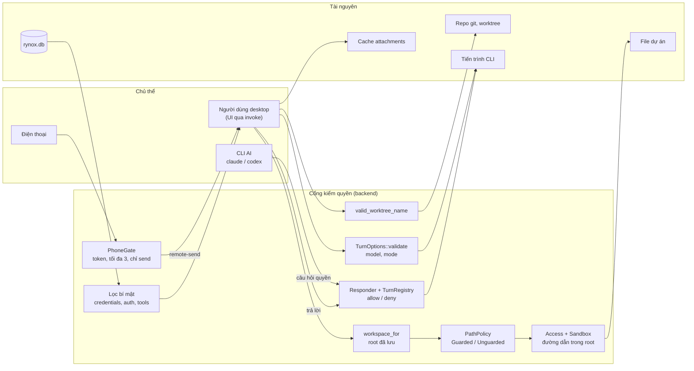

### 6.2. Ma trận quyền (hành vi hiện có, phải giữ)

| #   | Quyền                       | Chủ thể                                                                                                    | Hành động                         | Tài nguyên                                     | Quy tắc cho / chặn                                                                                                                                                                                                                                                                                                           | Lỗi (key)                                                                                                                                                    | Thành phần · pattern                            |
| --- | --------------------------- | ---------------------------------------------------------------------------------------------------------- | --------------------------------- | ---------------------------------------------- | ---------------------------------------------------------------------------------------------------------------------------------------------------------------------------------------------------------------------------------------------------------------------------------------------------------------------------- | ------------------------------------------------------------------------------------------------------------------------------------------------------------ | ----------------------------------------------- |
| P1  | Truy cập file có bảo vệ     | Luồng AI và tự động: `workspace_write`, `workspace_read_media`, `inline_ask`, git `head/discard`, `vscode` | đọc, ghi, xoá, băm                | File trong root                                | Đường dẫn tương đối sạch (`normalise`: không rỗng, ≤ 300 byte, không `..`, `\`, ký tự điều khiển, tuyệt đối, ổ đĩa); chặn `DENIED_DIRECTORIES` và `DENIED_NAMES` (`.env`, khoá, `credentials*`…); đường thật trong root; ghi không qua symlink; ghi phải khớp băm mong đợi; giới hạn đọc 1 MB, media 20 MB, ghi 100 000 byte | `workspace.bad_path`, `workspace.denied`, `workspace.not_found`, `workspace.not_text`, `workspace.too_large`, `workspace.conflict`, `workspace.write_failed` | `Access` + `Guarded` · Strategy + Proxy         |
| P2  | Truy cập file của trình xem | Người dùng qua code-viewer: `workspace_read`, `local_put_file`, `workspace_rename`                         | đọc, ghi đè, đổi tên              | File trong root                                | Như P1 nhưng không chặn danh sách cấm; `local_put_file` lấy băm hiện tại rồi ghi (ghi đè, không báo xung đột); đổi tên: tên mới không rỗng, không `/`, `\`, `.`, `..`, không đè file có sẵn                                                                                                                                  | như P1                                                                                                                                                       | `Access` + `Unguarded` · Strategy + Proxy       |
| P3  | Liệt kê cây file            | Người dùng: `workspace_tree`                                                                               | liệt kê                           | Cây thư mục root                               | Ẩn `DENIED_DIRECTORIES`, `HIDDEN_FROM_TREE`, symlink; tối đa 2000 mục, sâu 12                                                                                                                                                                                                                                                | (cắt bớt, `truncated`)                                                                                                                                       | `Workspace::tree` · không đổi                   |
| P4  | Chọn root                   | Mọi lệnh có tham số `root`, `extra_roots` của `agent_send`                                                 | mở workspace                      | Thư mục dự án                                  | `None` → workspace đang mở; bằng root đang mở; hoặc là thư mục đầu của một dự án đã lưu; còn lại chặn                                                                                                                                                                                                                        | `workspace.denied`, `workspace.unknown_root`                                                                                                                 | `AppState::workspace_for` · Facade, không đổi   |
| P5  | Tham số lượt chat           | Người dùng: `agent_send`                                                                                   | chạy CLI                          | Tiến trình CLI                                 | CLI ∈ {claude, codex}; model: chữ, số, `. _ : -`, ≤ 100 ký tự, không bắt đầu bằng `-`; mode ∈ {plan, auto, acceptEdits, manual, bypassPermissions} (`bypassPermissions` do plan permission-modes thêm, chưa commit, không thuộc refactor); prompt chỉ qua stdin (không thành cờ)                                             | `agent.cli_unsupported`, `agent.model_invalid`, `agent.mode_invalid`, `agent.workdir_failed`                                                                 | `CliKind::parse_agent`, `TurnOptions::validate` |
| P6  | Câu hỏi quyền của CLI       | CLI Claude hỏi, người dùng quyết: `agent_permission`                                                       | dùng một tool                     | Tool của CLI (Bash, Edit…)                     | Chỉ Claude ở mode `manual`; câu hỏi gửi lên `Event::Permission`; trả lời allow (kèm `input`, có thể đã sửa) hoặc deny; sau dòng `result` stdin đóng, trả lời bị từ chối                                                                                                                                                      | `agent.reply_failed`, `agent.turn_ended`                                                                                                                     | `Responder`, `Decision`, `TurnRegistry` · Proxy |
| P7  | Dừng lượt                   | Người dùng (Ctrl+C): `agent_stop`                                                                          | kết thúc tiến trình               | Tiến trình CLI của `run_id`                    | Chỉ lượt đã có pid trong registry                                                                                                                                                                                                                                                                                            | `agent.turn_ended`, `agent.stop_failed`                                                                                                                      | `TurnRegistry::pid` + `kill`                    |
| P8  | Worktree                    | `agent_send` khi bật worktree                                                                              | tạo / dùng lại worktree           | Repo git, thư mục `worktrees/` dữ liệu app     | Tên `[A-Za-z0-9-]{1,64}`; thư mục `worktrees/<sha256(root)[..12]>/<name>`; nhánh `codexis/<name>`; dự án gốc không bị sửa; danh sách nhánh chỉ hiện tên thư mục worktree                                                                                                                                                     | `git.worktree_failed`                                                                                                                                        | `valid_worktree_name`                           |
| P9  | Git commit / thay đổi       | Người dùng: `local_*`                                                                                      | xem, bỏ thay đổi, commit          | Repo git                                       | Danh sách thay đổi bỏ file bị cấm (`denied`); commit chỉ đúng các file đang hiện (không file staged khác), không push; bỏ thay đổi đi qua P1                                                                                                                                                                                 | `git.nothing_to_commit`, `git.commit_failed`, `workspace.*`                                                                                                  | `GitRepo` · Facade                              |
| P10 | Điện thoại                  | Điện thoại trong mạng                                                                                      | kết nối, gửi prompt, nhận sự kiện | Khung chat                                     | Token 32 hex từ RNG hệ điều hành, so sánh thời gian hằng; bắt tay và tin đầu ≤ 5 giây; tối đa 3 máy; chỉ tin `send`, prompt 1..20 000 ký tự → sự kiện `remote-send`; chiều về chỉ là `agent-event`; `remote_stop` vô hiệu token                                                                                              | `remote.port_failed`, `remote.pairing_code_failed`; phía điện thoại: đóng kết nối, không key                                                                 | `PhoneGate` · Proxy                             |
| P11 | Bí mật không trả ra         | Người dùng (UI)                                                                                            | đọc trạng thái                    | Khoá API, token CLI, cấu hình MCP/hook         | Khoá API: chỉ trả 4 ký tự cuối, ≤ 500 ký tự, chỉ đưa vào môi trường CLI Claude; trạng thái đăng nhập chỉ trường trong whitelist; Codex chỉ đọc email trong `id_token`; MCP: bỏ `user:pass@`, query, fragment; TOML chỉ `command`/`url`; `EnvVar` ẩn giá trị khi `Debug`                                                      | `credentials.invalid`, `credentials.save_failed`, `credentials.load_failed`                                                                                  | giữ hàm hiện có · không áp dụng pattern         |
| P12 | Đọc cấu hình tool           | Người dùng: `tools_*`                                                                                      | đọc                               | `~/.claude*`, `.codex`, `.agents`, `.mcp.json` | Symlink phải nằm trong base; file ≤ 256 KB (`~/.claude.json` ≤ 8 MB); ≤ 500 mục mỗi thư mục                                                                                                                                                                                                                                  | `tools.link_outside\|<path>`, `tools.file_too_large\|<path>`, `tools.invalid_json\|<path>`                                                                   | `Base` + `Sandbox`                              |
| P13 | Đính kèm                    | Người dùng: `attachment_save/read`                                                                         | ghi, đọc                          | Cache `attachments/`                           | Tên = 8 hex băm + tên an toàn (`[A-Za-z0-9._-]`); ≤ 25 MB; chỉ đọc file nằm trong thư mục cache                                                                                                                                                                                                                              | `attachments.empty`, `attachments.too_large`, `attachments.save_failed`                                                                                      | `Sandbox`                                       |
| P14 | Format khi lưu              | Người dùng: `format_code`                                                                                  | chạy prettier                     | Text trong bộ nhớ                              | Chỉ phần mở rộng trong `EXTENSIONS`; đường dẫn chỉ gồm thành phần thường; lỗi → trả nguyên văn                                                                                                                                                                                                                               | `files.format_failed` (chỉ khi task chết)                                                                                                                    | không đổi                                       |

Kiểm TASK-M3 (2026-11-08, ảnh ở `.agents/storage/evidence/permission-modes-m3/`, Playwright trên vite với `invoke` giả; thư mục tạm rỗng):

- Đạt: backend nhận `bypassPermissions` (`cargo test agent`: 53 đạt); chọn Bypass hiện hộp thoại xác nhận, huỷ giữ nguyên chế độ, xác nhận mới đổi; một lượt `claude -p --permission-mode bypassPermissions` (cờ như `claude.rs`, không qua app Tauri) tạo được `hello.txt`, sự kiện khởi tạo báo `permissionMode: bypassPermissions`.
- Chưa đạt (lỗi sản phẩm, chưa sửa): menu hiện dùng (cả hai nơi gọi `ProjectRow` đều `compact`) là menu Cài đặt, không có mô tả hiển thị (chỉ tooltip), không có nhãn Recommended, phím 1–5 không chọn mục, dấu chọn là chấm tròn không phải ✓. Nhánh có mô tả, Recommended, phím 1–5 chỉ nằm trong nhánh không-compact, hiện không hiển thị ở đâu.
- Chưa chạy: lượt Bypass qua app Tauri thật (không có GUI trong phiên này).

### 6.3. Sơ đồ kiểm đường dẫn (P1, P2)

Nguồn: `workspace.rs` (`existing_file_with`, `parent_directory`, `write_with`). Thứ tự bước quyết định key lỗi (ví dụ `../.env` → `bad_path`, không phải `denied`).

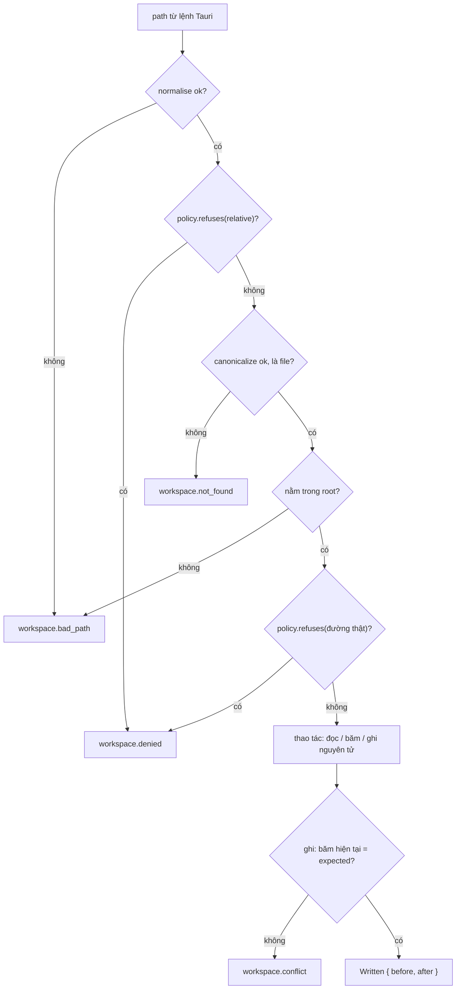

### 6.4. Struct và trait của lớp quyền

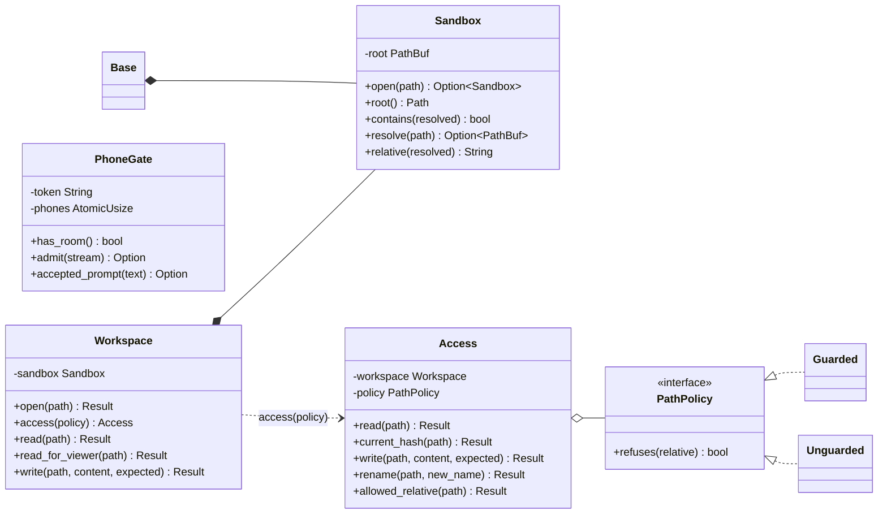

| Mục (file)                                     | Chữ ký                                                                                                                                                                              | Trách nhiệm                                                                                                                 |
| ---------------------------------------------- | ----------------------------------------------------------------------------------------------------------------------------------------------------------------------------------- | --------------------------------------------------------------------------------------------------------------------------- |
| trait `PathPolicy: Sync` (`permission.rs`)     | `fn refuses(&self, relative: &str) -> bool`                                                                                                                                         | Strategy: đường dẫn tương đối nào bị chặn                                                                                   |
| `Guarded`                                      | `pub struct Guarded;` — `refuses` = `crate::workspace::denied`                                                                                                                      | Chính sách cho AI và luồng tự động (thay `denied` truyền tay)                                                               |
| `Unguarded`                                    | `pub struct Unguarded;` — `refuses` = `false`                                                                                                                                       | Chính sách trình xem (thay `nothing_refused`)                                                                               |
| `Sandbox` (`permission.rs`)                    | `#[derive(Debug, Clone)] pub struct Sandbox { root: PathBuf }`                                                                                                                      | Thư mục gốc đã canonicalize                                                                                                 |
| `Sandbox::open`                                | `pub fn open(path: &Path) -> Option<Sandbox>`                                                                                                                                       | `canonicalize` + `is_dir`                                                                                                   |
| `Sandbox::root`                                | `pub fn root(&self) -> &Path`                                                                                                                                                       | Root thật                                                                                                                   |
| `Sandbox::contains`                            | `pub fn contains(&self, resolved: &Path) -> bool`                                                                                                                                   | `resolved.starts_with(root)`                                                                                                |
| `Sandbox::resolve`                             | `pub fn resolve(&self, path: &Path) -> Option<PathBuf>`                                                                                                                             | `canonicalize` rồi `contains`; dùng cho `tools::Base`, `attachments::read`                                                  |
| `Sandbox::relative`                            | `pub fn relative(&self, resolved: &Path) -> String`                                                                                                                                 | Đường tương đối dạng `/` (thay `relative_of`)                                                                               |
| `Workspace` (`workspace.rs`)                   | `#[derive(Debug, Clone)] pub struct Workspace { sandbox: Sandbox }`; `open`, `root`, `tree` giữ chữ ký                                                                              | Workspace = Proxy trên hệ thống file                                                                                        |
| `Workspace::access`                            | `pub fn access<'a>(&'a self, policy: &'a dyn PathPolicy) -> Access<'a>`                                                                                                             | Tạo proxy với chính sách                                                                                                    |
| method cũ giữ chữ ký                           | `read`, `read_for_viewer`, `read_bytes`, `current_hash`, `current_hash_for_viewer`, `write`, `write_for_viewer`, `rename_for_viewer`, `delete`, `existing_path`, `allowed_relative` | Một dòng uỷ quyền cho `access(&Guarded)` / `access(&Unguarded)`; `commands/files.rs`, `git.rs`, `vscode.rs`, test không đổi |
| `Access<'a>`                                   | `pub struct Access<'a> { workspace: &'a Workspace, policy: &'a dyn PathPolicy }`                                                                                                    | Một phiên truy cập theo chính sách                                                                                          |
| `Access::read`                                 | `pub fn read(&self, path: &str) -> Result<String>`                                                                                                                                  | Đọc text (≤ 1 MB, không byte 0, UTF-8)                                                                                      |
| `Access::current_hash`                         | `pub fn current_hash(&self, path: &str) -> Result<Option<String>>`                                                                                                                  | Băm SHA-256 hiện tại; `None` khi chưa có file                                                                               |
| `Access::write`                                | `pub fn write(&self, path: &str, content: &str, expected: Option<&str>) -> Result<Written>`                                                                                         | Ghi nguyên tử (file tạm + rename), giữ quyền file                                                                           |
| `Access::rename`                               | `pub fn rename(&self, path: &str, new_name: &str) -> Result<String>`                                                                                                                | Đổi tên trong cùng thư mục                                                                                                  |
| `Access::allowed_relative`                     | `pub fn allowed_relative(&self, path: &str) -> Result<String>`                                                                                                                      | `normalise` + policy                                                                                                        |
| `Access::existing_file` (riêng)                | `fn existing_file(&self, path: &str) -> Result<PathBuf>`                                                                                                                            | 5 bước của 6.3                                                                                                              |
| `Access::parent_directory` (riêng)             | `fn parent_directory(&self, relative: &str) -> Result<PathBuf>`                                                                                                                     | Thư mục cha thật trong root, qua policy; `parent_directory_with(relative, policy)` khi cần chính sách khác (6.5)            |
| `PhoneGate` (`remote.rs`, riêng)               | `struct PhoneGate { token: String, phones: AtomicUsize }`; `fn new(token: String) -> Self`                                                                                          | Cổng điện thoại, chia sẻ qua `Arc` giữa `serve` và `phone`                                                                  |
| `PhoneGate::has_room`                          | `fn has_room(&self) -> bool`                                                                                                                                                        | `< MAX_PHONES`                                                                                                              |
| `PhoneGate::admit`                             | `async fn admit(&self, stream: TcpStream) -> Option<WebSocketStream<TcpStream>>`                                                                                                    | Bắt tay + tin `auth` trong `AUTH_TIMEOUT`, `tokens_match`, gửi `ready`; sai → đóng, `None`                                  |
| `PhoneGate::joined` / `left`                   | `fn joined(&self) -> usize`; `fn left(&self) -> usize`                                                                                                                              | Đếm máy, giá trị cho `remote-connected` / `remote-disconnected`                                                             |
| `PhoneGate::accepted_prompt`                   | `fn accepted_prompt(text: &str) -> Option<String>`                                                                                                                                  | Chỉ `ClientMessage::Send`, không rỗng, ≤ `MAX_PROMPT_CHARS`                                                                 |
| giữ hàm                                        | `tokens_match`, `parse_message`, `generate_token`                                                                                                                                   | Hàm thuần, test đang dùng                                                                                                   |
| `Responder`, `Decision`, `TurnRegistry`        | xem 4.3                                                                                                                                                                             | P6, P7                                                                                                                      |
| `TurnOptions::validate`, `valid_worktree_name` | xem 4.3                                                                                                                                                                             | P5, P8                                                                                                                      |

### 6.5. Hành vi quyền hiện có phải giữ nguyên (kể cả điểm lạ)

Các điểm dưới đây đọc được từ mã; refactor **không** sửa, chỉ ghi lại. Muốn đổi phải hỏi riêng (mục 7.6).

- `current_hash_with` luôn kiểm thư mục cha bằng `denied`, bất kể chính sách → trình xem đọc được nhưng **không ghi được** file trong `.git/`, `node_modules/`, `vendor/`, `storage/` (bị `workspace.denied`). `Access::current_hash` gọi `parent_directory_with(.., &Guarded)` cố định (test `the_viewer_reads_inside_git_but_never_saves_there`).
- `read_bytes` (media) và `delete` luôn dùng `Guarded`, kể cả khi gọi từ trình xem.
- `rename_for_viewer` kiểm thư mục cha bằng `Unguarded`.
- `MAX_PHONES` được kiểm trước bắt tay nhưng bộ đếm chỉ tăng sau khi xác thực → có thể quá 3 kết nối đang bắt tay cùng lúc.
- Câu từ chối gửi cho CLI khi deny là chuỗi tiếng Việt cố định `"Người dùng từ chối."` (đi vào mô hình AI, không trả về UI).
- `local_commit_message` chỉ dùng môi trường hồ sơ Claude, không thêm khoá API; `inline_ask` thêm cả khoá API.

## 7. Thứ tự và nhóm refactor song song

### 7.1. Điều kiện bắt đầu

**Đã qua (lịch sử)**. Blocker lúc lập kế hoạch: hai việc đang sửa `src-tauri/` (clippy, đổi lỗi sang key i18n) phải xong và được commit trước; sau đó chạy baseline (7.5) trên cây sạch. Refactor không sửa nội dung enum lỗi.

### 7.2. Nhóm file (đã thực hiện)

Mỗi file chỉ thuộc **một** nhóm trong một pha. Phase 0 và Phase 3 làm tuần tự; nhóm A–G làm song song sau Phase 0.

| Pha / nhóm                 | File sở hữu                                                                                                                                                                                                                                                                       | Việc                                                                                                                                           | Phải giữ cho nhóm khác (đến Phase 3)                                                                                        |
| -------------------------- | --------------------------------------------------------------------------------------------------------------------------------------------------------------------------------------------------------------------------------------------------------------------------------- | ---------------------------------------------------------------------------------------------------------------------------------------------- | --------------------------------------------------------------------------------------------------------------------------- |
| **Phase 0** (1 coder)      | `cli.rs` (mới), `permission.rs` (mới), `lib.rs` (thêm `pub mod cli; pub mod permission;`), `agent.rs` (chỉ thay thân `locate` bằng `pub(crate) use crate::cli::locate;`)                                                                                                          | `CliKind`, `Environment`, `locate`, `command`; `PathPolicy`, `Guarded`, `Unguarded`, `Sandbox`                                                 | —                                                                                                                           |
| **A** agent                | `agent.rs`, `agent/claude.rs` (mới), `agent/codex.rs` (mới), `commands/agent.rs`, `lib.rs` (`manage(TurnRegistry)` thay `Approvals`, `Running`)                                                                                                                                   | `AgentCli`, adapter, `TurnOptions`, `TurnRequest`, `TurnObserver`, `EventFilter`, `Responder`, `Decision`, `TurnRegistry`, `TauriTurnObserver` | `agent::Cli` (+`parse`, `name`), `agent::ask_once`, `agent::split_message`, re-export `agent::locate`, shape `agent::Event` |
| **B** auth                 | `auth.rs`, `auth/claude.rs`, `auth/codex.rs`, `auth/github.rs` (mới), `commands/auth.rs`                                                                                                                                                                                          | `AuthTool`, `SignIn`, 3 impl, `CliKind::auth`                                                                                                  | — (chỉ lệnh `auth_*` dùng)                                                                                                  |
| **C** store                | `profiles.rs`, `usage.rs`, `settings.rs`, `chats.rs` (có thể tách C1 = profiles+usage, C2 = settings+chats)                                                                                                                                                                       | Thay `CLIS`, `CLI_NAMES`, literal, `Cli::parse` bằng `CliKind`                                                                                 | `ProfileStore::{environment(&str, i64), active_environment(&str), active_id(&str)}`, `SettingsStore::get()`                 |
| **D** git                  | `git.rs`, `commands/git.rs`                                                                                                                                                                                                                                                       | `GitRepo`, `valid_worktree_name`                                                                                                               | `git::ensure_worktree(root, base, name)`                                                                                    |
| **E** tools                | `tools.rs`                                                                                                                                                                                                                                                                        | `ToolScanner`, `Base` dùng `Sandbox`                                                                                                           | lệnh `tools_*`                                                                                                              |
| **F** workspace            | `workspace.rs`                                                                                                                                                                                                                                                                    | `Workspace { sandbox }`, `Access`, method cũ uỷ quyền                                                                                          | mọi method `pub` của `Workspace`, `workspace::{denied, normalise, hash}`, hằng `MAX_*`                                      |
| **G** remote + attachments | `remote.rs`, `attachments.rs`                                                                                                                                                                                                                                                     | `PhoneGate`; `attachments::read` dùng `Sandbox`                                                                                                | `remote::Remote::{start, stop}`, `attachments::{save, read}`                                                                |
| **Phase 3** (1 coder)      | `agent.rs` (xoá `Cli`, shim `ask_once`, re-export `locate`), `formatter.rs` (`cli::locate`), `commands/git.rs` + `commands/inline_ask.rs` (`ClaudeAgent::ask_once`, `CliKind::Claude.name()` thay literal `"claude"`), `docs/system/architecture.md` (cập nhật mục 3 theo mã mới) | Dọn shim                                                                                                                                       | —                                                                                                                           |

Không thuộc nhóm nào (không đổi): `main.rs`, `db.rs`, `credentials.rs`, `projects.rs`, `terminal.rs`, `vscode.rs`, `window_buttons.rs`, `commands/{mod, state, files, projects, chat, attachments, terminal, remote}.rs`.

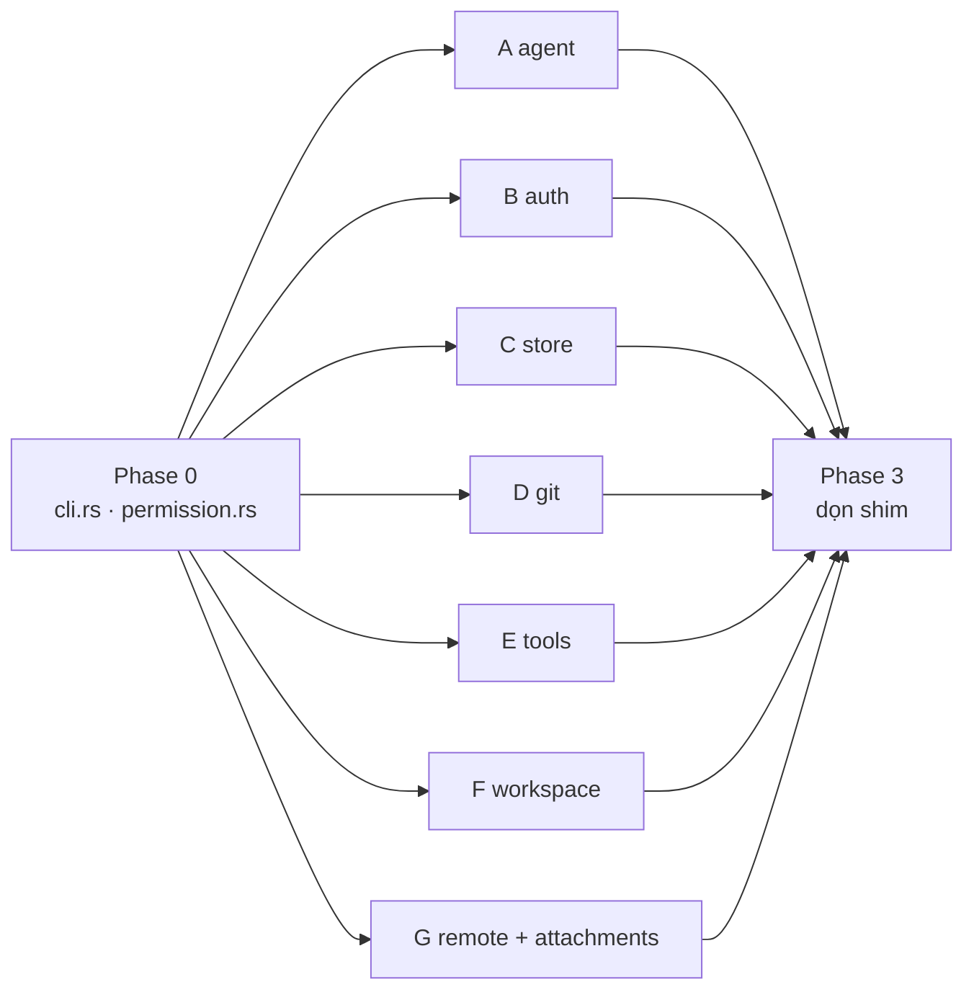

Phụ thuộc giữa nhóm song song chỉ qua API giữ nguyên ở cột cuối, nên không nhóm nào phải chờ nhóm khác. Mỗi nhóm tự biên dịch được trên nền Phase 0.

### 7.3. Bất biến hành vi

- **Thứ tự tham số CLI** (giữ đúng thứ tự cũ của `Cli::args` + `with_add_dirs`), nay do `AgentCli::turn_args` tạo:
    - Claude: `-p --output-format stream-json --verbose --include-partial-messages --append-system-prompt <CHAT_ROLE>` → `[--resume <id>]` → `[--permission-mode <mode>` `[--input-format stream-json --permission-prompt-tool stdio` khi mode = `manual`]`]` → `[--model <m>]` → `[--add-dir <d>]…`.
    - Codex: `exec` → `[--add-dir <d>]…` → `[-m <m>]` → `[resume <id>]` → `--json --skip-git-repo-check` → `-`.
- `Event` giữ nguyên biến thể và serde (`tag = "kind"`, `content = "text"`, lowercase); `Done` luôn là sự kiện cuối, kể cả khi thiếu CLI hoặc spawn lỗi.
- Mọi key lỗi giữ đúng chuỗi (kể cả hậu tố `|<program>`); thứ tự kiểm (model trước mode; `bad_path` trước `denied`…).
- Thứ tự liệt kê: profiles và `auth_status` theo Claude, Codex, Github; thống kê theo Claude, Codex.
- Ngữ nghĩa khoá: khoá registry bị poison → `agent.reply_failed` cho `agent_permission`, `agent.stop_failed` cho `agent_stop`.
- Điểm lạ ở 6.5.

### 7.4. Rủi ro và cách giảm (đã áp dụng)

| Rủi ro                                                           | Ảnh hưởng                          | Giảm thiểu                                                                                                                                                                                                 |
| ---------------------------------------------------------------- | ---------------------------------- | ---------------------------------------------------------------------------------------------------------------------------------------------------------------------------------------------------------- |
| Sai thứ tự tham số khi bỏ `insert(...)`                          | CLI hiểu sai cờ, lượt chat hỏng    | Giữ nguyên các test `resume_arguments_differ_per_cli`, `model_goes_to_the_flag_of_each_cli`, `extra_projects_become_add_dir_flags`, `permission_mode_is_a_claude_flag_only` (chỉ đổi cách gọi, giữ assert) |
| `CliKind::parse` nhận `github` ở chỗ trước chỉ nhận claude/codex | Lưu lượt/thống kê cho `github`     | Store dùng `parse_agent`; review grep                                                                                                                                                                      |
| Đổi kiểu `State<Approvals>` / `State<Running>`                   | Lệnh panic khi state chưa `manage` | Nhóm A sửa `lib.rs` cùng lượt; không đổi tham số JS                                                                                                                                                        |
| Chuyển test giữa file làm mất test                               | Giảm độ phủ                        | Giữ tên test; so số test với baseline                                                                                                                                                                      |
| `Access` đổi chính sách ở `current_hash`                         | Trình xem ghi được vào `.git/`     | 6.5 + test `state.rs`/`workspace.rs` hiện có                                                                                                                                                               |
| Xung đột với coder clippy/i18n                                   | Đè thay đổi                        | Blocker 7.1                                                                                                                                                                                                |
| `dyn Trait` không `Sync`                                         | Không biên dịch khi đưa vào thread | Bound `Sync` trên trait                                                                                                                                                                                    |

### 7.5. Kiểm chứng

Đã chạy ngày 2026-11-07 sau Phase 3 (kết quả ở cuối mục này). Lệnh:

```sh
cargo fmt --manifest-path src-tauri/Cargo.toml --check
cargo clippy --manifest-path src-tauri/Cargo.toml -- -D warnings
cargo test --manifest-path src-tauri/Cargo.toml --lib -- --skip terminal::tests::a_shell_runs_in_a_pseudo_terminal
git diff --stat -- src/ src-tauri/Cargo.toml   # phải rỗng
```

- Kết quả chạy lại 2026-11-07: `cargo fmt --check` sạch; `cargo clippy --all-targets -- -D warnings` sạch; `cargo test --lib` (bỏ test terminal): 179 qua, 1 rớt là `workspace::tests::binary_files_are_read_as_bytes_but_not_as_text` (rớt y hệt ở HEAD `0deadb8`, có sẵn: `../logo.png` trả `BadPath` thay vì `Denied`; không thuộc refactor). Số test lớn hơn lần chạy trước (153) vì cây làm việc còn việc khác của người dùng thêm test. Grep `Provider::`, `CLI_NAMES`, `CLIS`, `agent::Cli` trong `src-tauri/src` rỗng; `== "claude" | "codex"` chỉ còn ở `context.rs` (mã mới ngoài refactor, chưa thuộc lớp `CliKind`). `git diff --stat -- src/` không rỗng do việc frontend riêng của người dùng; `src-tauri/Cargo.toml` chỉ khác ở mục `[profile.dev]` (chưa commit, có sẵn), không có dependency mới. Số lệnh Tauri vẫn 62.
- Baseline: test terminal treo nên bỏ qua; `workspace::tests::binary_files_are_read_as_bytes_but_not_as_text` rớt sẵn (mục 13).
- Contract: `generate_handler!` trong `lib.rs` không đổi; so chữ ký các hàm `#[tauri::command]` trước/sau (`git diff` từng hàm).
- Grep chấp nhận R1/R2: không còn `Provider::`, `CLI_NAMES`, `CLIS`, `matches!(… "claude" | "codex")` ngoài `cli.rs`.
- CI (`.github/workflows/build.yml`) đã chạy fmt, clippy `-D warnings`, `cargo test` trên macOS.
- Test bổ sung đã có trong mã: `codex_arguments_follow_the_documented_order`, `the_viewer_reads_inside_git_but_never_saves_there`, `only_a_send_with_a_usable_prompt_is_accepted`, `the_gate_holds_at_most_three_phones`, `a_started_turn_has_a_responder_and_a_pid_once_spawned`.

### 7.6. Quyết định đã chốt (câu hỏi mở của bản đề xuất)

1. Blocker clippy/i18n: không chờ commit; refactor làm trên cây đang có (7.1).
2. `Approvals` + `Running` đã gộp thành `TurnRegistry` (`lib.rs` chỉ `manage` một kiểu, tham số JS các lệnh không đổi).
3. Các điểm lạ ở 6.5 giữ nguyên, chưa sửa; muốn đổi phải làm ở việc riêng.
4. `GitRepo` đã làm (ưu tiên thấp nhất).

## 8. Luồng chính

### 8.1. Một lượt chat AI

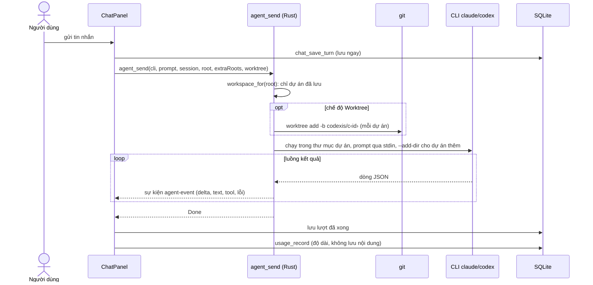

### 8.1b. Lưu file và format

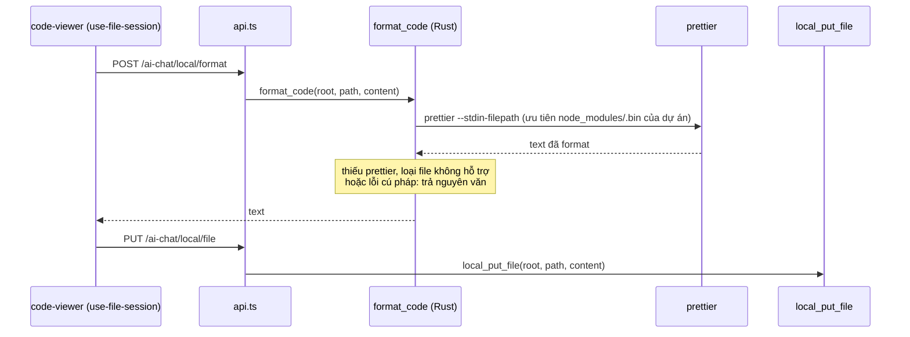

### 8.2. Điều khiển từ điện thoại

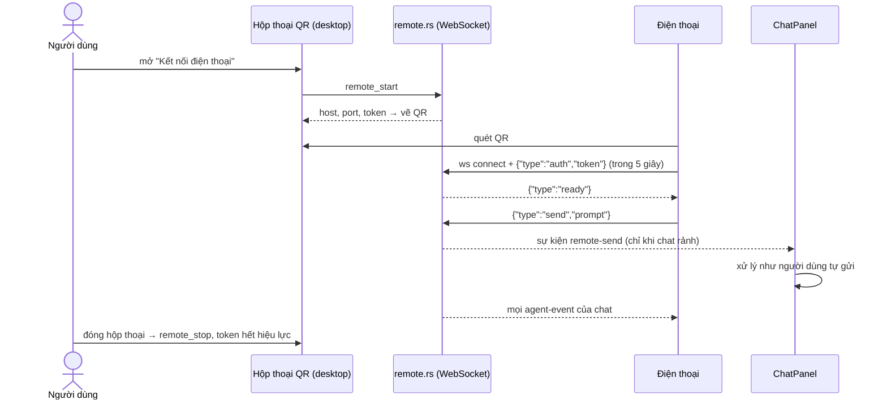

### 8.3. Đăng nhập CLI và nhiều tài khoản

Codexis không bao giờ thấy mật khẩu hay token: đăng nhập chạy luồng đăng nhập của chính CLI, rồi đọc trạng thái lại từ CLI. Mỗi tài khoản phụ là một thư mục hồ sơ riêng, CLI được trỏ tới đó bằng biến môi trường (`CLAUDE_CONFIG_DIR`, `CODEX_HOME`, `GH_CONFIG_DIR`).

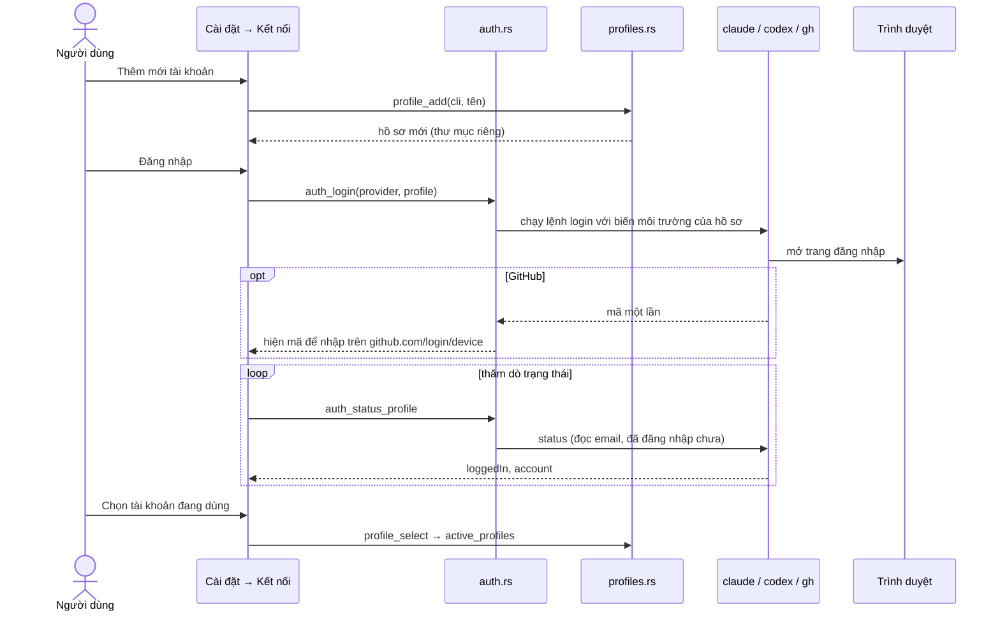

### 8.4. Terminal

Mỗi terminal là một shell thật chạy trong pseudo-terminal (PTY) tại thư mục dự án.

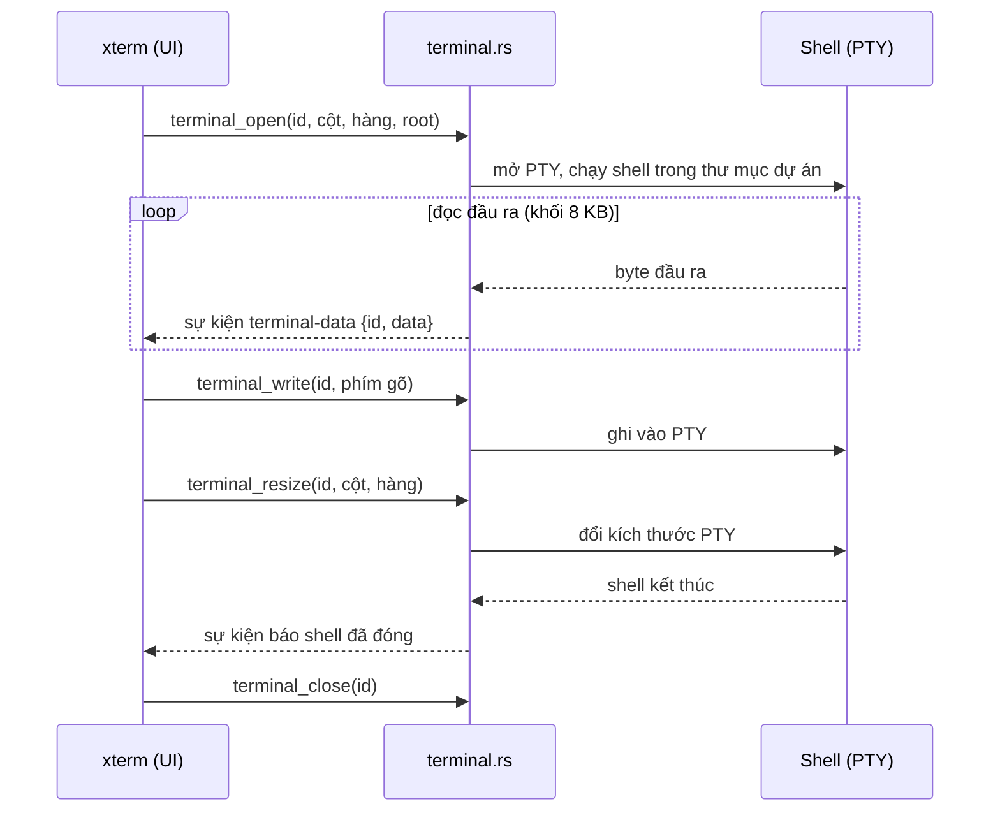

### 8.5. Skill, agent, MCP, rule và hook (chỉ đọc)

`tools.rs` chỉ liệt kê cấu hình có trên máy, không ghi gì. Bí mật (giá trị env, header, token, tham số, query URL) không bao giờ được trả về.

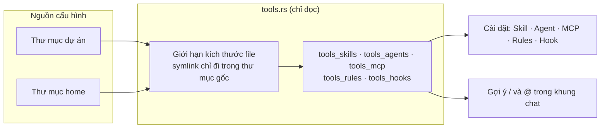

## 9. Bộ sơ đồ bổ sung

Vẽ từ mã hiện có (không phải thiết kế đề xuất), trừ khi ghi khác. Class Diagram ở mục 4.2 và 6.4; sequence ở mục 8; ERD ở mục 10 và `database.md`; Authentication Flow ở mục 8.3.

### 9.1. Use Case Diagram

Tác nhân và chức năng, gom từ 62 lệnh Tauri trong `lib.rs` và hai sự kiện của điện thoại. Mermaid không có ký hiệu use case riêng nên dùng flowchart: hình tròn dẹt là use case. Nguồn: `lib.rs`, `commands/*`, `remote.rs`, `auth.rs`, `agent.rs`.

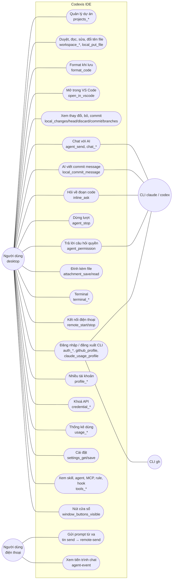

### 9.2. DFD cấp 0 (ngữ cảnh)

Toàn bộ app là một tiến trình; mũi tên ghi dữ liệu đi qua. Nguồn: `lib.rs`, `db.rs`, `agent.rs`, `remote.rs`, `auth.rs`, `formatter.rs`, `vscode.rs`, `commands/attachments.rs`.

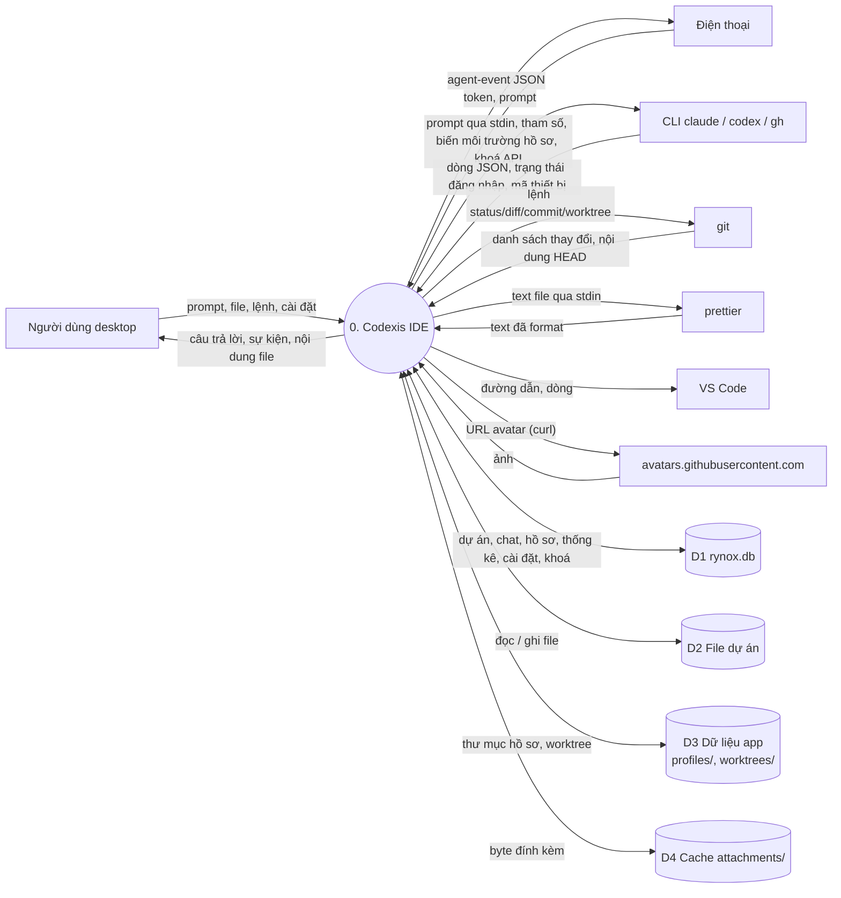

### 9.3. DFD cấp 1

Tách tiến trình 0 thành các tiến trình con theo module. Nguồn: như 9.2 và `commands/*`, `terminal.rs`, `git.rs`, `workspace.rs`.

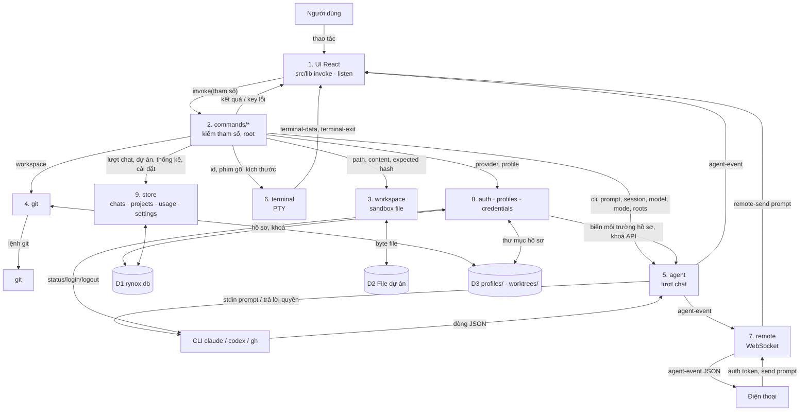

### 9.4. Activity Diagram: lượt chat AI

Gồm hỏi quyền, worktree, dừng lượt và chuyển tài khoản/AI khi chạm giới hạn. Nguồn: `src/components/shell/chat/use-agent-turns.ts` (`startTurn`, `nextAccount`, `failover`, `stopTurns`), `commands/agent.rs`, `agent.rs` (`TurnRequest::run`), `agent/claude.rs`.

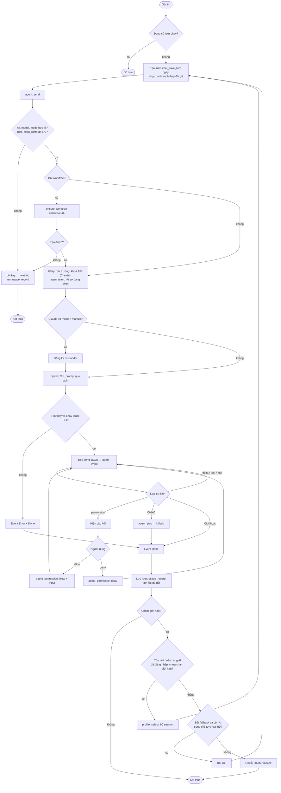

### 9.5. Activity Diagram: lưu file có format

Nguồn: `src/components/ai-chat/code-viewer/use-file-session.ts`, `commands/files.rs` (`format_code`, `local_put_file`), `formatter.rs`, `workspace.rs`.

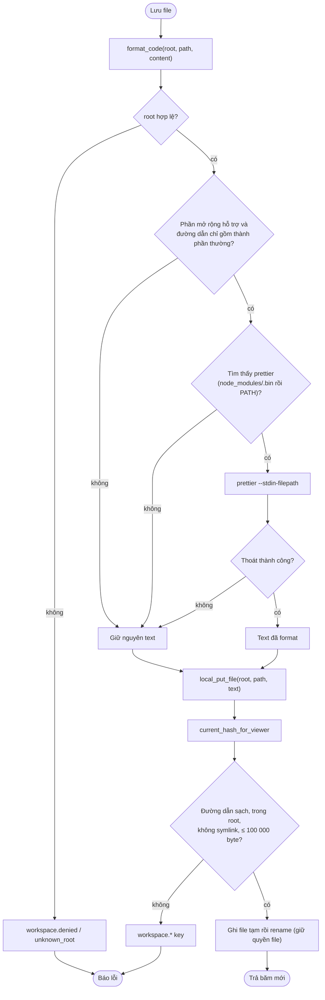

### 9.6. State Machine: một lượt agent

Ghép trạng thái phía backend (`commands/agent.rs`, `agent.rs`) và frontend (`Turn.running`, `permissions` trong `turn.ts`, `use-agent-turns.ts`).

```mermaid
stateDiagram-v2
    [*] --> Saved: startTurn (running = true, chat_save_turn)
    Saved --> Rejected: agent_send trả lỗi key
    Saved --> Preparing: agent_send nhận
    Preparing --> Rejected: worktree / root lỗi
    Preparing --> Spawning: thread chạy TurnRequest
    Spawning --> Finished: thiếu CLI / spawn lỗi (Error + Done)
    Spawning --> Streaming: observer spawned(pid) ghi vào TurnRegistry
    Streaming --> Streaming: delta, text, tool, subagent
    Streaming --> AwaitingPermission: Event Permission (Claude, mode manual)
    AwaitingPermission --> Streaming: agent_permission allow / deny
    Streaming --> Stopping: agent_stop (kill pid)
    AwaitingPermission --> Stopping: agent_stop
    Stopping --> Finished: CLI thoát
    Streaming --> Finished: CLI thoát, Event Done
    Finished --> Persisted: running = false, lưu lượt, usage_record
    Rejected --> Persisted
    Persisted --> Failover: chạm giới hạn
    Failover --> Saved: tài khoản khác / AI khác
    Persisted --> [*]
    Failover --> [*]: hết lựa chọn
```

Responder (chế độ hỏi quyền) có trạng thái con: `Open` từ lúc gửi prompt đến dòng `result` của CLI, sau đó `Closed`; trả lời sau khi `Closed` → `agent.turn_ended`.

### 9.7. State Machine: terminal

Nguồn: `terminal.rs` (`Terminals::open/write/resize/close`, thread đọc), `commands/terminal.rs`.

```mermaid
stateDiagram-v2
    [*] --> Opening: terminal_open(id, root, cột, hàng)
    Opening --> [*]: root không hợp lệ / lỗi PTY
    Opening --> Running: shell spawn, session vào HashMap
    Running --> Running: terminal_write, terminal_resize, terminal-data
    Running --> Exited: shell kết thúc → terminal-exit
    Exited --> Closed: terminal_close (xoá khỏi HashMap)
    Running --> Closed: terminal_close (kill shell)
    Closed --> [*]
```

Ở `Exited`, session vẫn nằm trong `HashMap` đến khi `terminal_close`; `terminal_write` vào lúc này trả lỗi ghi PTY.

### 9.8. State Machine: kết nối điện thoại

Nguồn: `remote.rs` (`Remote::start/stop`, `serve`, `phone`).

```mermaid
stateDiagram-v2
    state Server {
        [*] --> Stopped
        Stopped --> Listening: remote_start (cổng ngẫu nhiên, token mới)
        Listening --> Listening: remote_start (trả info đang chạy)
        Listening --> Stopped: remote_stop (token hết hiệu lực)
    }
    state Phone {
        [*] --> Accepted: TCP accept khi đang có < 3 máy
        Accepted --> Handshake: WebSocket ≤ 5 giây
        Handshake --> Authenticating: tin đầu ≤ 5 giây
        Authenticating --> Ready: auth đúng token, gửi ready, remote-connected
        Handshake --> Closed: quá giờ / lỗi
        Authenticating --> Closed: sai token / quá giờ
        Ready --> Ready: send → remote-send, agent-event → máy
        Ready --> Closed: máy đóng / server dừng → remote-disconnected
        Closed --> [*]
    }
```

### 9.9. Deployment Diagram

Chỉ theo repo: `tauri.conf.json` (`bundle.targets = ["app"]`, identifier `ai.geteasy.rynox-ide`), `.github/workflows/build.yml` (build trên `macos-latest`, artifact `*.app`), `db.rs`, `profiles.rs`, `commands/agent.rs`, `commands/attachments.rs`. Không có server, container hay hạ tầng đám mây.

```mermaid
flowchart TB
    subgraph Mac["Máy người dùng (macOS, bundle .app)"]
        subgraph App["Codexis IDE.app (một tiến trình Tauri)"]
            WV["WebView: frontend dist/"]
            RS["Rust core: codexis_ide_lib"]
            WSS["WebSocket server 0.0.0.0:‹cổng ngẫu nhiên›<br/>chỉ khi bật điện thoại"]
        end
        subgraph Data["Thư mục dữ liệu app (app_data_dir)"]
            DBF[("rynox.db<br/>hoặc RYNOX_DB")]
            PRO["profiles/‹cli›-‹id›/"]
            WTD["worktrees/‹băm dự án›/‹tên›/"]
        end
        CAC["app_cache_dir/attachments/"]
        PROJ["Thư mục dự án của người dùng"]
        subgraph Child["Tiến trình con"]
            C1["claude / codex / gh"]
            C2["git · prettier · curl · code"]
            C3["shell trong PTY"]
        end
    end
    PHONE["Điện thoại cùng mạng / VPN"]
    WV <--> RS
    RS --> DBF & PRO & WTD & CAC & PROJ
    RS --> C1 & C2 & C3
    PHONE <-- "ws:// + token" --> WSS
```

### 9.10. CI/CD Pipeline

Nguồn: `.github/workflows/build.yml`. Chỉ có CI build; **chưa có bước phát hành/triển khai** (không ký, không notarize, không publish).

```mermaid
flowchart LR
    TRG["push · pull_request · workflow_dispatch"] --> T
    subgraph T["job test (macos-latest, 30 phút)"]
        direction TB
        T1["checkout · pnpm 10 · node 22 · rust stable · rust-cache"] --> T2["pnpm install --frozen-lockfile"] --> T3["pnpm lint"] --> T4["cargo fmt --check"] --> T5["cargo clippy -D warnings"] --> T6["pnpm build"] --> T7["cargo test"]
    end
    T --> B
    subgraph B["job build (macos-latest, 60 phút)"]
        direction TB
        B1["checkout · toolchain"] --> B2["pnpm install"] --> B3["pnpm tauri build"] --> B4["upload-artifact codexis-ide-macos (*.app)"]
    end
```

Ghi chú: CI chạy `cargo test` đầy đủ, trong khi mục 13 ghi test terminal treo cục bộ (chưa đối chiếu kết quả CI).

### 9.11. Security Architecture (ranh giới tin cậy)

Quy tắc chi tiết ở mục 6. Nguồn: `capabilities/default.json` (`core:default`, `core:window:allow-start-dragging`, `dialog:allow-open`), `tauri.conf.json` (`csp: null`), `workspace.rs`, `remote.rs`, `credentials.rs`, `auth.rs`.

```mermaid
flowchart LR
    subgraph TB1["Vùng 1: WebView (không tin cậy hoàn toàn)"]
        UI["React UI<br/>CSP: null"]
    end
    subgraph TB2["Vùng 2: Rust core (tin cậy)"]
        CMD["62 lệnh Tauri<br/>capability: core:default, dialog:allow-open"]
        GATES["Cổng quyền mục 6<br/>root, sandbox, policy, responder"]
    end
    subgraph TB3["Vùng 3: tiến trình con (tin một phần)"]
        AI["claude / codex<br/>quyền mặc định của CLI"]
        TOOLS["git · prettier · gh · curl · shell"]
    end
    subgraph TB4["Vùng 4: hệ thống file"]
        FS["File dự án"]
        DB[("rynox.db (chủ sở hữu đọc)")]
    end
    subgraph TB5["Vùng 5: mạng LAN"]
        PH["Điện thoại"]
    end
    UI -- "invoke: tham số chưa tin" --> CMD --> GATES
    GATES --> FS & DB
    GATES -- "prompt stdin, env hồ sơ, khoá API chỉ cho Claude" --> AI
    GATES --> TOOLS
    AI -- "câu hỏi quyền" --> GATES
    PH -- "ws:// không mã hoá + token" --> GATES
    AI -. "CLI tự đọc/ghi dự án theo quyền của nó" .-> FS
```

Điểm cần lưu ý (đọc từ cấu hình, chưa đánh giá rủi ro thực tế): CSP tắt (`csp: null`); WebSocket điện thoại không mã hoá; CLI AI và shell chạy với quyền của người dùng, sandbox của app không giới hạn chúng (chỉ chế độ `manual` của Claude hỏi trước khi dùng tool).

### 9.12. API Integration Diagram

Backend gọi công cụ ngoài như tiến trình con (không HTTP API trực tiếp, trừ `curl` tải avatar GitHub). Nguồn: `agent.rs`, `auth.rs`, `git.rs`, `formatter.rs`, `vscode.rs`, `terminal.rs`, `profiles.rs`, `credentials.rs`.

```mermaid
flowchart LR
    RS["Rust core"]
    RS -- "claude -p --output-format stream-json …<br/>stdin: prompt hoặc JSON user · stdout: JSON lines<br/>env: CLAUDE_CONFIG_DIR, ANTHROPIC_API_KEY, CLAUDE_CODE_EXPERIMENTAL_AGENT_TEAMS" --> CL["claude"]
    RS -- "claude auth status/login/logout · claude -p /usage" --> CL
    RS -- "codex exec --json --skip-git-repo-check -<br/>stdin: prompt · stdout: JSON lines · env: CODEX_HOME" --> CX["codex"]
    RS -- "codex login status/login/logout · đọc auth.json (chỉ email)" --> CX
    RS -- "gh auth status/login --web/logout · gh api user<br/>env: GH_CONFIG_DIR · stderr: mã thiết bị" --> GH["gh"]
    RS -- "curl -sSfL --max-time 10 (avatar)" --> AV["avatars.githubusercontent.com"]
    RS -- "git status/diff/show/add/commit/rev-parse/branch/worktree" --> GIT["git"]
    RS -- "prettier --stdin-filepath · stdin/stdout" --> PR["prettier"]
    RS -- "code --new-window ‹root› [--goto file:line]" --> VS["VS Code"]
    RS -- "shell -l trong PTY · TERM=xterm-256color" --> SH["shell"]
```

### 9.13. Sơ đồ không áp dụng

- **Network Diagram**: không áp dụng — app chạy cục bộ; mạng chỉ có một WebSocket LAN tuỳ chọn (đã ở 9.9, 9.11).
- **Infrastructure / Cloud Diagram**: không áp dụng — repo không có server, container, IaC.
- **Release/CD**: chưa có (9.10).

## 10. Cơ sở dữ liệu (ERD)

Thiết kế đầy đủ (bảng, chủ sở hữu, chỉ mục, di trú, quyền): [database.md](./database.md).

Một file SQLite `rynox.db` trong thư mục dữ liệu app (đổi bằng biến `RYNOX_DB`), quyền chỉ chủ sở hữu trên Unix. **Không khai báo `FOREIGN KEY`**: các đường nối dưới đây là quan hệ logic do mã duy trì.

```mermaid
erDiagram
    projects {
        TEXT id PK
        INTEGER position
        TEXT name
        TEXT folders "JSON, thư mục đầu là root"
        TEXT env "JSON biến môi trường"
    }
    meta {
        TEXT key PK
        TEXT value "vd. dự án đang chọn"
    }
    conversations {
        INTEGER id PK
        TEXT workspace "root của dự án"
        TEXT title
        INTEGER updated_at
    }
    chat_turns {
        TEXT workspace PK
        TEXT id PK
        INTEGER position
        TEXT cli
        TEXT prompt
        TEXT answer
        TEXT error
        INTEGER archived
        INTEGER conversation "tham chiếu conversations.id"
        TEXT steps "JSON bước AI đã làm; cột thêm bằng di trú"
    }
    conversation_sessions {
        INTEGER conversation PK
        TEXT cli PK
        TEXT session "id phiên của CLI"
    }
    chat_sessions {
        TEXT workspace PK
        TEXT cli PK
        TEXT session "bảng cũ, chỉ để di trú"
    }
    profiles {
        INTEGER id PK
        TEXT cli
        TEXT name
    }
    active_profiles {
        TEXT cli PK
        INTEGER profile_id "tham chiếu profiles.id"
    }
    usage_events {
        INTEGER id PK
        TEXT cli
        INTEGER at
        TEXT model
        INTEGER prompt_characters
        INTEGER answer_characters
        INTEGER failed
        INTEGER limited
        INTEGER profile "tài khoản đã dùng"
    }
    settings {
        TEXT key PK
        TEXT value "JSON"
    }
    credentials {
        TEXT name PK
        TEXT value "khoá API đã lưu"
    }

    projects ||--o{ conversations : "root ↔ workspace"
    conversations ||--o{ chat_turns : "chứa lượt"
    conversations ||--o{ conversation_sessions : "phiên theo CLI"
    profiles ||--o{ usage_events : "tính theo tài khoản"
    profiles ||--o| active_profiles : "đang dùng"
```

Ghi chú:

- Chỉ mục: `usage_events_cli_at (cli, at)`.
- `db.rs` tự nâng cấp file cũ bằng `add_column_if_missing` (cột `archived`, `conversation`) và gom lượt chat cũ vào một cuộc trò chuyện (`group_old_turns`). File không phải database bị chuyển thành `*.corrupt` rồi tạo mới; nếu vẫn không mở được, app chạy bằng DB trong bộ nhớ.
- Nội dung chat (`prompt`, `answer`) nằm trong `chat_turns`; thống kê (`usage_events`) chỉ lưu độ dài, không lưu nội dung.

## 11. Ranh giới an toàn

Tóm tắt; mô hình quyền đầy đủ (chủ thể, hành động, tài nguyên, quy tắc, key lỗi) ở mục 6, sơ đồ ranh giới tin cậy ở mục 9.11.

- **Workspace sandbox** (`workspace.rs`): chỉ nhận đường dẫn tương đối, làm sạch và kiểm tra trong root; chặn symlink ra ngoài, chặn file nằm trong danh sách cấm (ví dụ `.env`, khoá); giới hạn kích thước; ghi có kiểm tra băm mong đợi.
- **Dự án**: lệnh nhận `root` chỉ chấp nhận dự án đã lưu hoặc workspace đang mở (`workspace_for`); dự án thêm trong một lượt chat đi qua cùng cửa kiểm tra.
- **Worktree**: lượt chat chạy trên nhánh `codexis/c<id>` trong bản sao ở thư mục dữ liệu app, dự án gốc không bị sửa; tên worktree chỉ gồm chữ, số, dấu gạch.
- **Điện thoại**: WebSocket `ws://` (không mã hóa) với token ngẫu nhiên mỗi lần mở; tối đa 3 máy; chỉ tin `send` được xử lý. Chỉ dùng trên mạng tin cậy hoặc qua VPN.
- **GitHub**: hồ sơ (`github_profile`) đọc qua `gh api user`, token không bao giờ tới app; ảnh đại diện chỉ tải từ `https://avatars.githubusercontent.com/`, tối đa 200 000 byte.
- **Ngôn ngữ trả lời**: `agent_send` đọc `settings.language` (`vi`, `en` hoặc rỗng) và chèn quy tắc ngôn ngữ vào đầu prompt (`with_language`).
- **Bí mật**: file DB chứa khoá API và biến môi trường dự án nên chỉ chủ sở hữu đọc được; không đưa secret vào repo.

## 12. Lệnh phát triển

```sh
pnpm install
pnpm start            # tauri dev (app đầy đủ)
pnpm typecheck        # tsc --noEmit
pnpm lint             # eslint
pnpm build            # build frontend
cargo fmt --manifest-path src-tauri/Cargo.toml
cargo clippy --manifest-path src-tauri/Cargo.toml -- -D warnings
cargo test --manifest-path src-tauri/Cargo.toml --lib <module>::
```

## 13. Giả định và giới hạn

- Quan hệ trong ERD là quan hệ logic suy ra từ tên cột và truy vấn; schema không có khoá ngoại. Cột `usage_events.profile` được thêm bằng di trú nên không có trong khối `CREATE TABLE` gốc.
- Số lệnh Tauri (62, đếm `#[tauri::command]` và danh sách `generate_handler` trong `lib.rs`) và thứ tự module lấy từ mã nguồn lúc viết; chưa có kiểm tra tự động giữ con số này đúng.
- Ba luồng ở mục 8.3 đến 8.5 (đăng nhập CLI, terminal, tools) vẽ từ phần đầu mỗi module và chữ ký hàm công khai; chưa đọc hết thân hàm nên thứ tự chi tiết (ví dụ khoảng thăm dò trạng thái) chưa được xác minh.
- Cài đặt (`settings`) có thêm `language` (`vi`/`en`), `appearance` (`system`/`light`/`dark`) và `code_colors` (`auto`, `light`, `dark`, `light-colorblind`, `dark-colorblind`); rỗng nghĩa là chưa chọn.
- Vấn đề đã biết: `cargo test --lib` đầy đủ không kết thúc vì `terminal::tests::a_shell_runs_in_a_pseudo_terminal` treo; `workspace::tests::binary_files_are_read_as_bytes_but_not_as_text` đang fail; typecheck có các lỗi có sẵn (xem `AGENTS.md`).
- Mục 4–7 (thiết kế OOP, pattern, permission, nhóm refactor) đã triển khai; chữ ký Rust trong bảng có thể lệch nhỏ về lifetime/kiểu so với mã thật, lấy mã làm chuẩn. Số liệu "≥ 8 file", "~15 nhánh", "~130 dòng" đếm tay khi đọc mã.
- Mục 9 vẽ từ mã ở thời điểm viết; các phần chưa đọc hết thân hàm: `git.rs` (`git_changes`, `submodules`), `tools.rs` (`rules`, `hooks`, `mcp_from_toml`), `chats.rs`, `projects.rs`, `use-file-session.ts` (chỉ đọc đoạn lưu/format), `use-agent-turns.ts` (chỉ đọc phần gửi, kết thúc lượt, chuyển tài khoản/AI). Trạng thái frontend ở 9.6 là gộp suy ra từ `Turn.running`/`permissions`, frontend không có enum trạng thái riêng.
- Điểm lạ về quyền ở mục 6.5 là đọc mã, chưa kiểm bằng chạy thử.
- 9.11 chỉ liệt kê cấu hình bảo mật đọc được (`csp: null`, capability, `ws://`), chưa phải đánh giá bảo mật.
