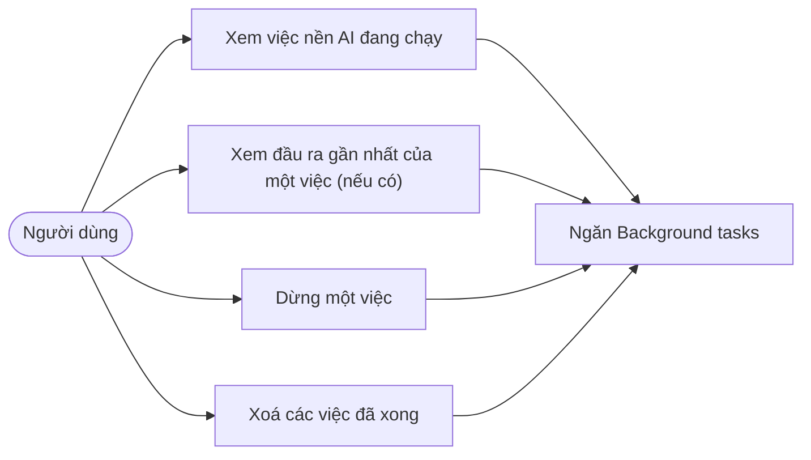
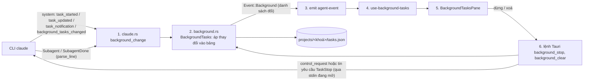
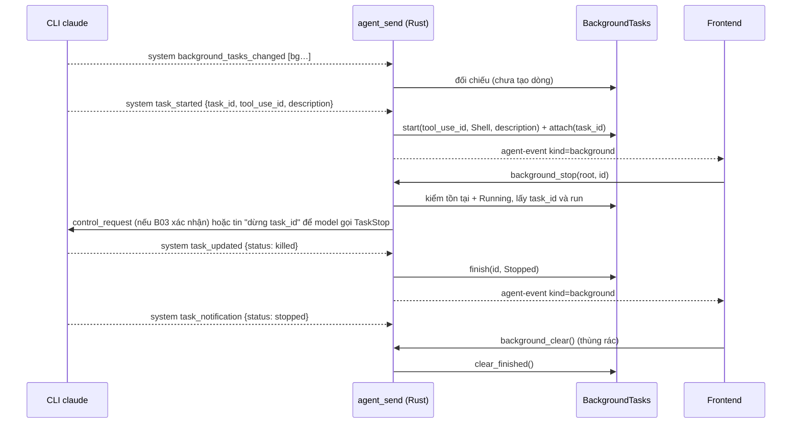
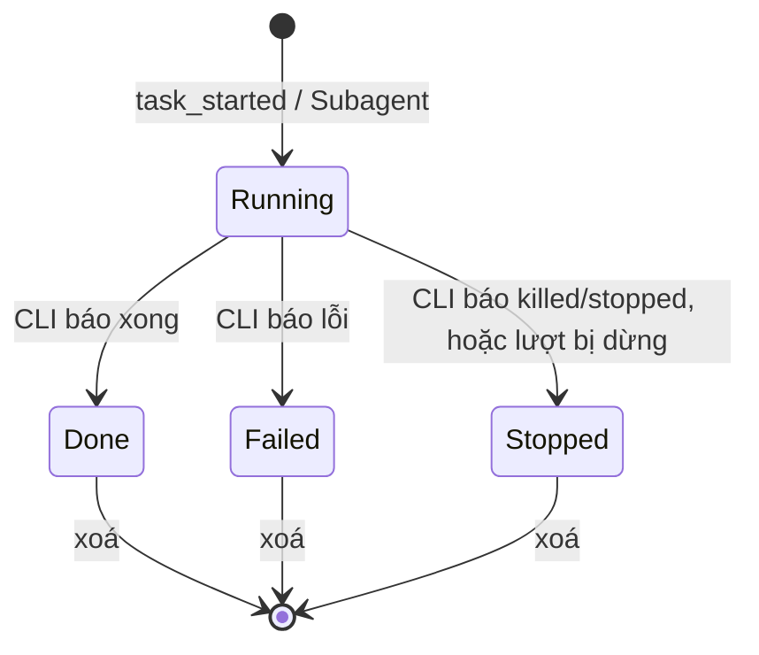
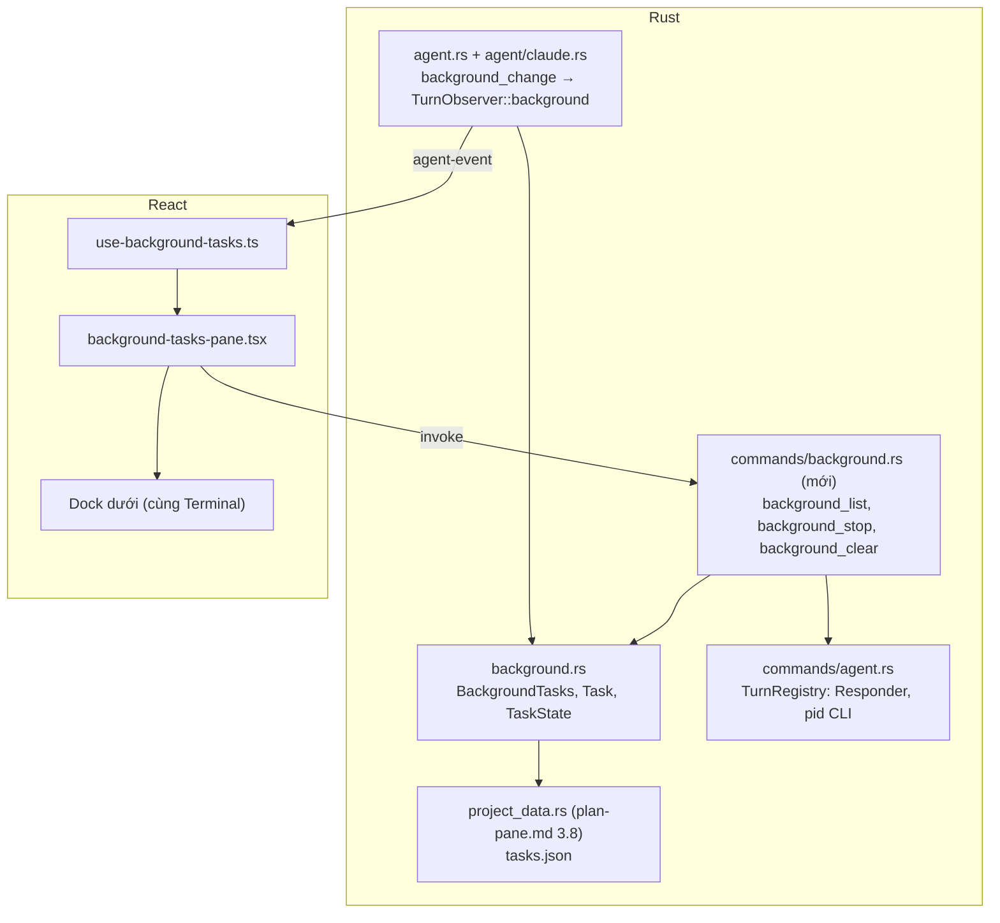
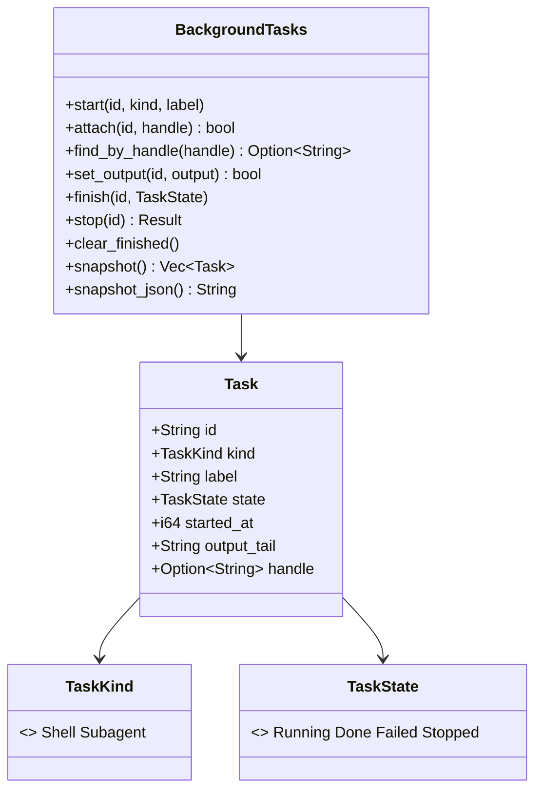

# Thiết kế: ngăn Background tasks (việc chạy nền của AI)

Trạng thái (2026-11-08): **đã có mã và test đơn vị cho toàn luồng** (B01 đã chụp CLI thật claude 2.1.319, mục 2.1; B02 `background.rs`; B03 `agent/claude_background.rs` + nối `TauriTurnObserver`; B04 `commands/background.rs` đã `manage` ở `lib.rs`, đăng ký 3 lệnh, dừng khi thoát; B05 tab "Việc chạy nền" ở dock dưới). **Chưa kiểm trên CLI thật**: vòng đời tự xong, lệnh nền sau khi CLI thoát, `stop_task`, `ps` sau khi thoát app (mục 6). Nguồn yêu cầu: ảnh chụp ngăn "Background tasks" của ứng dụng Claude do người dùng gửi ngày 2026-11-06 (tiêu đề, nút xoá, phóng to, đóng; trạng thái rỗng "Việc chạy nền hiện ở đây"; nằm ở ngăn dưới cạnh Files). Gộp chung quy ước với [plan-pane.md](./plan-pane.md) (nơi lưu theo tên dự án trong dữ liệu app, mục 3.8) và dock của [side-chat.md](./side-chat.md) mục 3.7. Căn cứ mã `[đã kiểm]`: `agent.rs` (`Event`, `TurnRequest::stream`, `Responder`), `agent/claude.rs` (`parse_line`, `turn_args`), `commands/agent.rs` (`TurnRegistry`, `agent_stop`), `terminal.rs`. `[chưa kiểm]` và `[giả định]` ghi rõ.

## 1. Phạm vi

Ngăn liệt kê **việc AI đã khởi chạy chạy nền** và cho dừng/xoá chúng:

- Lệnh shell chạy nền của AI: công cụ `Bash` với `run_in_background: true` `[đã kiểm B01]`. Bản 2.1.319 **không có** `BashOutput`/`KillShell`; dừng bằng công cụ `TaskStop {task_id}`; vòng đời đọc từ sự kiện `system` của CLI (mục 2.1).
- Sub-agent đang chạy (đã có `Event::Subagent` / `Event::SubagentDone`, hiện ở thanh bên `[đã kiểm]`): hiện cùng danh sách, trạng thái đang chạy hoặc xong.
- Mỗi dòng: tên/nhãn (description của CLI), trạng thái (đang chạy, xong, lỗi, đã dừng), thời gian bắt đầu; đầu ra gần nhất chỉ khi có (Q7: đợt này không đọc tệp đầu ra, nên dòng shell thường không có đầu ra).
- Nút **dừng** từng việc đang chạy, nút **xoá** (thùng rác) việc đã xong, phóng to, đóng; trạng thái rỗng như ảnh.

**Ngoài phạm vi (đợt này)**: tự chạy lệnh nền do người dùng gõ (đó là Terminal), lên lịch, thông báo hệ thống, Codex (xem Q1), kéo thả giữa dock, giữ/tìm pid của lệnh nền.

| ID  | Yêu cầu                                        | Tiêu chí chấp nhận                                                                                                                                                                                                                       |
| --- | ---------------------------------------------- | ---------------------------------------------------------------------------------------------------------------------------------------------------------------------------------------------------------------------------------------- |
| B1  | Mở/đóng/phóng to ngăn, nằm trong dock dưới     | Mục **Background tasks** (biểu tượng + dấu ✓ khi đang mở) trong menu `...` của thanh công cụ chat, bấm để bật/tắt; ngăn ở dock dưới cạnh Terminal/Files; phóng to và đóng như ảnh                                                        |
| B2  | Thấy việc nền AI khởi chạy theo thời gian thực | Khi CLI phát `task_started` (lệnh nền) dòng mới hiện với trạng thái đang chạy; đổi trạng thái khi CLI báo kết thúc (`task_updated` / `task_notification`)                                                                                |
| B3  | Dừng được việc nền đang chạy                   | Nút dừng gửi yêu cầu dừng `task_id` tới CLI qua lệnh Rust (control_request nếu được, không thì nhờ model gọi `TaskStop`, có ghi chi phí); thành đã dừng khi CLI báo; không gửi được thì báo lỗi `background.stop_failed`. Không dùng pid |
| B4  | Xoá việc đã kết thúc                           | Nút thùng rác xoá các dòng không còn chạy; dòng đang chạy được giữ                                                                                                                                                                       |
| B5  | Tính ở backend Rust                            | Rust dựng bảng từ sự kiện `system` của CLI; frontend chỉ vẽ, không tách việc nền từ `Event::Tool`                                                                                                                                        |
| B6  | Lưu theo tên dự án trong dữ liệu app           | Ghi `projects/<khoá-dự-án>/tasks.json`; không ghi vào thư mục dự án người dùng                                                                                                                                                           |
| B7  | Trạng thái rỗng, đa ngữ vi/en                  | Rỗng hiện biểu tượng và "Việc chạy nền hiện ở đây"; mọi chữ qua i18n                                                                                                                                                                     |
| B8  | Dọn khi lượt/ứng dụng kết thúc                 | Thoát app hoặc đóng dự án thì mọi lượt CLI còn chạy bị dừng (pid CLI trong `TurnRegistry`), việc Running chuyển đã dừng; kiểm bằng `ps` không còn tiến trình mồ côi (phụ thuộc kết quả B03 (ii))                                         |

**Điểm vào (theo ảnh chụp menu ngày 2026-11-06)**: ngăn mở từ mục "Background tasks" trong menu `...` ở thanh công cụ, dạng mục bật/tắt có dấu ✓ khi ngăn đang mở. Cùng menu đó có mục "Side chat" (✓, phím tắt) của [side-chat.md](./side-chat.md); các ngăn phụ mới (Side chat, Plan, Background tasks) dùng chung một quy ước: mục bật/tắt trong menu `...`, dấu ✓ phản ánh trạng thái, không thêm nút riêng chiếm chỗ thanh công cụ `[giả định]` (Q6).

### 1.1. Sub-agent xử lý như việc nền

Theo yêu cầu người dùng (2026-11-06), **sub-agent là một loại việc nền** (`kind = subagent`), đi chung bảng, cùng vòng đời và cùng cách lưu với lệnh nền; không còn là danh sách riêng:

- Dòng sub-agent hiện trong ngăn khi `Event::Subagent` đến (Running), chuyển Done khi `Event::SubagentDone` đến, như lệnh nền.
- Bấm dòng sub-agent mở khung xem hiện có (`subagent-view.tsx`: lời và các bước công cụ có `parent` của nó, `Event::SubText`, `Event::Tool`/`ToolResult` có `parent`); với lệnh nền thì mở đầu ra gần nhất nếu có.
- Xoá (thùng rác) và lưu `tasks.json` theo dự án áp dụng cho cả hai loại.
- **Dừng**: app không có pid riêng của sub-agent (chạy trong tiến trình CLI), nên nút dừng của dòng sub-agent dừng **cả lượt** bằng `agent_stop` và ghi rõ như vậy.
- Sub-agent có thể cũng phát `task_*` với `task_type` khác `local_bash` `[chưa kiểm, B03 (iii)]`: bảng chỉ nhận `local_bash` từ sự kiện `system`, sub-agent giữ nguồn `Event::Subagent` để không trùng dòng.
- Thanh bên hiện chỉ liệt kê sub-agent đang chạy (`PaneState.subagents`, `viewSubagent`): chuyển nguồn dữ liệu sang bảng này và để thanh bên giữ lối tắt mở khung xem, hay bỏ hẳn? Q5.

## 2. Hiện trạng

- Sub-agent đã có vòng đời (`Subagent` → `SubagentDone`) và hiện ở thanh bên `[đã kiểm]`.
- Lệnh `Bash` chạy nền do **chính CLI** quản lý (tiến trình con của `claude`) `[đã kiểm B01]`; luồng JSON **không có pid** của nó, chỉ có `task_id` (vd `bg6iuh7hi`) và `run_id` của CLI. App không thể tự giết lệnh nền; dừng phải đi qua CLI (`TaskStop`) hoặc dừng cả lượt.
- `agent_stop` gửi `kill` (SIGTERM trên Unix, chỉ pid CLI; `taskkill /T` trên Windows) tới tiến trình CLI của một lượt `[đã kiểm]`. Lệnh nền có chết theo hay không: `[chưa kiểm, B03 (ii)]`.
- stdin của CLI chỉ mở trong lượt ở chế độ "Hỏi từng việc" (`--input-format stream-json`, `Responder`); chế độ khác ghi prompt rồi đóng ngay. `Responder` đóng stdin khi có dòng `result`, để CLI thoát `[đã kiểm]`. Mọi cách gửi lệnh dừng vào CLI chỉ dùng được khi stdin còn mở.

### 2.1. Giao thức việc nền đã đo (TASK-B01, claude 2.1.319, 2026-11-07)

Chạy `claude -p --output-format stream-json --verbose` trong thư mục tạm, yêu cầu chạy `sleep 60; echo done` nền rồi dừng. Các dòng dưới đã bỏ `uuid`, `session_id` và rút gọn đường dẫn; dùng làm fixture test cho B03.

Khởi chạy (dòng `assistant` → `user`):

```json
{"type":"tool_use","name":"Bash","input":{"command":"sleep 60; echo done","description":"Run sleep then echo in background","run_in_background":true}}
{"tool_use_result":{"stdout":"","stderr":"","interrupted":false,"isImage":false,"noOutputExpected":false,"backgroundTaskId":"bg6iuh7hi"}}
```

Nội dung `tool_result`: `Command running in background with ID: bg6iuh7hi. Output is being written to: <tmp>/<session>/tasks/bg6iuh7hi.output`. Model đọc đầu ra bằng `Read` trên tệp đó (hoặc `Monitor`); không có `BashOutput`.

Dừng (model tìm công cụ deferred bằng `ToolSearch`): `TaskStop {"task_id":"bg6iuh7hi"}` → `tool_use_result` `{"message":"Successfully stopped task: bg6iuh7hi (sleep 60; echo done)","task_id":"bg6iuh7hi","task_type":"local_bash","command":"..."}`. Không có `KillShell`.

Sự kiện `system` theo đúng thứ tự đã thấy (đây là nguồn dựng bảng):

```json
{"type":"system","subtype":"background_tasks_changed","tasks":[{"task_id":"bg6iuh7hi","run_id":"0mw58aogi-78e6477f","task_type":"local_bash","description":"Run sleep then echo in background"}]}
{"type":"system","subtype":"task_started","task_id":"bg6iuh7hi","run_id":"0mw58aogi-78e6477f","tool_use_id":"toolu_01MLCRQD5dAMC3V1GEHcPF2K","description":"Run sleep then echo in background","is_backgrounded":true,"task_type":"local_bash"}
{"type":"system","subtype":"task_updated","task_id":"bg6iuh7hi","run_id":"0mw58aogi-78e6477f","patch":{"status":"killed","end_time":1793984917368}}
{"type":"system","subtype":"task_notification","task_id":"bg6iuh7hi","run_id":"0mw58aogi-78e6477f","tool_use_id":"toolu_01MLCRQD5dAMC3V1GEHcPF2K","status":"stopped","output_file":"<tmp>/<session>/tasks/bg6iuh7hi.output","summary":"Run sleep then echo in background"}
{"type":"system","subtype":"background_tasks_changed","tasks":[]}
```

Nhận xét:

- `background_tasks_changed` là danh sách **đầy đủ** việc đang chạy (rỗng khi hết) và đến **trước** `task_started`; chỉ dùng để đối chiếu, không dùng để tạo dòng (chưa có `tool_use_id`).
- `summary` của `task_notification` bằng `description`, không phải đầu ra.
- Cũng có các `system` khác không liên quan (`init`, `thinking_tokens`, `commands_changed`): bỏ qua.

**Chưa kiểm (B03 chụp bổ sung)**: (i) `status` khi lệnh nền tự xong exit 0 / exit 1 (mới thấy `killed`/`stopped`); (ii) lệnh nền có sống sau khi lượt kết thúc, khi CLI thoát, khi `agent_stop`; (iii) sub-agent có phát `task_*` không; (iv) dừng bằng `control_request` của stream-json (interrupt, hoặc loại dừng riêng một task nếu CLI nhận) mà không tốn lượt model; (v) chi phí khi nhờ model gọi `TaskStop` (số lượt, usage).

## 3. Thiết kế

### 3.1. Use case



### 3.2. Luồng dữ liệu (DFD cấp 1)



### 3.3. Trình tự: lệnh nền chạy, người dùng dừng



Lệnh nền tự xong đi cùng đường `task_updated` / `task_notification` với `status` khác (giá trị chốt ở B03 (i)). Ánh xạ: `killed`, `stopped` → Stopped; `completed` → Done, `failed` → Failed `[giả định tới B03 (i)]`; giá trị lạ bỏ qua.

### 3.4. Trạng thái một việc



### 3.5. Thành phần và lớp





Quy ước định danh (theo B01): `Task.id` = `tool_use_id` (cùng không gian id với `Event::Tool` và sub-agent); `Task.handle` = `task_id` của CLI (vd `bg6iuh7hi`), không gửi frontend, **không bao giờ là pid**. Chỗ cần chỉnh trong `background.rs` (làm ở B03/B04, B02 giữ DONE): chú thích `handle` đang ghi "shell id"; `stop()` đang đánh dấu Stopped ngay, trong khi với `kind = shell` trạng thái chỉ đổi khi CLI báo, nên cần hàm chỉ kiểm "tồn tại + Running" và trả `handle`; cần biết `run_id` của app để gửi qua đúng stdin; cần đọc các `handle` đang Running để đối chiếu `background_tasks_changed`.

### 3.6. Hợp đồng

- `Event::Background(String)`: JSON `{"tasks":[{"id","kind":"shell|subagent","label","state","startedAt","outputTail"}]}` (camelCase), phát khi bảng đổi. Giới hạn: 50 việc, `label` 200 ký tự, `outputTail` 2 000 ký tự. Biến thể thêm cuối enum, không đổi biến thể cũ.
- Nội bộ Rust (không ra frontend): `AgentCli::background_change(line)` mặc định `None` (Codex), Claude đọc 4 subtype `system` ở mục 2.1 (`task_started` chỉ khi `is_backgrounded = true` và `task_type = local_bash`); `TurnObserver::background(change)` mặc định không làm gì. Không suy ra việc nền từ `tool_use` `Bash`/`TaskStop`.
- Lệnh Tauri (đã có, đăng ký ở `lib.rs`): `background_list(root)`, `background_stop(root, id)`, `background_clear(root)`; đều qua `workspace_for(root)`. Key lỗi cố định (`background.not_found`, `background.stop_failed`). `background_stop`: id lạ → `not_found`; không Running, lượt đã hết hoặc stdin đã đóng → `stop_failed`; không tự dừng cả lượt (Q8). Phía frontend dùng `backgroundApi` ở `src/lib/api.ts`.
- Cơ chế dừng lệnh nền (Q2), **theo mã hiện tại**: `Responder::stop_task` ghi `control_request` `{"subtype":"stop_task","task_id":…}` vào stdin đang mở của lượt (không gọi model). **Chưa kiểm CLI thật có nhận `stop_task`** (B03 (iv) chưa chụp) và **chưa có nhánh dự phòng nhờ model gọi `TaskStop`** trong mã; stdin chỉ mở ở chế độ "Hỏi từng việc", chế độ khác trả `background.stop_failed`. Dòng sub-agent (không có `task_id`): `background_stop` gửi `kill` tới pid CLI của lượt rồi đánh dấu dòng đó Stopped.
- Lưu `projects/<khoá-dự-án>/tasks.json` (nơi lưu và khoá dự án theo plan-pane.md 3.8); chỉ giữ việc đã kết thúc gần đây (tối đa 50), việc đang chạy không sống sau khi app đóng.

### 3.7. An toàn

- Không chạy lệnh shell mới do app tự đặt: chỉ **theo dõi** lệnh AI đã được quyền chạy; "dừng" chỉ tác động việc đã liệt kê của đúng dự án. Tin nhờ model gọi `TaskStop` chỉ chứa `task_id` lấy từ bảng, không nhận chuỗi tự do từ frontend.
- `outputTail` có thể chứa dữ liệu nhạy cảm của lệnh; chỉ lưu ở dữ liệu app, cắt độ dài, không đưa vào logs (logs không ghi nội dung, plan-pane.md 3.8) và không gửi sang điện thoại (Q4). Tệp `output_file` ở thư mục tạm của CLI: không đọc ở đợt này (Q7).
- App không giữ pid của lệnh nền. Khi thoát app/đóng dự án: dừng mọi lượt CLI còn chạy qua `TurnRegistry`; nếu B03 (ii) cho thấy lệnh nền sống sót sau khi CLI bị dừng thì B8 chưa đạt và cần cách dọn được duyệt riêng.

## 4. Phi chức năng

- **Hiệu năng**: bảng nhỏ (≤ 50), cập nhật O(1) theo sự kiện; phát sự kiện chỉ khi bảng đổi.
- **Chi phí**: dừng qua `TaskStop` nhờ model tốn thêm lượt model (token, tiền, vài giây); dừng qua `control_request` (nếu được) không tốn.
- **Tương thích**: tên sự kiện `system` là của claude 2.1.319, không có tài liệu ổn định; giá trị lạ bị bỏ qua, không lỗi.
- **Quan hệ**: cùng sửa `parse_line`/`agent.rs` với bảng Context, Plan và refactor OOP nhóm A: làm tuần tự. Dock dưới dùng chung với Terminal (`app.tsx`, `terminalOpen`/`terminalHeight`).

## 5. Câu hỏi mở

1. Codex có việc nền tương đương trong `--json`? Mặc định: chỉ Claude đợt này (Codex chưa chụp được vì hết hạn mức).
2. "Dừng" một lệnh nền do CLI giữ. Đã quyết (2026-11-07): không có pid nên loại cách theo pid; dừng qua CLI: thử `control_request` ở B03, không được thì nhờ model gọi `TaskStop` và ghi chi phí. Cơ chế cụ thể chốt sau B03.
3. Tên công cụ và trường: **đã xác nhận** ở mục 2.1 (không có `BashOutput`/`KillShell`).
4. Điện thoại có xem việc nền? Mặc định: không.
5. Sub-agent đã đi chung bảng (mục 1.1). Thanh bên có giữ lối tắt tới sub-agent không? Mặc định: giữ lối tắt, cùng nguồn dữ liệu là bảng việc nền.
6. Mục menu `...` là điểm vào duy nhất của ngăn, hay thêm cả nút riêng trên thanh công cụ? Mặc định: chỉ mục menu (như ảnh).
7. Đầu ra gần nhất nằm ở tệp `output_file` của CLI: Rust có đọc phần cuối không? Mặc định: không đọc ở đợt này.
8. Không gửi được lệnh dừng qua CLI (stdin đã đóng): có tự dừng cả lượt không? Mặc định: không, trả `background.stop_failed`.
9. Có bật `--input-format stream-json` cho mọi chế độ để dừng được lệnh nền không (kéo theo `AskUserQuestion`/`EnterPlanMode`/`ExitPlanMode`)? Mặc định: không trong plan này.

## 6. Kiểm chứng (TASK-B06, 2026-11-08)

Lệnh: `cargo fmt --check` OK; `cargo clippy -- -D warnings` OK; `cargo test --lib` (bỏ `terminal::tests::a_shell_runs_in_a_pseudo_terminal`) 556 passed, 0 failed; `pnpm typecheck` 0 lỗi (AGENTS.md ghi 22 lỗi có sẵn nay không còn); `pnpm lint` 0 lỗi, 66 cảnh báo.

Ảnh chứng (vite + Chrome, Tauri **giả lập ở trình duyệt**: `background_list` trả dữ liệu mẫu, không có backend Rust) ở `.agents/storage/evidence/background-tasks/` (git-ignore): `menu-full.png` (menu "..." có mục Việc chạy nền), `pane-full.png` (5 dòng: lệnh Đang chạy/Xong/Lỗi/Đã dừng và sub-agent Đang chạy, nút dừng ở dòng Running, nút thùng rác), `pane-empty.png` (rỗng: biểu tượng, "Việc chạy nền hiện ở đây" + gợi ý, thùng rác bị khoá), `menu-open-*.png` (menu khi ngăn đang mở). Chỉ chứng minh phần vẽ, không chứng minh dữ liệu thật.

| AC | Kết quả | Căn cứ / lý do |
| -- | ------- | -------------- |
| B1 | Pass một phần | Ảnh: mục menu mở tab ở dock dưới cạnh Terminal/Lịch sử/Kế hoạch/Dữ liệu; có nút phóng to và đóng. **Lệch tài liệu**: menu (`panels-menu.tsx`) chỉ đặt `aria-checked`, ảnh không thấy dấu ✓ nhìn được. Chưa bấm phóng to/đóng để thử |
| B2 | Pass (test đơn vị, fixture từ B01) | `agent_claude_background.rs`, `background.rs` (`changes_drive_the_table`); `Bash` đơn lẻ không tạo việc. Tự xong exit 0/1: ánh xạ `completed`→Done, `failed`→Failed là **giả định**, chưa chụp |
| B3 | Chưa kiểm | `stop_target`/lỗi `not_found`/`stop_failed` có test mức bảng; đường `stop_task` tới CLI thật chưa chạy; không có dự phòng `TaskStop`; chi phí model chưa đo |
| B4 | Pass (test đơn vị) | `clear_finished`, `the_same_root_gives_the_same_table_and_clear_keeps_running` |
| B5 | Pass (đọc mã) | Frontend không còn `run_in_background`/`TaskStop`; danh sách chỉ từ `backgroundApi.list` + `onChange` |
| B6 | Pass một phần | Test lưu/đọc `tasks.json` (chỉ việc đã kết thúc, tệp quá lớn bị bỏ); chưa kiểm tệp thật trong dữ liệu app và thư mục dự án không đổi |
| B7 | Pass (ảnh vi) | `pane-empty.png`; bản en chưa chụp, chữ qua i18n |
| B8 | Chưa kiểm | Mã: `RunEvent::Exit` gọi `TurnRegistry::stop_all` (kill pid CLI) và `BackgroundStore::stop_all` (Running→Stopped, lưu). Chưa chạy app thật, chưa `ps`; lệnh nền có sống sau khi CLI bị kill chưa biết (mục 2.1 (ii)) |
| B9 | Pass một phần | Sub-agent đi chung bảng (start/finish trong `TauriTurnObserver::event`, đóng khi hết lượt), ảnh có dòng sub-agent; chưa bấm mở khung xem, chưa thử dừng thật |

Chạy thật chưa làm (cần `pnpm start` với claude đăng nhập): lệnh nền thật Running, dừng, tự xong, thoát app rồi `ps`.
