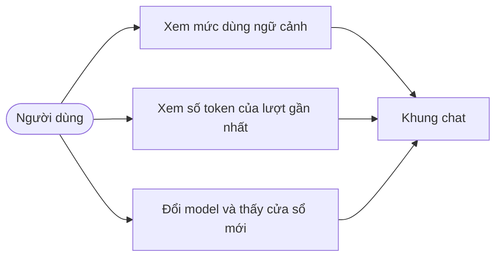
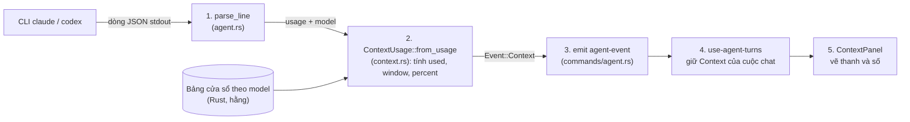
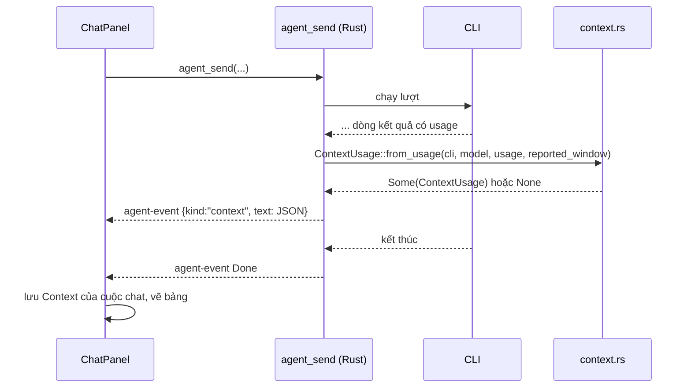
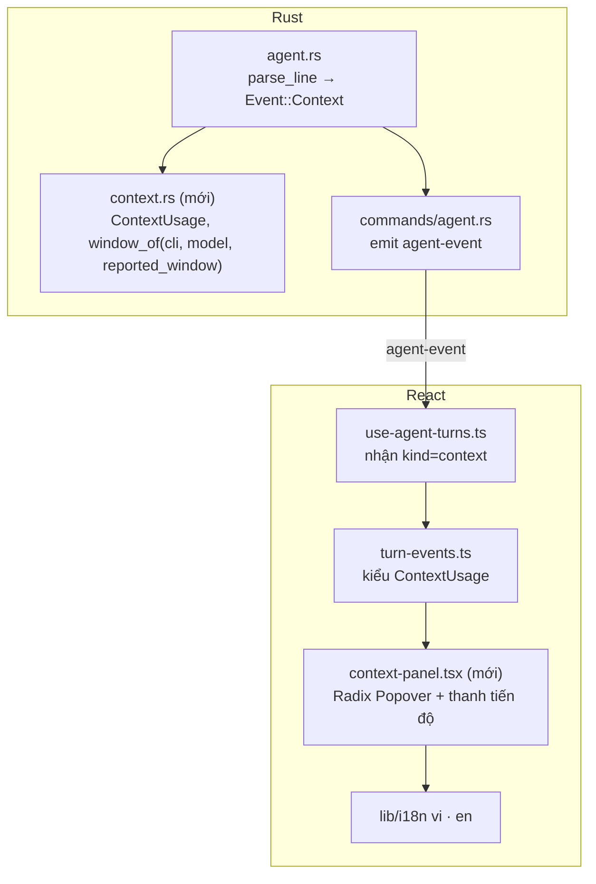
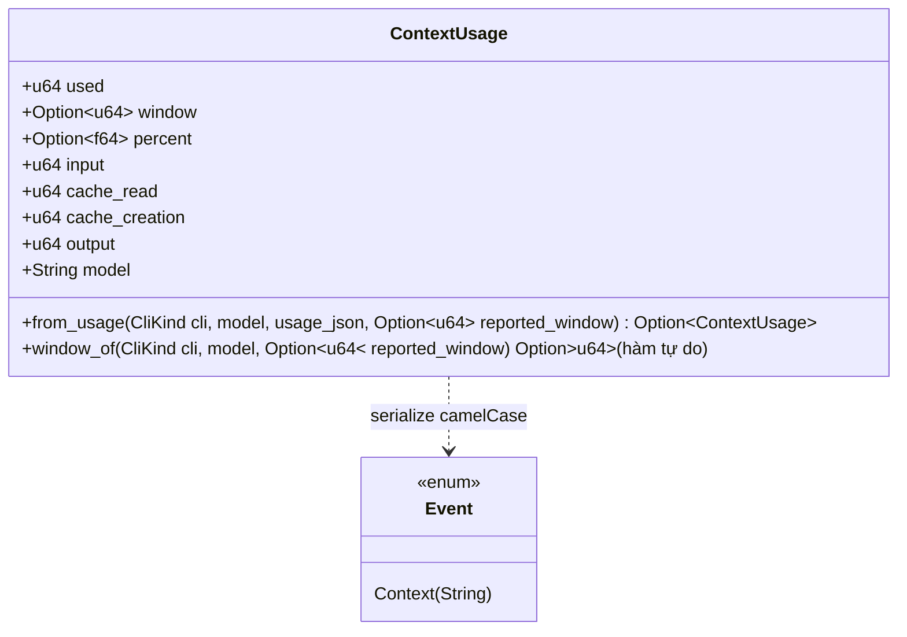

# Thiết kế: bảng Context (mức dùng ngữ cảnh của cuộc chat)

Trạng thái: **đã có mã Rust (C02, C03; Codex `[chưa kiểm]`) và đã nối frontend (`context-panel.tsx` gắn vào header `chat-panel.tsx`); phần hiển thị UI `[chưa kiểm]` (chưa chạy app), chưa đóng TASK-C06**. Nguồn yêu cầu: ảnh chụp bảng "Environment / Context" của ứng dụng Claude do người dùng gửi ngày 2026-11-06. Căn cứ mã: `src-tauri/src/agent.rs` (`parse_line`, `Event`), `commands/agent.rs`, `src/components/shell/chat/use-agent-turns.ts`, `chat-panel.tsx`. Tổng quan hệ thống: [architecture.md](./architecture.md). Ký hiệu: `[đã kiểm]` đọc được trong mã; `[chưa kiểm]` suy từ giao thức CLI, phải chạy thật để xác nhận; `[giả định]` đề xuất.

## 1. Phạm vi

Bảng nhỏ mở từ khung chat, cho người dùng thấy cuộc trò chuyện đang dùng bao nhiêu ngữ cảnh của model:

- Thanh phần trăm đã dùng và `đã dùng / cửa sổ` (ví dụ `203.9k / 400k`).
- Số token của lượt gần nhất: đầu vào, đọc từ cache, tạo cache, đầu ra.
- Tên model và CLI (`claude` hoặc `codex`) đang áp dụng.

**Ngoài phạm vi (đợt này)**:

- Tách theo loại (Messages, MCP tools, System tools, System prompt, Skills, Memory files, Custom agents, Autocompact buffer, Free space như ảnh). CLI ở chế độ `-p` không đưa số liệu này trong luồng `stream-json` đang đọc; chỉ có tổng `usage` `[chưa kiểm]`. Làm sau nếu có nguồn (câu hỏi Q1).
- Auto-compact (chọn ngưỡng, nút Compact session): là tính năng của Claude Code tương tác, ứng dụng này không điều khiển được `[chưa kiểm]` (Q2).
- Phần Environment, Remote Control, Connectors của ảnh: đã có chỗ khác hoặc không thuộc tính năng này.

| ID  | Yêu cầu                                                       | Tiêu chí chấp nhận                                                                                            |
| --- | ------------------------------------------------------------- | ------------------------------------------------------------------------------------------------------------- |
| C1  | Thấy mức dùng ngữ cảnh sau mỗi lượt                           | Sau lượt xong, bảng hiện `đã dùng / cửa sổ` và phần trăm khớp số `usage` CLI trả                              |
| C2  | Biết cửa sổ ngữ cảnh của model                                | Với Claude lấy từ kết quả CLI; với Codex dùng bảng model trong Rust; model lạ thì ẩn phần trăm, vẫn hiện số   |
| C3  | Số liệu tính ở backend Rust                                   | Frontend không tính phần trăm, không có hằng cửa sổ; chỉ vẽ giá trị backend gửi (quy ước tính năng ở backend) |
| C4  | Không đổi contract Tauri hiện có                              | Không thêm lệnh Tauri mới; chỉ thêm một biến thể `Event` đi qua `agent-event` sẵn có                          |
| C5  | Không làm hỏng lượt chat khi CLI không trả `usage`            | Thiếu `usage` thì không phát sự kiện, bảng hiện "chưa có số liệu"                                             |
| C6  | Đa ngữ vi/en, dùng component có sẵn (Radix, thanh tiến độ ui) | Mọi chữ qua i18n; không thêm thư viện                                                                         |

## 2. Dữ liệu từ CLI

Trước C03 mã bỏ qua `usage`. Nay `agent/claude.rs` và `agent/codex.rs` (trait `AgentCli`) đọc và phát `Event::Context` `[đã kiểm]`.

- **Claude** (`--output-format stream-json`) `[đã kiểm: claude 2.1.319, 2026-11-07]`: dòng `result` có `usage.{input_tokens, cache_creation_input_tokens, cache_read_input_tokens, output_tokens}` và `modelUsage.<model>.contextWindow` (ví dụ 1000000). **Cẩn thận**: `result.usage` và `modelUsage` là TỔNG qua mọi lần gọi model của lượt (lượt 3 lần gọi: cache_read 60244, trong khi lần cuối chỉ 26588), nên KHÔNG dùng để tính "đã dùng". Dùng `result.usage.iterations[-1]` (bằng `usage` của message `assistant` cuối). `contextWindow` chỉ có khi lượt kết thúc, nên bảng chỉ cập nhật cuối lượt.
- **Codex** (`exec --json`) `[chưa kiểm]`: giả định dòng `{"type":"turn.completed","usage":{input_tokens, cached_input_tokens, output_tokens}}`, không có cửa sổ và không có tên model trong dòng (nên `window`/`percent` null cho tới khi biết model từ nguồn khác). Chưa chụp được vì tài khoản bị chặn.

### 2.1. Kết quả chạy thật (TASK-C01, chạy lại 2026-11-08)

- **Claude `[đã kiểm: claude 2.1.319, 2026-11-08]`** (`claude -p "say hi" --output-format stream-json --verbose`, lượt thành công, `is_error:false`): tên trường khớp mã. Dòng `assistant`: `message.model` (chuỗi), `message.usage.{input_tokens, cache_creation_input_tokens, cache_read_input_tokens, output_tokens}` (số nguyên). Dòng `result`: `usage` cùng bốn khoá đó (tổng cả lượt) cộng `usage.iterations[]` (mỗi phần tử có bốn khoá trên và `type`), `modelUsage.<model>.{inputTokens, outputTokens, cacheReadInputTokens, cacheCreationInputTokens, contextWindow, maxOutputTokens, costUSD,...}` (camelCase; `contextWindow` = 1000000), `model_usage_since_last_result` cùng dạng. Lượt 1 lần gọi: `usage.iterations[-1]` trùng `usage` của `assistant`, nên công thức `used = input + cache_read + cache_creation` trên `iterations[-1]` đúng.
- **Codex `[chưa kiểm]`** (`codex exec --json`, không `-m`, dùng model mặc định của `~/.codex/config.toml` là `gpt-5.6-sol`): `turn.failed` / `error` với thông báo model không hỗ trợ tài khoản ChatGPT. Dòng thật thấy được: `thread.started`, `item.completed` (`item.type:"error"`), `turn.started`, `error`, `turn.failed{error.message}`. Chưa có `turn.completed`, chưa thấy `usage`; tên trường Codex vẫn là giả định. Cần model mặc định được hỗ trợ (đổi `model` trong config của người dùng) rồi chạy lại.
- Mã phải chịu được `result` lỗi có `usage` toàn 0 (không phát `Event::Context` khi mọi số bằng 0, hợp với C5).
- Mẫu Claude đã lưu: `src-tauri/src/agent/fixtures/claude-result-*.jsonl`.

**Mức đã dùng** = `input_tokens + cache_read + cache_creation` của lần gọi model CUỐI trong lượt (`usage.iterations[-1]`; đầu ra tính vào lượt kế) `[đã kiểm với Claude]`. Công thức nằm một chỗ ở Rust (`context.rs`), có test.

## 3. Thiết kế

### 3.1. Use case



### 3.2. Luồng dữ liệu (DFD cấp 1)



### 3.3. Trình tự một lượt



### 3.4. Trạng thái của bảng

```mermaid
stateDiagram-v2
    [*] --> Empty: mở cuộc chat chưa có lượt
    Empty --> Known: nhận Event::Context
    Known --> Known: lượt mới có usage
    Known --> Empty: chuyển sang cuộc chat khác chưa có số liệu
    Known --> Unknown: đổi model chưa có số liệu mới
    Unknown --> Known: lượt kế có usage
```

### 3.5. Thành phần (Component) và lớp





### 3.6. Dữ liệu và lưu trữ (ERD)

Đợt này **không đổi DB**: `ContextUsage` chỉ nằm trong bộ nhớ của frontend theo cuộc chat; mở lại cuộc chat cũ thì bảng hiện "chưa có số liệu" tới lượt kế. Không thêm bảng hay cột nên không có sơ đồ ERD mới. Lưu theo cuộc chat (cột trên `chat_turns` hoặc `conversation_sessions`) là Q3; nếu chọn thì phải thêm bằng `add_column_if_missing` trong `db.rs` kèm test di trú, tránh lặp lỗi cột `steps`.

### 3.7. Hợp đồng sự kiện

`Event::Context(String)` mang JSON (camelCase): `{"used":203900,"window":400000,"percent":51.0,"input":..,"cacheRead":..,"cacheCreation":..,"output":..,"model":".."}`; `window` và `percent` là `null` khi không biết cửa sổ. Serde của `Event` đã là `tag = "kind"`, `content = "text"`, lowercase nên frontend nhận `kind: "context"`. `remote.rs` chuyển tiếp mọi `agent-event` cho điện thoại; điện thoại bỏ qua kind lạ `[chưa kiểm]` (Q4).

## 4. Phi chức năng và an toàn

- **An toàn**: chỉ số, không chứa nội dung chat; không thêm quyền, không thêm lệnh.
- **Hiệu năng**: một lần parse JSON đã có sẵn cho mỗi dòng; thêm O(1) khi gặp dòng `result` hoặc `turn.completed`.
- **Lỗi**: dùng key cố định như phần còn lại; ở đây không phát lỗi, thiếu số liệu thì im lặng (C5).
- **Quan hệ với refactor OOP** ([plan](../plans/oop-refactor-backend-20261106.json)): `agent.rs` thuộc nhóm A; tính năng này nên làm sau TASK-003 hoặc đưa vào `ClaudeAgent`/`CodexAgent` để không xung đột file.

## 5. Câu hỏi mở

1. Có nguồn nào cho số theo loại (MCP tools, system prompt...)? Mặc định: không làm đợt này.
2. Có cần nút Compact/auto-compact? Mặc định: không (không điều khiển được từ `-p`).
3. Lưu `ContextUsage` theo cuộc chat vào DB? Mặc định: không.
4. Điện thoại có cần xem bảng? Mặc định: không.
5. (Đã thử 2026-11-06, CHƯA xác nhận được, xem mục 2.1) Cần chụp một dòng `result` (Claude) và `turn.completed` (Codex) thật để chốt tên trường và công thức `used`. Mặc định: chạy một lượt thật trước khi code.

## 6. Kiểm chứng (TASK-C06, 2026-11-08)

**Đã kiểm (đã chạy, có bằng chứng)**:

- `cargo fmt --check`: sạch. `cargo clippy -- -D warnings`: sạch. `cargo test --lib` (bỏ `terminal::tests::a_shell_runs_in_a_pseudo_terminal`): 556 passed, 0 failed.
- `pnpm typecheck`: 0 lỗi. `pnpm lint`: 0 error, 66 warning (không có warning nào ở tệp context-panel).
- Đọc mã: `src-tauri/Cargo.toml`, `db.rs`, `lib.rs` (`generate_handler!`) không có thay đổi trong `git status`; `context.rs` có test ở `src-tauri/tests/unit/context.rs`; `context-panel.tsx` chỉ làm tròn và kẹp 0..100 từ `percent` của backend, không có hằng cửa sổ (C3, C4).
- Claude: tên trường và công thức `used` khớp lượt thật (mục 2.1).

**Chưa kiểm**:

- Giao diện: chưa chạy `pnpm start` (ChatPanel cần backend Tauri, chưa có Playwright MCP), chưa có ảnh chứng; C1 (số trong bảng khớp `usage` ở một lượt thật), C6 (i18n, giao diện) chưa đóng.
- Codex: vẫn `[chưa kiểm]` vì tài khoản không chạy được model, chưa thấy `turn.completed`.
- `architecture.md`: chưa thêm `Event::Context` vào danh sách sự kiện.

**Vấn đề mở**: `ContextPanel` ở header `chat-panel.tsx` và khối Context trong `session-rail.tsx` (popup mở bằng `railOpen`) cùng đọc một nguồn `context`; khi popup mở thì cùng hiện hai nơi. Chờ quyết định giữ nơi nào.
