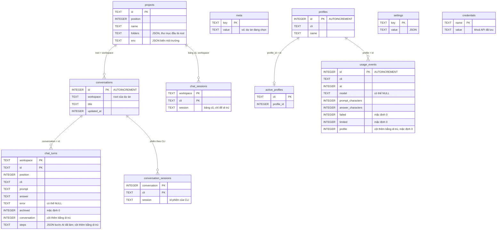

# Thiết kế cơ sở dữ liệu Codexis IDE

Một file SQLite duy nhất (`rynox.db`) trong thư mục dữ liệu của app; đổi đường dẫn bằng biến môi trường `RYNOX_DB`. Tài liệu vẽ từ mã nguồn (`db.rs`, `chats.rs`, `projects.rs`, `profiles.rs`, `usage.rs`, `credentials.rs`, `settings.rs`), chưa đối chiếu bằng chạy app. Tổng quan hệ thống: [architecture.md](./architecture.md).

## 1. Sơ đồ ERD

**Không khai báo `FOREIGN KEY`**: các đường nối là quan hệ logic do mã duy trì, nên khi xoá một dòng cha mã phải tự xoá dòng con.

## 2. Bảng, chủ sở hữu và mục đích

| Bảng                    | Module sở hữu          | Mục đích                                                      | Khoá chính            |
| ----------------------- | ---------------------- | ------------------------------------------------------------- | --------------------- |
| `projects`              | `projects.rs`, `db.rs` | Danh sách dự án đã lưu, thư mục và biến môi trường của dự án  | `id`                  |
| `meta`                  | `db.rs`                | Cặp khoá/giá trị nhỏ (dự án đang chọn)                        | `key`                 |
| `conversations`         | `db.rs`, `chats.rs`    | Một cuộc trò chuyện của một dự án                             | `id`                  |
| `chat_turns`            | `db.rs`, `chats.rs`    | Từng lượt hỏi đáp, kể cả các bước AI đã làm                   | `(workspace, id)`     |
| `conversation_sessions` | `db.rs`, `chats.rs`    | Id phiên của từng CLI trong một cuộc trò chuyện (để nối tiếp) | `(conversation, cli)` |
| `chat_sessions`         | `db.rs`                | Bảng cũ theo dự án, chỉ còn để di trú                         | `(workspace, cli)`    |
| `profiles`              | `profiles.rs`          | Tài khoản của từng CLI (mỗi cái một thư mục hồ sơ)            | `id`                  |
| `active_profiles`       | `profiles.rs`          | Tài khoản đang dùng của mỗi CLI                               | `cli`                 |
| `usage_events`          | `usage.rs`             | Thống kê mỗi lượt: chỉ độ dài, không lưu nội dung             | `id`                  |
| `settings`              | `settings.rs`          | Cài đặt người dùng dạng JSON                                  | `key`                 |
| `credentials`           | `credentials.rs`       | Khoá API đã lưu (truyền cho `claude` khi chat)                | `name`                |

## 3. Chỉ mục

- `usage_events_cli_at` trên `usage_events (cli, at)`: phục vụ thống kê theo CLI và khoảng thời gian.
- Các khoá chính ghép (`chat_turns`, `conversation_sessions`, `chat_sessions`) đồng thời là chỉ mục tra cứu theo dự án hoặc theo cuộc trò chuyện.
- Chưa có chỉ mục phụ cho `chat_turns.conversation` hay `conversations.workspace`; với lượng dữ liệu cục bộ hiện tại chưa phải điểm nghẽn, nhưng nên đo trước khi thêm.

## 4. Di trú

`db.rs` chạy mỗi lần mở file, an toàn khi chạy lại:

- `CREATE TABLE IF NOT EXISTS` cho toàn bộ bảng của `db.rs`; `usage.rs`, `profiles.rs`, `settings.rs`, `credentials.rs` tự tạo bảng của mình theo cách đó.
- `add_column_if_missing` thêm cột `archived`, `conversation` và `steps` vào `chat_turns`, và `profile` vào `usage_events`.
- `group_old_turns` gom lượt chat cũ (trước khi có `conversations`) vào một cuộc trò chuyện mỗi dự án.
- File không phải database được chuyển thành `*.corrupt` rồi tạo file mới; nếu vẫn không mở được, app chạy bằng DB trong bộ nhớ.

## 5. Quyền truy cập và bảo mật dữ liệu

- File DB chỉ chủ sở hữu đọc được (`0o600` trên Unix) vì chứa khoá API và biến môi trường dự án.
- Nội dung chat (`prompt`, `answer`) chỉ nằm ở `chat_turns`; `usage_events` chỉ lưu độ dài, không lưu nội dung.
- Mật khẩu và token đăng nhập của CLI không bao giờ vào DB: `profiles` chỉ lưu tên và id, thư mục hồ sơ do chính CLI quản lý.
- Frontend không truy cập DB trực tiếp; chỉ qua lệnh Tauri của từng store (`projects_*`, `chat_*`, `profile*`, `usage_*`, `settings_*`, `credential_*`).

## 6. Giả định và giới hạn

- Quan hệ trong ERD suy ra từ tên cột và truy vấn, không có khoá ngoại thật; việc xoá lan (ví dụ xoá dự án thì cuộc trò chuyện và lượt chat ra sao) chưa được tôi đọc hết trong thân hàm.
- `credentials.value` được mô tả theo comment của mã nguồn; tôi chưa kiểm xem có mã hoá hay không.
- `chat_sessions` ghi là bảng cũ theo ý tài liệu trước và tên bảng; chưa xác minh mã còn ghi vào nó hay không.
