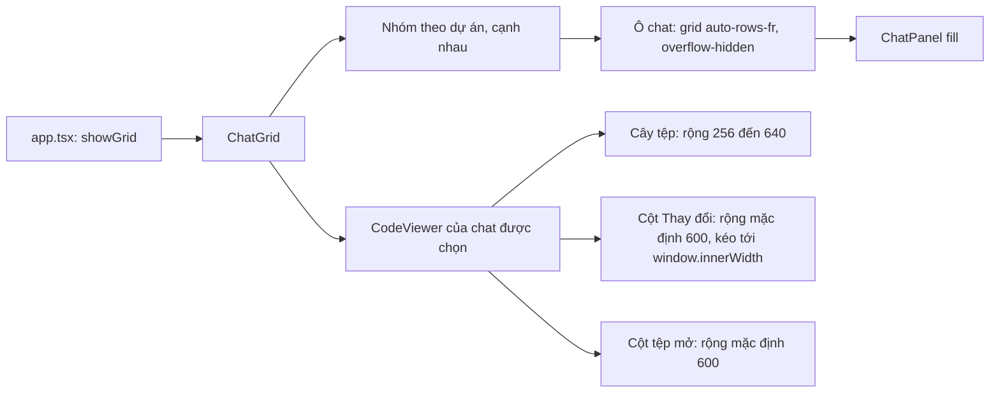

# Thiết kế: bố cục chế độ group (chat grid) không chồng khung

Trạng thái: **đang làm** (đợt 1 đã sửa, chờ kiểm tra bằng ảnh thật; các đợt sau chưa làm). Nguồn yêu cầu: ảnh chụp ngày 2026-11-08, cột "Thay đổi" bị chữ của khung khác đè lên khi dùng group hoặc khi kéo cột rộng. Căn cứ mã `[đã kiểm]`: `src/components/shell/chat-grid.tsx`, `src/components/ai-chat/code-viewer.tsx`, `src/components/ai-chat/code-viewer/{changes-panel,use-panel-widths,constants}.ts*`, `src/components/shell/dock-layout.tsx`, `src/hooks/use-resizable-width.ts`. `[giả định]`: nguyên nhân chính là bề rộng đã lưu của cột không co lại; chưa tái hiện bằng ảnh trên app thật.

## 1. Phạm vi

- Chế độ group (`ChatGrid`): tối đa 4 chat (`MAX_GRID`), chia theo dự án; các tệp của chat được chọn nằm bên phải (`CodeViewer`: cây tệp, cột Thay đổi hoặc cột tệp mở).
- Mục tiêu: dù cửa sổ hẹp, ô group nhỏ hay cột bị kéo rộng, không khung nào vẽ đè lên khung khác; chat không bị ép về bề rộng không dùng được.
- Ngoài phạm vi: đổi cách chia ô của group, đổi vị trí ngăn dock, logic của chat.

| ID  | Yêu cầu                                      | Tiêu chí chấp nhận                                                                                      |
| --- | -------------------------------------------- | ------------------------------------------------------------------------------------------------------- |
| G1  | Cột Thay đổi và cột tệp mở co theo chỗ trống | Bề rộng đã lưu chỉ là mong muốn; chỗ trống nhỏ hơn thì cột co lại, không tràn sang chat                 |
| G2  | Chat trong group luôn dùng được              | Mỗi ô chat giữ bề rộng tối thiểu dùng được; thiếu chỗ thì cột tệp co trước, không đè lên ô chat         |
| G3  | Bề rộng đã lưu không phá bố cục              | Bề rộng lưu từ lúc cửa sổ lớn được kẹp lại theo chỗ trống hiện tại, không ghi đè giá trị đã lưu         |
| G4  | Có kiểm chứng bằng ảnh                       | Chụp ảnh ba cỡ: group 2 chat, group 4 chat, một chat với cột kéo rộng; không có khung nào đè khung khác |

## 2. Bố cục hiện tại

Điểm gây lỗi `[giả định]`: ô chat đã có `overflow-hidden` nên không tràn, còn cột Thay đổi và cột tệp mở có bề rộng cố định (`style width`) và `shrink-0` nên không co khi chỗ trống nhỏ; `max-w-full` chỉ tính theo cha, không trừ cây tệp. Cột tràn ra và đè lên vùng khác.

## 3. Hướng sửa

1. **Đợt 1 (đã làm, CHO_KIEM_TRA)**: cột Thay đổi và cột tệp mở dùng `shrink` thay `shrink-0`, có `min-w-0` sẵn, nên co theo chỗ trống.
2. **Đợt 2 (đã làm, CHO_KIEM_TRA)**: kẹp bề rộng lưu theo chỗ trống của vùng chứa (không theo `window.innerWidth`) trong `use-panel-widths.ts`, không ghi đè giá trị đã lưu.
3. **Đợt 3 (đã làm, CHO_KIEM_TRA)**: bề rộng tối thiểu cho ô chat trong group; khi tổng nhỏ nhất vượt chỗ trống thì cột tệp thu về tối thiểu trước.
4. **Đợt 4 (đã làm, CHO_KIEM_TRA)**: kiểm chứng bằng ảnh thật ba cỡ ở G4.

## 4. Rủi ro và câu hỏi mở

- Chưa tái hiện được lỗi bằng ảnh trên app thật (Playwright MCP thiếu `npx`; trình duyệt chạy vite không có backend Tauri), nên đợt 1 chưa chắc đã đủ.
- Câu hỏi mở: có cần cho cột co về 0 hay giữ một bề rộng tối thiểu và cuộn ngang?

## 5. Bằng chứng kiểm chứng (2026-11-08)

Cách chụp: trang chạy trên vite với lệnh Tauri giả (`__TAURI_INTERNALS__`), Playwright + Chrome; không phải app Tauri thật. Ảnh nằm ở `docs/plans/group-layout-20261108/evidence/` (trong `docs/` để trang chi tiết plan đọc được, vì `workspace` chặn thư mục `storage`); script chụp `chup-anh.mjs` ở `e2e/group-layout/`.

| Ca                                      | Ảnh                                                    | Kết quả                                                       |
| --------------------------------------- | ------------------------------------------------------ | ------------------------------------------------------------- |
| Group 2 chat, 1906px, cột Thay đổi mở   | `docs/plans/group-layout-20261108/evidence/g2wide.png` | Hai ô chat nằm trọn, khung tệp chiếm một bên, không đè        |
| Group 4 chat, 1100px, cột Thay đổi mở   | `docs/plans/group-layout-20261108/evidence/g4wide.png` | Bốn ô chat nằm trọn; cột Thay đổi co gần hết, chỉ còn cây tệp |
| 1 chat, 1100px, cột Thay đổi lưu 1400px | `docs/plans/group-layout-20261108/evidence/wide.png`   | Cột co lại, chat vẫn thấy                                     |

Lỗi trước khi sửa (tái hiện cùng cách chụp): ở group 2 chat 1906px, khung tệp nổi đè lên ô chat 2; chưa lưu ảnh "trước". Sửa ở `changes-panel.tsx`, `code-viewer.tsx` (đợt 1) và `chat-grid.tsx` (đợt 3: ô chat tối thiểu 288px, khung tệp tối thiểu 320px). `pnpm typecheck` 0 lỗi, prettier và eslint sạch trên `chat-grid.tsx`.

Đợt 2 (`use-resizable-width.ts` nhận `max` là hàm; `use-panel-widths.ts` kẹp theo chỗ trống): ảnh `docs/plans/group-layout-20261108/evidence/wide-g02.png`, 1100px, bề rộng lưu 1400px, cột co lại và chat dùng được. Chưa kiểm: app Tauri thật, kéo đổi cỡ cửa sổ lúc đang chạy. Câu hỏi mở về cột co về 0 vẫn còn.
