# Thiết kế: language server (LSP) dùng chung extension VS Code

Trạng thái: **Thiết kế cho TASK-001, chờ người dùng duyệt (2026-11-07). Chưa có mã.** Plan nguồn: [`docs/plans/lsp-extensions-20261107/plan.json`](../plans/lsp-extensions-20261107.json) (r3). Liên quan: [architecture.md](./architecture.md) mục 3 (cấu trúc mã), mục 6 (permission); [background-tasks.md](./background-tasks.md) (mẫu tài liệu, mẫu dừng tiến trình khi thoát app).

Nhãn căn cứ: `[đã kiểm]` = đã đọc trong mã/đã khảo sát máy ngày 2026-11-07 (mục `machineSurvey` của plan); `[giả định]` = chọn để thiết kế, coder xác minh ở task ghi kèm; `[chưa kiểm]` = chưa có bằng chứng, không được coi là đúng.

Mã đã đọc làm căn cứ `[đã kiểm]`: `src-tauri/src/terminal.rs` (session theo id, giới hạn, luồng đọc, `emit`, `kill` khi đóng), `background.rs` (bảng trạng thái có khoá, cắt chuỗi, `stop_all_running`), `workspace.rs` (`normalise`, `denied`, `MAX_WRITE_BYTES = 100_000`, `write` có `expected`, `*_for_viewer`), `permission.rs` (`PathPolicy`, `Guarded`, `Unguarded`, `Sandbox`), `settings.rs` (`SettingsStore`, một dòng JSON trong bảng `settings`, `sanitized`), `commands/state.rs` (`AppState::workspace_for`, `remove_project`), `commands/mod.rs` (`blocking`), `commands/terminal.rs`, `commands/projects.rs`, `formatter.rs` (`Command::new` trực tiếp, luồng ghi stdin riêng, lỗi không chặn lưu), `agent.rs` (`TurnRequest::spawn` qua `cli::command`, `TurnObserver`), `commands/agent.rs` (`TurnRegistry::stop_all`, `kill`), `cli.rs` (`locate`, `EXTRA_BIN_DIRS`), `lib.rs` (`setup`, `invoke_handler`, `RunEvent::Exit`), `migrations.rs` + `0004_create_settings_table.sql`, `src/lib/invoke.ts`, `src/lib/ide-tools.ts`, `src/lib/ide.ts` (`listen`), `src/components/shell/settings-dialog.tsx`, `settings-tabs/tool-table.tsx`, `src/components/ai-chat/monaco-setup.ts`.

## 0. Quyết định đã chốt

Người dùng nói "làm luôn" ngày 2026-11-07, tức duyệt các mặc định của plan:

| Câu hỏi | Quyết định                                                                                                                                           | Ảnh hưởng thiết kế                                                                       |
| ------- | ---------------------------------------------------------------------------------------------------------------------------------------------------- | ---------------------------------------------------------------------------------------- |
| Q1      | Tự viết cầu nối LSP ↔ Monaco, **không** dùng `monaco-languageclient`                                                                                 | `package.json` không đổi; mục 9                                                          |
| Q2      | Phương án A: G-download gọi `curl`/`tar`/`unzip`/`gunzip` hệ thống trực tiếp (không shell, không crate mới); **nhóm G-download làm sau giai đoạn 1** | `Cargo.toml` không đổi ở cả hai giai đoạn; mục 12 chỉ là phác thảo cho TASK-014..016     |
| Q5      | Bảng tab Extensions dùng `ToolTable` có sẵn (`settings-tabs/tool-table.tsx`)                                                                         | Không tạo DataTable; mục 10                                                              |
| Q11     | C# dùng **csharp-ls** (MIT; PATH, `~/.dotnet/tools`, sau này G-download). **Không** dùng Roslyn trong extension Microsoft                            | Không quét `ms-dotnettools.*`; phần Roslyn của TASK-012 bỏ                               |
| Q12     | Quét cả 4 gốc: VS Code, Insiders, Cursor, VSCodium; chỉ đọc                                                                                          | `EXTENSION_ROOTS` cố định 4 mục; mục 3.1                                                 |
| BR-05   | Mọi server mặc định **tắt**                                                                                                                          | Không có tiến trình nào chạy khi người dùng chưa bật; tắt hết = hành vi hiện tại (AC-15) |

Còn mở (không chặn giai đoạn 1): Q3, Q4, Q6, Q7, Q8, Q9, Q10, Q13; xem mục 16.

## 1. Bài toán và phạm vi

**Mục tiêu**: trình soạn Monaco của Codexis có lỗi, gợi ý, hover, gợi ý tham số, đi tới định nghĩa, đổi tên, format cho Rust, PHP (Laravel), C#, bằng chính language server người dùng đã cài qua extension VS Code (dự phòng: PATH), do backend Rust điều khiển; frontend chỉ vẽ và nối Monaco (memory `feedback_features-in-rust-backend`).

**Actor**: Người dùng desktop (soạn code, mở tab Extensions); Language server (tiến trình con, không tin cậy hoàn toàn); VS Code và bản phái sinh (chỉ là nơi chứa file trên đĩa, Codexis không gọi chúng).

**Trong phạm vi giai đoạn 1**: quét chỉ đọc 4 gốc extension; danh mục 3 server; dò PATH + Node; trình quản lý tiến trình stdio JSON-RPC; lưu cấu hình; 11 lệnh Tauri + 2 sự kiện; cầu nối Monaco cho `rust`, `php`, `csharp`; tab Extensions.

**Ngoài phạm vi**: extension host/VSIX, chạy JavaScript của extension (`main`, `activationEvents`, script); cài/cập nhật/ghi thư mục extension; Roslyn; Blade (`*.blade.php`); semantic tokens, code action, code lens, inlay hint, references, workspace symbols, DAP; đa-root/worktree (chỉ `folders[0]`); Windows; tải về (G-download, giai đoạn sau); thêm dependency.

### 1.1. Yêu cầu phi chức năng (giá trị khởi đầu, `[giả định]` BR-07)

Không có số đo traffic/latency thật; các giới hạn dưới đây là trần an toàn, không phải cam kết hiệu năng.

| Thông số                             | Giá trị                                                   | Lý do                                                                    |
| ------------------------------------ | --------------------------------------------------------- | ------------------------------------------------------------------------ |
| Kích thước một message JSON-RPC      | ≤ 16 MiB (`MAX_MESSAGE_BYTES`)                            | Kiểm trước khi cấp phát bộ đệm (AC-03)                                   |
| Kích thước một tài liệu gửi server   | ≤ `workspace::MAX_WRITE_BYTES` (100 000 byte) `[đã kiểm]` | Cùng trần với lưu file trong viewer; file lớn hơn không có tính năng LSP |
| Timeout request                      | 10 s; `initialize` 60 s; `shutdown` 3 s rồi kill          | BR-07                                                                    |
| Số server chạy cùng lúc              | ≤ 8 (mọi project cộng lại)                                | RAM: rust-analyzer có thể dùng hàng GB                                   |
| Khởi động lại tự động                | ≤ 3 lần trong 3 phút, chờ 1 s × lần thứ n                 | Quá → `Error`                                                            |
| Log mỗi (root, server)               | 500 dòng, mỗi dòng ≤ 2 000 ký tự                          | Vòng (ring), sống qua restart                                            |
| Kiểm `--version` của binary PATH     | 5 s, kill khi quá                                         | Proxy rustup có thể in lỗi thay vì chạy                                  |
| Đọc `package.json`/`extensions.json` | ≤ 1 MiB mỗi file                                          | BR-09                                                                    |
| Diagnostics mỗi file                 | ≤ 1 000                                                   | Chặn payload sự kiện quá lớn `[giả định]`                                |
| Mục completion trả frontend          | ≤ 2 000 (cắt thì `isIncomplete = true`)                   | `[giả định]`                                                             |

### 1.2. Truy vết yêu cầu → thành phần

| ID     | Yêu cầu (tóm tắt)                                                 | Ưu tiên | Tiêu chí chấp nhận | Thành phần đáp ứng (mục)                                                          |
| ------ | ----------------------------------------------------------------- | ------- | ------------------ | --------------------------------------------------------------------------------- |
| REQ-01 | Vòng đời server theo (root, id), restart giới hạn, dọn tiến trình | P0      | AC-01, AC-02       | `language_server.rs` (6, 7), `lib.rs` Exit, `projects_remove`                     |
| REQ-02 | JSON-RPC Content-Length an toàn, timeout, tương quan id           | P0      | AC-03, AC-04       | `language_server_protocol.rs` (5.1), `Session` (5.3)                              |
| REQ-03 | Chỉ chạy file đã ánh xạ, không shell, sandbox URI                 | P0      | AC-05              | `language_server_catalog.rs` (3.3), `path_to_uri`/`uri_to_path` (5.4), ma trận 11 |
| REQ-04 | Nguồn: VS Code → PATH → bản tải; hướng dẫn cài                    | P0      | AC-06              | `language_server_catalog.rs::resolve` (3.5)                                       |
| REQ-05 | didOpen/didChange/didSave/didClose, UTF-16, giữ xuống dòng        | P0      | AC-07              | `Document` mirror (5.5), `use-language-server.ts` (9)                             |
| REQ-06 | Diagnostics → marker                                              | P1      | AC-08              | sự kiện `language-server-diagnostics` (8.3), `language-client.ts`                 |
| REQ-07 | Completion, hover, signatureHelp                                  | P1      | AC-09              | `language_server_request` (8.2), provider Monaco (9)                              |
| REQ-08 | Đi tới định nghĩa                                                 | P1      | AC-10              | `kind = definition` (8.2), `code-viewer.tsx`                                      |
| REQ-09 | Đổi tên có xác nhận                                               | P1      | AC-11              | `kind = rename` + `language_server_apply_edit` (7.6, 8.2)                         |
| REQ-10 | Format bằng server                                                | P1      | AC-12              | `kind = formatting` (8.2)                                                         |
| REQ-11 | Tab Extensions                                                    | P1      | AC-13              | `extensions-tab.tsx` (10), `language_server_list/configure/log`                   |
| REQ-12 | Đợt 1: Rust, PHP, C# (csharp-ls)                                  | P1      | AC-14              | danh mục (3.3)                                                                    |
| REQ-13 | Không phá hành vi cũ, không dependency                            | P0      | AC-15              | mặc định tắt, provider chỉ cho model đã đăng ký (9)                               |
| REQ-14 | Quét chỉ đọc 4 gốc, semver, `.obsolete`, nền tảng                 | P0      | AC-16              | `vscode_extensions.rs` (3.1, 3.2)                                                 |
| REQ-15 | Tải dự phòng có xác nhận (giai đoạn sau)                          | P2      | AC-17, AC-18       | `language_server_download.rs` (12, phác thảo)                                     |

## 2. Kiến trúc tổng thể (HLD)

### 2.1. Use case

**Nguồn**: REQ-01..REQ-15. **Trạng thái**: thiết kế (chưa có mã). Mermaid không có kiểu use case riêng nên vẽ bằng `flowchart`.

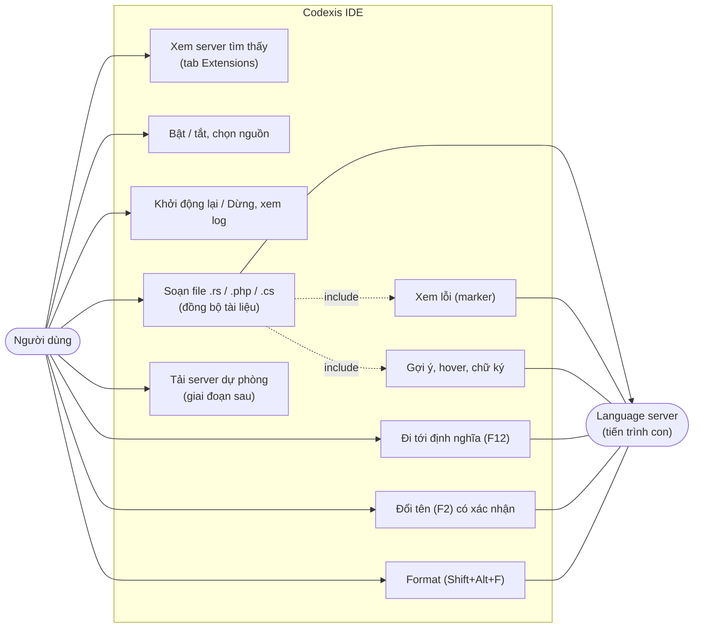

### 2.2. Sơ đồ thành phần

**Nguồn**: module hiện có `[đã kiểm]` (`AppState`, `Workspace`, `Sandbox`, `SettingsStore`, `cli::locate`, `commands::blocking`, `invoke.ts`); module mới `[thiết kế]`.

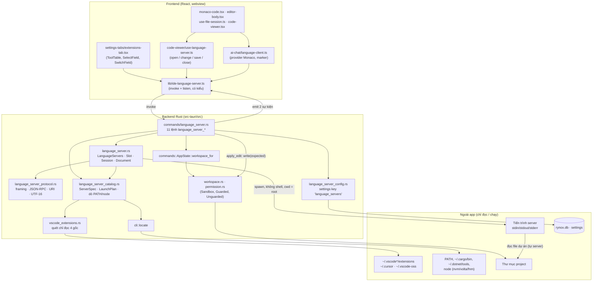

### 2.3. Module mới và trách nhiệm

| File (mới)                                                  | Trách nhiệm                                                                                                                                                       | Không làm                     | Task     |
| ----------------------------------------------------------- | ----------------------------------------------------------------------------------------------------------------------------------------------------------------- | ----------------------------- | -------- |
| `src-tauri/src/language_server_protocol.rs`                 | `MessageReader` (bộ đệm + Content-Length + giới hạn), `write_message`, kiểu JSON-RPC, `path_to_uri`/`uri_to_path`, đổi vị trí Monaco ↔ LSP, `apply_change` UTF-16 | Tiến trình, Tauri             | TASK-002 |
| `src-tauri/src/vscode_extensions.rs`                        | Quét chỉ đọc 4 gốc dưới HOME, đọc `.obsolete`/`extensions.json`/`package.json`, semver, nền tảng, canonicalize                                                    | Chạy bất cứ gì; ghi bất cứ gì | TASK-003 |
| `src-tauri/src/language_server_catalog.rs`                  | Danh mục `ServerSpec` (hằng), dò PATH/node, kiểm bit thực thi, dựng `LaunchPlan`, chọn nguồn                                                                      | Spawn server                  | TASK-003 |
| `src-tauri/src/language_server_config.rs`                   | `LanguageServerConfigStore`: đọc/ghi JSON settings key `language_servers`, `sanitized`                                                                            | Migration, bảng mới           | TASK-004 |
| `src-tauri/src/language_server.rs`                          | `LanguageServers` (state Tauri): slot theo (root, id), spawn, luồng đọc/ghi, pending + timeout, restart, mirror tài liệu, dựng params, chuyển kết quả             | Lệnh Tauri, UI                | TASK-005 |
| `src-tauri/src/commands/language_server.rs`                 | 11 lệnh mỏng: kiểm tham số, `workspace_for`, gọi `LanguageServers`, đổi lỗi thành khoá                                                                            | Logic giao thức               | TASK-006 |
| `src/lib/ide-language-server.ts`                            | Wrapper `invoke`/`listen` có kiểu (mục 8)                                                                                                                         | Logic                         | TASK-006 |
| `src/components/ai-chat/language-client.ts`                 | Registry model ↔ (root, path, serverId, features); provider Monaco; `setModelMarkers`                                                                             | Dựng params LSP (Rust làm)    | TASK-007 |
| `src/components/ai-chat/code-viewer/use-language-server.ts` | Gửi open/change (gom 150 ms)/save/close theo vòng đời model; bật hover/tắt gợi ý theo từ khi server chạy                                                          | Đổi hành vi lưu/format        | TASK-008 |
| `src/components/shell/settings-tabs/extensions-tab.tsx`     | Tab Extensions                                                                                                                                                    | Tải về (TASK-016)             | TASK-009 |

File sửa (chỉ thêm, có thay đổi chưa commit của người dùng thì sửa chồng): `lib.rs` (mod, `manage`, `invoke_handler`, `RunEvent::Exit`), `commands/mod.rs`, `commands/projects.rs` (`projects_remove`), `settings-dialog.tsx`, i18n `shell-settings.ts`/`code-viewer.ts` (vi/en), `monaco-code.tsx`, `editor-body.tsx`, `use-file-session.ts`, `code-viewer.tsx`.

### 2.4. Triển khai và ranh giới tin cậy (deployment / trust boundary)

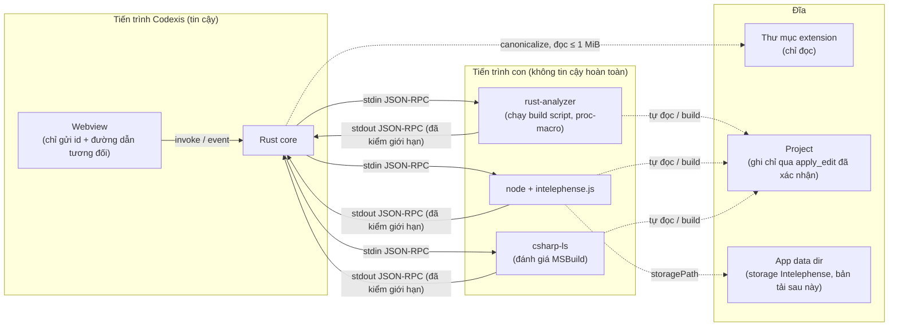

Ranh giới 1 (webview → Rust): giống mọi lệnh hiện có; webview không gửi đường dẫn tuyệt đối, không gửi tên chương trình. Ranh giới 2 (server → Rust): message server là dữ liệu không tin cậy: kiểm kích thước, JSON hợp lệ, URI phải nằm trong root, không thực thi `workspace/applyEdit` do server tự gửi. Server tự đọc/ghi đĩa và chạy build script của dự án: Codexis **không** sandbox được phần này ở mức OS, chỉ giảm bằng mặc định tắt + cảnh báo khi bật (BR-05).

### 2.5. So sánh phương án cho quyết định chính

| Quyết định                       | Phương án                                                              | Lợi ích                                                      | Chi phí / rủi ro                                                                             | Chọn | Xem lại khi                                                  |
| -------------------------------- | ---------------------------------------------------------------------- | ------------------------------------------------------------ | -------------------------------------------------------------------------------------------- | ---- | ------------------------------------------------------------ |
| Mô hình đồng thời                | (a) `std::process` + 3 luồng mỗi phiên (như `terminal.rs`, `agent.rs`) | Không đổi `Cargo.toml`; cùng mẫu với mã đang có              | ≤ 24 luồng khi đủ 8 server                                                                   | (a)  | Cần > 8 server hoặc hàng trăm request đồng thời              |
|                                  | (b) tokio `process` + `io-util`                                        | Ít luồng                                                     | Thêm feature tokio (đổi `Cargo.toml`), trộn async vào lệnh đồng bộ                           |      |                                                              |
| Cầu nối Monaco (Q1)              | (a) tự viết `language-client.ts` + Rust dựng params                    | Không dependency; logic ở Rust; chỉ 6 tính năng              | Tự viết đổi kiểu cho mỗi tính năng                                                           | (a)  | Cần > 10 tính năng LSP (code action, semantic tokens…)       |
|                                  | (b) `monaco-languageclient` (+ vscode-ws-jsonrpc)                      | Đủ tính năng                                                 | Dependency lớn, logic giao thức chạy ở webview (trái memory), cần kênh message thô qua Tauri |      |                                                              |
| Ai giữ version/văn bản           | (a) Rust giữ mirror + version LSP; frontend gửi thay đổi tuần tự       | Rust kiểm kích thước, áp UTF-16, mở lại tài liệu khi restart | Mirror có thể lệch → tự sửa khi `document_save` gửi toàn văn                                 | (a)  | —                                                            |
|                                  | (b) Frontend giữ version, Rust chỉ chuyển tiếp                         | Đơn giản hơn                                                 | Restart không mở lại tài liệu được; Rust không kiểm được trần kích thước                     |      |                                                              |
| C# (Q11)                         | csharp-ls (MIT)                                                        | Điều khoản rõ                                                | Người dùng phải tự `dotnet tool install -g csharp-ls`                                        | ✓    | Người dùng chấp nhận điều khoản Roslyn                       |
|                                  | Roslyn trong `ms-dotnettools.csharp`                                   | Có sẵn khi cài extension C#                                  | Điều khoản Microsoft giới hạn trong VS Code; kênh named pipe chưa xác minh                   |      |                                                              |
| Tải dự phòng (Q2, giai đoạn sau) | A: `curl`/`tar`/`unzip`/`gunzip` hệ thống, không shell                 | Không crate mới                                              | Phụ thuộc công cụ hệ thống (Linux không bảo đảm); kiểm entry trước + sau giải nén            | A    | Linux thiếu công cụ hoặc cần kiểm soát luồng tải tốt hơn → B |

## 3. Nguồn server

Thứ tự ưu tiên khi `source = auto`: (1) extension VS Code đã cài (VS Code → Insiders → Cursor → VSCodium) → (2) PATH và vị trí thường gặp → (3) bản đã tải trong app data dir (chỉ có sau G-download). Không nguồn nào hợp lệ → trạng thái `missing` + `installHint` "Hãy cài extension <tên> trong VS Code" (C#: "Hãy cài csharp-ls: `dotnet tool install -g csharp-ls`").

### 3.1. Quét extension (`vscode_extensions.rs`, chỉ đọc)

```rust
/// Fixed roots under $HOME, in priority order. Never taken from the UI.
pub const EXTENSION_ROOTS: [(ExtensionOrigin, &str); 4] = [
    (ExtensionOrigin::Vscode, ".vscode/extensions"),
    (ExtensionOrigin::Insiders, ".vscode-insiders/extensions"),
    (ExtensionOrigin::Cursor, ".cursor/extensions"),
    (ExtensionOrigin::Vscodium, ".vscode-oss/extensions"),
];
```

Hàm quét nhận `home: &Path` làm tham số (test dùng HOME giả bằng `tempfile`), chỉ dò các `extensionId` có trong danh mục (giai đoạn 1: `rust-lang.rust-analyzer`, `bmewburn.vscode-intelephense-client`).

**Nguồn**: plan BR-09, AC-16; cấu trúc thư mục `[đã kiểm]` trên máy (`rust-lang.rust-analyzer-0.3.3105-darwin-arm64`, `bmewburn.vscode-intelephense-client-1.18.5`, `.obsolete`, `extensions.json`).

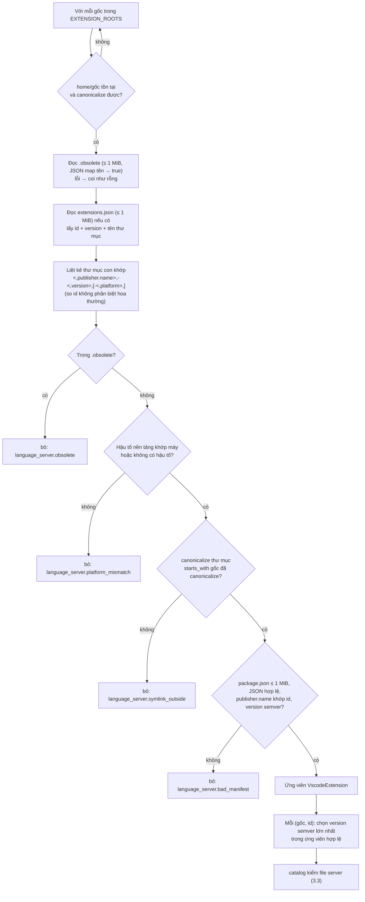

- Tên thư mục: `<publisher>.<name>-<version>[-<platform>]`; `version` tách ở dấu `-` đầu tiên sau `<publisher>.<name>`, `platform` là phần còn lại nếu thuộc `{darwin-arm64, darwin-x64, linux-x64, linux-arm64, linux-armhf, alpine-x64, alpine-arm64, win32-x64, win32-arm64, web}`. Máy hợp lệ: `(macos, aarch64) → darwin-arm64`, `(macos, x86_64) → darwin-x64`, `(linux, x86_64) → linux-x64`, `(linux, aarch64) → linux-arm64` theo `std::env::consts::{OS, ARCH}` `[giả định]`.
- `extensions.json` chỉ dùng để biết thư mục nào là bản đang cài; đọc hỏng hoặc không có thì quét tên thư mục `[giả định]`: trường `identifier.id`, `version`, `relativeLocation` theo VS Code, coder đối chiếu file thật ở TASK-003.
- Semver tự viết (không crate): so `major.minor.patch` theo số; có pre-release (`-...`) xếp thấp hơn bản không có; phần không phải số → ứng viên bị bỏ. `0.3.10 > 0.3.9` (AC-16).
- Ứng viên bị bỏ vẫn trả về UI (trong `candidates` kèm `problem`) để người dùng biết vì sao; không đọc bất kỳ file nào khác trong thư mục extension ngoài `package.json` và file server đã ánh xạ.
- Không gọi `main`, không đọc `activationEvents`, không chạy script; không ghi gì vào các gốc.

### 3.2. Kiểu dữ liệu quét

```rust
#[derive(Debug, Clone, Copy, PartialEq, Eq, Serialize, Deserialize)]
#[serde(rename_all = "lowercase")]
pub enum ExtensionOrigin { Vscode, Insiders, Cursor, Vscodium }

pub struct VscodeExtension {
    pub extension_id: String,       // "rust-lang.rust-analyzer"
    pub display_name: String,       // from package.json, falls back to the id
    pub version: String,            // "0.3.3105"
    pub origin: ExtensionOrigin,
    pub folder: PathBuf,            // canonical
    pub problem: Option<&'static str>, // language_server.* key, None = usable
}
```

### 3.3. Danh mục server (`language_server_catalog.rs`)

Danh mục là bảng hằng (data-driven), không phải trait: ba server khác nhau ở dữ liệu (đường dẫn, tham số, cách chạy), không ở hành vi.

| `id`            | Tên hiển thị  | Monaco / LSP `languageId` | Phần mở rộng (bỏ `.blade.php`) | Nguồn extension (`extensionId` → file tương đối)                                                    | Basename PATH (whitelist) | Thư mục dò thêm   | Cách chạy                                    |
| --------------- | ------------- | ------------------------- | ------------------------------ | --------------------------------------------------------------------------------------------------- | ------------------------- | ----------------- | -------------------------------------------- |
| `rust-analyzer` | rust-analyzer | `rust`                    | `rs`                           | `rust-lang.rust-analyzer` → `server/rust-analyzer` `[đã kiểm]`                                      | `rust-analyzer`           | `~/.cargo/bin`    | Binary, không tham số; PATH: `--version` 5 s |
| `intelephense`  | Intelephense  | `php`                     | `php` (trừ `*.blade.php`)      | `bmewburn.vscode-intelephense-client` → `node_modules/intelephense/lib/intelephense.js` `[đã kiểm]` | `intelephense`            | —                 | `node <js> --stdio` `[giả định, TASK-011]`   |
| `csharp-ls`     | csharp-ls     | `csharp`                  | `cs`                           | — (Q11: không dùng Roslyn)                                                                          | `csharp-ls`               | `~/.dotnet/tools` | Binary, không tham số `[giả định, TASK-012]` |

```rust
pub struct ServerSpec {
    pub id: &'static str,
    pub name: &'static str,
    pub language_ids: &'static [&'static str],
    pub file_extensions: &'static [&'static str],
    pub excluded_suffixes: &'static [&'static str],   // [".blade.php"]
    pub extension: Option<ExtensionLaunch>,           // id + relative path + LaunchKind
    pub path_names: &'static [&'static str],          // PATH basename whitelist
    pub extra_dirs: &'static [&'static str],          // relative to $HOME
    pub version_check: bool,
    pub install_hint: InstallHint,                    // { extensionId, displayName } or a command key
}

pub enum LaunchKind { Binary, NodeScript }

/// The only thing `language_server.rs` can spawn; built by the catalog only.
pub struct LaunchPlan {
    pub server_id: &'static str,
    pub origin: CandidateOrigin,     // vscode | insiders | cursor | vscodium | path | download
    pub version: Option<String>,
    pub program: PathBuf,            // canonical; node for NodeScript
    pub args: Vec<OsString>,         // fixed: [] or [<js>, "--stdio"]
    pub extra_path: Vec<PathBuf>,    // prepended to the child's PATH
    pub initialization_options: serde_json::Value,
}
```

Kiểm chung cho file server (AC-05, AC-16):

1. `canonicalize(file)` phải `starts_with` thư mục nguồn đã canonicalize (thư mục extension / thư mục PATH chứa nó / `<app data>/language-servers/<id>/<version>`); không → `language_server.symlink_outside`.
2. Là file thường; `Binary` → có bit thực thi (`mode & 0o111 != 0`), không → `language_server.not_executable`; `NodeScript` → đọc được, đuôi `.js`.
3. PATH: chỉ tìm đúng basename trong `path_names` qua `cli::locate` rồi `extra_dirs`; không chấp nhận đường dẫn do người dùng nhập (Q6 = không). `version_check` → chạy `<binary> --version` (không shell, stdin null, 5 s, kill khi quá); thoát khác 0 → `language_server.version_check_failed` (proxy rustup không có component). Kết quả cache theo `(path, mtime)` trong bộ nhớ để `list` không chạy lại mỗi lần.
4. File không còn tồn tại lúc spawn (VS Code vừa cập nhật extension) → dò lại một lần; vẫn không có → `language_server.extension_changed`.

### 3.4. Dò Node cho Intelephense (BR-11)

Thứ tự: `cli::locate("node")` (PATH + `/opt/homebrew/bin`, `/usr/local/bin`, `~/.local/bin` `[đã kiểm cli.rs]`) → `~/.volta/bin/node` → `~/.nvm/versions/node/<semver lớn nhất>/bin/node` → fnm (`~/.local/share/fnm/node-versions/<v>/installation/bin/node`, `~/Library/Application Support/fnm/node-versions/...`, `[chưa kiểm]` TASK-011 xác minh). Node phải là file thực thi; không có → mọi ứng viên intelephense có `problem = language_server.node_missing`, state `missing`. Phiên bản Node tối thiểu `[chưa kiểm]`: TASK-011 xác minh, nếu cần thì thêm kiểm `node --version`.

### 3.5. Chọn nguồn

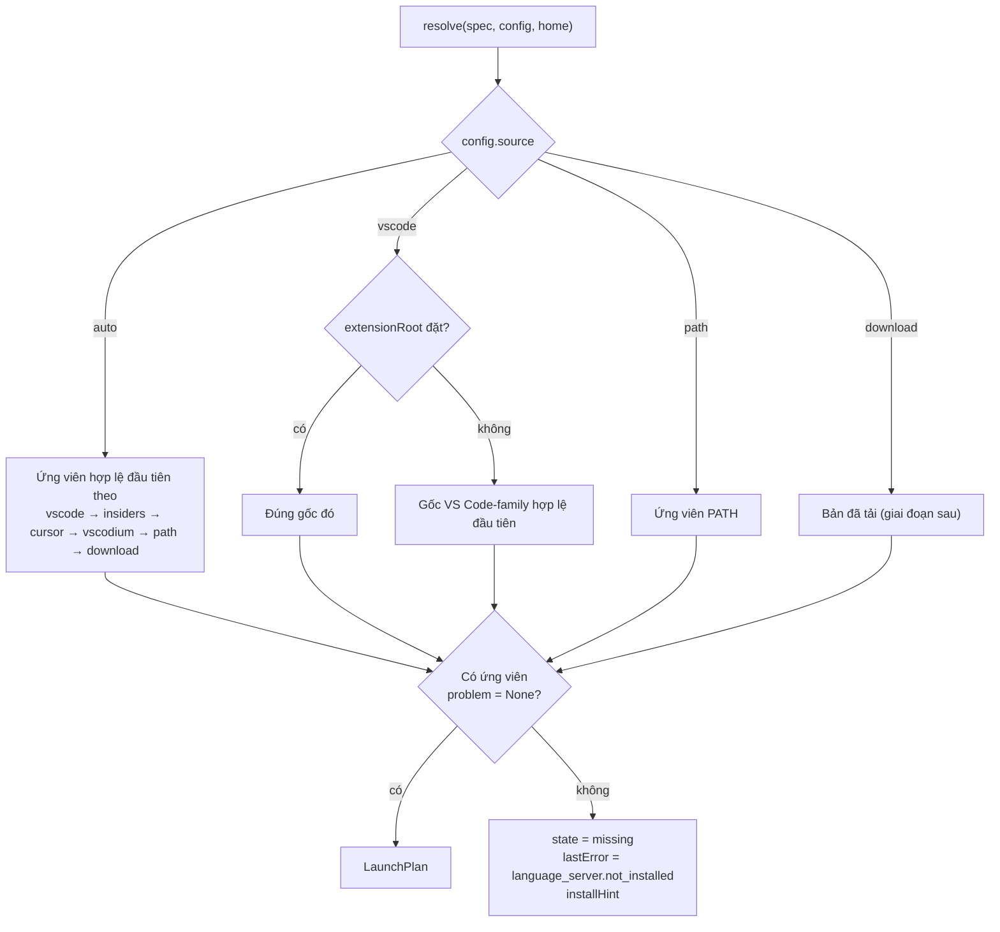

Nguồn chọn tay (`vscode`/`path`/`download`) không hợp lệ thì **không** tự rơi sang nguồn khác: người dùng đã chọn, UI hiện lý do. Quét lại mỗi lần `language_server_list` và mỗi lần spawn (không cache kết quả quét, chỉ cache `--version`).

## 4. Dữ liệu

### 4.1. Cấu hình lưu (SQLite, không migration)

Một dòng trong bảng `settings` đã có `[đã kiểm 0004_create_settings_table.sql]`: `key = 'language_servers'`, `value` = JSON. Cùng mẫu `SettingsStore` (`settings.rs`): `get` → JSON hỏng thì trả mặc định; `sanitized` bỏ id lạ, source lạ, `extensionRoot` ngoài 4 giá trị.

```json
{
    "servers": [
        {
            "id": "rust-analyzer",
            "enabled": false,
            "source": "auto",
            "extensionRoot": null
        },
        {
            "id": "intelephense",
            "enabled": false,
            "source": "auto",
            "extensionRoot": null
        },
        {
            "id": "csharp-ls",
            "enabled": false,
            "source": "auto",
            "extensionRoot": null
        }
    ]
}
```

| Trường          | Kiểu                                                       | Mặc định | Ràng buộc                                                                |
| --------------- | ---------------------------------------------------------- | -------- | ------------------------------------------------------------------------ |
| `id`            | `"rust-analyzer" \| "intelephense" \| "csharp-ls"`         | —        | Phải có trong danh mục; trùng → giữ mục đầu                              |
| `enabled`       | bool                                                       | `false`  | BR-05                                                                    |
| `source`        | `"auto" \| "vscode" \| "path" \| "download"`               | `"auto"` | `download` lưu được nhưng giai đoạn 1 luôn `missing`                     |
| `extensionRoot` | `"vscode" \| "insiders" \| "cursor" \| "vscodium" \| null` | `null`   | Chỉ là tên gốc trong `EXTENSION_ROOTS`, **không** phải đường dẫn (BR-09) |

Server không có dòng → mặc định. `extensionRoot` là tên gốc thay cho đường dẫn để webview không bao giờ đưa đường dẫn tuỳ ý vào Rust.

### 4.2. ERD

**Nguồn**: `0004_create_settings_table.sql` `[đã kiểm]`; dòng `language_servers` `[thiết kế]`. Trạng thái tiến trình không lưu đĩa.

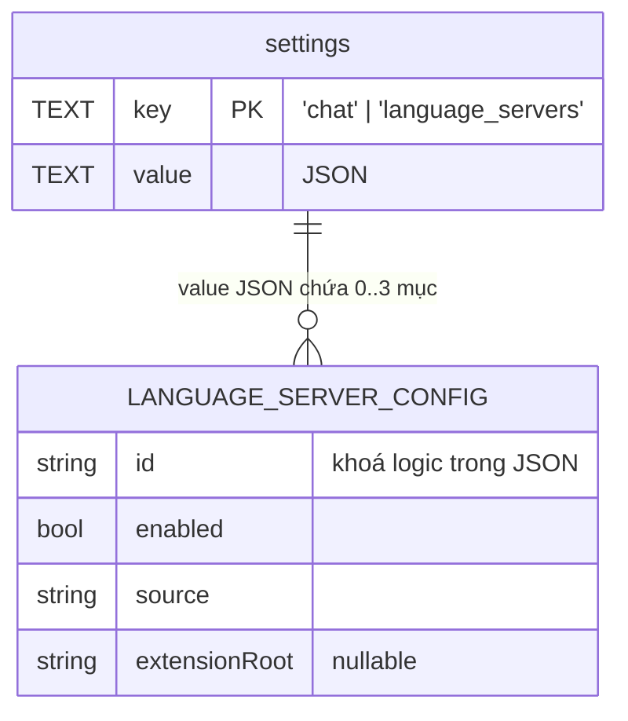

### 4.3. Trạng thái trong bộ nhớ (class diagram)

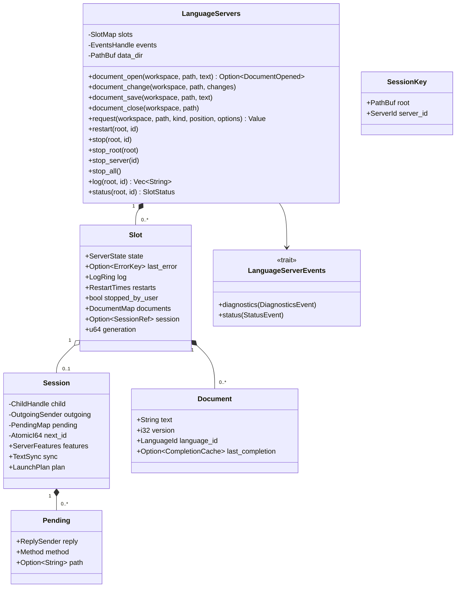

- Tên kiểu trong sơ đồ là bí danh cho dễ vẽ: `SlotMap = Mutex<HashMap<SessionKey, Slot>>`, `EventsHandle = Arc<dyn LanguageServerEvents>`, `ChildHandle = Mutex<Child>`, `OutgoingSender = mpsc::Sender<Vec<u8>>`, `PendingMap = Mutex<HashMap<i64, Pending>>`, `ReplySender = mpsc::Sender<Result<Value, RpcError>>`, `SessionRef = Arc<Session>`, `DocumentMap = HashMap<String, Document>` (khoá là đường dẫn tương đối), `RestartTimes = VecDeque<Instant>`, `ServerId`/`LanguageId`/`Method`/`ErrorKey` = `&'static str`.
- `Slot` sống lâu hơn `Session`: restart thay `Session`, giữ `documents` (để didOpen lại), `log`, `restarts`. `generation` tăng mỗi lần spawn; luồng của phiên cũ mang `generation` của nó và bỏ qua mọi cập nhật khi không còn khớp (tránh phiên chết muộn ghi đè trạng thái phiên mới).
- `LanguageServerEvents` là Observer (cùng ý tưởng `TurnObserver` trong `agent.rs` `[đã kiểm]`): bản production gọi `AppHandle::emit`, bản test ghi vào `Vec`. Lý do: test `language_server.rs` không cần Tauri runtime.
- `SessionKey.root` là `workspace.root()` (đường thật đã canonicalize); đây cũng là chuỗi `root` gửi trong sự kiện và trả về ở `document_open`.
- Khoá: không giữ khoá `slots` khi ghi stdin hoặc chờ response (cùng nguyên tắc `Terminals::write` `[đã kiểm]`): lấy `Arc<Session>` rồi thả khoá.

## 5. Giao thức

### 5.1. Framing (`language_server_protocol.rs`, AC-03)

- Header ASCII, mỗi dòng kết thúc `\r\n`, khối header kết thúc `\r\n\r\n`; nhận `Content-Length` (bắt buộc, số thập phân) và bỏ qua `Content-Type`; tên header không phân biệt hoa thường. Khối header > 8 KiB, thiếu/trùng/sai `Content-Length`, hoặc `Content-Length > MAX_MESSAGE_BYTES` (16 MiB) → `language_server.bad_message`, đóng phiên (không panic, **kiểm trước khi cấp phát** body).
- `MessageReader<R: Read>` giữ bộ đệm, đọc khối 8 KiB như `terminal.rs`; chịu được message bị cắt nhiều mảnh và nhiều message trong một lần đọc. Body không phải UTF-8 hoặc JSON hỏng → bỏ message đó, ghi log, **không** đóng phiên (một message hỏng không đáng giết server).
- `write_message(w, &Value)`: `Content-Length: <n>\r\n\r\n<json>`; chỉ luồng ghi của phiên gọi.

### 5.2. Khởi tạo

`initialize` (60 s) với:

```json
{
  "processId": <pid của Codexis>,
  "clientInfo": { "name": "Codexis IDE", "version": "<app version>" },
  "rootUri": "file:///<root>",
  "workspaceFolders": [{ "uri": "file:///<root>", "name": "<tên thư mục>" }],
  "initializationOptions": <LaunchPlan.initialization_options>,
  "capabilities": {
    "general": { "positionEncodings": ["utf-16"] },
    "textDocument": {
      "synchronization": { "didSave": true, "willSave": false, "willSaveWaitUntil": false, "dynamicRegistration": false },
      "completion": { "contextSupport": true, "completionItem": { "snippetSupport": true, "documentationFormat": ["markdown", "plaintext"], "resolveSupport": { "properties": ["documentation", "detail", "additionalTextEdits"] } } },
      "hover": { "contentFormat": ["markdown", "plaintext"] },
      "signatureHelp": { "contextSupport": true, "signatureInformation": { "documentationFormat": ["markdown", "plaintext"], "parameterInformation": { "labelOffsetSupport": true } } },
      "definition": { "linkSupport": false },
      "rename": { "prepareSupport": true },
      "formatting": {},
      "publishDiagnostics": { "relatedInformation": false }
    },
    "workspace": { "applyEdit": false, "configuration": true, "workspaceFolders": true, "workspaceEdit": { "documentChanges": true, "resourceOperations": [] } },
    "window": { "workDoneProgress": true }
  }
}
```

Sau response: server trả `positionEncoding` khác `utf-16` → `language_server.encoding_unsupported`, dừng phiên. Rút `ServerFeatures` (8.1) và `TextSync` (`textDocumentSync` = số hoặc `{ change }`: 0 none, 1 full, 2 incremental) rồi gửi `initialized {}`, state `running`, didOpen lại mọi `Document` của slot.

`initializationOptions` theo server `[giả định]`: rust-analyzer `{}` (TASK-010 kiểm repo có `Cargo.toml` ở `src-tauri/`; cần `linkedProjects` thì thêm vào danh mục, không lấy từ UI); intelephense `{ "storagePath": "<app data>/language-servers/intelephense/storage", "globalStoragePath": "<app data>/language-servers/intelephense/global" }` (thư mục tạo trước khi spawn, ngoài workspace); csharp-ls `{}`.

### 5.3. Request, response, server request (AC-04)

- Id request do client cấp: `AtomicI64` tăng dần mỗi phiên. Gửi = đăng ký `Pending` rồi đẩy vào kênh của luồng ghi; người gọi chờ `recv_timeout(10 s)`. Quá hạn → xoá pending, gửi `$/cancelRequest { id }`, trả `language_server.timeout`. Response đến không có pending (đã quá hạn) → bỏ qua.
- Request mới cùng `kind` cho cùng `path` → gửi `$/cancelRequest` cho request cũ còn chờ cùng loại và trả lỗi `language_server.cancelled` cho người gọi cũ (Monaco đã bỏ kết quả cũ). Cách này thay cho một lệnh huỷ riêng.
- Response lỗi JSON-RPC: `-32800 RequestCancelled` → `language_server.cancelled`; `-32801 ContentModified` → `language_server.cancelled`; còn lại → `language_server.request_failed` (message server chỉ vào log, BR-08).

Request từ server gửi client (luồng đọc tự trả lời, không lên frontend):

| Method                           | Trả lời                                                                                          |
| -------------------------------- | ------------------------------------------------------------------------------------------------ |
| `workspace/configuration`        | Mảng `null` dài bằng `items` (server dùng mặc định của nó)                                       |
| `workspace/workspaceFolders`     | `[{ uri: rootUri, name }]`                                                                       |
| `client/registerCapability`      | `null` (chấp nhận, không thực hiện đăng ký động; ghi log method đã đăng ký)                      |
| `client/unregisterCapability`    | `null`                                                                                           |
| `window/workDoneProgress/create` | `null`                                                                                           |
| `window/showMessageRequest`      | `null` (ghi log message)                                                                         |
| `workspace/applyEdit`            | `{ "applied": false, "failureReason": "Codexis applies edits only after confirmation" }` (BR-04) |
| Khác                             | Lỗi `-32601 MethodNotFound`                                                                      |

Notification từ server: `textDocument/publishDiagnostics` → sự kiện (8.3); `window/logMessage`, `window/showMessage` → log; `$/progress` → log (rút gọn `title`/`message`); còn lại bỏ qua.

### 5.4. URI và đường dẫn (BR-01)

- `path_to_uri(sandbox, relative)`: `normalise(relative)` → `root.join(clean)` → `Sandbox::resolve` (phải tồn tại và nằm trong root; file mới chưa lưu thì không mở cho server) → `file://` + percent-encoding tự viết theo RFC 3986 (giữ `A-Z a-z 0-9 - . _ ~ /`, mã hoá phần còn lại theo byte UTF-8, gồm dấu cách, `#`, `?`, `%`, tiếng Việt).
- `uri_to_path(sandbox, uri)`: chỉ scheme `file`, host rỗng hoặc `localhost`; giải mã percent; đường tuyệt đối → `canonicalize` → `Sandbox::contains`; trả `Some(relative)` hoặc `None`. `None` = ngoài root (std, `~/.cargo/registry`, `vendor` ngoài, file đã xoá).
- Diagnostics có URI ngoài root → bỏ. Definition ngoài root → trả `{ path: null, external: "<đường hiển thị>" }` (AC-10, Q8 = chỉ thông báo). Rename có file ngoài root → vào `skipped`.
- Viewer mở được cả file trong danh sách cấm (`Unguarded`, P2 của architecture.md `[đã kiểm]`), nên `document_open` dùng chính sách `Unguarded` (chỉ sandbox) cho **đọc/đồng bộ**; còn **ghi** do rename luôn qua `Guarded` (7.6).

### 5.5. Đồng bộ tài liệu (REQ-05, AC-07)

- Vị trí Monaco 1-based, cột tính theo đơn vị UTF-16; LSP 0-based, `utf-16` → chỉ trừ/cộng 1 (`[giả định]` plan; test emoji ở TASK-002).
- Frontend gửi thay đổi Monaco thô (range 1-based + text) theo **đúng thứ tự** các `IModelContentChangedEvent`, gom ≤ 150 ms; hàng đợi phía frontend bảo đảm mỗi lời gọi document_* của một tài liệu chỉ chạy khi lời gọi trước đã xong. Trong một event, Monaco liệt kê thay đổi theo thứ tự áp tuần tự được `[giả định, TASK-007 kiểm bằng so sánh mirror ↔ model]`.
- Rust áp từng thay đổi vào `Document.text` (`apply_change`: dòng/cột UTF-16 → byte offset; giữ nguyên `\r\n`, coi `\r\n` là một ngắt dòng), tăng `version` (Rust giữ, bắt đầu 1, tăng 1 mỗi didChange), rồi gửi: `TextSync::Incremental` → các thay đổi đã đổi gốc 0; `Full` → toàn văn mirror; `None` → không gửi.
- Mirror sau thay đổi > `MAX_WRITE_BYTES` → gửi didClose, xoá tài liệu khỏi slot, trả `language_server.too_large` (frontend bỏ đăng ký model đó, editor vẫn soạn bình thường).
- Range ngoài văn bản (lệch) → trả `language_server.out_of_sync`; frontend gọi `document_close` + `document_open` với toàn văn model (tự hồi phục).
- `document_save(text)`: `text` là nội dung **đã lưu** (sau Prettier nếu có). Khác mirror → một didChange toàn văn (version + 1); rồi didSave `{ textDocument: { uri } }`. Bảo đảm AC-07 "lưu kể cả Prettier đổi text".

## 6. Vòng đời server (state machine)

`ServerState` (serialize lowercase): `missing | stopped | starting | running | error`. Trạng thái tính **theo (root, id)**; `language_server_list(root)` trả trạng thái của slot thuộc root đó (không có slot → `stopped`, hoặc `missing` khi không có nguồn hợp lệ). `enabled` là cấu hình chung theo id, tách khỏi state.

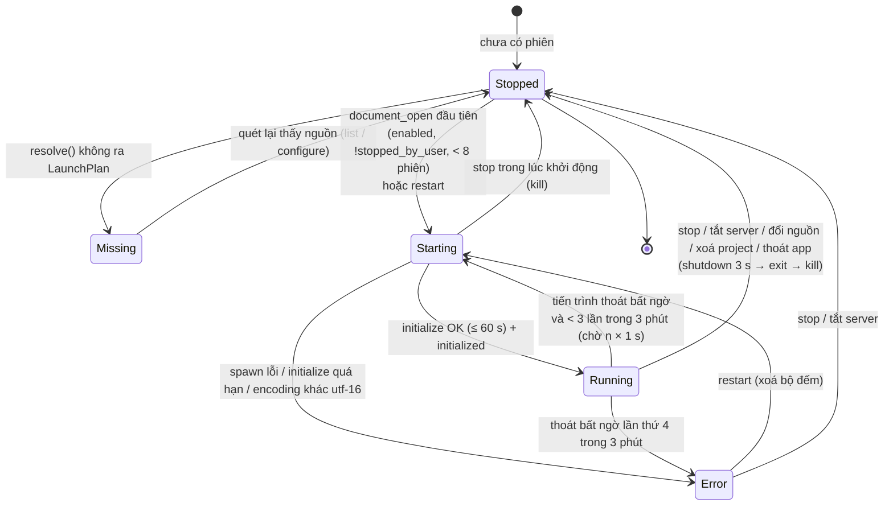

Quy tắc:

- **Khởi động lười** (BR-05): chỉ `document_open` của file thuộc server đã bật mới spawn; mở file thứ hai cùng ngôn ngữ/project dùng lại phiên (AC-01). Hai `document_open` đồng thời cho cùng slot: slot ở `Starting` thì lời gọi sau chỉ thêm `Document` và chờ; một tiến trình mỗi (root, id).
- **Giới hạn 8** đếm slot ở `starting`/`running`; vượt → `language_server.too_many`, state slot đó `error`.
- **Dừng tay** (`language_server_stop`) đặt `stopped_by_user = true`: `document_open` sau đó không tự spawn (trả `state = stopped`) cho tới `language_server_restart` hoặc app mở lại. Tránh "bấm Dừng rồi mở file lại chạy ngay".
- **Dừng** (mọi đường): gửi `shutdown` (chờ ≤ 3 s) → `exit` → đóng stdin → `try_wait` tới 500 ms → `child.kill()` + `wait()` (không để zombie). Mọi pending nhận `language_server.not_running`. Phát `language-server-diagnostics` rỗng cho mọi tài liệu của slot (xoá marker, AC-08) và `language-server-status`.
- **Tắt server / đổi nguồn** (`configure`): tắt → dừng mọi slot của id ở mọi root, xoá `documents`; đổi `source`/`extensionRoot` khi đang bật → dừng rồi spawn lại slot đang có tài liệu với `LaunchPlan` mới (giữ `documents`).
- **Xoá project** (`projects_remove`): lấy `folders[0]` của project **trước** khi xoá, `Workspace::open` để có root thật, rồi `stop_root(root)`. Root đó vẫn là workspace đang mở (architecture: `remove_project` giữ workspace mở `[đã kiểm state.rs]`) thì lần mở file sau sẽ spawn lại như bình thường.
- **Thoát app** (`RunEvent::Exit`, cạnh `TurnRegistry::stop_all` `[đã kiểm lib.rs]`): `stop_all()` gửi shutdown **song song** cho mọi phiên, hạn chung 3 s, rồi kill phần còn lại; không chặn thoát quá ~3,5 s.
- **Tiến trình cháu** `[chưa kiểm]`: rust-analyzer chạy `cargo check`/proc-macro server, csharp-ls chạy MSBuild. `child.kill()` chỉ giết tiến trình con. TASK-006 kiểm bằng `ps` sau stop/thoát; nếu còn tiến trình cháu thì spawn với `std::os::unix::process::CommandExt::process_group(0)` và dừng cả nhóm (gọi `/bin/kill -KILL -- -<pgid>` trực tiếp như `commands/agent.rs::kill`, không shell). Ghi kết quả vào mục 16.

## 7. Luồng chính (sequence)

### 7.1. Dò nguồn và hiện tab Extensions

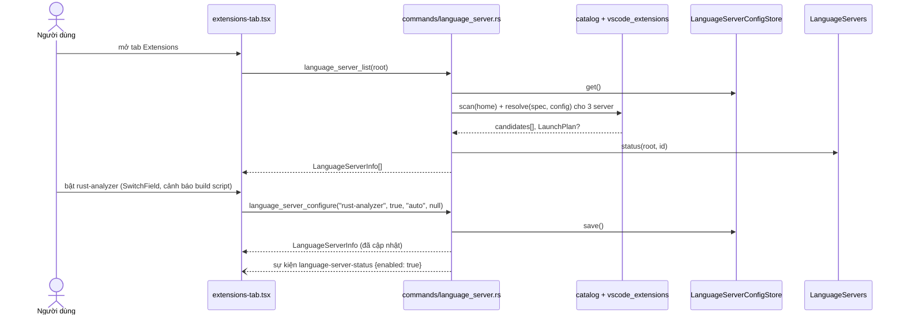

### 7.2. Mở file đầu tiên (khởi động lười) và nhận lỗi

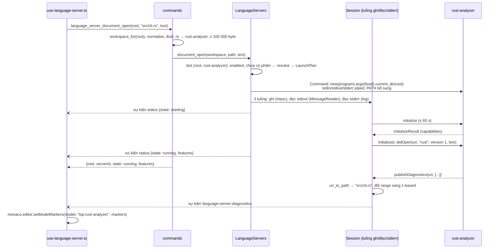

`document_open` chờ tới khi phiên `running` hoặc hết 60 s (chạy trong `commands::blocking`, không chặn luồng UI). Server không bật / không có server cho đuôi file / `.blade.php` → trả `null` ngay, không spawn.

### 7.3. Gõ, lưu, đóng

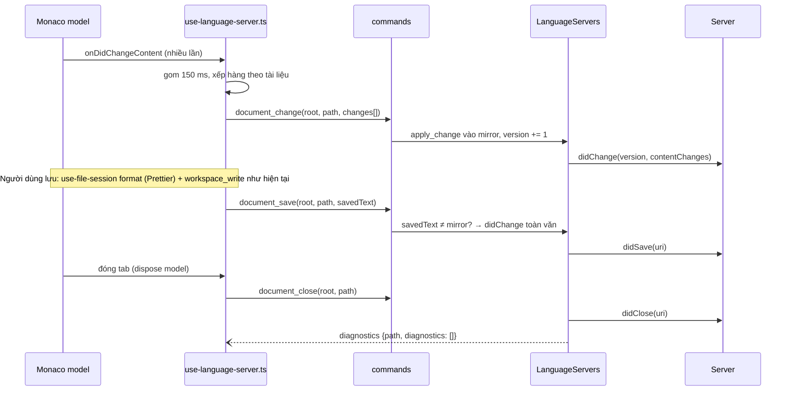

Lỗi của `document_*` không bao giờ chặn soạn hoặc lưu: hook chỉ ghi log console ở chế độ dev và bỏ đăng ký model nếu lỗi là `too_large`/`not_running`.

### 7.4. Completion (+ resolve), hover, signature help

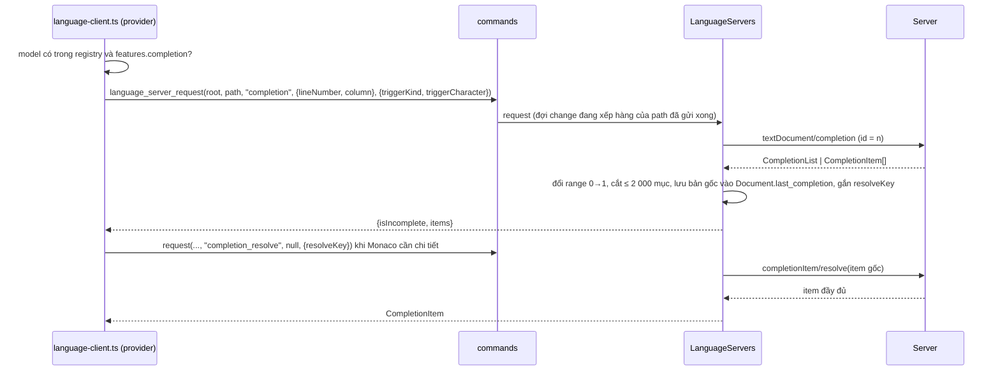

Hover và signature help cùng mẫu, không cache. Hết 10 s → `language_server.timeout`; provider trả `undefined` (Monaco không hiện gì, không báo lỗi, AC-09).

### 7.5. Đi tới định nghĩa (AC-10)

`language_server_request(..., "definition", position)` → `Location | Location[] | LocationLink[]` của server được Rust đổi thành `DefinitionTarget[]` (8.2). Frontend: một đích có `path` → `code-viewer.tsx` mở file đó và đặt con trỏ tại `range.start`; `path = null` → toast "Định nghĩa nằm ngoài project: <external>" và không mở.

### 7.6. Đổi tên có xác nhận (AC-11, BR-04)

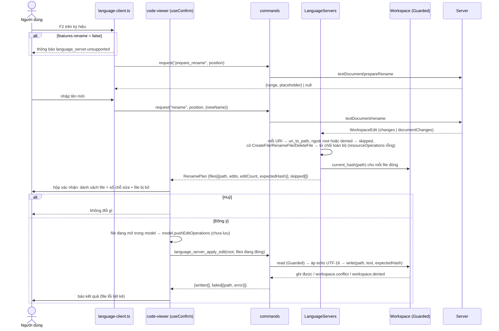

`apply_edit` không nhận nội dung file từ webview: Rust đọc file từ đĩa, áp edits, ghi với `expectedHash`; file đổi giữa lúc xem và lúc đồng ý → `workspace.conflict`, file đó không bị ghi.

### 7.7. Server chết và khởi động lại (AC-02)

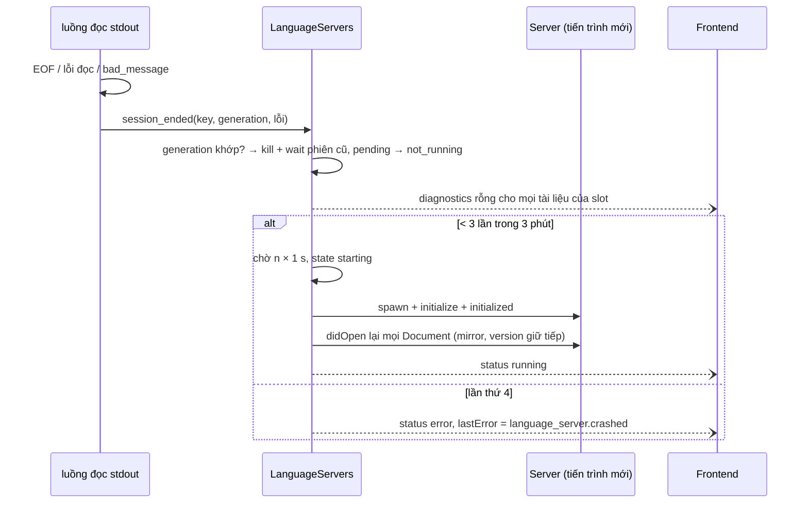

Editor vẫn soạn và lưu bình thường trong mọi nhánh (lỗi LSP không đi vào đường lưu).

## 8. Giao diện backend ↔ frontend (hợp đồng chung cho agent Rust và agent UI)

Quy ước `[đã kiểm AGENTS.md]`: tên lệnh snake_case; tham số phía JS camelCase (Tauri tự đổi sang snake_case Rust); trường JSON payload camelCase (`#[serde(rename_all = "camelCase")]`); giá trị enum là chữ thường một từ hoặc snake_case như bảng dưới; sự kiện kebab-case. Mọi lệnh có `root?: string | null` như các lệnh hiện có (`None` = workspace đang mở, kiểm qua `AppState::workspace_for`). Lỗi là chuỗi khoá cố định `language_server.*` (hoặc `workspace.*` từ sandbox), đã dịch qua `invoke.ts` → `translateError`.

**Giai đoạn 1 có đúng 11 lệnh và 2 sự kiện dưới đây.** Lệnh tải về (mục 12) thuộc G-download, không đăng ký ở giai đoạn 1.

### 8.1. Kiểu dùng chung (TypeScript, `src/lib/ide-language-server.ts`)

```ts
export type LanguageServerId = 'rust-analyzer' | 'intelephense' | 'csharp-ls';
export type ServerSourceSetting = 'auto' | 'vscode' | 'path' | 'download';
export type ExtensionRoot = 'vscode' | 'insiders' | 'cursor' | 'vscodium';
export type CandidateOrigin = ExtensionRoot | 'path' | 'download';
export type ServerState =
    'missing' | 'stopped' | 'starting' | 'running' | 'error';

/** Monaco coordinates: 1-based lines and UTF-16 columns. */
export type EditorPosition = { lineNumber: number; column: number };
export type EditorRange = {
    startLineNumber: number;
    startColumn: number;
    endLineNumber: number;
    endColumn: number;
};
export type TextEdit = { range: EditorRange; text: string };

export type ServerCandidate = {
    origin: CandidateOrigin;
    /** Extension display name, or the binary name for PATH. */
    label: string;
    extensionId: string | null;
    version: string | null;
    /** Absolute path of the server file, shown in the tab only. */
    path: string;
    /** `language_server.*` key; null = usable. */
    problem: string | null;
};

export type InstallHint = {
    /** Extension to install in VS Code; null for csharp-ls. */
    extensionId: string | null;
    displayName: string;
    /** i18n key of the instruction (e.g. `language_server.hint_install_extension`). */
    messageKey: string;
};

export type ServerFeatures = {
    completion: boolean;
    completionResolve: boolean;
    completionTriggerCharacters: string[];
    hover: boolean;
    signatureHelp: boolean;
    signatureTriggerCharacters: string[];
    signatureRetriggerCharacters: string[];
    definition: boolean;
    rename: boolean;
    prepareRename: boolean;
    formatting: boolean;
};

export type LanguageServerInfo = {
    id: LanguageServerId;
    name: string;
    /** Monaco language ids: `rust`, `php`, `csharp`. */
    languages: string[];
    fileExtensions: string[];
    enabled: boolean;
    source: ServerSourceSetting;
    extensionRoot: ExtensionRoot | null;
    candidates: ServerCandidate[];
    /** Index in `candidates` of the one used now (or next start); null = none usable. */
    selected: number | null;
    /** State for the given root. */
    state: ServerState;
    lastError: string | null;
    installHint: InstallHint | null;
    /** Always false in phase 1 (G-download). */
    canDownload: boolean;
};

export type DocumentOpened = {
    /** Canonical root: the key events carry; the registry stores this, not the folder string sent. */
    root: string;
    serverId: LanguageServerId;
    state: ServerState;
    /** null until the server is running. */
    features: ServerFeatures | null;
};

/** One Monaco content change, as Monaco reports it (range in the text before this change). */
export type DocumentChange = { range: EditorRange | null; text: string };

export type RequestKind =
    | 'completion'
    | 'completion_resolve'
    | 'hover'
    | 'signature_help'
    | 'definition'
    | 'prepare_rename'
    | 'rename'
    | 'formatting';
```

`DocumentChange.range = null` nghĩa là thay toàn văn bằng `text`.

### 8.2. 11 lệnh Tauri

Mọi lệnh có thể chờ tiến trình con chạy `async` + `commands::blocking("language_server.unavailable", …)` `[đã kiểm commands/mod.rs]`. Rust: `commands/language_server.rs`; TS: `ideLanguageServer.<tên>` trong `ide-language-server.ts`.

| #   | Lệnh (Rust)                       | Tham số JS (camelCase)                                                                                                      | Trả về                   | Hành vi / lỗi chính                                                                                                                                                                                                                                                                                                                             |
| --- | --------------------------------- | --------------------------------------------------------------------------------------------------------------------------- | ------------------------ | ----------------------------------------------------------------------------------------------------------------------------------------------------------------------------------------------------------------------------------------------------------------------------------------------------------------------------------------------- |
| 1   | `language_server_list`            | `root?: string \| null`                                                                                                     | `LanguageServerInfo[]`   | Quét lại nguồn, đọc cấu hình, ghép trạng thái slot của root. Luôn đủ 3 server theo thứ tự danh mục. Lỗi: `language_server.load_failed`, `workspace.*`                                                                                                                                                                                           |
| 2   | `language_server_configure`       | `id: LanguageServerId, enabled: boolean, source: ServerSourceSetting, extensionRoot: ExtensionRoot \| null`                 | `LanguageServerInfo`     | Lưu cấu hình; áp ngay theo mục 6 (tắt → dừng mọi root; đổi nguồn → spawn lại slot đang có tài liệu). Phát `language-server-status` cho mỗi slot đổi và một lần với `root = null` cho đổi `enabled`. Lỗi: `language_server.unknown_server`, `language_server.invalid`, `language_server.save_failed`                                             |
| 3   | `language_server_restart`         | `root?: string \| null, id: LanguageServerId`                                                                               | `void`                   | Xoá `stopped_by_user` và bộ đếm restart; dừng phiên nếu có, spawn lại, didOpen lại tài liệu. Chưa bật → `language_server.disabled`; không nguồn → `language_server.not_installed`                                                                                                                                                               |
| 4   | `language_server_stop`            | `root?: string \| null, id: LanguageServerId`                                                                               | `void`                   | Dừng phiên của (root, id), đặt `stopped_by_user`. Không có phiên: không lỗi                                                                                                                                                                                                                                                                     |
| 5   | `language_server_log`             | `root?: string \| null, id: LanguageServerId`                                                                               | `string[]`               | ≤ 500 dòng mới nhất (stderr, `window/logMessage`, sự kiện vòng đời do app ghi). Không có slot → `[]`                                                                                                                                                                                                                                            |
| 6   | `language_server_document_open`   | `root?: string \| null, path: string, text: string`                                                                         | `DocumentOpened \| null` | `null` khi: không server cho đuôi file, `.blade.php`, server tắt, `stopped_by_user`, không nguồn (state hiện ở tab). Đã mở → thay mirror bằng `text` (didChange toàn văn). Lỗi: `workspace.bad_path`, `workspace.not_found`, `language_server.too_large`, `language_server.too_many`, `language_server.start_failed`, `language_server.timeout` |
| 7   | `language_server_document_change` | `root?: string \| null, path: string, changes: DocumentChange[]`                                                            | `void`                   | Áp tuần tự vào mirror, version + 1, didChange. Lỗi: `language_server.not_open`, `language_server.out_of_sync`, `language_server.too_large`. `changes` rỗng → không làm gì; tổng `text` > 100 000 byte → `too_large`                                                                                                                             |
| 8   | `language_server_document_save`   | `root?: string \| null, path: string, text: string`                                                                         | `void`                   | `text` ≠ mirror → didChange toàn văn; rồi didSave. Lỗi: `language_server.not_open`, `language_server.too_large`                                                                                                                                                                                                                                 |
| 9   | `language_server_document_close`  | `root?: string \| null, path: string`                                                                                       | `void`                   | didClose, xoá mirror, phát diagnostics rỗng cho path. Chưa mở: không lỗi                                                                                                                                                                                                                                                                        |
| 10  | `language_server_request`         | `root?: string \| null, path: string, kind: RequestKind, position: EditorPosition \| null, options: RequestOptions \| null` | theo `kind` (bảng dưới)  | Tài liệu phải đã mở và phiên `running`. Lỗi: `language_server.not_open`, `language_server.not_running`, `language_server.unsupported` (server không có capability), `language_server.bad_request`, `language_server.timeout`, `language_server.cancelled`, `language_server.request_failed`                                                     |
| 11  | `language_server_apply_edit`      | `root?: string \| null, files: FileEdits[]`                                                                                 | `ApplyEditResult`        | Chỉ cho file **đang đóng** sau xác nhận rename. Mỗi file: `Guarded` read → áp edits → `write(path, text, expectedHash)`. Lỗi từng file nằm trong `failed`, không làm hỏng file khác. ≤ 500 file mỗi lần, mỗi file ≤ 10 000 edit (`language_server.too_large`) `[giả định]`                                                                      |

Chữ ký Rust (gợi ý, theo mẫu `commands/terminal.rs` và `commands/files.rs::format_code` `[đã kiểm]`):

```rust
#[tauri::command]
pub async fn language_server_list(
    app: AppHandle, state: State<'_, AppState>, servers: State<'_, LanguageServers>,
    config: State<'_, LanguageServerConfigStore>, root: Option<String>,
) -> Result<Vec<LanguageServerInfo>, String>;

#[tauri::command]
pub async fn language_server_configure(/* states */, id: String, enabled: bool,
    source: String, extension_root: Option<String>) -> Result<LanguageServerInfo, String>;

#[tauri::command] pub async fn language_server_restart(/* states */, root: Option<String>, id: String) -> Result<(), String>;
#[tauri::command] pub async fn language_server_stop(/* states */, root: Option<String>, id: String) -> Result<(), String>;
#[tauri::command] pub fn language_server_log(/* states */, root: Option<String>, id: String) -> Result<Vec<String>, String>;
#[tauri::command] pub async fn language_server_document_open(/* states */, root: Option<String>, path: String, text: String) -> Result<Option<DocumentOpened>, String>;
#[tauri::command] pub async fn language_server_document_change(/* states */, root: Option<String>, path: String, changes: Vec<DocumentChange>) -> Result<(), String>;
#[tauri::command] pub async fn language_server_document_save(/* states */, root: Option<String>, path: String, text: String) -> Result<(), String>;
#[tauri::command] pub async fn language_server_document_close(/* states */, root: Option<String>, path: String) -> Result<(), String>;
#[tauri::command] pub async fn language_server_request(/* states */, root: Option<String>, path: String, kind: String,
    position: Option<EditorPosition>, options: Option<serde_json::Value>) -> Result<serde_json::Value, String>;
#[tauri::command] pub async fn language_server_apply_edit(/* states */, root: Option<String>, files: Vec<FileEdits>) -> Result<ApplyEditResult, String>;
```

`id`, `source`, `extension_root`, `kind` nhận `String` rồi parse sang enum ở Rust (giá trị lạ → `language_server.unknown_server` / `language_server.invalid` / `language_server.bad_request`), để lỗi là khoá cố định thay cho lỗi deserialize của Tauri. `options` của `request` parse theo `kind` (dưới).

**`language_server_request` theo `kind`** (`RequestOptions` là union theo `kind`; phần dư bị bỏ qua):

| `kind`               | `position` | `options`                                                                                   | Kết quả (camelCase)                                                                                                                                                                                                | Capability cần               |
| -------------------- | ---------- | ------------------------------------------------------------------------------------------- | ------------------------------------------------------------------------------------------------------------------------------------------------------------------------------------------------------------------ | ---------------------------- |
| `completion`         | bắt buộc   | `{ triggerKind: 1 \| 2 \| 3, triggerCharacter?: string }` (LSP `CompletionTriggerKind`)     | `{ isIncomplete: boolean, items: CompletionItem[] }`                                                                                                                                                               | `completionProvider`         |
| `completion_resolve` | `null`     | `{ resolveKey: string }`                                                                    | `CompletionItem`                                                                                                                                                                                                   | `resolveProvider`            |
| `hover`              | bắt buộc   | `null`                                                                                      | `{ contents: string /* markdown */, range: EditorRange \| null } \| null`                                                                                                                                          | `hoverProvider`              |
| `signature_help`     | bắt buộc   | `{ triggerKind: 1 \| 2 \| 3, triggerCharacter?: string, isRetrigger: boolean }`             | `{ signatures: { label: string, documentation: string \| null, parameters: { label: string \| [number, number], documentation: string \| null }[] }[], activeSignature: number, activeParameter: number } \| null` | `signatureHelpProvider`      |
| `definition`         | bắt buộc   | `null`                                                                                      | `DefinitionTarget[]` = `{ path: string \| null, external: string \| null, range: EditorRange }[]` (`path` tương đối trong root; ngoài root → `path = null`, `external` = đường hiển thị, `~` thay HOME)            | `definitionProvider`         |
| `prepare_rename`     | bắt buộc   | `null`                                                                                      | `{ range: EditorRange, placeholder: string } \| null` (`null` = không đổi tên được ở đây). Server không có `prepareProvider` → Rust trả range của từ tại vị trí (tính từ mirror) + placeholder là từ đó            | `renameProvider`             |
| `rename`             | bắt buộc   | `{ newName: string }` (1..256 ký tự, không ký tự điều khiển, `language_server.bad_request`) | `RenamePlan` (định nghĩa dưới)                                                                                                                                                                                     | `renameProvider`             |
| `formatting`         | `null`     | `{ tabSize: number, insertSpaces: boolean }`                                                | `TextEdit[]`                                                                                                                                                                                                       | `documentFormattingProvider` |

```ts
export type CompletionItem = {
    label: string;
    /** LSP CompletionItemKind (1..25); the bridge maps it to Monaco's enum. */
    kind: number | null;
    detail: string | null;
    /** Markdown. */
    documentation: string | null;
    insertText: string;
    isSnippet: boolean;
    range: EditorRange | null;
    additionalTextEdits: TextEdit[];
    sortText: string | null;
    filterText: string | null;
    commitCharacters: string[];
    preselect: boolean;
    /** Opaque; null when the server cannot resolve. Valid until the next completion on the same document. */
    resolveKey: string | null;
};

export type FileEdits = {
    /** Relative to the root. */
    path: string;
    edits: TextEdit[];
    /** Hash of the file on disk when the plan was made (`workspace::hash`); null = file not readable. */
    expectedHash: string | null;
};

export type RenamePlan = {
    /** Files inside the root that may be written; `editCount` = edits.length, shown in the confirmation. */
    files: (FileEdits & { editCount: number })[];
    /** Outside the root or denied: never written, listed in the confirmation. `reason` is a `language_server.*` / `workspace.*` key. */
    skipped: { display: string; reason: string }[];
};

export type ApplyEditResult = {
    written: string[];
    failed: { path: string; error: string }[];
};
```

Ghi chú chuyển đổi (Rust làm, frontend không xử lý LSP thô):

- `MarkupContent`/`MarkedString`/`string` → một chuỗi markdown (plaintext được bọc thành đoạn văn, `MarkedString` có `language` thành khối code).
- `InsertReplaceEdit` không được khai (client không bật `insertReplaceSupport`); có thì lấy `insert`.
- `CompletionList` hoặc mảng → `{ isIncomplete, items }`; `textEdit` → `insertText` + `range`; `insertTextFormat = 2` → `isSnippet = true`.
- `WorkspaceEdit.documentChanges` (`TextDocumentEdit`) ưu tiên hơn `changes`; có thao tác tài nguyên → `language_server.unsupported`.
- `resolveKey` = `"<generation>:<index>"`; bản gốc giữ trong `Document.last_completion`, bị thay ở completion kế tiếp.

### 8.3. Hai sự kiện

| Sự kiện                       | Payload (camelCase)                                                                                                                                       | Phát khi                                                                                                                       |
| ----------------------------- | --------------------------------------------------------------------------------------------------------------------------------------------------------- | ------------------------------------------------------------------------------------------------------------------------------ |
| `language-server-diagnostics` | `{ root: string, serverId: LanguageServerId, path: string, version: number \| null, diagnostics: Diagnostic[] }`                                          | Server gửi `publishDiagnostics` cho URI trong root; `document_close`; phiên dừng/chết (mỗi tài liệu một sự kiện với mảng rỗng) |
| `language-server-status`      | `{ root: string \| null, serverId: LanguageServerId, state: ServerState, enabled: boolean, lastError: string \| null, features: ServerFeatures \| null }` | Mỗi lần state của slot đổi; `configure` (khi `enabled` đổi: `root = null`, `state` là `stopped`/`missing`)                     |

```ts
export type Diagnostic = {
    range: EditorRange;
    /** LSP DiagnosticSeverity: 1 error, 2 warning, 3 information, 4 hint. */
    severity: 1 | 2 | 3 | 4;
    message: string;
    source: string | null;
    /** LSP code as text (number or string). */
    code: string | null;
};

export const ideLanguageServer = {
    list: (root?: string | null) =>
        invoke<LanguageServerInfo[]>('language_server_list', { root }),
    configure: (
        id: LanguageServerId,
        enabled: boolean,
        source: ServerSourceSetting,
        extensionRoot: ExtensionRoot | null,
    ) =>
        invoke<LanguageServerInfo>('language_server_configure', {
            id,
            enabled,
            source,
            extensionRoot,
        }),
    restart: (root: string | null, id: LanguageServerId) =>
        invoke<void>('language_server_restart', { root, id }),
    stop: (root: string | null, id: LanguageServerId) =>
        invoke<void>('language_server_stop', { root, id }),
    log: (root: string | null, id: LanguageServerId) =>
        invoke<string[]>('language_server_log', { root, id }),
    documentOpen: (root: string | null, path: string, text: string) =>
        invoke<DocumentOpened | null>('language_server_document_open', {
            root,
            path,
            text,
        }),
    documentChange: (
        root: string | null,
        path: string,
        changes: DocumentChange[],
    ) =>
        invoke<void>('language_server_document_change', {
            root,
            path,
            changes,
        }),
    documentSave: (root: string | null, path: string, text: string) =>
        invoke<void>('language_server_document_save', { root, path, text }),
    documentClose: (root: string | null, path: string) =>
        invoke<void>('language_server_document_close', { root, path }),
    request: <T>(
        root: string | null,
        path: string,
        kind: RequestKind,
        position: EditorPosition | null,
        options: object | null,
    ) =>
        invoke<T>('language_server_request', {
            root,
            path,
            kind,
            position,
            options,
        }),
    applyEdit: (root: string | null, files: FileEdits[]) =>
        invoke<ApplyEditResult>('language_server_apply_edit', { root, files }),
    onDiagnostics: (handler: (event: DiagnosticsEvent) => void) =>
        listen<DiagnosticsEvent>('language-server-diagnostics', ({ payload }) =>
            handler(payload),
        ),
    onStatus: (handler: (event: StatusEvent) => void) =>
        listen<StatusEvent>('language-server-status', ({ payload }) =>
            handler(payload),
        ),
};
```

(Đoạn trên là shape; định dạng theo `.prettierrc` khi viết thật.)

### 8.4. Khoá lỗi `language_server.*`

| Khoá                                                                                                                                               | Nghĩa                                                             | Nơi phát                    |
| -------------------------------------------------------------------------------------------------------------------------------------------------- | ----------------------------------------------------------------- | --------------------------- |
| `language_server.unknown_server`                                                                                                                   | `id` không có trong danh mục                                      | lệnh                        |
| `language_server.invalid`                                                                                                                          | `source`/`extensionRoot` không hợp lệ                             | configure                   |
| `language_server.load_failed` / `save_failed`                                                                                                      | Đọc/ghi cấu hình lỗi                                              | config store                |
| `language_server.disabled`                                                                                                                         | Server chưa bật                                                   | restart                     |
| `language_server.not_installed`                                                                                                                    | Không có nguồn hợp lệ                                             | restart, `lastError`        |
| `language_server.node_missing`                                                                                                                     | Không tìm thấy Node cho Intelephense                              | `problem`, `lastError`      |
| `language_server.start_failed`                                                                                                                     | Spawn lỗi                                                         | open/restart, `lastError`   |
| `language_server.too_many`                                                                                                                         | Đã đủ 8 phiên                                                     | open/restart                |
| `language_server.not_running`                                                                                                                      | Phiên không chạy / đã dừng giữa chừng                             | request                     |
| `language_server.not_open`                                                                                                                         | Tài liệu chưa `document_open`                                     | change/save/request         |
| `language_server.out_of_sync`                                                                                                                      | Range ngoài mirror                                                | change                      |
| `language_server.too_large`                                                                                                                        | Tài liệu/payload vượt trần                                        | open/change/save/apply_edit |
| `language_server.timeout`                                                                                                                          | Quá hạn request / initialize                                      | request, open               |
| `language_server.cancelled`                                                                                                                        | Bị request mới thay / server huỷ                                  | request                     |
| `language_server.request_failed`                                                                                                                   | Server trả lỗi JSON-RPC                                           | request                     |
| `language_server.unsupported`                                                                                                                      | Server không có capability / WorkspaceEdit có thao tác tài nguyên | request                     |
| `language_server.bad_request`                                                                                                                      | `kind`/`position`/`options` sai                                   | request                     |
| `language_server.bad_message`                                                                                                                      | Framing sai / quá 16 MiB                                          | log, `lastError`            |
| `language_server.encoding_unsupported`                                                                                                             | Server không dùng UTF-16                                          | `lastError`                 |
| `language_server.crashed`                                                                                                                          | Chết quá 3 lần / 3 phút                                           | `lastError`                 |
| `language_server.extension_changed`                                                                                                                | File server biến mất (extension vừa cập nhật)                     | `lastError`                 |
| `language_server.unavailable`                                                                                                                      | Khoá bị nhiễm / task blocking chết                                | mọi lệnh                    |
| `language_server.obsolete`, `platform_mismatch`, `symlink_outside`, `bad_manifest`, `not_executable`, `version_check_failed`, `path_name_rejected` | Lý do bỏ ứng viên                                                 | `ServerCandidate.problem`   |

stderr, message server, đường dẫn máy không bao giờ nằm trong khoá lỗi (BR-08); chỉ hiện trong màn log.

## 9. Cầu nối Monaco (frontend, Q1 = tự viết)

Frontend chỉ: giữ registry model, chuyển sự kiện Monaco ↔ lệnh, vẽ kết quả. Không dựng params LSP, không đọc capability thô.

- `language-client.ts` (module, không phải component):
    - `registerLanguageProviders(monaco)` gọi **một lần** (cạnh `monaco-setup.ts`) cho `rust`, `php`, `csharp`: `registerCompletionItemProvider` (trigger characters = hợp các `completionTriggerCharacters` đã biết, provider tự lọc theo features của model), `registerHoverProvider`, `registerSignatureHelpProvider`, `registerDefinitionProvider`, `registerRenameProvider` (+ `resolveRenameLocation` = `prepare_rename`), `registerDocumentFormattingEditProvider`.
    - Registry: `Map<model.uri.toString(), { root, path, serverId, features }>`. Provider gặp model **không** trong registry hoặc feature `false` → trả `undefined`/`null` ngay (không gọi Rust). Tắt hết server = không có model nào trong registry = hành vi như hiện tại (REQ-13, AC-15).
    - `language-server-diagnostics` → tìm model theo `(root, path)` → `setModelMarkers(model, 'lsp:' + serverId, markers)`; severity 1/2/3/4 → `MarkerSeverity.Error/Warning/Info/Hint`.
    - `language-server-status`: `running` → cập nhật features; `stopped`/`error`/`missing` → xoá features (provider tự tắt), marker đã được Rust xoá bằng diagnostics rỗng; `enabled` đổi từ `false` → `true` → báo hook mở lại (`document_open`) các model đang mở của ngôn ngữ đó.
    - Đổi kiểu: `CompletionItem.kind` (LSP 1..25) → `monaco.languages.CompletionItemKind`; `isSnippet` → `insertTextRules = InsertAsSnippet`; markdown → `{ value }`.
    - TS/JSON/CSS/HTML: không đăng ký provider nào; không đụng worker hiện có.
- `use-language-server.ts` (hook, dùng trong `monaco-code.tsx` khi editor sửa được):
    - Model mount với `root` + `path` → `documentOpen(root, path, model.getValue())`; kết quả khác `null` → thêm vào registry (khoá `root` lấy từ `DocumentOpened.root`).
    - `onDidChangeContent` → gom `changes` 150 ms → `documentChange`; mọi lời gọi của một tài liệu đi qua một chuỗi promise (tuần tự).
    - Sau khi `use-file-session.ts` lưu thành công (chỉ thêm một lời gọi sau đường lưu hiện tại) → `documentSave(root, path, savedText)`.
    - Unmount/đổi file → `documentClose`, xoá registry.
    - Model có trong registry và `features.hover` → bật `hover` (hiện `READ_ONLY_OPTIONS` tắt hover `[đã kiểm plan currentState]`), `wordBasedSuggestions: 'off'` (AC-09); ngược lại giữ tuỳ chọn hiện tại.
    - Lỗi mọi lệnh: nuốt (log dev), lỗi `too_large`/`not_running`/`not_open` → bỏ khỏi registry; không bao giờ chặn soạn/lưu.
- Definition (AC-10): provider trả `Location` cho đích trong root (URI model = cách `monaco-code.tsx` đặt `path`) và `code-viewer.tsx` mở file + nhảy dòng qua callback `editor-body.tsx` truyền xuống; `external` → toast.
- Rename (AC-11): `provideRenameEdits` gọi `rename` → mở `useConfirm` (đã có trong repo `[đã kiểm]`) liệt kê `files` (+ `editCount`) và `skipped`; đồng ý → model đang mở nhận `pushEditOperations`, file đóng gửi `applyEdit`; provider trả `{ edits: [] }` cho Monaco để Monaco không tự áp lần hai.
- Format (AC-12): Shift+Alt+F (`editor.action.formatDocument`) cho `rust`/`php`/`csharp` dùng provider này; format-on-save Prettier giữ nguyên (`formatter.rs` không xử lý `rs`/`php`/`cs` `[đã kiểm EXTENSIONS]`).

## 10. Tab Extensions (frontend)

Giao diện chi tiết thuộc `designer` (`docs/design/components.md`); ở đây chỉ chốt thành phần và dữ liệu.

- `SettingsTab` thêm `'extensions'` vào `settings-dialog.tsx` (`SECTIONS`, `TabsContent`) `[đã kiểm cấu trúc]`.
- Bảng `ToolTable` (Q5): mỗi server một dòng; cột: Ngôn ngữ (`languages`), Server (`name`), Nguồn đang dùng (`candidates[selected]`: nhãn gốc VS Code/Insiders/Cursor/VSCodium/PATH + `version`), Trạng thái (`state`, `lastError` đã dịch), Bật (`SwitchField`). Trang chi tiết: danh sách `candidates` (nhãn, phiên bản, `path`, `problem` đã dịch), `SelectField` chọn `source` (+ `extensionRoot` khi chọn `vscode` và có nhiều gốc), nút Khởi động lại / Dừng, khối log (`language_server_log`, 500 dòng, chữ đơn cách), `installHint` khi `selected = null` (kèm nút "Mở VS Code" chỉ nếu dùng lại cơ chế `open_in_vscode` hiện có).
- Bật server lần đầu → hộp xác nhận cảnh báo "server có thể chạy build script / proc-macro / MSBuild của dự án" (BR-05); Intelephense thêm ghi chú giấy phép riêng (Q7).
- Trạng thái cập nhật theo `language-server-status`; `root` = project đang mở.
- Trong vite (không Tauri) `list` lỗi → hiện trạng thái lỗi tải, không vỡ bố cục (AC-13, e2e).
- i18n vi/en: nhãn tab, cột, nguồn, trạng thái, mọi khoá `language_server.*`.

## 11. Bảo mật và ma trận quyền

Bổ sung vào mô hình quyền của [architecture.md mục 6](./architecture.md) (cùng cột):

| #   | Quyền                 | Chủ thể                                       | Hành động                     | Tài nguyên                               | Quy tắc cho / chặn                                                                                                                                                                                  | Lỗi (key)                                                                     | Thành phần                                                |
| --- | --------------------- | --------------------------------------------- | ----------------------------- | ---------------------------------------- | --------------------------------------------------------------------------------------------------------------------------------------------------------------------------------------------------- | ----------------------------------------------------------------------------- | --------------------------------------------------------- |
| P15 | Đọc thư mục extension | Rust (do `list`/spawn)                        | liệt kê, đọc                  | 4 gốc cố định dưới `$HOME`               | Gốc không lấy từ UI; canonicalize gốc + thư mục extension (`starts_with`); chỉ đọc `.obsolete`, `extensions.json`, `package.json` ≤ 1 MiB; không ghi, không chạy script                             | `problem`: `symlink_outside`, `bad_manifest`, `obsolete`, `platform_mismatch` | `vscode_extensions.rs` + `Sandbox`                        |
| P16 | Chạy language server  | Người dùng bật server; Rust spawn khi mở file | chạy tiến trình               | File server đã ánh xạ, node, binary PATH | Chỉ `LaunchPlan` từ danh mục: file trong thư mục nguồn đã canonicalize, bit thực thi; PATH chỉ basename whitelist; tham số cố định; `Command::new` không shell; cwd = root; mặc định tắt; ≤ 8 phiên | `not_installed`, `node_missing`, `start_failed`, `too_many`                   | `language_server_catalog.rs`, `language_server.rs`        |
| P17 | Đồng bộ tài liệu      | Người dùng qua viewer                         | gửi văn bản cho server        | File trong root                          | Như P2 (`Unguarded` + `Sandbox`): `normalise`, đường thật trong root, ≤ 100 000 byte; đuôi file thuộc server; bỏ `.blade.php`                                                                       | `workspace.bad_path`, `workspace.not_found`, `language_server.too_large`      | `path_to_uri`                                             |
| P18 | Kết quả từ server     | Server (không tin cậy)                        | gửi diagnostics, vị trí, edit | URI bất kỳ                               | Message ≤ 16 MiB; URI chỉ `file`, phải trong root mới hiện/ghi; `workspace/applyEdit` luôn bị từ chối; thao tác tài nguyên bị từ chối                                                               | `bad_message`, `unsupported`                                                  | `uri_to_path`                                             |
| P19 | Ghi do rename         | Người dùng xác nhận                           | ghi file đang đóng            | File trong root                          | Như P1 (`Guarded`): danh sách cấm bị bỏ; `expectedHash` phải khớp; ghi nguyên tử                                                                                                                    | `workspace.*`                                                                 | `Workspace::write`                                        |
| P20 | Ghi dữ liệu app       | Rust                                          | tạo thư mục, server ghi cache | `<app data>/language-servers/**`         | Chỉ thư mục này; Intelephense `storagePath` trỏ vào đây; G-download chỉ giải nén vào đây                                                                                                            | —                                                                             | `language_server.rs`, (sau) `language_server_download.rs` |

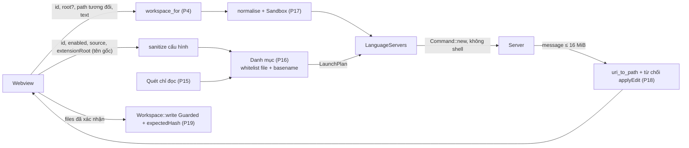

Rủi ro còn lại không chặn được bằng thiết kế này: binary trong thư mục extension/PATH có thể đã bị thay (không kiểm chữ ký); server chạy build script/MSBuild của dự án với quyền người dùng; server đọc mọi file trong root (kể cả `.env`) bằng quyền của nó. Giảm: mặc định tắt + cảnh báo khi bật, cwd = root, không truyền biến môi trường bí mật riêng của app (chỉ môi trường thừa hưởng + PATH bổ sung; không thêm khoá API từ `credentials`).

Môi trường tiến trình con: thừa hưởng môi trường app, `PATH` = `LaunchPlan.extra_path` (thư mục node, `~/.cargo/bin`, `~/.dotnet/tools`, `EXTRA_BIN_DIRS`) + PATH hiện có. Lý do: app desktop không thừa hưởng PATH của shell `[đã kiểm cli.rs]`, mà rust-analyzer cần `cargo`, csharp-ls cần `dotnet`. `DOTNET_ROOT` cho csharp-ls `[chưa kiểm]` TASK-012.

## 12. G-download (giai đoạn sau, phác thảo, chặn tới khi giai đoạn 1 xong)

Chỉ phác thảo để giữ chỗ trong hợp đồng; TASK-014 phải cập nhật mục này trước khi code. Q2 = A (công cụ hệ thống), Q13 mặc định (phiên bản + SHA-256 ghim trong mã, đổi theo bản phát hành app).

- Điều kiện hiện nút (`canDownload = true`): không có ứng viên VS Code-family hợp lệ **và** không có ứng viên PATH hợp lệ **và** danh mục có nguồn tải cho nền tảng máy (Intelephense: thêm điều kiện có Node).
- Lệnh dự kiến (chưa đăng ký ở giai đoạn 1): `language_server_download_info(id) → { url, version, sizeBytes, sha256, licenseUrl, licenseName }`, `language_server_download(id) → void` (chạy nền một luồng, một lượt mỗi id), `language_server_download_cancel(id)`, `language_server_download_remove(id)`. Sự kiện `language-server-download-progress { id, receivedBytes, totalBytes, phase: 'downloading' | 'verifying' | 'extracting' | 'done' | 'failed' | 'cancelled', error }`.

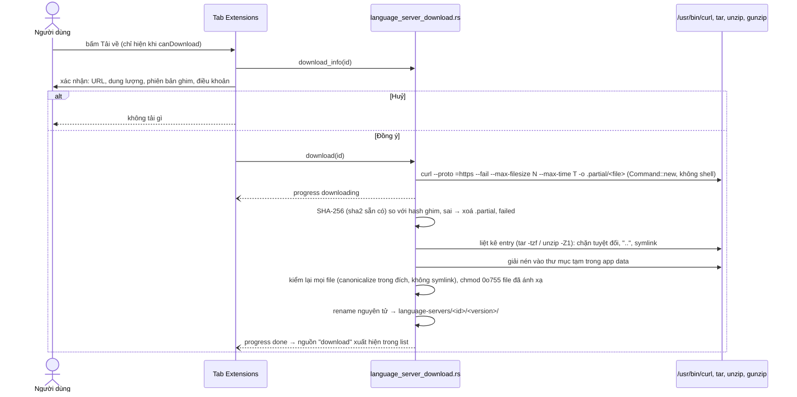

## 13. Luồng dữ liệu (DFD mức 1)

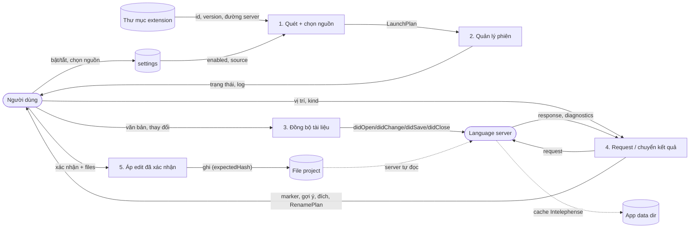

## 14. Độ tin cậy, quan sát, hiệu năng

- **Luồng**: mỗi phiên 3 luồng (ghi từ `mpsc`, đọc stdout, đọc stderr) như `terminal.rs`/`formatter.rs` `[đã kiểm]`; luồng ghi riêng để server không đọc stdin kịp không làm treo lệnh (cùng lý do `formatter.rs` ghi stdin ở luồng riêng). Lệnh chờ response qua `recv_timeout`, chạy trong `commands::blocking`.
- **Không retry request**: request lỗi/timeout trả lỗi, Monaco tự hỏi lại ở thao tác sau; chỉ tiến trình được restart (giới hạn).
- **Quan sát**: log ring mỗi slot (dòng app ghi: `spawn <origin> <version> <path>`, `initialize ok <ms>`, `exit <code>`, `restart n/3`, `request timeout <method>`); không có metrics/telemetry gửi đi. Bằng chứng hiệu năng (thời gian `initialize`, RAM) chỉ ghi khi đã đo ở TASK-010..012.
- **Bottleneck dự kiến** `[giả thuyết, chưa đo]`: rust-analyzer index lần đầu lâu (completion trả rỗng/timeout trong lúc index); file lớn gần 100 000 byte với sync full (csharp-ls nếu chỉ hỗ trợ full) → mỗi lần gõ gửi toàn văn, giảm bằng gom 150 ms. Kiểm bằng log thời gian ở TASK-010.
- **Nhất quán**: mirror là nguồn văn bản chuẩn cho server; model Monaco là nguồn chuẩn cho người dùng; `document_save` đồng bộ lại toàn văn mỗi lần lưu.

## 15. Kiểm chứng (kế hoạch, chưa chạy)

| Rủi ro                                                | Kiểm chứng                                                                                                                                                                                                                                                                 | Task          |
| ----------------------------------------------------- | -------------------------------------------------------------------------------------------------------------------------------------------------------------------------------------------------------------------------------------------------------------------------- | ------------- |
| Framing sai / cấp phát theo độ dài giả                | `cargo test`: cắt 1 byte/lần, 2 message 1 chunk, có Content-Type, thiếu/trùng Content-Length, 17 MiB, body không UTF-8                                                                                                                                                     | TASK-002      |
| UTF-16 / CRLF lệch                                    | `apply_change` với emoji, tiếng Việt, CRLF; so mirror với văn bản kỳ vọng                                                                                                                                                                                                  | TASK-002      |
| URI thoát root                                        | URI có dấu cách/`#`/tiếng Việt; URI ngoài root, symlink ra ngoài → `None`                                                                                                                                                                                                  | TASK-002      |
| Quét extension sai / chạy file lạ                     | HOME giả: 4 gốc, 0.3.9 vs 0.3.10, `.obsolete`, hậu tố nền tảng, symlink thư mục/file ra ngoài, thiếu bit thực thi, `package.json` 2 MiB/hỏng, basename PATH sai                                                                                                            | TASK-003      |
| Cấu hình hỏng                                         | DB tạm: mặc định tắt; JSON hỏng → mặc định; `extensionRoot` lạ bị bỏ; dòng `chat` không đổi                                                                                                                                                                                | TASK-004      |
| Treo / rò tiến trình / ghép id sai                    | Transport giả trong bộ nhớ: response ngược thứ tự, timeout + `$/cancelRequest`, server request tối thiểu, `-32601`, restart 3/3 phút; `#[cfg(unix)]` spawn `cat` không trả initialize → `error`, `stop_all` không còn tiến trình; mỗi test có deadline (bài học `63f088e`) | TASK-005      |
| Shape Rust ≠ TS                                       | `pnpm typecheck` không tăng quá 22 lỗi có sẵn; đối chiếu bảng 8.2 khi review                                                                                                                                                                                               | TASK-006      |
| Dọn tiến trình khi thoát/xoá project, tiến trình cháu | Thủ công `pnpm start` + `ps` sau Dừng, xoá project, thoát app                                                                                                                                                                                                              | TASK-006, 010 |
| Tắt server làm đổi hành vi editor                     | Playwright vite: file `.ts` như cũ; thủ công tắt hết server                                                                                                                                                                                                                | TASK-008, 013 |
| Từng ngôn ngữ chạy thật                               | Thủ công trên `src-tauri/` (Rust), project Laravel người dùng chỉ định (PHP, chỉ đọc), console mẫu trong thư mục tạm (C#)                                                                                                                                                  | TASK-010..012 |

## 16. Rủi ro và câu hỏi mở

| Rủi ro                                                                                                                       | Ảnh hưởng                                                                         | Giảm thiểu                                                                                                   |
| ---------------------------------------------------------------------------------------------------------------------------- | --------------------------------------------------------------------------------- | ------------------------------------------------------------------------------------------------------------ |
| Bỏ qua `client/registerCapability` (vd. `workspace/didChangeWatchedFiles`)                                                   | Server không biết file đổi trên đĩa do AI/git → index cũ tới khi file được mở/lưu | Chấp nhận ở đợt 1; restart server làm mới. Đợt 2 có thể gửi `didChangeWatchedFiles` từ các đường ghi của app |
| Tiến trình cháu sống sót sau kill                                                                                            | Rò CPU/RAM                                                                        | Kiểm `ps` ở TASK-006; có thì dùng process group (mục 6)                                                      |
| VS Code cập nhật extension khi server đang chạy (thư mục cũ bị xoá)                                                          | Server chết, restart không tìm thấy file                                          | Quét lại khi spawn; `extension_changed`                                                                      |
| Cargo.toml ở thư mục con (`src-tauri/`) với root = gốc repo                                                                  | rust-analyzer không nhận workspace                                                | TASK-010 kiểm; nếu cần, danh mục thêm `linkedProjects` dò từ root (không lấy từ UI)                          |
| File > 100 000 byte không có LSP                                                                                             | Thiếu tính năng ở file lớn                                                        | Ghi rõ trong tab/README; nâng trần là quyết định riêng (cũng là trần lưu của viewer)                         |
| Giấy phép Intelephense (độc quyền) khi gọi ngoài VS Code                                                                     | Pháp lý                                                                           | Mặc định tắt; ghi chú giấy phép khi bật; người dùng xác nhận (Q7)                                            |
| Monaco gộp nhiều thay đổi trong một event theo thứ tự khác giả định                                                          | Mirror lệch                                                                       | `out_of_sync` → mở lại toàn văn; `document_save` gửi toàn văn; TASK-007 so mirror ↔ model                    |
| Thay đổi chưa commit ở `lib.rs`, `monaco-code.tsx`, `editor-body.tsx`, `use-file-session.ts`, `code-viewer.tsx`, `README.md` | Xung đột                                                                          | Coder sửa chồng, chỉ thêm dòng, không hoàn tác                                                               |

Câu hỏi mở (không chặn giai đoạn 1, dùng mặc định đã ghi):

- **Q3**: ngôn ngữ/tính năng đợt 2 (Blade, Phpactor, Python, Go, Vue, C/C++, TS server thật; references, code action, inlay hint). Mặc định: ngoài phạm vi.
- **Q4**: đa-root/worktree. Mặc định: chỉ `folders[0]`.
- **Q6**: đường dẫn server tuỳ chỉnh. Mặc định: không.
- **Q7**: Intelephense có giấy phép độc quyền; người dùng cần xác nhận việc gọi server ngoài VS Code phù hợp điều khoản trước TASK-011. Mặc định: không có ô licence premium.
- **Q8**: mở định nghĩa ngoài project ở chế độ chỉ đọc. Mặc định: chỉ thông báo.
- **Q9**: tự dừng server khi không dùng. Mặc định: không.
- **Q10**: Windows. Mặc định: macOS/Linux.
- **Q13**: cách cập nhật phiên bản + SHA-256 ghim cho G-download. Mặc định: ghim trong mã.

Blocker: chỉ có **người dùng duyệt tài liệu này** (TASK-001 `doneWhen`) trước khi bắt đầu G1. Q2 chặn G-download đã được chốt (A); G-download vẫn chờ giai đoạn 1 xong.

## 17. Rollback và bàn giao

- **Rollback**: mặc định tắt nên tắt server trong tab = trở về hành vi cũ. Gỡ mã: bỏ mod/`manage`/lệnh trong `lib.rs`, bỏ tab và hook editor; dòng `settings.language_servers` vô hại khi để lại. Không chạm thư mục extension nên không có gì phải hoàn tác ở đó. Xoá `<app data>/language-servers` để dọn cache Intelephense (và bản tải sau này). File do rename ghi: hoàn tác bằng undo/git.
- **Bàn giao**: tài liệu này là input của `planner`/coder theo plan `lsp-extensions-20261107.json`. Hợp đồng chung giữa agent Rust (G1) và agent UI (G2, G3) là **mục 8** (11 lệnh, 2 sự kiện, kiểu, khoá lỗi); thay đổi shape phải sửa Rust và `ide-language-server.ts` cùng lúc và cập nhật mục 8. Ảnh hưởng plan do quyết định đã chốt: TASK-012 bỏ phần Roslyn (Q11); TASK-009 dùng `ToolTable` (Q5); TASK-014 dùng phương án A (Q2), không đổi `Cargo.toml`.
