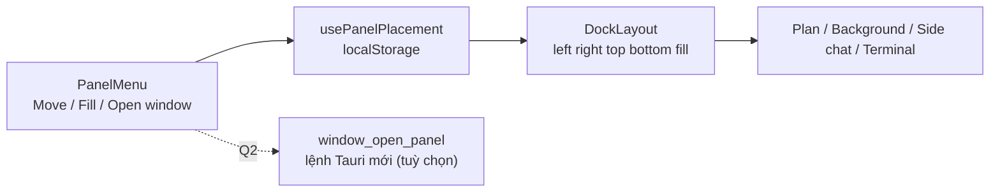

# Thiết kế: vị trí các ngăn (Move, Fill and arrange, Open in new window)

Trạng thái: **đã triển khai (Move, Fill and arrange, Float, vị trí mặc định); Open in new window hoãn (Q2); kiểm chứng L6 một phần, xem mục "Kiểm chứng 2026-11-08"**. Nguồn yêu cầu: ảnh chụp menu của ngăn Plan trong ứng dụng Claude do người dùng gửi ngày 2026-11-06: nút phóng to mở menu có ba nhóm: **Move** (bốn biểu tượng vị trí), **Fill and arrange** (hai biểu tượng) và **Open in new window**. Áp dụng cho các ngăn của dock: Plan, Background tasks, Side chat, Terminal (xem [plan-pane.md](./plan-pane.md), [background-tasks.md](./background-tasks.md), [side-chat.md](./side-chat.md)). Căn cứ mã `[đã kiểm]`: `src/app.tsx` (terminal ở dock dưới, `terminalOpen`, `useResizableWidth('ide.height.terminal', ...)`), `src/hooks/use-resizable-width.ts` (kích thước lưu localStorage). `[giả định]`: hình bốn biểu tượng Move là trái, phải, trên, dưới (ảnh nhỏ, biểu tượng thứ ba đang chọn); hai biểu tượng Fill and arrange là "chiếm cả vùng" và "chia đôi cạnh ngăn khác". Q1 đã chốt (2026-11-06): đúng như giả định.

## 1. Phạm vi

- Mỗi ngăn có menu vị trí (mở từ nút phóng to hoặc nút `...` của ngăn) gồm:
    - **Move**: đặt ngăn ở trái, phải, trên hoặc dưới vùng làm việc; vị trí hiện tại được đánh dấu.
    - **Fill and arrange**: ngăn chiếm cả vùng làm việc, hoặc xếp cạnh ngăn khác đang mở.
    - **Open in new window**: mở ngăn ở cửa sổ riêng (Q2).
- Vị trí và kích thước nhớ theo từng ngăn, là tuỳ chọn hiển thị (giống `useResizableWidth`), không phải dữ liệu dự án.
- Ngoài phạm vi: kéo thả ngăn giữa các vùng, ghi nhớ bố cục theo dự án, nhiều cửa sổ đồng bộ trạng thái.

| ID  | Yêu cầu                   | Tiêu chí chấp nhận                                                                                  |
| --- | ------------------------- | --------------------------------------------------------------------------------------------------- |
| L1  | Chọn vị trí ngăn          | Bấm một trong bốn biểu tượng Move thì ngăn chuyển sang vùng đó; biểu tượng đang chọn có dấu hiệu rõ |
| L2  | Fill and arrange          | Chiếm cả vùng thì ẩn các ngăn khác tạm thời; bấm lại trả bố cục cũ                                  |
| L3  | Nhớ lựa chọn              | Mở lại app, ngăn ở đúng vị trí đã chọn; lỗi đọc localStorage thì dùng vị trí mặc định               |
| L4  | Mở cửa sổ mới             | Mục Open in new window mở ngăn ở cửa sổ riêng, ngăn cũ ẩn đi (Q2)                                   |
| L5  | Không phá bố cục hiện có  | Terminal vẫn ở dưới theo mặc định; Side chat đứng một mình vẫn chiếm cả vùng (side-chat.md S11)     |
| L6  | Đa ngữ, bàn phím, màn hẹp | Chữ qua i18n vi/en; menu thao tác bằng phím; viewport hẹp ẩn mục Move trái/phải và không cuộn ngang |

## 2. Mô hình

- `PanelPlacement = 'left' | 'right' | 'top' | 'bottom' | 'fill'`.
- Hook `usePanelPlacement(panelId, defaultPlacement)` đọc/ghi `ide.placement.<panelId>` trong localStorage, bọc try/catch.
- `DockLayout` nhận danh sách ngăn đang mở kèm `placement`, vẽ bốn vùng và vùng giữa là editor/chat; ngăn `fill` chiếm vùng giữa.
- `PanelMenu` là thành phần dùng chung (Radix dropdown) cho mọi ngăn, nhận `panelId`, `placement`, `onPlacementChange`, `onOpenWindow?`.

## 3. Sơ đồ

## 4. Câu hỏi mở

- **Q1** (đã chốt 2026-11-06): đúng như giả định.
- **Q2** (đã chốt 2026-11-06): hoãn Open in new window; menu chỉ có Move và Fill and arrange.

## Cập nhật 2026-11-07

- `PanelPlacement` thêm `'float'`; `DockedPlacement` loại cả `fill` và `float`. Rời `fill`/`float` quay về cạnh dock gần nhất.
- Cột file (`TreePanel`) dùng chung `PanelMenu` (chỉ trái/phải; fill là maximize có sẵn), lưu qua `usePanelPlacement('file-tree', 'right')`. Chọn trái: cột file được vẽ qua portal vào `DockLayout` `leadingSlot`, ngay trước chat chính (cạnh sidebar).
- Thứ tự mặc định: [sidebar | chat chính | vùng file (editor + cây file) trên / Multichat dưới].

## Cập nhật 2026-11-08: vị trí mặc định

- `PanelMenu` thêm hai mục dưới đường kẻ ngang (chỉ hiện khi ngăn truyền `onSaveDefault`/`onResetDefault`): **Đặt làm vị trí mặc định** (`panel_menu.save_default`) và **Về vị trí mặc định** (`panel_menu.reset_default`).
- `usePanelPlacement` trả thêm `saveAsDefault` và `resetToDefault`. Khoá localStorage: `ide.placement.<id>` (vị trí hiện tại) và `ide.placement-default.<id>` (vị trí mặc định đã lưu). Khi đọc: giá trị hiện tại hợp lệ, nếu không thì mặc định đã lưu, nếu không thì mặc định trong mã; lỗi storage thì dùng mặc định và chỉ giữ lựa chọn trong phiên.
- Open in new window vẫn hoãn (Q2): menu không có mục này, không thêm lệnh Tauri.

## Kiểm chứng 2026-11-08 (TASK-L06, REQ-L6)

Môi trường: vite (cổng 5191) trên Chrome hệ thống qua Playwright, `window.__TAURI_INTERNALS__` giả lập (không có backend Tauri). Ảnh chứng: `.agents/storage/evidence/pane-placement/` (git-ignore).

| Hạng mục                                                                                                              | Kết quả                                                                                                                                                                               |
| --------------------------------------------------------------------------------------------------------------------- | ------------------------------------------------------------------------------------------------------------------------------------------------------------------------------------- |
| `pnpm typecheck`                                                                                                      | Pass: 0 lỗi (22 lỗi có sẵn ghi ở AGENTS.md không còn)                                                                                                                                 |
| `pnpm lint`                                                                                                           | Pass: 0 lỗi, 66 cảnh báo, không cảnh báo nào ở tệp placement                                                                                                                          |
| `pnpm format:check`                                                                                                   | Fail: `tree-panel.tsx` (tệp placement; bản HEAD đạt, lỗi do thay đổi chưa commit ở dòng `onCloseAutoFocus`), `tree.ts`, `local-changes.tsx` chưa đúng định dạng; chưa sửa             |
| Menu cột file, vi/en, 768 và 1280: mở bằng Enter, mũi tên chuyển focus, Enter chọn, Esc đóng                          | Pass; `aria-checked` đổi theo lựa chọn; Esc trả focus về nút; không cuộn ngang; menu nằm trong viewport                                                                               |
| Chọn Trái ghi `ide.placement.file-tree=left`; Đặt làm mặc định ghi `ide.placement-default.file-tree`                  | Pass                                                                                                                                                                                  |
| Menu ngăn Terminal, vi/en, 390 và 768                                                                                 | Pass: mở bằng phím, Esc trả focus, không cuộn ngang, menu trong viewport                                                                                                              |
| Nút Trái/Phải ẩn ở `max-sm` (dưới 640px)                                                                              | Chưa kiểm: không ngăn nào có Trái/Phải hiển thị dưới 640px trên vite (cột file không hiện ở 390; Terminal chỉ có Dưới); ở 768 hai nút hiện. Mới xác nhận qua đọc mã (`max-sm:hidden`) |
| Sau khi chọn Trái, focus không về nút menu                                                                            | Quan sát: cột file chuyển slot (portal) nên nút được dựng lại; không phải lỗi                                                                                                         |
| Chưa kiểm: Plan, Side chat, Background tasks, kéo kích thước, lưu vị trí qua lần mở lại app thật, hành vi trong Tauri | Chưa kiểm                                                                                                                                                                             |

## Cập nhật 2026-11-08: mã thực tế và kiểm chứng TASK-L06

### Mã thực tế `[đã kiểm]`

- `usePanelPlacement(panelId, defaultPlacement)` (`src/hooks/use-panel-placement.ts`) trả `placement`, `dockedPlacement`, `setPlacement`, `saveAsDefault`, `resetToDefault`.
    - `ide.placement.<panelId>`: vị trí hiện tại. Giá trị lạ hoặc lỗi đọc localStorage thì dùng vị trí mặc định đã lưu, không có thì `defaultPlacement`.
    - `ide.placement-default.<panelId>`: vị trí mặc định người dùng đã đặt (`saveAsDefault` lưu vị trí hiện tại; `resetToDefault` quay về nó, chưa lưu thì về `defaultPlacement`). Ghi lỗi thì chỉ giữ trong phiên (try/catch).
    - Id đang dùng: `bottom-panel` (dưới), `side-chat` (dưới), `plan` (phải), `file-tree` (phải).
- `PanelMenu` (`src/components/shell/panel-menu.tsx`) không nhận `panelId`/`onOpenWindow`; nhận `placement`, `dockedPlacement`, `floatable?`, `edges?`, `onPlacementChange`, `onSaveDefault?`, `onResetDefault?`. Nút mở menu mở cả khi rê chuột.
    - **Move**: Trái, Phải, Trên, Dưới (lọc theo `edges`: cột file chỉ Trái/Phải, ngăn dưới chỉ Dưới), thêm **Float** khi `floatable` (bấm lại về `dockedPlacement`). Trái/Phải có `max-sm:hidden`.
    - **Fill and arrange**: "Chiếm cả vùng làm việc" (bấm lại về `dockedPlacement`) và "Xếp cạnh ngăn khác".
    - Hai mục dưới dải phân cách, chỉ hiện khi truyền handler: **Đặt làm vị trí mặc định** (`panel_menu.save_default`) và **Về vị trí mặc định** (`panel_menu.reset_default`). Plan, Side chat, Background, Terminal, cột file đều truyền cả hai.
    - Mỗi mục vị trí là `role="menuitemradio"` với `aria-checked` và `aria-label`; **không có** mục Open in new window (Q2).

### Kiểm chứng TASK-L06 (2026-11-08)

Lệnh: `pnpm typecheck` 0 lỗi (kết quả có sẵn trong AGENTS.md là 22 lỗi, nay không còn); `pnpm lint` 0 lỗi, 66 cảnh báo, không có cảnh báo ở tệp placement; `pnpm format:check` **không đạt** ở 3 tệp: `tree-panel.tsx` (đang sửa, bản HEAD đạt), `tree.ts`, `local-changes.tsx` (hai tệp này chưa sửa).

Playwright (Chrome hệ thống, vite `localhost:1420`, giả lập `window.__TAURI_INTERNALS__` bằng dữ liệu mẫu vì vite không có backend Tauri; ảnh ở `.agents/storage/evidence/pane-placement/L06/`):

| Mục                                                                                                | Kết quả | Ghi chú                                                                              |
| -------------------------------------------------------------------------------------------------- | ------- | ------------------------------------------------------------------------------------ |
| Không cuộn ngang ở 390, 768, 1280, 1800                                                            | Pass    | `scrollWidth <= innerWidth`, cả sau khi thao tác                                     |
| 390px: Trái/Phải ẩn, Trên/Dưới còn (ngăn Plan)                                                     | Pass    | `plan-390-sidechat-menu.png`                                                         |
| 768px và từ 640px trở lên: Trái/Phải hiện                                                          | Pass    | `plan-768-*`, `side-768-*`                                                           |
| Bàn phím: Enter mở menu, mũi tên đổi focus, Enter chọn, Esc đóng và trả focus về nút               | Pass    | `1280-vi-keyboard-focus.png`                                                         |
| `aria-checked` đúng vị trí hiện tại (Dưới và "Xếp cạnh ngăn khác" mặc định; Trái sau khi chọn)     | Pass    | ba ngăn: cột file, Side chat, Plan                                                   |
| Chọn Trên/Trái/Phải/Nổi/Chiếm cả vùng ghi đúng `ide.placement.<id>`; Chiếm cả vùng còn sau tải lại | Pass    | Side chat, Plan (không có Nổi); `side-1800-*`, `plan-1800-*`                         |
| Đặt/Về vị trí mặc định ghi và đọc `ide.placement-default.<id>`                                     | Pass    | cột file; `1280-vi-menu-defaults.png`                                                |
| Giá trị lạ trong localStorage không làm hỏng giao diện                                             | Pass    | cột file, mới kiểm trang vẫn hiện nút menu                                           |
| Chữ vi và en                                                                                       | Pass    | menu cột file ở 1280 (`1280-en-menu-open.png`); chưa chụp đủ mọi ngăn bằng tiếng Anh |

Chưa kiểm hoặc cần lưu ý:

- Ngăn Terminal (`bottom-panel`) không kiểm trên vite (xterm không nạp được trong môi trường này); phần cần PTY và lệnh Tauri thật chưa chạy.
- Ở 390px cột file bị ẩn và Side chat đứng một mình nên không có menu (đúng S11), vì vậy Trái/Phải ẩn ở max-sm chỉ kiểm bằng ngăn Plan.
- Ở 390px, ngăn Plan mở cạnh chat chính ép chat còn rất hẹp (không cuộn ngang nhưng chật); ở 1280px, Side chat đặt Trái/Phải làm chat chính tự thu lại (Side chat đứng một mình). Chưa có yêu cầu nên chưa sửa.
- Ở 390px với vị trí hiện tại là Phải (Plan mặc định), mục Phải bị ẩn nên không mục Move nào được đánh dấu.
- Chiếm cả vùng của cột file là maximize có sẵn, không ghi `ide.placement.file-tree`.
- Thoát `fill` về cạnh dock gần nhất qua tải lại trang chưa kiểm bằng trình duyệt.
- Open in new window vẫn hoãn theo Q2; không có lệnh Tauri mới.
