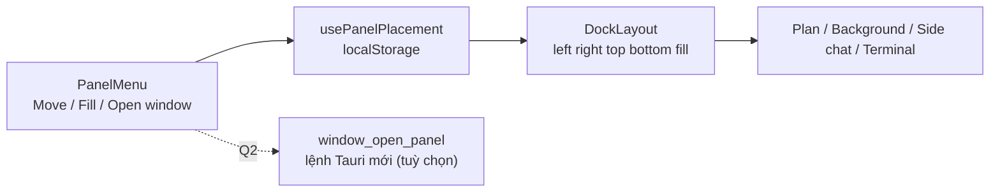

# Thiết kế: vị trí các ngăn (Move, Fill and arrange, Open in new window)

Trạng thái: **thiết kế đề xuất, chưa triển khai**. Nguồn yêu cầu: ảnh chụp menu của ngăn Plan trong ứng dụng Claude do người dùng gửi ngày 2026-11-06: nút phóng to mở menu có ba nhóm: **Move** (bốn biểu tượng vị trí), **Fill and arrange** (hai biểu tượng) và **Open in new window**. Áp dụng cho các ngăn của dock: Plan, Background tasks, Side chat, Terminal (xem [plan-pane.md](./plan-pane.md), [background-tasks.md](./background-tasks.md), [side-chat.md](./side-chat.md)). Căn cứ mã `[đã kiểm]`: `src/app.tsx` (terminal ở dock dưới, `terminalOpen`, `useResizableWidth('ide.height.terminal', ...)`), `src/hooks/use-resizable-width.ts` (kích thước lưu localStorage). `[giả định]`: hình bốn biểu tượng Move là trái, phải, trên, dưới (ảnh nhỏ, biểu tượng thứ ba đang chọn); hai biểu tượng Fill and arrange là "chiếm cả vùng" và "chia đôi cạnh ngăn khác". Q1 đã chốt (2026-11-06): đúng như giả định.

## 1. Phạm vi

- Mỗi ngăn có menu vị trí (mở từ nút phóng to hoặc nút `...` của ngăn) gồm:
    - **Move**: đặt ngăn ở trái, phải, trên hoặc dưới vùng làm việc; vị trí hiện tại được đánh dấu.
    - **Fill and arrange**: ngăn chiếm cả vùng làm việc, hoặc xếp cạnh ngăn khác đang mở.
    - **Open in new window**: mở ngăn ở cửa sổ riêng (Q2).
- Vị trí và kích thước nhớ theo từng ngăn, là tuỳ chọn hiển thị (giống `useResizableWidth`), không phải dữ liệu dự án.
- Ngoài phạm vi: kéo thả ngăn giữa các vùng, ghi nhớ bố cục theo dự án, nhiều cửa sổ đồng bộ trạng thái.

| ID  | Yêu cầu                   | Tiêu chí chấp nhận                                                                                  |
| --- | ------------------------- | --------------------------------------------------------------------------------------------------- |
| L1  | Chọn vị trí ngăn          | Bấm một trong bốn biểu tượng Move thì ngăn chuyển sang vùng đó; biểu tượng đang chọn có dấu hiệu rõ |
| L2  | Fill and arrange          | Chiếm cả vùng thì ẩn các ngăn khác tạm thời; bấm lại trả bố cục cũ                                  |
| L3  | Nhớ lựa chọn              | Mở lại app, ngăn ở đúng vị trí đã chọn; lỗi đọc localStorage thì dùng vị trí mặc định               |
| L4  | Mở cửa sổ mới             | Mục Open in new window mở ngăn ở cửa sổ riêng, ngăn cũ ẩn đi (Q2)                                   |
| L5  | Không phá bố cục hiện có  | Terminal vẫn ở dưới theo mặc định; Side chat đứng một mình vẫn chiếm cả vùng (side-chat.md S11)     |
| L6  | Đa ngữ, bàn phím, màn hẹp | Chữ qua i18n vi/en; menu thao tác bằng phím; viewport hẹp ẩn mục Move trái/phải và không cuộn ngang |

## 2. Mô hình

- `PanelPlacement = 'left' | 'right' | 'top' | 'bottom' | 'fill'`.
- Hook `usePanelPlacement(panelId, defaultPlacement)` đọc/ghi `ide.placement.<panelId>` trong localStorage, bọc try/catch.
- `DockLayout` nhận danh sách ngăn đang mở kèm `placement`, vẽ bốn vùng và vùng giữa là editor/chat; ngăn `fill` chiếm vùng giữa.
- `PanelMenu` là thành phần dùng chung (Radix dropdown) cho mọi ngăn, nhận `panelId`, `placement`, `onPlacementChange`, `onOpenWindow?`.

## 3. Sơ đồ

## 4. Câu hỏi mở

- **Q1** (đã chốt 2026-11-06): đúng như giả định.
- **Q2** (đã chốt 2026-11-06): hoãn Open in new window; menu chỉ có Move và Fill and arrange.

## Cập nhật 2026-11-07

- `PanelPlacement` thêm `'float'`; `DockedPlacement` loại cả `fill` và `float`. Rời `fill`/`float` quay về cạnh dock gần nhất.
- Cột file (`TreePanel`) dùng chung `PanelMenu` (chỉ trái/phải; fill là maximize có sẵn), lưu qua `usePanelPlacement('file-tree', 'right')`. Chọn trái: cột file được vẽ qua portal vào `DockLayout` `leadingSlot`, ngay trước chat chính (cạnh sidebar).
- Thứ tự mặc định: [sidebar | chat chính | vùng file (editor + cây file) trên / Multichat dưới].
