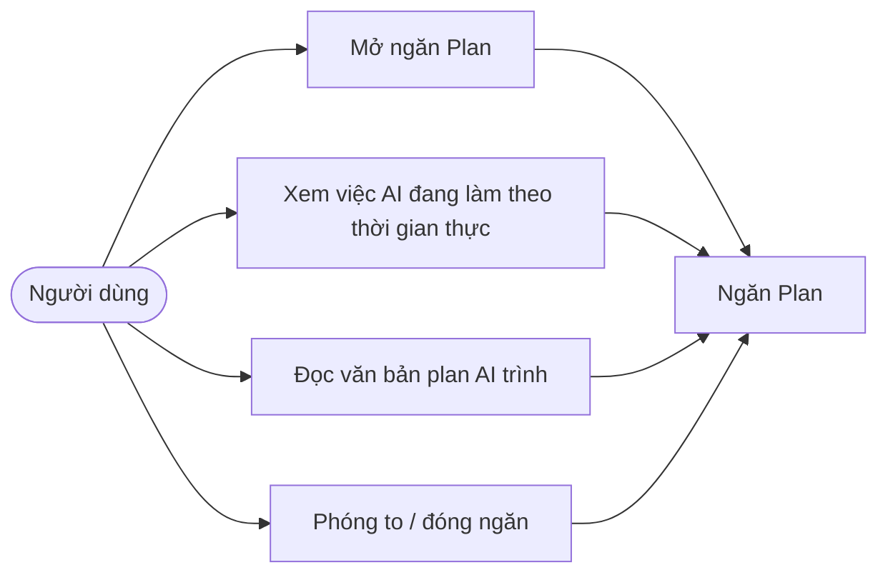
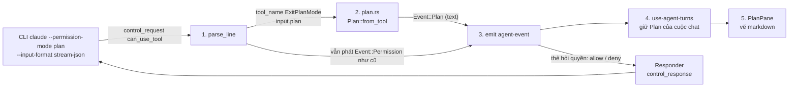
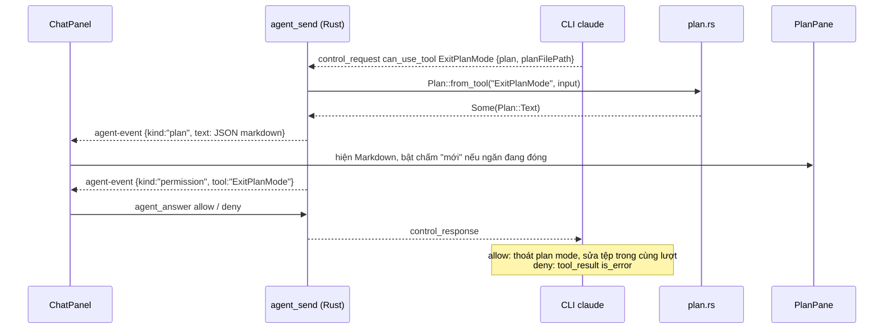
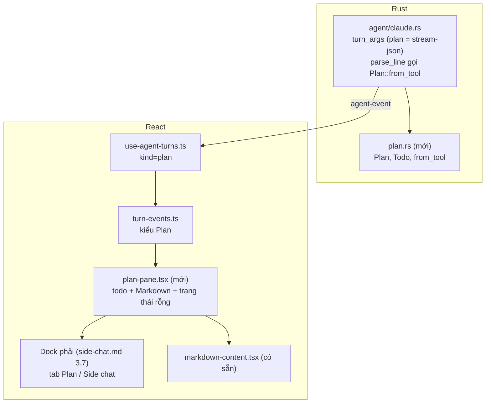
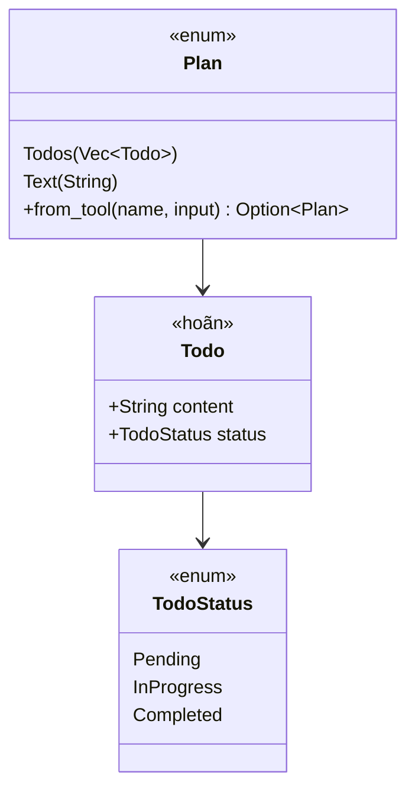
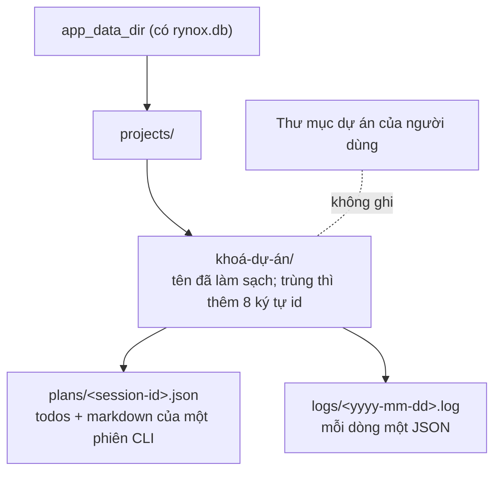

# Thiết kế: ngăn Plan (kế hoạch AI đang viết khi làm việc)

Trạng thái: **đã triển khai; kiểm chứng một phần (xem mục 7)**: mã (`plan.rs`, `plan_store.rs`, `run_log.rs`, `project_data.rs`, `commands/plan.rs`, `plan-pane.tsx`) đã có và qua kiểm tự động, còn các AC cần app Tauri thật với CLI `claude` thật ghi "chưa kiểm". **Sửa 2026-11-07 theo kết quả chụp CLI thật (TASK-P01, claude 2.1.319, mục 2.1): đợt này chỉ làm phần văn bản kế hoạch qua `ExitPlanMode`; phần todo HOÃN (mục 6).** Nguồn yêu cầu: ảnh chụp ngăn "Plan" của ứng dụng Claude do người dùng gửi ngày 2026-11-06 (tiêu đề Plan, nút phóng to và đóng, trạng thái rỗng "Chưa có plan — AI viết plan ở đây khi khám phá, cứ tiếp tục chat"). Căn cứ mã `[đã kiểm]`: `agent.rs` (`parse_line`, `tool_started`, `Event::Tool`), `use-agent-turns.ts`, `turn-steps.tsx`, `workspace-pane.tsx`, `use-pane-state.ts`. `[chưa kiểm]` và `[giả định]` ghi rõ. Dock dùng chung với [side-chat.md](./side-chat.md) mục 3.7; tổng quan: [architecture.md](./architecture.md).

## 1. Phạm vi

Ngăn chỉ đọc hiện **kế hoạch của lượt AI hiện tại**, cập nhật ngay khi AI viết:

- Văn bản plan (Markdown) khi Claude ở chế độ plan trình plan bằng `ExitPlanMode` (trường `input.plan` của `control_request` `can_use_tool`) `[đã kiểm]`.
- ~~Danh sách việc (todo) từ `TodoWrite`~~: **HOÃN** (P2, mục 6) vì app chạy `claude -p` không có `--tools` nên CLI không có `TodoWrite`/`Task*` `[đã kiểm]`. Thành phần vẽ todo trong `plan-pane.tsx` giữ nguyên, dữ liệu luôn rỗng.
- Trạng thái rỗng như ảnh: biểu tượng, "Chưa có plan", dòng gợi ý; nút phóng to và đóng.
- Chấm báo mới trên nút mở khi có plan chưa xem (như chấm xanh ở góc ảnh).

**Ngoài phạm vi (đợt này)**: sửa plan trong ngăn, duyệt/từ chối plan từ ngăn (đã có luồng hỏi quyền của chat), lưu plan vào DB (plan lưu thành tệp theo dự án, mục 3.8), màn hình xem log, plan của Codex (xem Q1), kéo thả tab giữa dock, liên hệ với `docs/plans/*.json` của repo (đó là plan triển khai của người dùng, khác plan của AI).

| ID  | Yêu cầu                                                   | Tiêu chí chấp nhận                                                                                                                                                      |
| --- | --------------------------------------------------------- | ----------------------------------------------------------------------------------------------------------------------------------------------------------------------- |
| P1  | Mở/đóng/phóng to ngăn Plan                                | Nút mở ở thanh công cụ chat; ngăn nằm trong dock phải cùng tab với Side chat; phóng to, đóng như ảnh                                                                    |
| P2  | Hiện todo của AI theo thời gian thực (**HOÃN**)           | Mỗi lần AI gọi `TodoWrite`, danh sách trong ngăn thay bằng bản mới, đúng thứ tự và trạng thái. Hoãn: xem mục 6                                                          |
| P3  | Hiện văn bản plan                                         | Ở chế độ plan, khi CLI gửi `control_request` `can_use_tool` `ExitPlanMode`, nội dung `input.plan` hiện dạng Markdown trong ngăn; duyệt/từ chối qua thẻ hỏi quyền có sẵn |
| P4  | Trạng thái rỗng                                           | Chưa có todo/plan thì hiện đúng ba phần của ảnh, vi/en                                                                                                                  |
| P5  | Tính ở backend Rust                                       | Rust tách `ExitPlanMode` từ `control_request` của CLI và phát sự kiện riêng; frontend chỉ vẽ                                                                            |
| P6  | Theo từng cuộc chat; sub-agent không lẫn                  | Plan thuộc lượt của cuộc chat đang mở; công cụ gọi trong sub-agent (`parent`) bị bỏ qua                                                                                 |
| P7  | Đổi contract tối thiểu, không đổi DB, không thêm thư viện | Chỉ thêm **một** lệnh Tauri `plan_load` và biến thể `Event::Plan`; DB và `Cargo.toml` không đổi                                                                         |
| P8  | Không rò sang điện thoại ngoài ý muốn                     | `Event::Plan` đi như mọi `agent-event`; điện thoại bỏ qua kind lạ (Q3)                                                                                                  |
| P9  | Lưu plan theo tên dự án trong dữ liệu app                 | Plan ghi vào `<app_data_dir>/projects/<khoá-dự-án>/plans/<session>.json`; thư mục dự án của người dùng không có tệp mới                                                 |
| P10 | Lưu logs theo tên dự án                                   | Nhật ký lượt ghi vào `projects/<khoá-dự-án>/logs/<ngày>.log`, không chứa nội dung prompt/answer, khoá API, biến môi trường                                              |

## 2. Hiện trạng

- `parse_line` đã thấy mọi `tool_use` của Claude và phát `Event::Tool` (JSON `{id,name,description,input,...}`) `[đã kiểm]`; `tool_started` chỉ lấy **một chuỗi đích** (`command`, `file_path`, `path`, `pattern`, `url`, `prompt`) nên đầu vào `TodoWrite` (`input.todos`) và `ExitPlanMode` (`input.plan`) hiện bị bỏ `[đã kiểm]`.
- Mỗi bước còn được lưu trong cột `steps` của lượt chat (đã sửa, xem database.md) nên todo có thể dựng lại từ các bước đã lưu khi mở lại cuộc chat `[giả định]` (Q2).
- Codex `exec --json` không có tên công cụ tương đương trong mã hiện tại; chụp thật không được vì tài khoản hết hạn mức tới 2026-12-01 `[chưa kiểm]`.
- App chạy Claude với stdin văn bản ở mọi chế độ, trừ "Hỏi từng việc" (`manual` = `ASK_MODE`) dùng `--input-format stream-json --permission-prompt-tool stdio` và `Responder` (`agent/claude.rs` `turn_args`, `commands/agent.rs`) `[đã kiểm]`. `parse_line` (ở `agent/claude.rs`) đã đổi `control_request` `can_use_tool` thành `Event::Permission` `[đã kiểm]`.

### 2.1. Kết quả chụp CLI thật (TASK-P01, claude 2.1.319, 2026-11-06/07)

Đo trong thư mục tạm, với `--setting-sources local` (hook của người dùng chặn `Write` khi chạy `claude -p`, nên app thật có thể khác).

| Cách chạy                                                           | Có trong danh sách tool                                                                                                                                     |
| ------------------------------------------------------------------- | ----------------------------------------------------------------------------------------------------------------------------------------------------------- |
| `claude -p`, stdin văn bản (cách app chạy chế độ `plan`, `auto`...) | **Không** có `TodoWrite`, `Task*`, `ExitPlanMode`, `EnterPlanMode`, `AskUserQuestion`; `ToolSearch select:TodoWrite` trả "No matching deferred tools found" |
| `--input-format stream-json`                                        | Thêm `AskUserQuestion`, `EnterPlanMode`, `ExitPlanMode`; vẫn không có `TodoWrite`/`Task*`                                                                   |
| `--tools TodoWrite` (+ `CLAUDE_CODE_ENABLE_TASKS=0`)                | Có `TodoWrite`, nhưng `--tools` giới hạn **toàn bộ** tập tool                                                                                               |
| `CLAUDE_CODE_ENABLE_TASKS=1 --tools TaskCreate,TaskUpdate,...`      | Có bộ `Task*` thay `TodoWrite`                                                                                                                              |

`ExitPlanMode` thật (`requires_user_interaction: true`), đồng thời có dòng `assistant` `tool_use` cùng `input`:

```json
{
    "type": "control_request",
    "request_id": "..",
    "request": {
        "subtype": "can_use_tool",
        "tool_name": "ExitPlanMode",
        "display_name": "ExitPlanMode",
        "input": {
            "plan": "# ...markdown...",
            "planFilePath": "/Users/.../.claude/plans/xxx.md"
        },
        "tool_use_id": "toolu_..."
    }
}
```

- Trả lời allow: `tool_result` "User has approved your plan. You can now start coding..." và CLI **thoát plan mode trong cùng lượt**, model ghi tệp ngay sau.
- Trả lời deny (message): `tool_result` `is_error` mang message; model thường gọi tiếp `AskUserQuestion`.
- Plan mode không tạo tệp trong dự án khi chưa duyệt, nhưng **tự ghi `~/.claude/plans/<tên ngẫu nhiên>.md`** (không hỏi quyền); `planFilePath` trỏ tới tệp đó.
- `TodoWrite` (khi ép): `input.todos[{content, status, activeForm}]`, `status` ∈ `pending|in_progress|completed`, mỗi lần gửi lại **cả danh sách**.
- `Task*`: `TaskCreate {subject, description}` → `tool_use_result.task.id`; `TaskUpdate {taskId, status}` → `statusChange {from, to}`; phải **gộp theo id**.
- Bố cục dock mới từ thiết kế Side chat (cột phải, tab, phóng to, đóng); Terminal ở đáy giữ nguyên.

## 3. Thiết kế

### 3.1. Phương án

| Phương án                                                         | Ưu                                                 | Nhược                               |
| ----------------------------------------------------------------- | -------------------------------------------------- | ----------------------------------- |
| A. Frontend tự dò `Event::Permission` có `tool` là `ExitPlanMode` | Không đổi Rust                                     | Vi phạm quy ước tính năng ở backend |
| **B. Rust phát `Event::Plan` riêng (đề xuất)**                    | Đúng quy ước; tách sớm, có test; frontend đơn giản | Thêm một biến thể `Event`           |

Chọn **B**. Nguồn plan là **`control_request` `ExitPlanMode`**, không phải dòng `assistant` `tool_use` (cùng nội dung, phát hai lần sẽ trùng). Để CLI có `ExitPlanMode`, chế độ `plan` của app chạy như "Hỏi từng việc": `--input-format stream-json --permission-prompt-tool stdio` và có `Responder`.

### 3.2. Use case



### 3.3. Luồng dữ liệu (DFD cấp 1)



### 3.4. Trình tự



### 3.5. Trạng thái của ngăn

```mermaid
stateDiagram-v2
    [*] --> Empty
    Empty --> HasText: nhận Plan::Text
    HasText --> HasText: ExitPlanMode mới thay bản cũ
    HasText --> Empty: chuyển cuộc chat chưa có plan
    note right of HasText: HasTodos / Both hoãn cùng P2
```

### 3.6. Thành phần và lớp





### 3.7. Hợp đồng sự kiện

`Event::Plan(String)` mang JSON camelCase, một trong hai dạng:

- `{"kind":"todos","todos":[{"content":"…","status":"pending|in_progress|completed"}]}`
- `{"kind":"text","markdown":"…"}`

Đợt này Rust chỉ phát dạng `text`; dạng `todos` giữ trong `plan.rs` (đã viết, có test) nhưng không được gọi tới (P2 hoãn). `planFilePath` không đưa vào sự kiện.

Ràng buộc: tối đa 100 todo, mỗi `content` cắt ở 500 ký tự, `markdown` cắt ở 100 000 ký tự `[giả định]`; trạng thái lạ bỏ qua todo đó. Công cụ có `parent_tool_use_id` (trong sub-agent) không phát (P6); `control_request` không mang `parent_tool_use_id` và chưa thấy sub-agent gọi `ExitPlanMode` `[chưa kiểm]`. `Event::Plan` phát **trước** `Event::Permission` của cùng `control_request`; `Event::Tool` của dòng `assistant` vẫn phát như cũ để mốc thời gian của chat không đổi.

### 3.8. Nơi lưu (theo tên dự án, trong dữ liệu app)

Quyết định của người dùng ngày 2026-11-06: plan và logs của app **không** ghi vào thư mục dự án (dữ liệu thật, mặc định chỉ đọc) mà vào dữ liệu của chính app, cùng thư mục với `rynox.db` (`app.path().app_data_dir()`, xem `lib.rs`, `db::path`).



- **Khoá dự án**: tên dự án làm sạch (chữ, số, `-`, `_`); trùng tên thì thêm 8 ký tự đầu của `projects.id`; tên rỗng dùng `id`. Đổi tên dự án không đổi thư mục (Q4).
- **Module mới `project_data.rs`**: `ProjectData::dir(data_dir, name, id)`, kiểm kết quả nằm trong `projects/` (chặn `..`, symlink), ghi nguyên tử (tệp tạm rồi đổi tên). Lỗi ghi (đĩa đầy, quyền) bị bỏ qua lặng lẽ, không làm hỏng lượt chat.
- **Plan**: khi `parse_line` phát `Event::Plan` (từ `ExitPlanMode`; lần trình lại ghi đè), `commands/agent.rs` ghi `plans/<session>.json` (session id từ `Event::Session` của cùng lượt). Lệnh mới `plan_load(root, session) -> Option<String>` đi qua `workspace_for(root)` để chỉ đọc plan của dự án đã lưu; frontend gọi khi mở cuộc chat cũ (thay Q2 cũ).
- **Logs**: dòng JSON `{ts, runId, cli, kind, ...}` cho sự kiện của lượt (bắt đầu, tên công cụ, key lỗi, kết thúc); **không** ghi prompt, answer, khoá API, biến môi trường. Giữ 14 ngày và tối đa 5 MB mỗi tệp (Q5). Màn hình xem log ngoài phạm vi.
- **Dữ liệu**: không đổi DB; thêm tệp theo dự án như trên.

```mermaid
sequenceDiagram
    participant R as agent_send (Rust)
    participant X as plan.rs
    participant S as project_data.rs
    participant F as projects/&lt;khoá&gt;/
    participant C as ChatPanel

    R->>X: Plan::from_tool("ExitPlanMode", input)
    X-->>R: Some(Plan)
    R-->>C: agent-event kind=plan
    R->>S: dir(data_dir, tên, id)
    S-->>R: đường dẫn an toàn
    R->>F: ghi plans/session.json (nguyên tử) và dòng logs/ngày.log
    C->>R: plan_load(root, session) khi mở cuộc chat cũ
    R->>F: đọc plans/session.json
    R-->>C: Plan hoặc None
```

### 3.9. An toàn

Plan chỉ là văn bản của AI, không có đường chạy lệnh hay ghi tệp; Markdown vẽ bằng `markdown-content.tsx` có sẵn. Ghi tệp ngoài workspace là ghi vào dữ liệu của chính app, không vi phạm quy tắc dữ liệu thật mặc định chỉ đọc.

Lưu ý mới từ P01:

- **Duyệt plan = cho phép sửa tệp**: allow `ExitPlanMode` làm CLI thoát plan mode và ghi vào dự án trong cùng lượt. Chế độ Plan của app chỉ còn chỉ đọc tới lúc người dùng duyệt (câu hỏi 6). Chưa kiểm các lần ghi sau đó có còn hỏi quyền qua stdio không.
- **Tác dụng phụ ngoài app**: plan mode của CLI tự ghi `~/.claude/plans/<tên>.md` không hỏi quyền; app không kiểm soát được, chỉ ghi nhận.
- **Thêm thẻ hỏi quyền trong chế độ plan**: chạy stdio thì các `can_use_tool` khác (và `AskUserQuestion` sau khi deny) cũng đến app (câu hỏi 7).

## 4. Phi chức năng

- **Hiệu năng**: thêm một so sánh `tool_name` ở nhánh `control_request` đã có; O(độ dài plan) cho mỗi lần gọi.
- **Lỗi**: thiếu `plan` hoặc sai kiểu thì không phát `Event::Plan`, `Event::Permission` vẫn phát; không báo lỗi. Lượt phải kết thúc khi có dòng `result` (Responder đóng stdin như chế độ Hỏi từng việc).
- **Quan hệ với plan khác**: `agent.rs` thuộc nhóm A của [plan OOP](../plans/oop-refactor-backend-20261106.json) và cũng nằm trong [bảng Context](./context-panel.md); ba việc cùng sửa `parse_line`: làm tuần tự, ưu tiên sau TASK-003 hoặc đặt vào `ClaudeAgent`. Dock phải dùng chung với [Side chat](./side-chat.md).

## 5. Câu hỏi mở

1. Codex có sự kiện todo/plan (`todo_list`) trong `exec --json` không? Mặc định: chỉ Claude đợt này. Chưa chụp được (hết hạn mức tới 2026-12-01).
2. (Đã quyết) Mở lại cuộc chat cũ dựng plan bằng `plan_load` từ tệp theo dự án, không dựng từ cột `steps`.
3. Điện thoại có xem plan? Mặc định: không; xác nhận điện thoại bỏ qua kind `plan`.
4. (Đã trả lời bởi TASK-P01, mục 2.1) Tên công cụ và trường của bản `claude` 2.1.319.
5. Ngăn Plan tự mở khi có plan đầu tiên, hay chỉ bật chấm? Mặc định: chỉ bật chấm.
6. Duyệt plan làm CLI sửa tệp ngay trong lượt: chấp nhận cho chế độ Plan của app? Mặc định: chấp nhận như Claude Code (người dùng chủ động bấm), kiểm hành vi sau khi duyệt ở TASK-P06.
7. Trong chế độ plan (nay chạy stdio), các `can_use_tool` khác `ExitPlanMode` xử lý thế nào? Mặc định: hiện thẻ hỏi quyền như "Hỏi từng việc", không tự allow/deny.
8. Đổi tên dự án có đổi thư mục lưu? Mặc định: không (giữ thư mục cũ, tránh mất dữ liệu).
9. Giới hạn log 14 ngày và 5 MB mỗi tệp, chưa có màn hình xem log. Mặc định: có.

## 6. Phần hoãn: todo của AI (P2)

- **Lý do**: với claude 2.1.319, app chạy `claude -p` không có `--tools` nên CLI không có `TodoWrite`/`Task*` (mục 2.1). Bật được chỉ bằng `--tools` liệt kê **toàn bộ** tool (đổi tập tool của chat) hoặc bộ `Task*` (`CLAUDE_CODE_ENABLE_TASKS=1`, cần gộp theo `id`, khác hẳn `TodoWrite` gửi cả danh sách).
- **Điều kiện mở lại** (một trong): (a) bản `claude` đang cài có `TodoWrite`/`Task*` trong tập tool mặc định của `-p`/stream-json; (b) người dùng duyệt việc truyền `--tools` đầy đủ hoặc `CLAUDE_CODE_ENABLE_TASKS` cho chat; (c) chụp được `todo_list` của `codex exec --json`.
- **Đã có sẵn, giữ nguyên**: nhánh `TodoWrite` trong `plan.rs` (trường khớp chụp thật, bỏ qua `activeForm`), `TodoList` và khoá `plan_pane.status_*` trong `plan-pane.tsx`. Khi mở lại: chụp lại CLI, thêm `Task*` gộp theo id, lập task mới (TASK-P10 trong plan).

## 7. Trạng thái kiểm chứng (TASK-P06, 2026-11-08)

### 7.1. Năm lệnh kiểm chứng (chạy thật)

| Lệnh | Kết quả |
| --- | --- |
| `cargo fmt --manifest-path src-tauri/Cargo.toml --check` | Pass (mã thoát 0) |
| `cargo clippy --manifest-path src-tauri/Cargo.toml -- -D warnings` | Pass (mã thoát 0) |
| `cargo test --manifest-path src-tauri/Cargo.toml --lib -- --skip terminal::tests::a_shell_runs_in_a_pseudo_terminal` | Pass: 556 passed, 0 failed (1 test bỏ qua theo ý người dùng) |
| `pnpm typecheck` | Pass: 0 lỗi `error TS` (mục "Vấn đề đã biết" của AGENTS.md ghi 22 lỗi cũ không còn thấy) |
| `pnpm lint` | Pass: 0 error, 66 warning (có sẵn, không thuộc plan) |

Chạy nhắm riêng `-- plan project_data run_log relay remote ...`: 103 test qua.

### 7.2. Từng AC

"Pass (tự động)" nghĩa là có test Rust hoặc ảnh Playwright đã chạy; "chưa kiểm" nghĩa là chỉ kiểm được trên app Tauri thật (`pnpm start`) với CLI `claude` thật, phiên kiểm này không chạy được.

| AC | Trạng thái | Bằng chứng / lý do |
| --- | --- | --- |
| P1 Mở, phóng to, đóng; chung dock với Side chat | Pass (tự động, phần UI trên vite) | Ảnh Playwright của TASK-P05 trong `.agents/storage/evidence/plan-pane/`: `vi-expanded.png`, `en-expanded.png`, `vi-placement-menu.png`, `en-placement-menu.png`, `vi-narrow-420.png`. Chạy trong app Tauri: chưa kiểm |
| P3 Rust phát `Event::Plan` rồi `Event::Permission`; không đưa `planFilePath`; chế độ plan chạy stdio | Pass phần Rust (tự động); markdown trong ngăn khớp lượt CLI thật: chưa kiểm | `agent::claude::tests::claude_exit_plan_mode_request_gives_a_plan_then_the_question`, `agent::tests::plan_mode_asks_the_person_but_the_side_chat_stays_read_only`, `plan::tests::exit_plan_mode_gives_text`, `plan::tests::json_contract_is_camel_case_tagged`. Ảnh `vi-markdown.png`, `en-markdown.png` là dữ liệu giả lập trên vite, không phải lượt CLI thật |
| P4 Trạng thái rỗng vi/en | Pass (tự động) | `vi-empty.png`, `en-empty.png` |
| P5 Frontend chỉ đọc `Event::Plan` | Pass (đối chiếu mã) | Tìm trong `src/`: không còn chỗ tách plan từ `Event::Tool`/`Event::Permission`; chỉ `case 'plan'` trong `use-agent-turns.ts` và `planLoad` trong `use-chat-session.ts`. Test cùng loại: dòng `assistant` mang `ExitPlanMode`/`TodoWrite` không phát plan (trong test P3) |
| P6 Sub-agent không phát; đổi chat reset ngăn | Pass một phần | `Plan::from_tool` chỉ được gọi ở nhánh `control_request` của `parse_line` (mã `agent/claude.rs`), dòng `assistant` không phát plan (test P3). Reset khi chuyển chat: mã `use-chat-session.ts` (`setPlan(null)` khi `replace`), chưa có test chạy. `control_request` không có `parent_tool_use_id`, sub-agent gọi `ExitPlanMode`: chưa kiểm |
| P7 Chỉ thêm `plan_load`; `db.rs`, `Cargo.toml` không đổi | Pass một phần | `plan_load` có trong `generate_handler` (`lib.rs`); `git status` không báo `db.rs`, `Cargo.toml`, `lib.rs` đổi. `generate_handler` hiện còn các lệnh khác của tính năng khác (ví dụ `plan_docs_*`), nên vế "chỉ thêm" không so được với mốc ban đầu |
| P8 Điện thoại bỏ qua kind `plan` | Chưa kiểm | `remote.rs::event_message` chỉ loại `runId` `side-`; `Event::Plan` vẫn được chuyển tới điện thoại như mọi `agent-event`. Chưa kiểm trang điện thoại có bỏ qua kind lạ không (Q3) |
| P9 Plan lưu ở `projects/<khoá>/plans/<session>.json`, thư mục dự án không có tệp mới | Pass phần lưu (tự động); đối chiếu thư mục dự án thật: chưa kiểm | `plan_store::tests::a_recorded_plan_loads_back_and_merges_kinds`, `plan_store::tests::a_corrupt_file_is_replaced_by_the_next_record`, `plan_store::tests::unknown_or_unsafe_sessions_give_none_or_error`, `project_data::tests::*` (chặn `..`, symlink, ghi nguyên tử, khoá dự án). Lưu ý: `settings.save_plans_to_project` (mặc định `false`) khi bật sẽ ghi plan vào dự án (`commands/activity.rs::auto_save_plan`), khác với AC này |
| P10 Logs theo ngày, không chứa prompt/answer/khoá, 14 ngày, 5 MB | Pass (tự động) | `run_log::tests::lines_hold_only_allowed_fields`, `run_log::tests::records_go_to_the_day_file_and_stop_at_the_size_limit`, `run_log::tests::files_older_than_fourteen_days_are_removed`, `run_log::tests::dates_round_trip_and_format`. `LogEntry` chỉ có `Start`, `Tool`, `Error`, `End`, không mang văn bản tự do. File log từ lượt thật: chưa kiểm |
| P11 Duyệt/từ chối bằng thẻ hỏi quyền; không lượt nào treo | Chưa kiểm | Có test cho `Responder` (`agent::tests::a_permission_can_only_be_answered_once_and_only_if_asked`), nhưng `control_response` allow/deny của `ExitPlanMode` với CLI thật và hành vi sau allow (Q6, Q7) chưa chạy |

### 7.3. Chưa kiểm (cần `pnpm start` với CLI `claude` thật)

- Lượt chế độ plan thật: Markdown trong ngăn khớp `input.plan`, thẻ hỏi quyền `ExitPlanMode`.
- Deny: dự án thử không đổi; allow: hành vi sau khi CLI thoát plan mode, các thẻ hỏi quyền kế tiếp (Q6, Q7).
- Tệp `plans/<session>.json` và `logs/<ngày>.log` sinh từ lượt thật trong dữ liệu app; `git status` của dự án thử sạch.
- Điện thoại bỏ qua kind `plan` (Q3); sub-agent gọi `ExitPlanMode`.
- Todo (P2) hoãn, không thuộc đợt này.

### 7.4. Dựng lại 2026-11-08

Ngăn Plan từng bị gỡ (chưa commit) rồi được dựng lại đúng như ở HEAD: `plan-pane.tsx`, khoá `plan_pane.*`, nối trong `workspace-pane.tsx`, `panels-menu.tsx` (chấm `plan-unseen`), `chat-panel.tsx`, `chat-grid.tsx`, `use-chat-session.ts`, `use-agent-turns.ts`, `turn-events.ts`. Kiểm: `cargo fmt --check`, `clippy -D warnings`, `cargo test` (561 pass), `pnpm typecheck` (0 lỗi), eslint (0 lỗi, 1 cảnh báo `exhaustive-deps` `setPlan` có sẵn ở HEAD), prettier các tệp `src` đã sửa. Chưa chụp ảnh lại, chưa chạy app Tauri. Todo (P2/TASK-P10) vẫn hoãn: điều kiện mở lại chưa thoả (cần người dùng duyệt `--tools` đầy đủ hoặc `CLAUDE_CODE_ENABLE_TASKS`).
