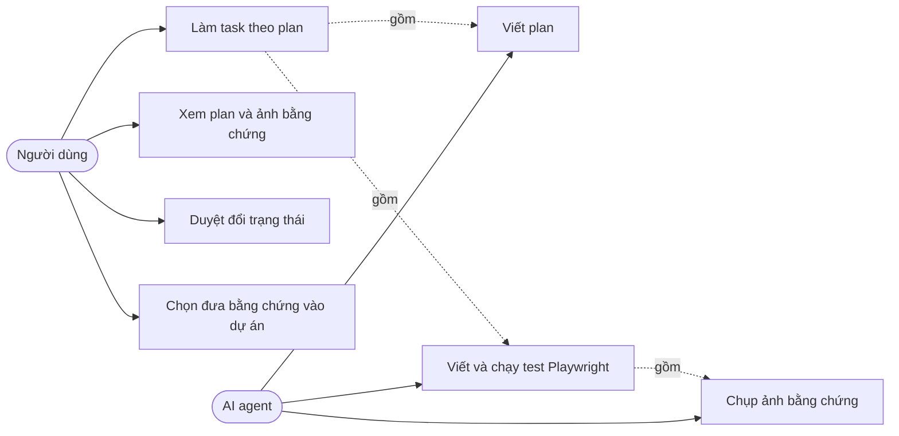
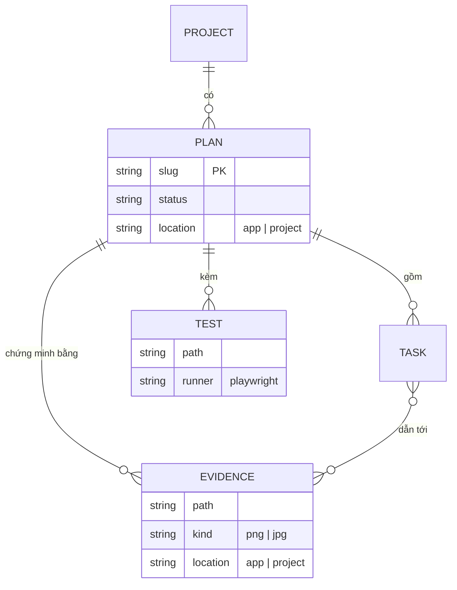
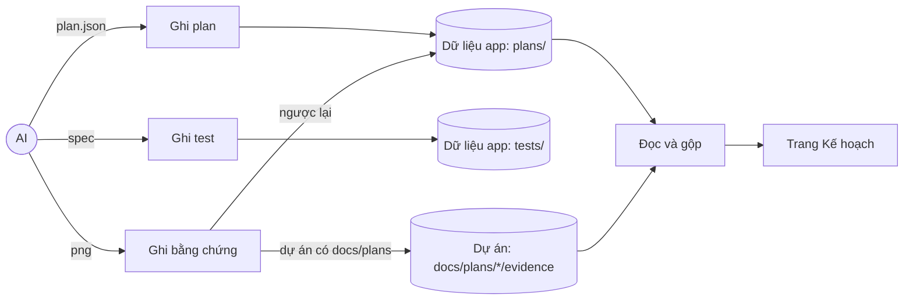
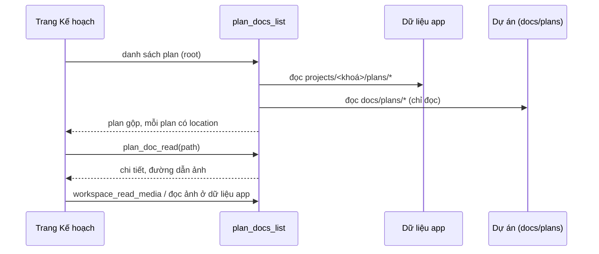
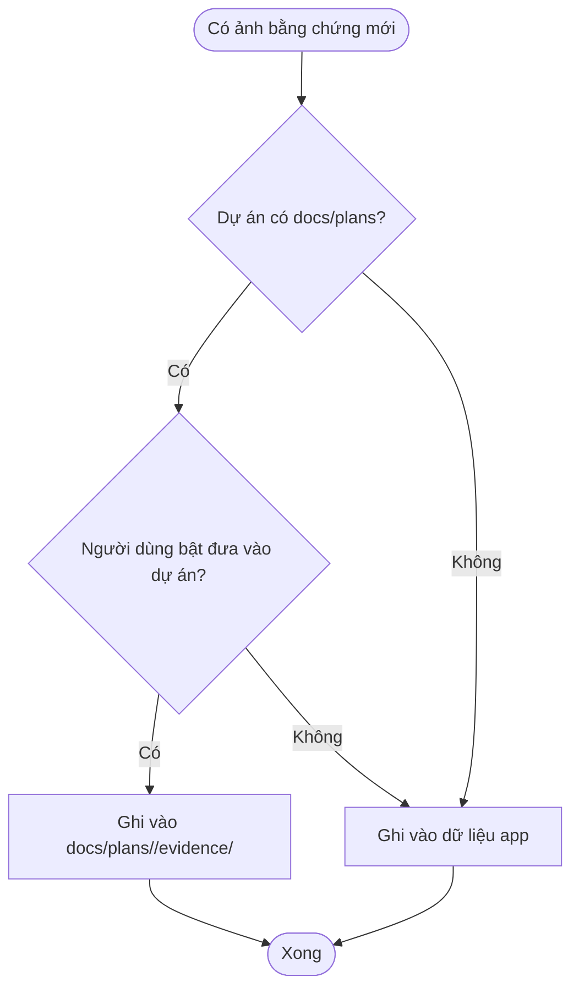

# Nơi lưu plan, test và bằng chứng

Trạng thái: **thiết kế, chưa triển khai** (2026-11-08). Nguồn yêu cầu: người dùng nói plan và test mặc định do người dùng quản lý trên máy mình, không đẩy vào dự án; vào dự án chỉ có bằng chứng, và chỉ khi dự án đã có `docs/plans`. Căn cứ mã `[đã kiểm]`: `src-tauri/src/project_data.rs` (`<data_dir>/projects/<khoá>/`), `plans/store.rs` (`plans/<session>.json`), `plans/project.rs` (ghi vào dự án khi bật `save_plans_to_project`, mặc định tắt), `plans/docs.rs` (chỉ đọc `docs/plans` của dự án), `settings.rs` (`save_plans_to_project`, `plans_dir`). Mục `[giả định]` ghi rõ ở mục 6.

## 1. Mục tiêu

| Mã  | Yêu cầu                                                                                    | Tiêu chí nghiệm thu                                                                                   |
| --- | ------------------------------------------------------------------------------------------ | ----------------------------------------------------------------------------------------------------- |
| S1  | Plan và test Playwright mặc định nằm ở dữ liệu của người dùng, không ghi vào thư mục dự án | Với cài đặt mặc định, làm một plan có test xong thì `git status` của dự án không có tệp mới           |
| S2  | Bằng chứng (ảnh) chỉ vào dự án khi dự án đã có thư mục `docs/plans`                        | Dự án có `docs/plans/` thì ảnh nằm ở `docs/plans/<plan>/evidence/`; không có thì ảnh ở dữ liệu app    |
| S3  | Trang Kế hoạch vẫn thấy mọi plan và ảnh, dù nằm ở dữ liệu app hay trong dự án              | Plan ở dữ liệu app và plan trong dự án cùng hiện, đổi trạng thái và xem ảnh đều chạy                  |
| S4  | Plan cũ trong `docs/plans/` của dự án không bị đổi hay xoá                                 | Mở dự án đang có `docs/plans/*.json` thì vẫn đọc được, không có lệnh nào ghi vào đó khi chưa được bật |
| S5  | Xoá plan thì xoá luôn thư mục bằng chứng (ảnh) của plan đó                                 | Xoá một plan thì `plan.json` và `evidence/` của nó biến mất, ảnh của plan khác còn nguyên             |

## 2. Use case



## 3. Cấu trúc thư mục

```text
<data_dir>/projects/<khoá-dự-án>/          # dữ liệu của người dùng (project_data.rs)
├── plans/<tên-plan>/
│   ├── plan.json | plan.md
│   └── evidence/*.png                      # khi dự án KHÔNG có docs/plans
└── tests/<tên-plan>/*.spec.ts | *.mjs      # test Playwright của plan

<thư-mục-dự-án>/docs/plans/<tên-plan>/      # chỉ khi dự án đã có docs/plans
└── evidence/*.png                          # chỉ bằng chứng; plan và test không vào đây
```

Quan hệ dữ liệu:



## 4. Luồng dữ liệu và trình tự







## 5. Hướng thay đổi

1. **Plan**: `PlanStore` ghi `plans/<tên-plan>/plan.json` ở dữ liệu app; `plans/project.rs` chỉ chạy khi người dùng bật lưu vào dự án (cờ `save_plans_to_project` giữ mặc định tắt).
2. **Test**: thư mục `tests/<tên-plan>/` ở dữ liệu app; lệnh chạy Playwright trỏ vào đó, không ghi vào `e2e/` của dự án.
3. **Đọc**: `plans/docs.rs` đọc cả hai nguồn, trả thêm `location` (`app` hoặc `project`); `plan_doc_set_status` ghi đúng nguồn của plan.
4. **Ảnh**: lệnh đọc ảnh nhận cả đường dẫn ở dữ liệu app (qua sandbox của thư mục `projects/<khoá>/`), vì `workspace_read` chặn `storage` và không đọc ngoài dự án.
5. **Tài liệu**: sửa mục `docs/plans/<tên-plan>/` trong `AGENTS.md`.

## 6. Rủi ro và câu hỏi mở

- `[giả định]` "khi có trên dự án" nghĩa là dự án đã có thư mục `docs/plans`; nếu ý khác (ví dụ chỉ khi có cờ bật) thì sơ đồ ở mục 4 đổi nhánh quyết định.
- Repo này tự dùng `docs/plans/` làm tài liệu của chính nó; thiết kế này áp cho dự án người dùng, còn repo này cần quyết định có giữ như hiện nay không.
- Lượt trước tôi đã dời script chụp ảnh vào `e2e/group-layout/` (trong repo) và ghi vào `AGENTS.md` rằng test Playwright của plan nằm ở `e2e/<tên-plan>/`. Thiết kế này nói test mặc định nằm ở dữ liệu người dùng, nên dòng đó cần sửa khi triển khai.
- Hai nguồn plan có thể trùng tên: cần quy tắc ưu tiên (đề xuất: nguồn trong dự án thắng, vì đó là bản người dùng đã chủ động đưa vào).
- Dữ liệu app theo từng tài khoản hệ điều hành, nên "người dùng quản lý" chỉ đúng trong phạm vi máy này; đồng bộ giữa các máy nằm ngoài phạm vi.
