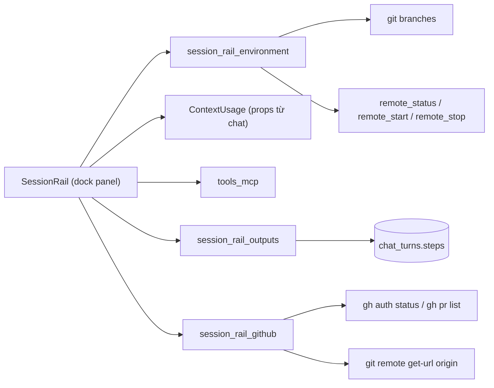

# Thiết kế: thanh thông tin phiên (session rail)

Trạng thái: **đã triển khai (2026-11-07)**. Nguồn yêu cầu: ảnh tham chiếu thanh bên phải của ứng dụng Claude Desktop (Environment, Context, Connectors, Outputs) do người dùng gửi ngày 2026-11-07, thêm khối GitHub. Căn cứ mã `[đã kiểm]`: `context.rs`, `Event::Context`, `context-panel.tsx`, `tools.rs` (`tools_mcp`), `remote.rs`, `auth/github.rs`, `git.rs`, `chats.rs` (cột `steps`), `dock-layout.tsx`, `panels-menu.tsx`, `use-panel-placement.ts`. Mọi khối **chỉ đọc**, không ghi cấu hình, không gọi mạng trừ `gh` ở khối GitHub.

## 1. Phạm vi

Một popup (`rail-popup.tsx`) neo trên ô nhập của chat chính, từ đáy header tới trên ô nhập, sát mép phải cột chat; không còn là ngăn dock. Bật/tắt bằng nút `SquareMenu` ở thanh công cụ và nút ở hàng dưới ô nhập (`Hide/Show session rail`); đóng bằng Escape hoặc bấm ra ngoài. Gồm sáu khối; khối nào không có dữ liệu thật thì ẩn hoặc nói rõ.

## 2. Nguồn dữ liệu từng khối

| Khối        | Hiện gì                                                                                                                                                                                                                                                            | Nguồn thật                                                                                                                                        | Không có nguồn (không bịa)                                                                                                                                                       |
| ----------- | ------------------------------------------------------------------------------------------------------------------------------------------------------------------------------------------------------------------------------------------------------------------ | ------------------------------------------------------------------------------------------------------------------------------------------------- | -------------------------------------------------------------------------------------------------------------------------------------------------------------------------------- |
| Environment | Tên dự án + nút bánh răng (mở Cài đặt), thư mục (rút gọn `~`), nhánh git                                                                                                                                                                                           | `session_rail_environment` (`GitRepo::branches`, `Remote::is_running`); công tắc dùng `remote_start/stop` có sẵn                                  | Không                                                                                                                                                                            |
| Context     | `N% used`, thanh nhiều đoạn, `used / window`                                                                                                                                                                                                                       | `ContextUsage` của lượt gần nhất (`Event::Context`): `input`, `cacheRead`, `cacheCreation`, `output`                                              | **Phân loại Messages / MCP tools / Skills / System prompt**: CLI không báo. **Auto-compact**: CLI không báo, ẩn dòng này                                                         |
| Connectors  | Tên, kiểu (`stdio/http/sse`), phạm vi, trạng thái "cấu hình"                                                                                                                                                                                                       | `tools_mcp` (`.mcp.json` của dự án, `~/.claude.json`, `~/.codex/config.toml`), chỉ đọc                                                            | **Authenticate / đã kết nối**: không có cơ chế thật (CLI không cho biết server đã xác thực), nên không có nút                                                                    |
| Outputs     | Tệp AI đã tạo/sửa trong cuộc chat đang mở, bỏ trùng; bấm mở trong editor                                                                                                                                                                                           | `session_rail_outputs`: quét `steps` đã lưu của `chat_turns`, tool `Write/Edit/MultiEdit/NotebookEdit` (Claude)                                   | Tool ghi tệp của Codex: chưa kiểm, chưa tính. Tệp ngoài thư mục dự án bị bỏ (editor không mở được)                                                                               |
| Usage       | Số lượt (và lượt lỗi) của cuộc chat đang mở, CLI và model (model lấy từ `ContextUsage` của lượt gần nhất; chưa có thì ghi "Mặc định của CLI", vì model không được lưu trong `chat_turns`), token ước tính đã gửi/nhận, tổng lượt và token 24 giờ qua của mọi dự án | `session_rail_usage`: `ChatStore::size_of` (độ dài `prompt`/`answer` của `chat_turns`) và `UsageStore::stats` (`usage_events`); token = ký tự / 4 | **Chi phí, thời gian, token thật của từng lượt**: CLI không báo, không lưu, nên không hiện. Tổng theo dự án: `usage_events` không có cột dự án, nên chỉ có tổng 24 giờ mọi dự án |
| GitHub      | Tài khoản `gh`, repo `origin`, nhánh, PR đang mở của nhánh                                                                                                                                                                                                         | `session_rail_github`: `gh auth status`, `git remote get-url origin`, `gh pr list --head <nhánh> --state open`                                    | Không có `gh`/chưa đăng nhập/origin không phải github.com: hiện trạng thái hoặc ẩn khối, rail vẫn chạy                                                                           |

## 3. Lệnh Tauri (struct serde camelCase)

- `session_rail_environment(root)` → `{ folder, branch, remoteRunning }` (tên dự án lấy từ frontend).
- `session_rail_outputs(root, conversation)` → `{ files: [{ path, tool }] }`, `path` tương đối với dự án.
- `session_rail_github(root)` → `{ status, account, repo: {owner,name,url}, branch, pullRequest: {number,title,url} }`; `status` là `ok | no_cli | signed_out | no_remote`.
- `session_rail_usage(root, conversation?)` → `{ conversation: { turns, failedTurns, promptTokens, answerTokens, cli } | null, today: { turns, tokens } }`; `conversation` phải thuộc workspace (`ChatStore::size_of`).
- `remote_status()` → `bool` (thêm vào `commands/remote.rs`, dựa `Remote::is_running`); popup không còn dùng, vì công tắc Remote đã bị gỡ khỏi khối Môi trường.
- Connectors dùng lại `tools_mcp(projectRoot)`; Context dùng lại `ContextUsage` đã có ở frontend.
- Đầu vào kiểm bằng `validation.rs`: `root` qua `AppState::workspace_for` (chỉ thư mục đã thêm), `conversation` phải thuộc workspace (`ChatStore::steps_of`), tên nhánh qua `validation::branch_name` trước khi đưa cho `gh`.

## 4. Sơ đồ

## 5. Ghi chú

- Khối Môi trường không còn công tắc Remote (người dùng yêu cầu gỡ); ghép điện thoại vẫn ở Cài đặt > Kết nối.
- Lỗi của từng khối không ảnh hưởng khối khác: mỗi khối tự tải và tự báo lỗi.
- Đóng/mở popup không đổi dữ liệu dự án.
