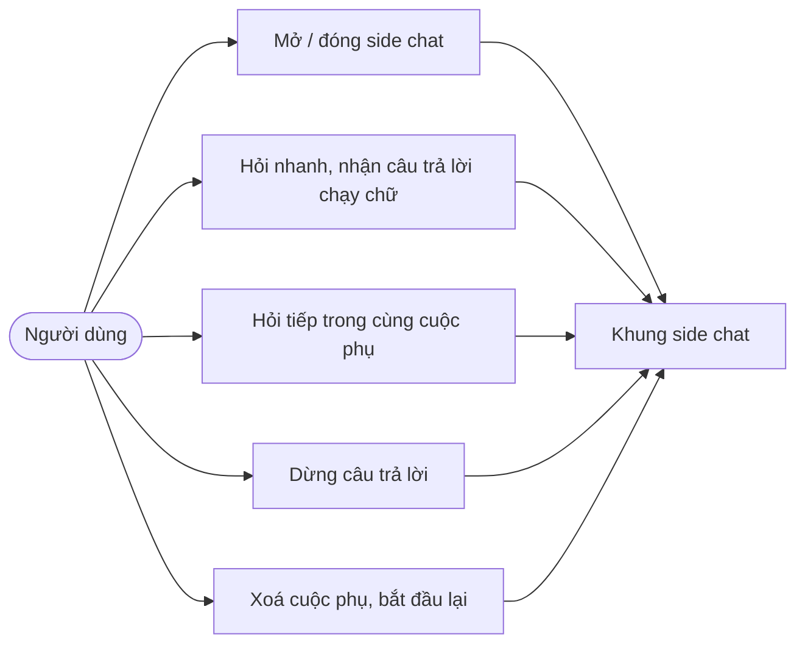
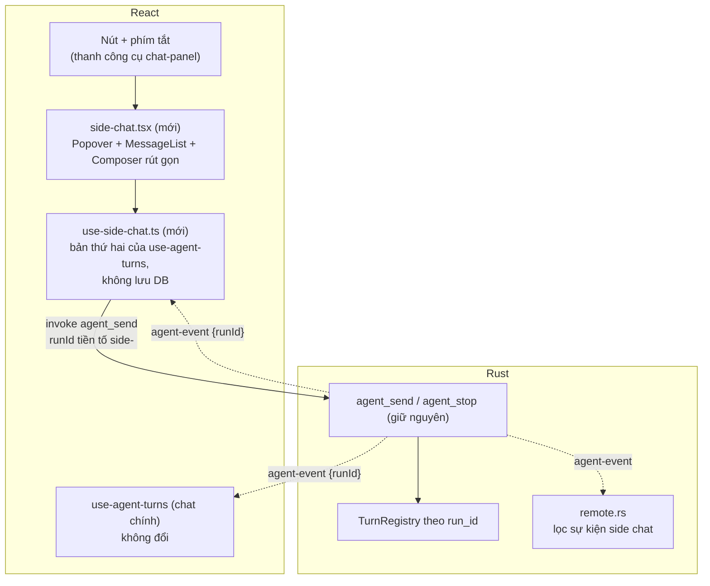
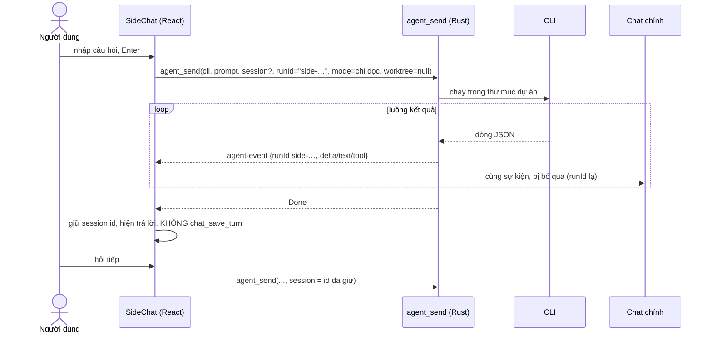
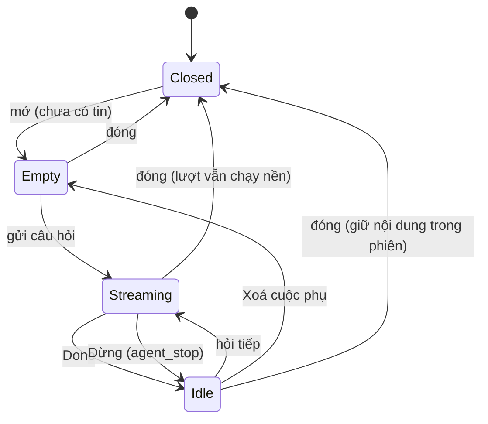
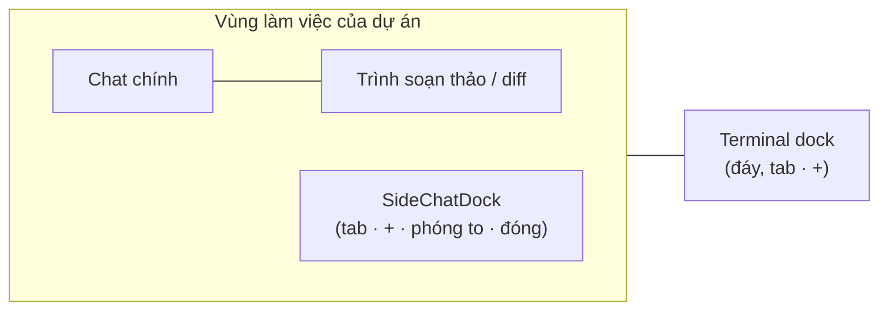
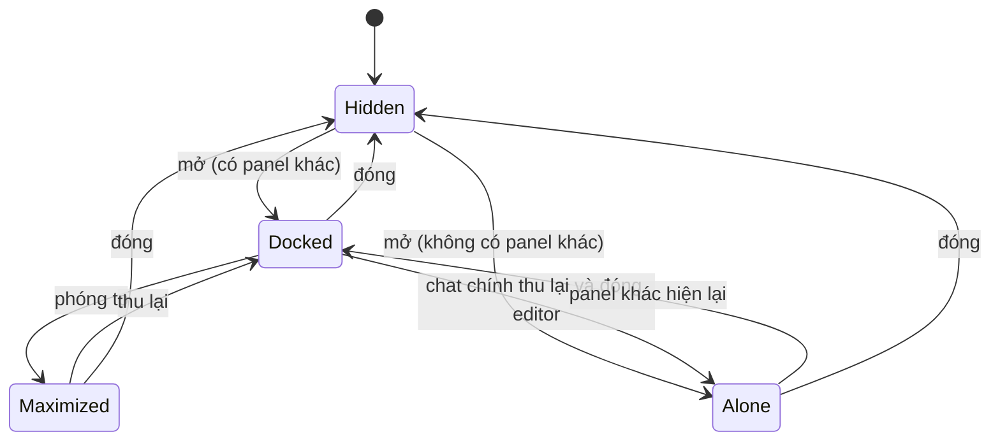

# Thiết kế: Side chat (hỏi nhanh bên cạnh cuộc chat chính)

Trạng thái: **đã triển khai phía giao diện và `remote.rs`; kiểm chứng một phần (xem mục 6)**. Tên hiển thị hiện là **"Hỏi nhanh"/"Quick ask"** (trước đây "Side chat", rồi "Multichat"); bố cục thực tế theo mục "Cập nhật 2026-11-07" cuối tệp (panel dock dưới vùng file hoặc thẻ nổi), không phải cột phải của mục 3.7. Nguồn yêu cầu: ảnh chụp "Side chat" của ứng dụng Claude do người dùng gửi ngày 2026-11-06 (nút trên thanh công cụ, phím tắt, khung "No messages yet", ô "Ask a quick question", hiện dạng cửa sổ nổi hoặc ngăn dưới). Căn cứ mã `[đã kiểm]`: `commands/agent.rs` (`agent_send`, `run_id`, `TurnRegistry`), `use-agent-turns.ts` (lọc sự kiện theo `runId`), `remote.rs` (nghe `agent-event`), `commands/inline_ask.rs`. Mục `[chưa kiểm]` và `[giả định]` ghi rõ. Tổng quan: [architecture.md](./architecture.md). Bảng Context liên quan: [context-panel.md](./context-panel.md).

## 1. Phạm vi

Một khung chat phụ, mở bằng nút hoặc phím tắt, để hỏi nhanh **không làm gián đoạn cuộc chat chính** (kể cả khi chat chính đang chạy lượt):

- Ô nhập "Hỏi nhanh", danh sách tin nhắn riêng, hiện chữ chạy (stream) như chat chính.
- Cuộc trò chuyện phụ liền mạch nhiều lượt (nhớ phiên của CLI) nhưng **tách hẳn** chat chính: không vào danh sách cuộc trò chuyện ở thanh bên, không lưu DB (đợt này), đóng app là mất.
- Chỉ đọc: câu hỏi không được sửa tệp.
- Dùng đúng dự án, tài khoản (profile), model và CLI đang chọn của chat chính.

**Cập nhật theo ảnh mẫu thứ hai (cùng ngày)**: side chat có nhiều tab (`Side chat 7`, `Side chat 9`, nút `+`), nằm trong **ngăn phụ (dock)** bên phải cao hết chiều dọc, có nút phóng to và đóng; khi nó **đứng một mình** (không có trình soạn thảo, chat chính thu lại) thì chiếm cả vùng làm việc. Terminal đã có sẵn ở ngăn dưới cùng kiểu tab + `+` (`ActivityTerminal` trong `app.tsx`); thiết kế dùng chung quy ước dock với terminal.

**Ngoài phạm vi (đợt này)**: lưu lịch sử side chat, đính kèm tệp, sub-agent, hỏi quyền công cụ, chạy trong worktree, điều khiển từ điện thoại, kéo thả tab giữa các dock.

| ID  | Yêu cầu                                                     | Tiêu chí chấp nhận                                                                                                         |
| --- | ----------------------------------------------------------- | -------------------------------------------------------------------------------------------------------------------------- |
| S1  | Mở/đóng side chat bằng nút và phím tắt                      | Nút ở thanh công cụ và phím tắt đóng/mở khung; Esc đóng; trạng thái nhớ trong phiên                                        |
| S2  | Hỏi nhanh khi chat chính đang chạy                          | Gửi ở side chat không dừng, không chen vào lượt của chat chính; hai lượt chạy song song                                    |
| S3  | Tách khỏi chat chính                                        | Lượt side chat không xuất hiện trong danh sách cuộc chat, không gọi `chat_save_turn`, không ghi `usage` ẩn                 |
| S4  | Chỉ đọc                                                     | Lượt side chat chạy chế độ chỉ đọc của CLI; yêu cầu sửa tệp bị từ chối bởi CLI                                             |
| S5  | Giữ ngữ cảnh nhiều lượt trong side chat                     | Lượt thứ hai dùng lại session id của lượt đầu                                                                              |
| S6  | Không đổi contract Tauri, không đổi DB, không thêm thư viện | Chỉ dùng `agent_send`, `agent_stop`, `agent-event` sẵn có                                                                  |
| S7  | Không rò sang điện thoại                                    | Sự kiện của side chat không tới điện thoại (xem 3.6)                                                                       |
| S8  | Đa ngữ vi/en, dùng component có sẵn                         | Chữ qua i18n; Radix, `Field` cho ô nhập                                                                                    |
| S9  | Nhiều side chat dạng tab                                    | Nút `+` thêm tab, mỗi tab một cuộc phụ riêng (session riêng); đóng tab dừng lượt đang chạy của tab đó                      |
| S10 | Ngăn phụ bên phải, phóng to, đóng                           | Cột phải có chiều rộng kéo được; nút phóng to cho side chat chiếm cả vùng; nút đóng đóng cả cột                            |
| S11 | Đứng một mình thì chiếm cả vùng                             | Khi không có trình soạn thảo và chat chính đang thu lại, side chat tự chiếm toàn bộ; có lại panel khác thì trở về cột phải |
| S12 | Sống chung với Terminal                                     | Terminal vẫn ở ngăn dưới như hiện tại; mở/đóng side chat không làm mất terminal và ngược lại                               |

## 2. Hiện trạng

- `agent_send` đã nhận `run_id` do frontend đặt, chạy nhiều lượt cùng lúc được (registry `Running` khoá theo `run_id`) `[đã kiểm]`.
- `use-agent-turns.ts` chỉ xử lý sự kiện có `runId` nằm trong `runs` của chính nó, bỏ qua sự kiện của run khác `[đã kiểm]`: hai bản hook độc lập không nhiễu nhau.
- Lưu lịch sử do frontend chủ động gọi `chat_save_turn` `[đã kiểm]`: side chat chỉ cần không gọi.
- `remote.rs` nghe **mọi** `agent-event` và phát cho điện thoại `[đã kiểm]`; sự kiện có `runId` nhưng không phân biệt side chat.
- `inline_ask` (hỏi về đoạn code đã chọn) là cơ chế một lần, không stream, không nhớ phiên, chỉ Claude `[đã kiểm]`: không đủ cho side chat nhiều lượt, giữ nguyên.

## 3. Thiết kế

### 3.1. Phương án

| Phương án                                                     | Ưu                                                                         | Nhược                                                      |
| ------------------------------------------------------------- | -------------------------------------------------------------------------- | ---------------------------------------------------------- |
| A. Lệnh mới `side_ask` dùng `ask_once`                        | Đơn giản                                                                   | Không stream, không nhớ phiên, chỉ Claude, thêm lệnh Tauri |
| **B. Dùng lại `agent_send` + một bản hook thứ hai (đề xuất)** | Không thêm lệnh; stream và nhớ phiên có sẵn; hỗ trợ cả `claude` và `codex` | Phải chặn rò sang điện thoại và chốt chế độ chỉ đọc        |

Chọn **B**.

### 3.2. Use case

### 3.3. Thành phần

Phân biệt bằng **tiền tố `runId`**: frontend đặt `runId = "side-<uuid>"`; hook chính bỏ qua (không có trong `runs` của nó), hook side chỉ nhận `side-*`; `remote.rs` bỏ qua sự kiện có `runId` bắt đầu bằng `side-` (3.6).

### 3.4. Trình tự một câu hỏi

### 3.5. Trạng thái

Đóng khung khi đang stream: lượt vẫn chạy nền, mở lại thấy kết quả `[giả định]` (Q2).

### 3.6. An toàn và quyền

- **Chỉ đọc (S4)** `[đã kiểm 2026-11-07, claude 2.1.319]`:
    - Claude: `--permission-mode plan`; lượt thử không tạo được tệp trong dự án (cả khi trả lời allow mọi `can_use_tool`, cả khi deny). **Ngoại lệ**: plan mode vẫn cho ghi tệp kế hoạch `~/.claude/plans/<tên-ngẫu-nhiên>.md` ngoài dự án (không hỏi quyền); chấp nhận hoặc ghi nhận là tác dụng phụ. Nếu stdin là text (không stream-json) thì `ExitPlanMode` không có, model chỉ trả lời.
    - Codex: lượt mới dùng `-s read-only`; `codex exec resume` không có `-s` nên dùng `-c sandbox_mode="read-only"`. Kiểm ở mức OS: `codex sandbox -c 'sandbox_mode="read-only"' -- sh -c 'echo x > t.txt'` báo "Operation not permitted", tệp không tạo. `[chưa kiểm với model]` (hết hạn mức); luôn truyền cờ rõ ràng, không dựa vào mặc định.
- **Không worktree, không `extraRoots`**: truyền `worktree = null`, không thêm dự án.
- **Điện thoại (S7)**: `remote.rs::event_message` lọc `runId` bắt đầu bằng `side-` trước khi broadcast. Đây là thay đổi hành vi nhỏ duy nhất ở Rust, có test.
- **Quyền hiện có**: `workspace_for(root)` vẫn áp dụng; không thêm lệnh mới nên không thêm bề mặt quyền (mục 6, 11 của architecture.md).
- **Thống kê**: side chat có gọi `usage_record` không? Mặc định: có (vẫn tiêu tốn hạn mức của tài khoản), tách nhãn `side` là Q3.

### 3.7. Bố cục dock (ngăn phụ)

Quy ước chung cho Terminal và Side chat: mỗi dock có thanh tab (tên + nút `+` + phóng to + đóng) và nội dung.

| Dock      | Vị trí                                                                                    | Trạng thái hiện có       | Thay đổi                                              |
| --------- | ----------------------------------------------------------------------------------------- | ------------------------ | ----------------------------------------------------- |
| Terminal  | Dưới vùng làm việc, chiều cao kéo được (`terminalOpen`, `terminalHeight` trong `app.tsx`) | Đã có tab, `+`, chia đôi | Không đổi; chỉ dùng chung nút phóng to/đóng nếu thiếu |
| Side chat | Cột phải cao hết chiều dọc, chiều rộng kéo được (`useResizableWidth`)                     | Chưa có                  | Mới: `SideChatDock` với tab và `+`                    |

Quy tắc bố cục (`SideChatDock`):

- **Cùng với panel khác**: cột phải, rộng theo kéo thả, nhớ trong phiên.
- **Đứng một mình** (S11): `editorVisible = false` và `chatCollapsed = true` trong `PaneState` (đã có trong `use-pane-state.ts`) → dock chiếm `flex-1`, ô hỏi nhanh ở đáy như ảnh. Có panel khác hiện lại thì trở về cột phải.
- **Phóng to** (S10): chiếm cả vùng làm việc, bấm lại thì thu về cột; không đổi tab, không dừng lượt.
- **Terminal** nằm dưới cả hai chế độ; chiều cao riêng, không phụ thuộc dock phải `[giả định: terminal chạy suốt chiều ngang như hiện tại]`.

### 3.8. Dữ liệu

Không đổi DB, không đổi serde của `Event`. Trạng thái nằm trong bộ nhớ React: danh sách tab `{ id, title, messages, sessionId, running }`, tab đang chọn, chế độ dock và chiều rộng cột. Tên tab `Side chat <n>` đánh số tăng dần theo phiên.

### 3.9. Giới hạn đã biết

- **Permission có thể treo lượt**: side chat chạy plan mode và bỏ qua sự kiện `permission` (`control_request` `can_use_tool`, xem `agent/claude.rs`), nên không có ai trả lời. Nếu CLI chờ trả lời thì lượt đứng yên; người dùng bấm Dừng (hoặc `Ctrl+C`, đóng tab). Chưa tái hiện được trường hợp này; không đổi hành vi.
- Sự kiện lạ (ví dụ `context`) bị bỏ qua; chỉ `done` kết thúc lượt.

## 4. Phi chức năng

- **Hiệu năng**: thêm một tiến trình CLI khi hỏi song song; không thêm vòng lặp mới ở backend.
- **Lỗi**: dùng key lỗi `agent.*` hiện có, frontend dịch như chat chính.
- **Quan hệ với plan khác**: `agent.rs` đang ở nhóm A của [plan OOP](../plans/oop-refactor-backend-20261106.json) nhưng side chat **không sửa `agent.rs`**, chỉ `remote.rs` (nhóm G) và frontend; xung đột duy nhất là `remote.rs`, nên làm sau TASK-010 hoặc gộp vào đó.

## 5. Câu hỏi mở

1. Chỉ đọc cho Codex: đã chốt `-s read-only` (lượt mới) và `-c sandbox_mode="read-only"` (resume), chưa kiểm với model; xem 3.6.
2. Đóng khung khi đang stream: dừng hay chạy nền? Mặc định: chạy nền.
3. Có tính `usage` của side chat vào thống kê? Mặc định: có, nhãn riêng chưa làm.
4. Phím tắt: ảnh mẫu dùng `⌘;`. Dùng đúng phím này? Mặc định: có (`Ctrl+;` trên Windows/Linux), xác nhận không xung đột với Monaco/xterm.
5. Hiện dạng nào: cửa sổ nổi hay cột phải? Mặc định theo ảnh thứ hai: cột phải (dock), cửa sổ nổi chỉ khi cột phải không đủ chỗ (xác nhận).
6. Terminal có nằm dưới cả cột side chat hay chỉ dưới vùng chính? Mặc định: dưới cả hai như `app.tsx` hiện tại.
7. Đã xác nhận: `--permission-mode plan` chặn ghi tệp trong dự án; chỉ còn ngoại lệ `~/.claude/plans/` (xem 3.6).

## Cập nhật 2026-11-07: Multichat dưới vùng file, chế độ nổi, Thanh phiên dạng popup

- Vị trí mặc định: panel dock `bottom` nằm **dưới vùng file** (editor + cây file), không dưới chat chính, cao khoảng 40% cửa sổ, kéo đổi được (`DockPanel.underTrailing`, `DockLayout` prop `trailing`).
- Chế độ **nổi** (`placement = 'float'`): thẻ 320px treo vào mép phải của chat chính (neo không rộng nằm giữa chat chính và vùng file), không đẩy bố cục. Nút "Thu nhỏ" (header) chuyển dock sang nổi; ở chế độ nổi có nút "Đưa về dock" và nút thu gọn thành nút tròn (Escape cũng thu gọn). Panel vẫn mounted nên tab và câu trả lời đang viết giữ nguyên. Menu vị trí có thêm mục "Nổi" (chỉ side chat bật `floatable`).
- Thanh phiên (session rail) không còn là dock: mở thành popup neo trên hàng dưới ô nhập chat chính (`rail-popup.tsx`, `ChatPanel` prop `popup`), đóng bằng Escape hoặc bấm ra ngoài.

## 6. Kết quả kiểm chứng (TASK-S05, 2026-11-08)

### 6.1. Lệnh kiểm chứng (đã chạy)

| Lệnh | Kết quả |
| --- | --- |
| `cargo fmt --manifest-path src-tauri/Cargo.toml --check` | Pass (exit 0) |
| `cargo clippy --manifest-path src-tauri/Cargo.toml -- -D warnings` | Pass (exit 0) |
| `cargo test --manifest-path src-tauri/Cargo.toml --lib -- --skip terminal::tests::a_shell_runs_in_a_pseudo_terminal` | Pass: 556 passed, 0 failed |
| `pnpm typecheck` | Pass: 0 lỗi (lần chạy này; `AGENTS.md` ghi 22 lỗi có sẵn nay không còn) |
| `pnpm lint` | 0 lỗi, 66 cảnh báo (không có cảnh báo ở tệp side chat) |

### 6.2. Tiêu chí chấp nhận

Cách kiểm UI: Playwright (Chrome hệ thống) trên vite với **giả lập `__TAURI_INTERNALS__`** (script tạm ngoài repo, không có backend Tauri thật); ảnh ở `.agents/storage/evidence/side-chat/` (git-ignore). Giả lập chỉ chứng minh hành vi frontend và tham số gửi đi, không chứng minh hành vi CLI.

| AC | Kết quả | Bằng chứng |
| --- | --- | --- |
| S1 | Đạt (UI giả lập) | Cmd+; mở, Esc đóng, mở lại còn nội dung (`s01-open-vi.png`, `s01-reopen.png`); nút trong menu "Các ngăn" đọc từ mã |
| S2 | Chưa kiểm thật | Hai lượt song song thật cần CLI. Giả lập: sự kiện `run-main` không lọt vào khung (`runId` khác); đối chiếu mã `use-side-chat.ts` (map `runId` → tab) |
| S3 | Chưa kiểm thật (DB) | Giả lập: không có `chat_save_turn`, `chat_create`, `usage_record` nào được gọi; mã `use-side-chat.ts` không gọi chúng. Chưa mở DB thật sau khi dùng |
| S4 | Chưa kiểm thật | Cần CLI sửa tệp thật. Mã: `agent_send` nhận `mode = "plan"`. Kết quả thử tay 2026-11-07 ở mục 3.6 |
| S5 | Đạt (giả lập) | `agent_send` lượt 2 có `session = "sess-1"` sau sự kiện `session` của lượt 1 (`s05-two-turns.png`) |
| S6 | Đạt (đối chiếu mã) | `git diff HEAD` không chạm `Cargo.toml`, `db.rs`; không thêm lệnh vào `generate_handler` (chỉ `agent_send`, `agent_stop`) |
| S7 | Đạt | Test `events_of_side_runs_are_not_sent_to_the_phone` và 2 test lân cận trong `tests/unit/remote.rs` pass (nằm trong 556) |
| S8 | Đạt | 16 khoá `side_chat.*` giống nhau ở vi và en; typecheck 0 lỗi; ô nhập dùng `Field` |
| S9 | Đạt (giả lập) | `+` thêm "Hỏi nhanh 2" với `session = null`; đóng tab 2 gọi `agent_stop` đúng `runId` của tab (`s09-two-tabs.png`) |
| S10 | Một phần | Kéo thanh đổi kích thước: cao 359 → 500 px (`s10-resized.png`); chế độ nổi 320 px (`s10-float.png`). Bố cục thực tế là dock dưới vùng file, không có cột phải; AC viết theo thiết kế cũ |
| S11 | Chưa kiểm UI | Mã `workspace-pane.tsx`: `sideChatAlone = open && !editorVisible && chatCollapsed` → `placement 'fill'`. `chatCollapsed` chỉ bật khi chat quá hẹp nên chưa dựng được. Quan sát: ẩn khung tệp mà chat chưa thu gọn thì khung đang mở có kích thước 0 (`s11-editor-hidden.png`) |
| S12 | Đạt (giả lập) | Terminal và Hỏi nhanh cùng hiện; đóng Hỏi nhanh không gọi `terminal_close`, xterm còn; mở lại còn nội dung (`s12-terminal-and-sidechat.png`, `s12-side-closed-terminal-stays.png`). Chiều: đóng terminal rồi xem side chat chưa chạy riêng |

### 6.3. Thực trạng cần biết

- **Chỉ Claude**: `use-side-chat.ts` luôn gửi `cli = "claude"`, `mode = "plan"` (hằng `READ_ONLY_MODE`).
- **Codex chỉ đọc**: đã chốt cờ (`-s read-only`, `-c sandbox_mode="read-only"` khi resume) nhưng `agent/codex.rs::turn_args` hiện chưa truyền cờ nào cho lượt `side-*` (chỉ `--add-dir`, `-m`, `resume`, `--json`, `--skip-git-repo-check`). Vì side chat chưa gửi `codex` nên chưa ảnh hưởng, nhưng **chưa được phép bật Codex** cho tới khi `turn_args` thêm cờ.
- Phím tắt: Cmd/Ctrl+; đã có; chưa kiểm xung đột với Monaco/xterm khi con trỏ nằm trong đó.
- Chưa chạy `pnpm start` với CLI thật: S2, S3 (DB), S4 vẫn mở.
